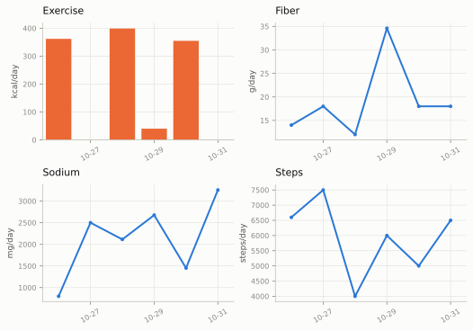

Every figure `wdm plots` draws for the current diet, from the real record as of , regenerated with the [presentation](weight-dynamics.html)'s numbers whenever new days are logged; nothing here is drawn by hand. Each caption says how to read its figure. Click or tap a figure to open it full screen and zoom in.

## Weight and body composition

## The plan

![**Adherence.** Top: energy and each macronutrient eaten on each finished day (dots) against the prescription from the plans log (line), with the range within 10% of it shaded; titles count the days inside that range, and the latest values are labeled. Energy is on the label scale `wdm log` shows, before the model's fiber correction. Bottom: the running total of energy eaten above or below plan. That is the panel to watch: a line climbing steadily means the weight will come off more slowly than planned. A macronutrient off on a day when energy is on plan matters less: low protein risks lean mass over weeks, and carbohydrate moves water from day to day, but neither changes how much is lost.](assets/wdm/adherence.svg)

## What the model has learned

).](assets/wdm/maintenance.svg)

## Diagnostics and inputs

).](assets/wdm/innovations.svg)

