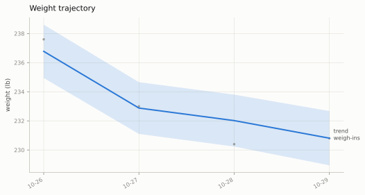
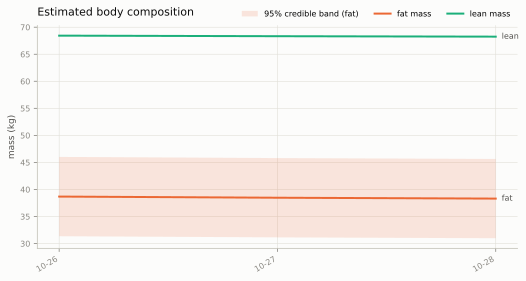
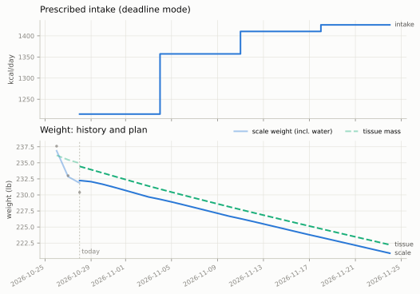
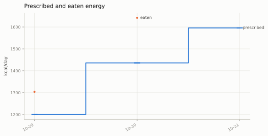
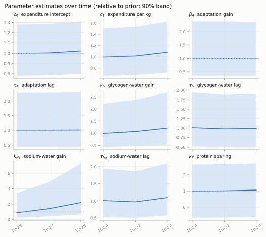
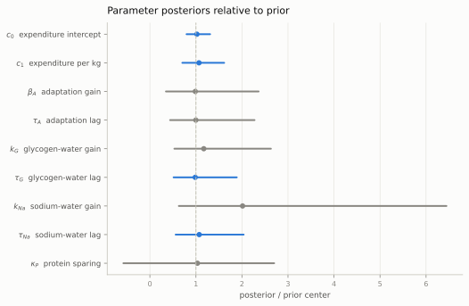
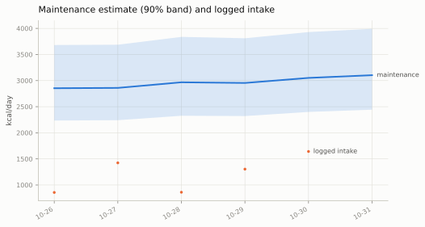
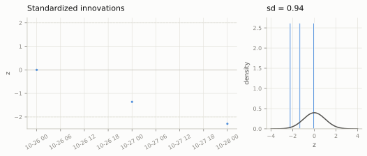
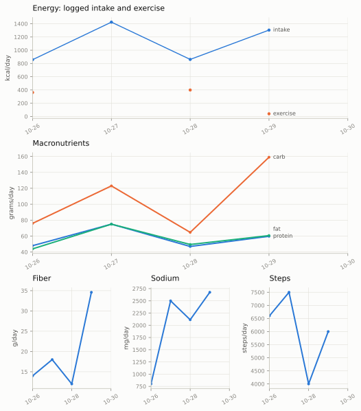

Every figure `wdm plots` draws for the current diet, from the real record as of . They are regenerated, with the [presentation](weight-dynamics.html)'s numbers, by one script whenever new days are logged, so nothing here is drawn by hand. The [documentation](docs/reading-output.md) explains how to read each one.

## Weight and body composition

## The plan

## What the model has learned

## Diagnostics and inputs

