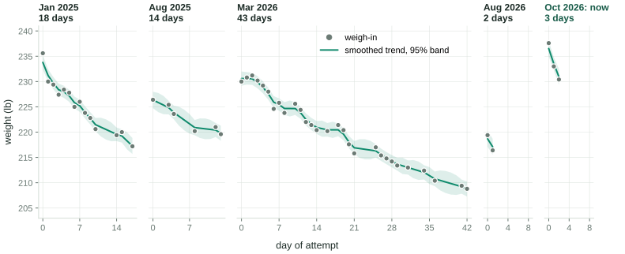
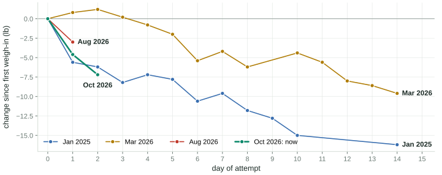
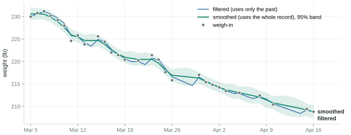
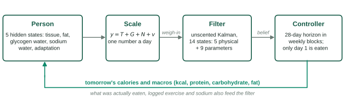
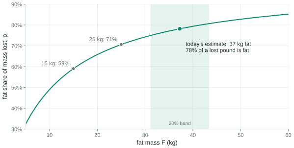
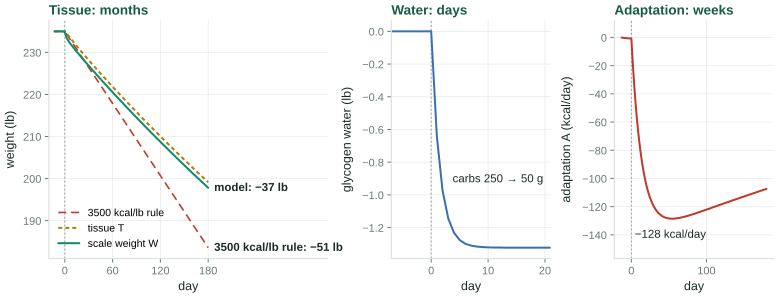
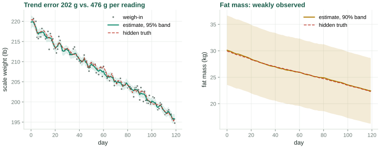
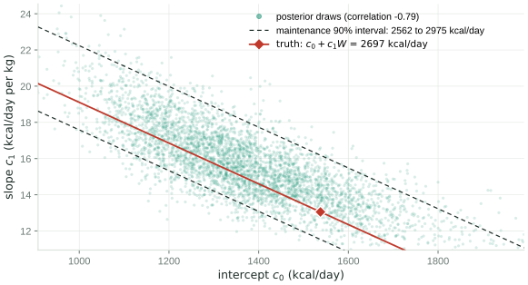
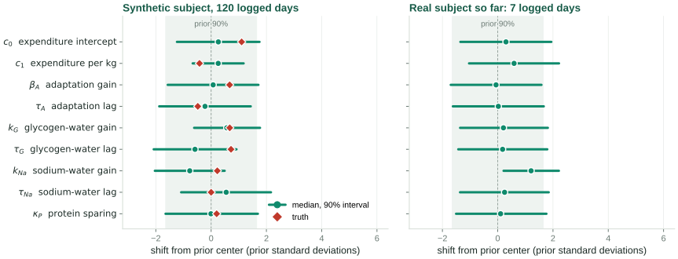
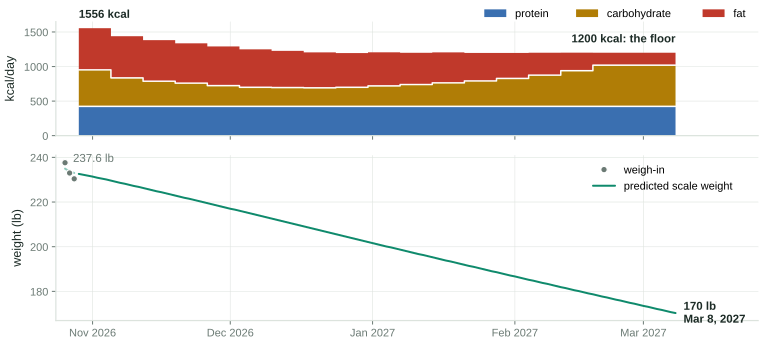

## Twenty-one months on one bathroom scale {.smaller}

{.fig-wide fig-alt="Five panels, one per diet attempt from January 2025 to October 2026, each showing raw weigh-ins and a smoothed trend with a 95 percent band."}

::: stats
::: stat
[5 attempts]{.num}
[Jan 2025 to now, months apart]{.lab}
:::
::: stat
[54 weigh-ins]{.num}
[the only measurement; no food log before Aug 2026]{.lab}
:::
::: {.stat .gold}
[±0.9 lb]{.num}
[scatter of one morning reading about the trend, fitted from this record]{.lab}
:::
::: {.stat .hot}
[7 to 22 lb]{.num}
[lost on each of the three longer attempts, then regained before the next]{.lab}
:::
:::

::: notes
Every weigh-in on record, one panel per attempt, on a shared weight axis. The gaps between
panels are months long and contain no data, so they are not drawn. Each attempt worked
while it lasted. What this record cannot tell you is why: there is no food log for the first
four attempts, so all it can identify is how noisy a single reading is and how fast the
trend moves. That turns out to be exactly what the filter needs first.
:::

## A day-one drop is mostly water {.smaller}

{.fig-band fig-alt="Weight change from the first weigh-in for four attempts. Three of them drop 3 to 6 pounds after the first day."}

::: cols2
::: card
[The energy budget says under 1 lb]{.cardh}
Day 1 of the current attempt: 885 kcal eaten against roughly 3,350 kcal of expenditure, a
deficit near 2,500 kcal. At about 7,800 kcal per kg of tissue that is 0.3 kg, or 0.7 lb.
:::
::: card
[The scale said 4.6 lb]{.cardh}
237.6 → 233.0 lb overnight. The other 4 lb are glycogen and its bound water, gut contents, and
fluid: real mass, but not the mass a diet is trying to move. A model that cannot tell the two
apart will over-credit the first week and then report a "stall".
:::
:::

::: notes
Three of the four attempts open with a 3 to 6 pound drop on the first day. No energy
balance produces that from tissue. The model has to carry a separate fast compartment for
it, or it will mistake water for progress.
:::

## The scale is a noisy sensor of a slow state {.smaller}

{.fig-wide fig-alt="The March 2026 attempt: weigh-ins scatter about a pound around a filtered and a smoothed trend that agree closely."}

- A morning reading scatters by **0.42 kg (0.9 lb)** about the true trend. That is not the
  scale's error, which is tens of grams; it is fluid, gut contents, and glycogen.
- **Filtered:** the best estimate using only readings up to that day. This is what a
  controller can use. **Smoothed:** conditioned on the whole record, the right way to review
  history.
- Missing days cost precision, not accuracy: the update is skipped, never filled in.

::: notes
The March attempt, which has the densest weigh-ins. The blue line is causal: it is what the
filter would have known that morning. The green line uses the future too, which is why it is
smoother. A controller only ever gets the blue line.
:::

## Why "3,500 kcal per pound" is wrong

::: cols3
::: card
[Mass is a mixture]{.cardh}
A lost pound is part fat (about 9,400 kcal/kg) and part lean tissue (about 1,800 kcal/kg).
The mix depends on how much fat you carry, so the energy per pound **falls** as the diet
goes on.
:::
::: card
[Water moves first]{.cardh}
Glycogen is stored with about three times its mass in water. Cutting carbohydrate empties it
in days: **pounds on the scale, no tissue lost**. Salt does the same in the other direction.
:::
::: card
[Expenditure adapts]{.cardh}
In a sustained deficit the body spends less than its lower mass alone explains, with a lag
of a few weeks. **The plateau is part of the dynamics**, not a failure to comply.
:::
:::

::: claim
Each of these is a state with its own time constant. The rest of this talk is a model with
those states, a filter that estimates them from a scale, and a controller that plans food
around them.
:::

::: notes
The rule of thumb treats the body as a fixed-density battery. It is wrong three ways, and
each way becomes one state of the model.
:::

## The model {.divider}

Five states, nine parameters, one equation that matters most.

## The loop {.smaller}

{.fig-wide fig-alt="Block diagram: person, scale, filter, controller, with the controller's prescription feeding back to the person."}

- The person is a nonlinear system with **five hidden states**. The only sensor is a scale,
  read once a morning.
- The filter estimates the states **and** the person's metabolic parameters, jointly.
- The controller plans 28 days ahead from that estimate, and the subject eats **only the first
  day** of the plan. Tomorrow it plans again from a new weigh-in.

::: notes
This is a textbook output-feedback loop with an unusual plant. The plant's input is food,
its output is one noisy number per day, and its parameters are unknown and personal.
:::

## Five states

| State | Units | Meaning | Clock |
|---|---|---|---|
| $T$ | kg | tissue: fat plus fat-free solids and their water. What a diet changes | months |
| $F$ | kg | fat mass, a part of $T$ (lean mass is $T - F$) | months |
| $G$ | kg | glycogen and bound water, deviation from the attempt's mean | 1 to 2 days |
| $N$ | kg | sodium-associated water, deviation from the mean | about 1 day |
| $A$ | kcal/day | adaptive thermogenesis; negative in a deficit | about 2 weeks |

: {tbl-colwidths="[7,11,62,20]"}

::: eqbox
$$
\rho_{\text{eff}}\,\dot T = I - E - \rho_G\,\dot G,
\qquad
\dot F = p\,\dot T,
\qquad
y = T + G + N + v
$$
:::

Energy eaten $I$ minus energy spent $E$ goes into tissue, except what is diverted into
glycogen ($\rho_G \approx 1{,}025$ kcal/kg of glycogen-water complex). $\rho_{\text{eff}}$ is
the energy density of the tissue being lost, $p$ its fat fraction, and the scale reads $y$:
tissue plus both water compartments plus noise $v$.

::: notes
The boxed equation is the whole model in one line: energy balance, with the energy density
set by what kind of tissue is moving and a correction for energy parked in glycogen. The
scale cannot see T alone; it sees T plus water.
:::

## Expenditure, and the plateau as an ODE

::: eqbox
$$
E = c_0 + c_1 W + \text{TEF} + X + A,
\qquad
\dot A = \frac{-\beta_A\,(E_{\text{base}} - I) - A}{\tau_A}
$$
:::

- $c_0 + c_1 W$: resting and baseline expenditure, $W$ total mass, TEF the thermic effect of
  food, $X$ logged exercise, and $E_{\text{base}} = E - A$.
- Under a sustained deficit $D = E_{\text{base}} - I$, adaptation settles at $-\beta_A D$ with
  time constant $\tau_A$. Priors: $\beta_A \approx 0.15$, $\tau_A \approx 14$ days.
- Water: $\dot G = (k_G\,\Delta C - G)/\tau_G$, with $\Delta C$ carbohydrate relative to the
  attempt's mean; the same form for sodium.

::: remark
$c_0$ also absorbs any **constant** bias in the food log, harmlessly. A bias that **drifts** is
another matter: the model cannot tell it apart from adaptation.
:::

::: notes
Nine parameters in all: c0, c1, beta_A, tau_A, the gain and time constant for each water
compartment, and kappa_P for protein, which appears on the next slide.
:::

## What a lost pound is made of {.smaller}

::: cols2w
::: {}
{fig-alt="Fat share of mass lost, rising from about 50 percent at 10 kg of fat to 85 percent at 60 kg, with today's estimate at 38 kg and 79 percent."}
:::
::: {}
Forbes found lean mass roughly logarithmic in fat mass across people. Differentiating gives
the fat share of any change:

$$
p = \frac{F}{F + 10.4} + \kappa_P\!\left(\frac{P_g}{W} - 1.6\right)
$$

clipped to $[0.5, 0.98]$, with $P_g$ grams of protein. Then
$\rho_{\text{eff}} = p\,\rho_F + (1-p)\,\rho_L$.

The leaner you get, the more of each pound is lean tissue, and the **less energy** each pound
takes. The last stretch of a diet is harder than the first, structurally.
:::
:::

::: notes
The protein term kappa_P lets higher protein shift the mix toward fat. It is in the model
because leaving it out would assert protein has no effect; the data, as we will see, cannot
estimate it.
:::

## Three clocks {.smaller}

{.fig-wide fig-alt="A simulated 1,000 kcal per day cut: scale weight loses 37 pounds in 180 days against 51 for the 3,500 kcal rule; glycogen water drops 1.3 pounds in 5 days; adaptation reaches minus 128 kcal per day near day 55."}

The model at its prior parameters, for a 235 lb subject who cuts 1,000 kcal/day and drops
carbohydrate from 250 to 50 g on day 0. Water settles in **days**, adaptation in **weeks**,
tissue in **months**. Over six months the model predicts 37 lb, against 51 lb for the rule of
thumb.

::: claim
The separation of timescales is what makes the states distinguishable at all. If adaptation
were instantaneous it would be perfectly confounded with an error in $c_0$; because it lags,
a change in intake produces a brief transient in which the two differ.
:::

::: notes
Adaptation peaks and then shrinks because the deficit itself shrinks as mass falls. The gap
between scale and tissue in the left panel is the 1.3 pounds of glycogen water.
:::

## From physiology to a filter

::: cols2
::: card
[Discretize exactly]{.cardh}
Food logs are daily totals, so inputs are held for a day: an exact zero-order hold. The
one-day map $x_{k+1} = f(x_k, u_k)$ is RK4 with four substeps, checked against an adaptive
Tsit5 solve to $2.5\times10^{-7}$.
:::
::: card
[Observe linearly]{.cardh}
$y_k = H x_k + v_k$ with $H = (1\ 0\ 1\ 1\ 0)$. The measurement is linear in the state, so
every measurement update is **exact**; only the time update is approximate.
:::
::: card
[Unlogged days are one unknown]{.cardh}
A day with no food log sets intake to current expenditure and adds process noise along a
single direction, $\propto (1, p, 0, 0, 0)/\rho_{\text{eff}}$. An unknown intake moves tissue
and fat **together**; diagonal noise would let the filter learn composition from nothing.
:::
::: card
[Missing weigh-ins are skipped]{.cardh}
The update is skipped and the prediction carried forward. Never interpolate a missed
weigh-in by hand, and never delete an awkward one: both corrupt the noise estimate
everything else rests on.
:::
:::

::: notes
These four choices are where most of the care went. The rank-one noise on unlogged days is
the least obvious and, I think, the most important.
:::

## Estimation {.divider}

A weight-only history identifies noise. Weight and food together identify metabolism.

## Phase 1: noise, from weight alone

::: cols2w
::: {}
The first four attempts have no food log, so they cannot say anything about metabolism.
They can say how noisy a reading is and how fast the trend moves. A **local linear trend**
model does exactly that:

$$
\begin{pmatrix}\ell_{k+1}\\ b_{k+1}\end{pmatrix}
= \begin{pmatrix}1&1\\0&1\end{pmatrix}\begin{pmatrix}\ell_k\\ b_k\end{pmatrix} + w_k,
\qquad y_k = \ell_k + v_k
$$

with level $\ell$ and daily slope $b$. The three noise scales are fitted by maximum
likelihood over all attempts at once, each with its own diffuse start.
:::
::: {}
| | The record |
|---|---|
| observation sd | 0.42 kg (0.9 lb) |
| level innovation sd | 0.40 kg/day |
| slope innovation sd | at its bound |
| steady-state gain | 0.60 |
| effective window | 1.7 days |

: {tbl-colwidths="[62,38]"}

[Gain 0.60: each weigh-in moves the estimate 60% of the way toward itself. A standard error
is reported as "unidentified" when the optimum sits on a bound, rather than as a huge number.]{.small}
:::
:::

::: notes
The fitted observation noise is what phase 2 inherits. The short window here, about two
days, reflects how much these past trends bent. It may lengthen as the current attempt adds
steadier data.
:::

## Phase 2: parameters as slow states

::: eqbox
$$
z_k = \bigl(\underbrace{T, F, G, N, A}_{x_k \in \mathbb{R}^5},\;
\underbrace{\eta}_{\in \mathbb{R}^9}\bigr) \in \mathbb{R}^{14},
\qquad \eta_{k+1} = \eta_k + \omega_k,\ \ \omega_k \sim \mathcal{N}(0,\, 0.02^2 I)
$$
:::

::: cols3
::: card
[Unscented, not extended]{.cardh}
Sigma points go through the exact nonlinear dynamics; $\alpha = 0.3$, because the classic
$10^{-3}$ loses positive definiteness in 14 dimensions. Smoothing is Rauch-Tung-Striebel with
the sigma-point cross-covariance.
:::
::: card
[Filter in a coordinate that cannot break]{.cardh}
$\theta = c\,e^{s\eta}$ for positive quantities, a logistic map for $\beta_A \in (0,1)$, affine
for $\kappa_P$. Centered and scaled so the prior is **exactly** $\mathcal{N}(0, I)$, and no
sigma point is ever a negative time constant.
:::
::: card
[Share metabolism, not state]{.cardh}
Each attempt restarts the physical states from its first weigh-in. The parameter posterior
carries over as the next prior, relaxed toward the population prior with a two-year time
constant across the gap.
:::
:::

The random walk keeps the filter from going deaf to later evidence. Its cost: intervals
settle at a steady width instead of shrinking forever.

::: notes
The random walk on parameters is a modeling fiction, but a useful one: early food logs are
the least reliable, and a filter with zero parameter noise would lock onto them.
:::

## Validation: does it recover what it was given? {.smaller}

{.fig-wide fig-alt="Synthetic subject over 120 days: the estimated scale trend tracks the hidden truth; the estimated fat mass tracks truth inside a wide band."}

::: stats
::: stat
[9 of 9]{.num}
[true parameters inside their 90% intervals, truth set deliberately off the priors]{.lab}
:::
::: stat
[202 g]{.num}
[trend error, from readings with 476 g of noise each]{.lab}
:::
::: {.stat .gold}
[±7 kg]{.num}
[90% band on fat mass, nearly unchanged after 120 days]{.lab}
:::
:::

[Data generated by the model itself: this validates the inference machinery, and says nothing
about whether the model resembles a person.]{.tiny}

::: notes
The synthetic subject has two weight-only past attempts and 120 logged days. If the truth sat
on the prior, an estimator that ignored the data would pass; it does not sit there. Fat mass
is only weakly observable: it enters the dynamics only through rho_eff.
:::

## Maintenance is identified; its parts are not {.smaller}

::: cols2w
::: {}
{fig-alt="Posterior draws of intercept c0 against slope c1, strongly negatively correlated, lying along lines of constant maintenance energy."}
:::
::: {}
Over the narrow range of weights in one dataset, raising $c_0$ and lowering $c_1$ leaves the
fitted trajectory almost unchanged: correlation **−0.79**.

So each coefficient has a wide marginal, but **maintenance** $c_0 + c_1 W$ at the current
weight is tight: 2,562 to 2,975 kcal/day around a true 2,697.

The package reports maintenance by propagating the full covariance through the sum. A test
asserts that interval is more than 20% narrower than treating the two as independent.
:::
:::

::: notes
This is the slide to remember before quoting any single parameter as a finding. Also well
identified: the glycogen gain, because carbohydrate varies a lot day to day. Weakly: the
adaptation pair, which needs deliberate variation in intake. Not at all: kappa_P.
:::

## What the real data has said so far {.smaller}

{.fig-wide fig-alt="Posterior intervals in prior standard deviations. Synthetic: intervals move and contain the truth. Real data: every interval sits on the prior except the glycogen time constant."}

::: cols2
::: claim
With two logged days, eight of nine parameters sit on their priors. **That is the correct
answer:** the weigh-in history pins down noise, and nothing about metabolism, so the filter
reports its ignorance instead of inventing precision.
:::
::: warn
$\tau_G$ has moved to about 21 days against a prior of 1.5. From one day of carbohydrate
variation that is far more likely a flat likelihood ridge than a finding. If it is real, it
will keep landing there as data accrues.
:::
:::

::: notes
Same axes as the synthetic case, deliberately, so the contrast is the message. Check back in a
few weeks.
:::

## Control {.divider}

Plan four weeks, eat one day, replan.

## Receding horizon

::: cols2
::: {}
Each morning the controller takes the **filtered** state, optimizes intake over a 28-day
horizon, prescribes the **first day**, and discards the rest. Tomorrow's weigh-in corrects
whatever the model got wrong.

Decisions are held constant over **weekly blocks**:

| Per block | Bounds |
|---|---|
| energy $I$ | $[I_{\min}, I_{\max}]$, floor 1,200 kcal |
| protein per kg | $[P_{\min}, 3.0]$ g/kg |
| fat share of energy | $[0.15, 0.75]$ |

: {tbl-colwidths="[42,58]"}

Carbohydrate is the residual, $C = (I - 4P_g - 9F_g)/4$, so the three are independent and
the bounds are boxes for L-BFGS-B.
:::
::: {}
::: remark
**Certainty equivalence.** The plan uses posterior-mean parameters and ignores their spread.
That is cheap and optimistic: a maintenance estimate 200 kcal too high under-delivers, and
the controller learns so only from the weigh-ins. Daily replanning keeps the error from
compounding, but for the first two weeks the numbers are a starting point, not a
prescription.
:::
::: openq
**Not modeled: adherence.** The plan is what would be optimal if followed exactly. People do
not follow plans exactly.
:::
:::
:::

::: notes
The receding-horizon structure is what makes this robust to a model that is certainly wrong
in its details. Nothing beyond tomorrow is ever acted on.
:::

## The objective, term by term

::: eqbox
$$
J_{\text{sustainable}} = w_p\,T_H + w_s\,\textstyle\sum\Delta I^2 + w_e\,D^2 + w_c\,C^2
+ w_\phi(\phi - \phi^\star)^2 + \mu\,\Phi
$$
:::

::: kv
| Term | In plain English |
|---|---|
| $w_p\,T_H$ | end the horizon with less **tissue**. Linear, so it trades against the quadratic terms at an interior optimum instead of running to the floor |
| $w_s\,\Delta I^2$ | do not change the target every day |
| $w_e\,D^2$ | large deficits cost adherence, training and sleep, beyond any hard limit |
| $w_c\,C^2$ | an optional preference for less carbohydrate, at any level |
| $w_\phi(\phi - \phi^\star)^2$ | pull one macro's energy share $\phi$ toward a target (or break a flat tie) |
| $\mu\,\Phi$ | hinge penalties on every safety limit, escalated until they hold |

: {tbl-colwidths="[22,78]"}
:::

Deadline mode replaces the progress term with tracking: tissue against a straight path from
today's weight to the goal, scored at the end of the horizon, **not** at the goal itself.

::: notes
Scoring the gap to the final goal over a 28-day horizon was a real bug during development:
it asked to arrive within 28 days no matter how far away the deadline was, and pinned intake
to the floor. Tracking the reference instead makes the horizon a window onto a longer plan.
:::

## Constrain tissue, not the scale

::: eqbox
$$
-\Delta T_k \;\le\; \frac{\gamma\, T_k}{7} \qquad \text{for every day } k,
\qquad \gamma = 1.75\%/\text{week}
$$
:::

::: cols2
::: card
[Why tissue]{.cardh}
Cutting carbohydrate sheds a kilogram of glycogen water in days. On the scale that reads as
4 lb/week and trips any limit written on scale weight, though no tissue moved. A controller
limited on the scale would refuse a sound plan, or **raise** calories in response to water.
The objective scores $T$ for the same reason: scored on $W$, cutting carbohydrate alone
would look like progress.
:::
::: card
[Constraints in fact, not intention]{.cardh}
The limit acts on the trajectory, so it is a hinge penalty. A soft penalty binds only by
coincidence, so the solver checks the result, multiplies violated penalties by 12 and
re-solves, warm-started, up to nine times. The CLI checks the final plan independently, and
says so when a goal is out of reach:

[target of 170 lb by 2026-10-25 is not reachable within your 2.0%/week limit; the earliest
achievable date at that maximum rate is 2026-12-03]{.small}
:::
:::

::: notes
This is the most important modeling decision in the controller. Separating tissue from water
is what makes the safety constraint mean anything.
:::

## The plan being followed {.smaller}

{.fig-wide fig-alt="Prescribed intake: 1,556 kcal in the first week, stepping down weekly to the 1,200 kcal floor by late December, with protein constant; predicted weight falls nearly linearly from about 233 lb to 170 lb on March 8, 2027."}

::: stats
::: stat
[1,556 kcal]{.num}
[tomorrow: 106 g protein, 132 g carbohydrate, 67 g fat]{.lab}
:::
::: {.stat .gold}
[2.9 to 3.5 lb/wk]{.num}
[predicted scale loss; tissue at 1.5 to 1.9% of what remains, a week]{.lab}
:::
::: {.stat .hot}
[1,200 kcal]{.num}
[the floor, reached in week 9 and held to the deadline]{.lab}
:::
:::

::: notes
Deadline mode, 170 pounds by March 8. Intake starts at 1,556 kcal and steps down each week
until it meets the 1,200 kcal floor in late December; from there the deadline is met on the
floor, with carbohydrate rising and protein held constant. Only tomorrow's line is a prescription; the rest will be replaced as weigh-ins arrive
and the parameters move off their priors.
:::

## Where things stand on day 3

::: stats
::: stat
[233.0 lb]{.num}
[filtered trend, against a reading of 230.4: one low morning is not believed]{.lab}
:::
::: stat
[3,187 kcal]{.num}
[maintenance $c_0 + c_1W$; 90% interval 2,496 to 4,187, still the prior's width]{.lab}
:::
::: {.stat .gold}
[38 ± 7 kg]{.num}
[fat mass, 90%; anchored by the prior and Forbes, not by data yet]{.lab}
:::
::: {.stat .hot}
[−53 kcal/day]{.num}
[adaptation, three days into a large deficit]{.lab}
:::
:::

::: claim
**What to expect after four months of consistent data:** a trend far better than the raw
scale, a personal maintenance figure good to perhaps 5 to 8% with an honest interval, a usable
split of scale movement into tissue and water, and a daily plan grounded in the subject's data
rather than a population formula.
:::

::: warn
**What not to expect:** a reliable body-composition measurement, a trustworthy adaptation
estimate unless intake is deliberately varied, or any insight into whether the plan will be
followed.
:::

::: notes
These numbers are honest about being early. The maintenance interval is still nearly 1,700
kcal wide. A planned diet break would be the most informative thing the subject could do for the
adaptation parameters, an unusual case of the experimentally optimal choice also being the
pleasant one.
:::

## What the model cannot do

::: cols2
::: {}
- **Drifting log bias looks like adaptation.** If under-logging grows as the weeks go by, the
  model sees expenditure falling. Nothing in scale data separates the two.
- **Intake is self-reported**, and expenditure is never measured, only inferred.
- **Unlogged days are treated as neutral.** In reality they are more often the high days.
- **One subject, no replication.** The physiology is population-level; the fit is to one person.
:::
::: {}
- **Gaussian everything**, and a parameter random walk that is a convenient fiction.
- **Reported intervals are optimistic**: they assume the model is right.
- **Certainty-equivalent control.** A stochastic or minimax formulation is the obvious
  extension.
- **Residual diagnostics** can show when the model is clearly wrong. They cannot show it is
  right.
:::
:::

::: remark
Not medical advice. The safety limits are conservative defaults from general guidance, not
anything specific to one person.
:::

::: notes
Chapter 11 of the technical report lists these in full. The first one is the deepest: it is
structural, not a matter of more data.
:::

## The software

::: cols2
::: {}
`wdm`, a Python package on **JAX**, **Equinox** and **Diffrax**:

- models as JAX pytrees; one-day RK4 map, Tsit5 reference
- linear, extended and unscented filters, RTS smoothers
- phase-1 maximum likelihood with L-BFGS-B and JAX gradients
- receding-horizon solver with escalating penalties
- exercise energy from a lifting routine
- **163 tests**, and a 78-page technical report deriving all of it
:::
::: {}
The daily loop:

```bash
# 1. weigh in; close out yesterday's row
#    in observations.csv (weight, food,
#    exercise)
# 2. plan from yesterday's state
wdm plan observations.csv \
    --config subject.toml
# 3. eat the "Today:" line
```

[`wdm filter` and `wdm fit-noise` are diagnostics, not part of the daily loop. The plan's
horizon starts the day after the last row, so tomorrow's row is never added before planning.]{.tiny}
:::
:::

::: notes
Everything in this deck was generated by running the package against the real observation
file. Rerunning two scripts brings every figure up to date.
:::

## {.closing}

::: closing
[A scale is a sensor, a diet is an input, and a plateau is a time constant.]{.lead}

Estimate the state, respect the noise, plan ahead, act one day at a time, and let tomorrow's
weigh-in correct today's plan.

[Updated as the current attempt accrues data. Figures generated by the `wdm` package from the
subject's weigh-ins and food log.]{.tiny}
:::

## Backup {.divider .bkindex}

- [**B1** Sigma points and weights](#/b1)
- [**B2** The steady-state gain](#/b2)
- [**B3** Notation](#/b3)

## B1. Sigma points and weights {#b1 .bk}

For an $n$-dimensional belief $(\hat x, P)$ with Cholesky factor $L$ and
$\lambda = \alpha^2(n + \kappa) - n$:

$$
\mathcal{X}^{(0)} = \hat x,\qquad
\mathcal{X}^{(i)} = \hat x + \sqrt{n+\lambda}\,L_{:,i},\qquad
\mathcal{X}^{(i+n)} = \hat x - \sqrt{n+\lambda}\,L_{:,i},
\quad i = 1,\dots,n
$$

$$
W_m^{(0)} = \frac{\lambda}{n+\lambda},\qquad
W_c^{(0)} = \frac{\lambda}{n+\lambda} + 1 - \alpha^2 + \beta,\qquad
W_m^{(i)} = W_c^{(i)} = \frac{1}{2(n+\lambda)}
$$

The $2n + 1 = 29$ points reproduce the mean and covariance exactly. Each is pushed through the
one-day map, and the prediction is their weighted mean and covariance plus $Q_k$. With
$\alpha = 10^{-3}$ and $n = 14$, $W_c^{(0)}$ is large and negative and the recombined covariance
can lose positive definiteness; the package uses $\alpha = 0.3$.

## B2. The steady-state gain {#b2 .bk}

Iterate the Riccati recursion of the local linear trend model to convergence and read off the
Kalman gain $K_\ell$ on the level. It answers the operational question directly: what fraction
of the gap between this morning's reading and yesterday's estimate does the filter act on?

$$
\hat\ell_{k|k} = \hat\ell_{k|k-1} + K_\ell\,\bigl(y_k - \hat\ell_{k|k-1}\bigr),
\qquad \text{effective window} \approx 1/K_\ell \text{ days}
$$

It is reported in place of the ratio $\sigma_\ell/\sigma_v$, which reads as "no signal" whenever
maximum likelihood drives $\sigma_\ell \to 0$: an ordinary outcome meaning the trend moves by
slope innovations rather than level jumps.

## B3. Notation {#b3 .bk}

::: kv
| Symbol | Meaning |
|---|---|
| $T, F, G, N, A$ | tissue, fat, glycogen water, sodium water (kg); adaptation (kcal/day) |
| $W = T + G + N$ | total mass, what the scale reads before noise $v$ |
| $I, E, X, D$ | intake, expenditure, logged exercise, deficit $E_{\text{base}} - I$ (kcal/day) |
| $P_g, C, F_g$ | protein, carbohydrate, fat (g/day); $\Delta C$ carbohydrate relative to the mean |
| $c_0, c_1$ | expenditure intercept (kcal/day) and slope (kcal/day per kg) |
| $\beta_A, \tau_A$ | adaptation gain and time constant |
| $k_G, \tau_G$; $k_{Na}, \tau_{Na}$ | gain and time constant of the glycogen and sodium water compartments |
| $p, \kappa_P$ | fat fraction of a mass change; its protein sensitivity |
| $\rho_F, \rho_L, \rho_G, \rho_{\text{eff}}$ | energy density of fat, lean tissue, glycogen-water complex, and the current mix (kcal/kg) |
| $\eta, z$ | unconstrained parameters; the 14-dimensional augmented state |
| $\ell, b$ | level and slope of the local linear trend model |
| $\gamma$ | permitted weekly tissue-loss fraction |

: {tbl-colwidths="[26,74]"}
:::
