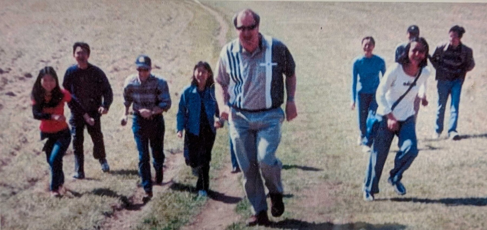
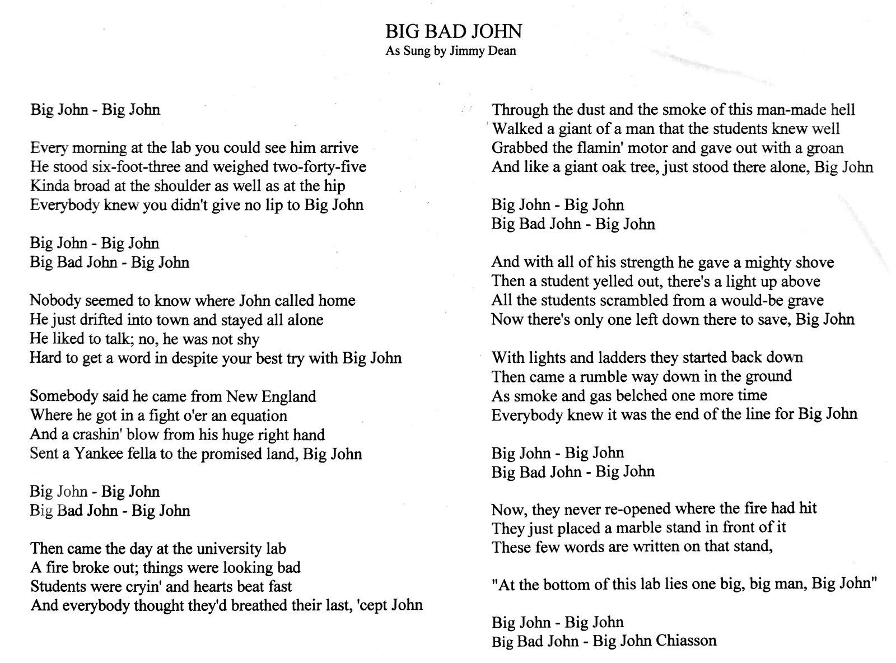

::: {.column-margin}
{.lightbox}
:::

This spot-on parody of Jimmy Dean's
["Big Bad John"](https://genius.com/Jimmy-dean-big-bad-john-lyrics) was written
for John by Prof. Leon M. Tolbert and their joint students at the University of
Tennessee, Knoxville.

{.lightbox}


