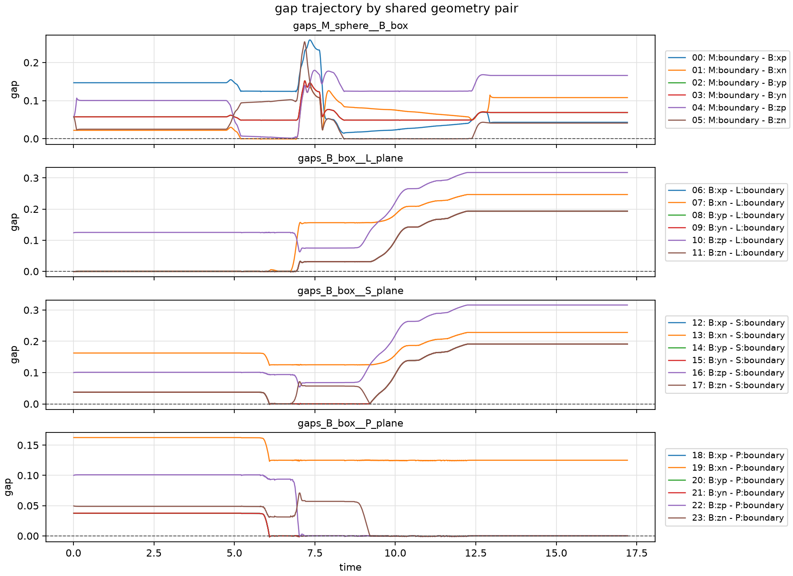

The search's discrete state is the formation, one bit per template. Today
the formation at a pose is simply `Catalog.band(pose)`. This step prints it at
the seven named poses the tests use (`tests/configs/step.txt`) and along a
1,721-frame trajectory recorded by moving the disk by hand, and counts how
many bits each body pair has on at once.

```bash
python walkthrough/03_formations.py
```

<details><summary>The script, <code>03_formations.py</code> (<a href="scripts/03_formations.py">download</a>)</summary>

```python
"""Step 3: formations (the band test) at named poses and along a trajectory.

The formation the search starts from is Catalog.band(pose): every template
whose gap lies in [-epsilon_pen, epsilon_on). Print it at each fixture in
tests/configs/step.txt, then count, along the hand-moved demo trajectory,
how many bits each body pair has on at once.
"""
import jax
import jax.numpy as jnp
import numpy as np

from cmg.catalog.templates import Catalog
from cmg.physics.world import ExecutionWorld, State

from _common import TRAJECTORY, fixtures, load_spec, on, template_names

spec = load_spec()
catalog = Catalog.from_spec(spec)
world = ExecutionWorld(spec.execution)
names = template_names(spec, catalog)


def band_of(qpos):
    qpos = jnp.asarray(qpos)
    return catalog.band(world.pose(State(qpos, jnp.zeros_like(qpos))))


for name, qpos in fixtures().items():
    print(f"{name:16s} {on(band_of(qpos), names)}")

# Which body pair does each template belong to?
pair_of = [tuple(sorted((t.feature1.body(), t.feature2.body()))) for t in catalog]
pairs = sorted(set(pair_of), key=pair_of.index)
member = np.array([[p == q for q in pair_of] for p in pairs])  # (pairs, templates)

qpos = jnp.asarray(np.load(TRAJECTORY)["qpos"])
bands = np.asarray(jax.jit(jax.vmap(band_of))(qpos))  # (frames, templates)
per_pair = bands.astype(int) @ member.T.astype(int)   # (frames, pairs)

print(f"\nDemo trajectory: {len(qpos)} frames")
for k, (a, b) in enumerate(pairs):
    label = f"{spec.bodies[a].name}-{spec.bodies[b].name}"
    counts = np.bincount(per_pair[:, k], minlength=6)
    print(f"  {label}: frames with 0..5 bits on = {counts[:6].tolist()}")
print("Distinct formations visited:", len({tuple(r) for r in bands}))
```

</details>

## Output

```text
flat_stable_far  {B:xp-L:boundary, B:xn-L:boundary, B:yp-L:boundary, B:yn-L:boundary, B:zn-L:boundary, B:xp-S:boundary, B:yp-S:boundary, B:yn-S:boundary, B:zn-S:boundary, B:xp-P:boundary, B:yp-P:boundary, B:yn-P:boundary}
flat_stable_close {M:boundary-B:xn, B:xp-L:boundary, B:xn-L:boundary, B:yp-L:boundary, B:yn-L:boundary, B:zn-L:boundary, B:xp-S:boundary, B:yp-S:boundary, B:yn-S:boundary, B:zn-S:boundary, B:xp-P:boundary, B:yp-P:boundary, B:yn-P:boundary}
flat             {B:xp-L:boundary, B:xn-L:boundary, B:yp-L:boundary, B:yn-L:boundary, B:zn-L:boundary}
hanging          {B:xp-S:boundary, B:yp-S:boundary, B:yn-S:boundary, B:xp-P:boundary, B:yp-P:boundary, B:yn-P:boundary, B:zp-P:boundary}
toppled30_far    {B:xp-L:boundary, B:yp-L:boundary, B:yn-L:boundary, B:zn-L:boundary, B:xp-S:boundary, B:yp-S:boundary, B:yn-S:boundary, B:xp-P:boundary, B:yp-P:boundary, B:yn-P:boundary}
toppled30_close  {M:boundary-B:xn, B:xp-L:boundary, B:yp-L:boundary, B:yn-L:boundary, B:zn-L:boundary, B:xp-S:boundary, B:yp-S:boundary, B:yn-S:boundary, B:xp-P:boundary, B:yp-P:boundary, B:yn-P:boundary}
toppled60_far    {B:xp-L:boundary, B:yp-L:boundary, B:yn-L:boundary, B:zn-L:boundary, B:xp-S:boundary, B:yp-S:boundary, B:yn-S:boundary, B:xp-P:boundary, B:yp-P:boundary, B:yn-P:boundary}

Demo trajectory: 1721 frames
  M-B: frames with 0..5 bits on = [1148, 573, 0, 0, 0, 0]
  B-L: frames with 0..5 bits on = [1030, 0, 0, 0, 41, 650]
  B-S: frames with 0..5 bits on = [1408, 0, 0, 262, 51, 0]
  B-P: frames with 0..5 bits on = [608, 0, 0, 103, 209, 801]
Distinct formations visited: 14
```

## The demo trajectory and its gaps

The test suite renders the demo into `tests/result/step_mujoco_trajectory.mp4`:

<video src="media/step_mujoco_trajectory.mp4" controls muted width="100%"></video>

and plots all 24 gaps along it in `tests/result/step_gap_trajectory.png`:

{fig-alt="Four stacked panels of gap versus time, one per body pair (disk-box, box-floor, box-riser, box-platform). In each panel several curves sit on zero at the same time."}

## What to notice

- **The disk–box pair behaves**: it has at most one bit on, because a sphere
  touches only one face of a box at a time (except exactly at an edge).
- **Every environment pair has 3 to 5 bits on whenever it has any.** The
  box–floor pair is never in contact through one bit only. Xiao and Ji's
  principal contacts allow exactly one per pair; step 1 enforces that.
- **The step corner belongs to two bodies.** At `flat_stable_far` the box's
  front face sits at x = 0, so it touches both the riser `S` (along its whole
  height) and the platform `P` (at its left edge, the point (0, h)). Decision 4
  gives that corner to the riser and makes the platform open at x = 0.
- **Feature names are in the box's own frame.** `hanging` is the box after the
  topple: turned 90°, lying on its local +x face (`xp`) on the platform, and
  overhanging the step by 5.25 cm. Its local +z face (`zp`) now faces forward,
  and that face's bottom edge lies on the platform, so `B:zp-P` is on: the same
  closed-face effect as on the floor.
- **14 distinct formations** over the demo. A search over formations sees
  many more nodes than the seven steps of the paper's chain.

## Code to read

- `tests/configs/step.txt`: the named poses, with a one-line comment each.
- `tests/test_gap_test.py`, `test_gap_trajectory`: how the plot and the video
  are made (offscreen `mujoco.Renderer`, `imageio`).

## Exercises

**3.1** At `flat_stable_far`, why is `B:zn-S:boundary` (bottom face against
the riser) on?

::: {.callout-tip collapse="true"}
## Solution

The bottom face spans x ∈ [−0.125, 0] at z = 0, and the riser is the segment
x = 0, z ∈ [0, h]. They share the point (0, 0), the concave junction where the
floor meets the riser. Both closed sets contain it, so the gap is zero.
Decision 4 rules that concave junctions are not features; this bit should
not exist.
:::

**3.2** On how many of the 1,721 demo frames does at least one body pair have
more than one bit on?

::: {.callout-tip collapse="true"}
## Solution

Add one line at the end of `03_formations.py`:

```python
print("Frames with some pair above one bit:", int((per_pair > 1).any(axis=1).sum()))
```

It prints `1721`: every frame. The box always touches some part of the
environment, and the per-pair counts show that whenever it touches the floor,
riser or platform, that pair has at least three bits on.
:::

**3.3** At `toppled30_far`, `B:zn-L` and `B:xp-L` are on but `B:xn-L` is
off. Which edge of the box is on the floor, and where?

::: {.callout-tip collapse="true"}
## Solution

The box is turned by θ = 30° about y with its center at (−0.0409, 0.0854).
MuJoCo's rotation about y maps a body-frame point (x, z) to
(x cos θ + z sin θ, −x sin θ + z cos θ). The corner (+a/2, −a/2) lands at
(−0.0409 + 0.0229, 0.0854 − 0.0854) = (−0.018, 0): on the floor. That corner
is the edge shared by the +x and bottom faces, so `xp` and `zn` touch the
floor (and `yp`, `yn`, whose closed rectangles contain that edge's endpoints),
while the −x face is in the air. The front face rises from (−0.018, 0) in the
direction (sin θ, cos θ) and passes through (0, h): the box leans on the step
corner, which is why the riser and platform bits are on too.
:::

[← 2. Templates and gaps](02-templates.qmd) · [Next: 4. The contact graph →](04-graph.qmd)
