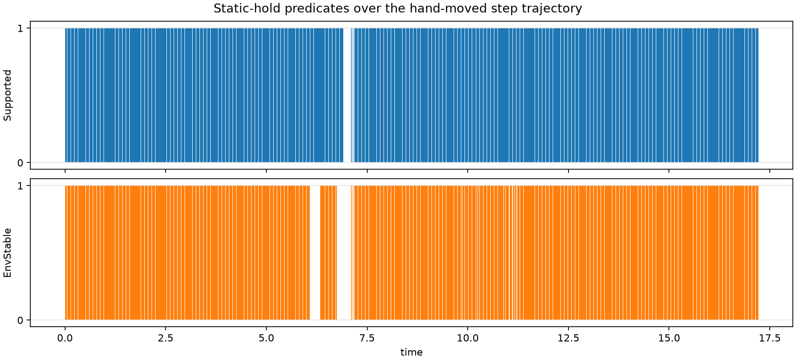

::: {.callout-warning title="Archived: the pre-redesign code"}
This walkthrough documents `cmg` as it was on branch `phase1/dev` at commit
`7d2d343` (published November 4, 2026), before the planar build and the
redesign of the search. It is kept as a record and is not updated: the scene,
the catalog, the hold test, the candidate edits, the solver and the search it
describes have all been replaced. The current code is on branch
`phase1/planar`; see [Planar Build](../planar-build/index.qmd).
:::

The hold test H asks whether some set of contact forces, each inside its
friction cone, can hold the box still against gravity. `physics/hold.py`
answers it with a linear program solved by MPAX. Each asserted template
contributes one contact point (its gap midpoint), a normal (its gap normal),
and three force components: two signed tangential components and one
nonnegative normal component. The friction cone is replaced by an 8-sided
pyramid. Force and torque on the box must balance in all six components.
`create_predicates` returns two jitted predicates of (state, formation):

- **Supported**: every asserted contact may push, the disk's included.
- **EnvStable**: only environment contacts may push.

```bash
python walkthrough/05_hold.py
```

<details><summary>The script, <code>05_hold.py</code> (<a href="scripts/05_hold.py">download</a>)</summary>

```python
"""Step 5: the static-hold LP (Supported and EnvStable).

create_predicates returns two jitted functions of (state, formation):
Supported admits every asserted contact, EnvStable drops the manipulator's.
Each solves one friction-cone LP for the box's wrench balance at the
asserted templates' gap midpoints and normals.
"""
import time

import jax.numpy as jnp
import numpy as np

from cmg.catalog.templates import Catalog
from cmg.physics.hold import create_predicates
from cmg.physics.world import ExecutionWorld, State

from _common import fixtures, load_spec, on, template_names

spec = load_spec()
catalog = Catalog.from_spec(spec)
world = ExecutionWorld(spec.execution)
names = template_names(spec, catalog)
# The same tolerance that marking/candidate.py uses inside the search.
supported, env_stable = create_predicates(spec, catalog, world, tolerance=1e-3)

print("Friction per body pair (MuJoCo's priority rule):")
for a, b in ((0, 1), (1, 2), (1, 3), (1, 4)):
    print(f"  {spec.bodies[a].name}-{spec.bodies[b].name}: mu = {world.pair_friction(a, b)}")
print("Box mass:", float(world.model.body_mass[1]), "kg")


def state_at(qpos):
    qpos = jnp.asarray(qpos)
    return State(qpos, jnp.zeros_like(qpos))


def mask(*wanted):
    return jnp.array([n in wanted for n in names])


start = time.perf_counter()
supported(state_at(fixtures()["flat"]), mask())
print(f"\nFirst call (compiles the LP): {time.perf_counter() - start:.1f} s")

print("\nBand formation at each fixture:")
print(f"  {'fixture':16s} Supported EnvStable")
for name, qpos in fixtures().items():
    state = state_at(qpos)
    band = catalog.band(world.pose(state))
    print(f"  {name:16s} {bool(supported(state, band))!s:9s} {bool(env_stable(state, band))}")

flat = state_at(fixtures()["flat"])
print("\nHand-picked formations at 'flat':")
for formation in (
    (),
    ("B:zn-L:boundary",),
    ("B:xn-L:boundary",),
    ("B:xp-L:boundary", "B:xn-L:boundary"),
):
    f = mask(*formation)
    print(f"  {on(f, names):40s} Supported={bool(supported(flat, f))}")

start = time.perf_counter()
for _ in range(20):
    supported(flat, mask("B:zn-L:boundary")).block_until_ready()
print(f"\nCompiled call: {(time.perf_counter() - start) / 20 * 1e3:.1f} ms each")
```

</details>

## Output

```text
Friction per body pair (MuJoCo's priority rule):
  M-B: mu = 0.9900000095367432
  B-L: mu = 0.20000000298023224
  B-S: mu = 0.20000000298023224
  B-P: mu = 0.20000000298023224
Box mass: 0.10000000149011612 kg

First call (compiles the LP): 6.2 s

Band formation at each fixture:
  fixture          Supported EnvStable
  flat_stable_far  True      True
  flat_stable_close True      True
  flat             True      True
  hanging          True      True
  toppled30_far    False     False
  toppled30_close  True      False
  toppled60_far    True      True

Hand-picked formations at 'flat':
  {}                                       Supported=False
  {B:zn-L:boundary}                        Supported=False
  {B:xn-L:boundary}                        Supported=False
  {B:xp-L:boundary, B:xn-L:boundary}       Supported=False

Compiled call: 1.4 ms each
```

The test suite runs both predicates along the demo trajectory and saves
`tests/result/step_hold_lp_trajectory.png`:

{fig-alt="Two bar strips over 17 seconds. Supported holds almost everywhere except near t = 7 s; EnvStable also fails around t = 6 to 7 s, while the box is tipping and only the disk holds it."}

## What to notice

- **Friction comes from MuJoCo.** When two geoms have different `priority`, the
  higher one's friction wins: the disk (priority 2, μ = 0.99) against the box
  (priority 0), and the environment (priority 1, μ = 0.2) against the box.
- **The box resting flat is "not supported" by its bottom face alone.** One
  bit, `B:zn-L`, fails; the five-bit band formation passes. Exercise 5.1
  explains why. Today the hold test passes only *because* of the extra bits
  from step 3.
- **`toppled30_close` is the interesting row.** With the disk pushing it is
  held (Supported); without the disk it is not (EnvStable). The search uses
  this to refuse letting go mid-topple (step 6).
- **Cost.** Compiling takes about 6 s; a call then costs about 1.4 ms on the CPU.
- **The LP's objective** minimizes the total normal force of manipulator
  contacts; only feasibility is used.

## Code to read

`src/cmg/physics/hold.py`, from the bottom up:

- `create_predicates` builds the incidence (which body each force acts on, with
  sign), the per-template friction, and the manipulator mask, and returns the
  two jitted predicates. EnvStable is the same predicate with manipulator
  templates removed from `allowed`.
- `_predicate` computes midpoints and normals, averaged over five tiny
  perturbations of `qpos` (1e−5 along each coordinate) to smooth ties.
- `_solve_contact_lp` assembles the wrench matrix and the cone constraints, calls
  MPAX's `raPDHG`, and re-checks balance and cones within `tolerance`.
- `_friction_constraints` builds the 8-sided pyramid.

## Exercises

**5.1** Why does `{B:zn-L}` alone fail at `flat` while the five-bit band
formation passes? Print the midpoints of the in-band templates.

::: {.callout-tip collapse="true"}
## Solution

```python
import jax.numpy as jnp, numpy as np
from cmg.catalog.templates import Catalog
from cmg.physics.world import ExecutionWorld, State
from _common import fixtures, load_spec, template_names

spec = load_spec(); catalog = Catalog.from_spec(spec); world = ExecutionWorld(spec.execution)
names = template_names(spec, catalog)
q = jnp.array(fixtures()["flat"]); pose = world.pose(State(q, jnp.zeros_like(q)))
mid, nrm, band = map(np.asarray, (catalog.gap_midpoint(pose), catalog.gap_normal(pose), catalog.band(pose)))
for i in np.flatnonzero(band):
    print(names[i], mid[i].round(4), nrm[i].round(3))
```

```text
B:xp-L:boundary [-0.0375 -0.0625  0.    ] [-0. -0. -1.]
B:xn-L:boundary [-0.1625 -0.0625  0.    ] [-0. -0. -1.]
B:yp-L:boundary [-0.1625  0.0625  0.    ] [-0. -0. -1.]
B:yn-L:boundary [-0.1625 -0.0625  0.    ] [-0. -0. -1.]
B:zn-L:boundary [-0.1625 -0.0625  0.    ] [-0. -0. -1.]
```

The midpoint of a face-on-plane contact is *one* representative closest pair,
not the face. When the box rests exactly flat, every corner of a face touches
the floor, all candidates tie at distance 0, and `_rectangle_closest_points`
returns the first one: corner 0 of the box face in its parameter order
(`local_point` maps (0, 0) to it). Corner 0 of `xn`, `yn` and `zn` is
(−0.1625, −0.0625), of `xp` is (−0.0375, −0.0625), of `yp` is
(−0.1625, 0.0625). The fourth floor corner, (−0.0375, 0.0625), is no face's
corner 0, so no template reports it.

These raw midpoints are not what the LP receives. `_predicate` averages each
midpoint over five copies of the state, each with one `qpos` coordinate nudged
by 1e−5. Print what that hands the LP:

```python
nudged = [np.asarray(catalog.gap_midpoint(world.pose(State(q + o, jnp.zeros_like(q)))))
          for o in 1e-5 * jnp.eye(5)]
for i in np.flatnonzero(band):
    print(f"{names[i]:16s} raw {nudged[0][i].round(4)}  nudge box angle {nudged[2][i].round(4)}"
          f"  LP sees {np.mean(nudged, axis=0)[i].round(4)}")
```

```text
B:xp-L:boundary  raw [-0.0375 -0.0625  0.    ]  nudge box angle [-0.0375  0.0625  0.    ]  LP sees [-0.0375 -0.0375  0.    ]
B:xn-L:boundary  raw [-0.1625 -0.0625  0.    ]  nudge box angle [-0.1625 -0.0625  0.    ]  LP sees [-0.1625 -0.0625  0.    ]
B:yp-L:boundary  raw [-0.1625  0.0625  0.    ]  nudge box angle [-0.1     0.0625  0.    ]  LP sees [-0.15    0.0625  0.    ]
B:yn-L:boundary  raw [-0.1625 -0.0625  0.    ]  nudge box angle [-0.1    -0.0625  0.    ]  LP sees [-0.15   -0.0625  0.    ]
B:zn-L:boundary  raw [-0.1625 -0.0625  0.    ]  nudge box angle [-0.1    -0.0625  0.    ]  LP sees [-0.15   -0.0625  0.    ]
```

Nudging the box angle tilts the bottom face through the floor plane, and the
closest-point routine then returns the point where an edge crosses the floor,
at the box's center x = −0.1. Four nudges keep the corner, one moves the point,
so the LP sees 80/20 blends that are no physical contact point.

`{B:zn-L}` alone is one point, (−0.15, −0.0625). One point under the box
cannot balance gravity's torque about it, so it fails. The five bits give four
distinct points, and the center of mass (−0.1, 0) lies inside their hull, 1.35 cm
from the nearest edge (the one from (−0.0375, −0.0375) to (−0.15, 0.0625)).
So the band formation passes, with a positive margin, but both the pass and the
1.35 cm are artifacts of tie-breaking and averaging. A robust margin in the
sense of Decision 6 computed from these points would be a meaningless number.
Step 1 gives each contact its full contact set (the face's endpoints), so the LP
sees the true support polygon.
:::

**5.2** In the table, `toppled30_close` is Supported but not EnvStable. What
does that imply for an edit that breaks the disk contact at that pose?

::: {.callout-tip collapse="true"}
## Solution

Breaking `M:boundary-B:xn` leaves only environment contacts, and those cannot
hold the box (EnvStable is false). The hold test of step 6 checks the contacts
that persist through an edit, so that break is illegal there, and step 6's output
confirms it. This is the persistent-contact rule (Decision 7): you may not let
go mid-topple, but the same break becomes legal once the box has landed.
:::

**5.3** Is `toppled30_far` unstable because the environment's friction
(μ = 0.2) is too low? Test it with μ = 1.

::: {.callout-tip collapse="true"}
## Solution

Write a copy of the scene with a higher environment friction and evaluate
EnvStable there:

```python
import pathlib, tempfile
import jax.numpy as jnp
from cmg.catalog.templates import Catalog
from cmg.physics.hold import create_predicates
from cmg.physics.world import ExecutionWorld, State
from _common import CMG, STEP_YAML, fixtures, load_spec

folder = pathlib.Path(tempfile.mkdtemp())
xml = (CMG / "src/cmg/scene/families/step.xml").read_text()
(folder / "step.xml").write_text(xml.replace('friction="0.2 1.0 0.1"', 'friction="1.0 1.0 0.1"'))
(folder / "step.yaml").write_text(
    STEP_YAML.read_text().replace('"src/cmg/scene/families/step.xml"', str(folder / "step.xml")))
spec = load_spec(folder / "step.yaml"); catalog = Catalog.from_spec(spec); world = ExecutionWorld(spec.execution)
_, env_stable = create_predicates(spec, catalog, world, tolerance=1e-3)
for name in ("toppled30_far", "toppled60_far"):
    q = jnp.array(fixtures()[name]); state = State(q, jnp.zeros_like(q))
    print(name, world.pair_friction(1, 2), bool(env_stable(state, catalog.band(world.pose(state)))))
```

```text
toppled30_far 1.0 False
toppled60_far 1.0 True
```

Still unstable, at μ = 0.2, 0.3, 0.4, 0.5 and 1.0 alike, so friction is not
the issue. The box's center of mass is at x = −0.0409, *behind* its floor
contact at x = −0.018 (exercise 3.3), so gravity tips it backward, away from
the step. The only other support is the step corner, which can push but not
pull. No friction coefficient fixes that; only the disk pushing from behind
does (`toppled30_close`). At 60° the center of mass has passed over the floor
contact and the corner holds it.
:::

[← 4. The contact graph](04-graph.qmd) · [Next: 6. Candidate edits →](06-candidates.qmd)
