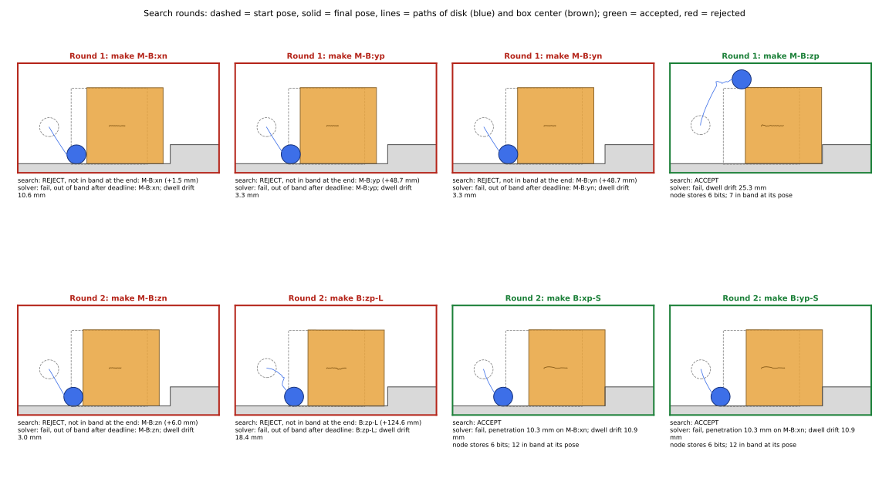

`Search` ties the layers together. `Search.from_specs` builds `Cand`, the
solver and the `Discretizer`, and adds one root node at `start_qpos` with its
band formation. A node is keyed by (discretized `qpos`, formation).
`run_single()` performs one round:

1. For every node, list its legal edits (step 6), skipping (node, destination)
   pairs already tried.
2. Rank them with the default ranker: the node's breadth-first depth + 1,
   with ties broken by node insertion order and then by catalog order.
3. Send the best `batch_size` edits to the solver in one `vmap`ped call.
4. Accept an edit when every destination bit is in band at the final state;
   add (or update) a node there, and record the realized path as its incoming edge.

There is no goal test and no budget yet; you call `run_single()` yourself. To
fit in a few minutes on a CPU this script uses a lighter solver (64 samples,
2 iterations) and batches of 4.

```bash
python walkthrough/08_search.py
```

<details><summary>The script, <code>08_search.py</code> (<a href="scripts/08_search.py">download</a>)</summary>

```python
"""Step 8: the search loop, two batches.

Search.from_specs builds Cand, the solver and the discretizer, and seeds
the graph with one node at start_qpos. run_single() ranks every untried
(node, legal edit) pair by BFS depth, sends the best batch_size of them to
the solver in one vmapped call, and adds a node for each accepted result.
The solver is lightened (64 samples, 2 iterations, batch of 4) so the run
fits in a few minutes on a CPU.
"""
import tempfile
import time

import numpy as np

from cmg.config.search_config import SearchConfig
from cmg.config.solver_config import SolverConfig
from cmg.search import Search

from _common import CMG, on, template_names

base = SolverConfig.from_yaml(str(CMG / "assets/configs/solver/step-base.yaml"))
solver_config = SolverConfig(
    solver_type=base.solver_type,
    solver_args=[],
    solver_overrides={**base.solver_overrides, "n_samples": 64, "maxiters": 2},
    scene_spec=base.scene_spec,
)
search = Search.from_specs(SearchConfig(batch_size=4), solver_config, base.scene_spec)
names = template_names(base.scene_spec, search.candidate_formations.catalog)


def show_nodes():
    for key, node in search.search_state.nodes.items():
        depth = node.stats.get("depth", 0)
        print(f"  depth {depth}  qpos {np.round(np.asarray(node.scene_state.configuration), 4)}")
        print(f"           {on(np.array(node.formation), names)}")


print("Root:")
show_nodes()
root = next(iter(search.search_state.nodes.values()))
tried = []
for batch in (1, 2):
    start = time.perf_counter()
    paths = search.run_single()
    print(f"\nBatch {batch}: {len(paths)} accepted in {time.perf_counter() - start:.0f} s;"
          f" {len(search.search_state.attempted)} (node, formation) pairs tried so far")
    new = [f for node, f in search.search_state.attempted if node is root and f not in tried]
    tried.extend(new)
    added = [np.array(f) & ~np.array(root.formation) for f in new]
    for bits in sorted(added, key=lambda bits: int(np.argmax(bits))):
        print(f"  tried from root: make {on(bits, names)}")
    for path in paths:
        added = np.array(path.cur_node.formation) & ~np.array(path.prev_node.formation)
        dropped = np.array(path.prev_node.formation) & ~np.array(path.cur_node.formation)
        print(f"  + {on(added, names)}  - {on(dropped, names)}  ({len(path.path)} steps)")

print(f"\nGraph after two batches: {len(search.search_state.nodes)} nodes")
show_nodes()

with tempfile.TemporaryDirectory() as directory:
    search.save(directory)
    print("\nSaved:", sorted(p.name for p in __import__("pathlib").Path(directory).iterdir()))
    search.load(directory)
    print("Reloaded nodes:", len(search.search_state.nodes))
```

</details>

## Output

```text
Root:
  depth 0  qpos [-0.1     0.0625  0.     -0.2     0.0625]
           {B:xp-L:boundary, B:xn-L:boundary, B:yp-L:boundary, B:yn-L:boundary, B:zn-L:boundary}

Batch 1: 1 accepted in 78 s; 4 (node, formation) pairs tried so far
  tried from root: make {M:boundary-B:xn}
  tried from root: make {M:boundary-B:yp}
  tried from root: make {M:boundary-B:yn}
  tried from root: make {M:boundary-B:zp}
  + {M:boundary-B:zp}  - {}  (30 steps)

Batch 2: 2 accepted in 28 s; 8 (node, formation) pairs tried so far
  tried from root: make {M:boundary-B:zn}
  tried from root: make {B:zp-L:boundary}
  tried from root: make {B:xp-S:boundary}
  tried from root: make {B:yp-S:boundary}
  + {B:xp-S:boundary}  - {}  (30 steps)
  + {B:yp-S:boundary}  - {}  (30 steps)

Graph after two batches: 4 nodes
  depth 0  qpos [-0.1     0.0625  0.     -0.2     0.0625]
           {B:xp-L:boundary, B:xn-L:boundary, B:yp-L:boundary, B:yn-L:boundary, B:zn-L:boundary}
  depth 1  qpos [-6.390e-02  6.260e-02  1.000e-04 -1.324e-01  1.385e-01]
           {M:boundary-B:zp, B:xp-L:boundary, B:xn-L:boundary, B:yp-L:boundary, B:yn-L:boundary, B:zn-L:boundary}
  depth 1  qpos [-0.0625  0.0625  0.0002 -0.167   0.015 ]
           {B:xp-L:boundary, B:xn-L:boundary, B:yp-L:boundary, B:yn-L:boundary, B:zn-L:boundary, B:xp-S:boundary}
  depth 1  qpos [-0.0625  0.0625  0.0002 -0.167   0.015 ]
           {B:xp-L:boundary, B:xn-L:boundary, B:yp-L:boundary, B:yn-L:boundary, B:zn-L:boundary, B:yp-S:boundary}

Saved: ['attempted-7d2d343268d5b0be8b9e3b5fe7b668da5d828585.parquet', 'edges-7d2d343268d5b0be8b9e3b5fe7b668da5d828585.parquet', 'nodes-7d2d343268d5b0be8b9e3b5fe7b668da5d828585.parquet']
Reloaded nodes: 4
```

The saved file names end in the git hash of your checkout, so they match only
if you are on `7d2d343`.

## What to notice

- **Catalog order drives the search.** Every edit from the root has rank 1, so
  the first batch is simply the first four legal makes in catalog order: the
  disk on the box's −x, +y, −y and +z faces. Two of those (±y) are
  unreachable for a disk that never moves in y. Each still costs a solver call.
- **The accepted "make" of the disk on the box's top** is the disk pushing the
  box 3.6 cm forward and ending at the box's back top edge (exercise 8.3 renders it).
- **Making a riser contact means pushing the box to the riser.** Both
  `B:xp-S` and `B:yp-S` are "made" by the same motion and end at the same
  `qpos`, yet they become two different nodes, because the formation is part
  of the key.
- **A node stores the requested formation, not the one it reached.** At those
  two nodes the box touches the riser and platform, with six more bits in
  band than the node records (exercise 8.1).
- **There is no goal.** Nothing in `Search` or `DefaultRanker` refers to a
  goal pose or a target formation, and nothing stops the loop when one is
  reached. Breadth-first search expands every legal edit of depth 1, then of
  depth 2, and so on; it would reach a goal only by exhausting everything
  shallower. Direction is meant to come from the null edit (which pulls toward
  the goal) and from a learned ranker in place of breadth-first order.
- **Save and load** write three Parquet tables (nodes, realized edges, tried
  pairs). Simulator data is stripped; states keep `qpos` and `qvel` only.

## Seeing each round

The search keeps only the attempts it accepts. `08b_search_rounds.py` runs the
same two batches but records every solver call, rejected ones included, and
draws one panel per attempt with two verdicts: the search's (every requested
bit in band at the final step) and the solver's own success checks,
recomputed from the trajectory. It writes `walkthrough/08b_search_rounds.png` and a vector `.svg` copy.
It needs no display, so it works over SSH.

```bash
python walkthrough/08b_search_rounds.py
```

<details><summary>The script, <code>08b_search_rounds.py</code> (<a href="scripts/08b_search_rounds.py">download</a>)</summary>

```python
"""Step 8b: what each search round tried, rejected and accepted.

Runs the same two batches as 08_search.py, but records every solver call the
search makes, rejected ones included (the search itself keeps only accepted
results). For each attempt it recomputes

  * the search's verdict: every requested bit in band at the final step, and
  * the solver's own verdict (MPPISolver's success checks): no penetration
    beyond epsilon_pen at any step, requested bits within epsilon_on from the
    deadline on, dropped bits at least R away, and dwell drift within tolerance,

and draws one panel per attempt in the x-z plane: start pose (dashed), final
pose (solid), the disk's path, and both verdicts. Writes
walkthrough/08b_search_rounds.png (and a zoomable .svg) and prints the same
information.
"""
import textwrap
from pathlib import Path

import matplotlib

matplotlib.use("Agg")  # no display needed (works over SSH)
import jax
import jax.numpy as jnp
import matplotlib.pyplot as plt
import numpy as np
from matplotlib.patches import Circle, Polygon

from cmg.config.search_config import SearchConfig
from cmg.config.solver_config import SolverConfig
from cmg.physics.world import State
from cmg.search import Search

from _common import CMG, template_names

base = SolverConfig.from_yaml(str(CMG / "assets/configs/solver/step-base.yaml"))
solver_config = SolverConfig(
    solver_type=base.solver_type,
    solver_args=[],
    solver_overrides={**base.solver_overrides, "n_samples": 64, "maxiters": 2},
    scene_spec=base.scene_spec,
)
search = Search.from_specs(SearchConfig(batch_size=4), solver_config, base.scene_spec)
catalog = search.candidate_formations.catalog
world = search.candidate_formations.exec_world
solver = search.local_solver
names = [n.replace(":boundary", "") for n in template_names(base.scene_spec, catalog)]
EPS_PEN, EPS_ON = float(catalog.epsilon_pen), float(catalog.epsilon_on)
gaps_along = jax.jit(jax.vmap(lambda q: catalog.gap(pose=world.pose(State(q, jnp.zeros_like(q))))))

# Record every batch the search sends to the solver, accepted or not.
calls = []
solve_batch = search._solve_batch


def recording(states, old, new, op_types):
    out = solve_batch(states, old, new, op_types)
    calls.append((np.asarray(old), np.asarray(new), out))
    return out


search._solve_batch = recording


def verdicts(q, old, new):
    """Both verdicts for one attempt, from its qpos trajectory (T, 5)."""
    g = np.asarray(gaps_along(jnp.asarray(q)))  # (T, 24)
    final = g[-1]
    in_band = (final >= -EPS_PEN) & (final < EPS_ON)
    missing = [(names[i], final[i]) for i in np.flatnonzero(new & ~in_band)]
    reasons = []
    t, c = np.unravel_index(np.argmin(g), g.shape)
    if g[t, c] < -EPS_PEN:
        reasons.append(f"penetration {-g[t, c] * 1e3:.1f} mm on {names[c]}")
    deadline = g[solver.horizon - 1:]
    late = [names[i] for i in np.flatnonzero(new & np.any(deadline >= EPS_ON, axis=0))]
    if late:
        reasons.append("out of band after deadline: " + ", ".join(late))
    leaving = old & ~new
    if np.any(leaving & np.any(deadline < solver.R, axis=0)):
        reasons.append("dropped contact not cleared")
    drift = np.abs(q[solver.horizon:] - q[solver.horizon - 1]).max()
    if drift > solver.dwell_tolerance:
        reasons.append(f"dwell drift {drift * 1e3:.1f} mm")
    return missing, reasons, int(in_band.sum())


def edit_label(old, new):
    made = [names[i] for i in np.flatnonzero(new & ~old)]
    broken = [names[i] for i in np.flatnonzero(old & ~new)]
    return " ".join([f"make {m}" for m in made] + [f"break {b}" for b in broken]) or "transport"


def draw_scene(ax, q_start, q):
    h, a, r = 0.03125, 0.125, 0.015625
    ax.fill([-0.3, 0, 0, 0.12, 0.12, -0.3], [0, 0, h, h, -0.02, -0.02], color="0.85", lw=0)
    ax.plot([-0.3, 0, 0, 0.12], [0, 0, h, h], color="0.3", lw=1)

    def box(qq):
        c, s = np.cos(qq[2]), np.sin(qq[2])
        local = np.array([[-1, -1], [1, -1], [1, 1], [-1, 1]]) * a / 2
        return np.c_[qq[0] + local[:, 0] * c + local[:, 1] * s,
                     qq[1] - local[:, 0] * s + local[:, 1] * c]

    ax.add_patch(Polygon(box(q_start), fill=False, ls="--", ec="0.5", lw=0.8))
    ax.add_patch(Circle(q_start[3:5], r, fill=False, ls="--", ec="0.5", lw=0.8))
    ax.add_patch(Polygon(box(q[-1]), fc="#e8a33d", ec="#7a4f0e", alpha=0.85, lw=1))
    ax.add_patch(Circle(q[-1, 3:5], r, fc="#3d6fe8", ec="#14307a", lw=1))
    ax.plot(q[:, 3], q[:, 4], color="#3d6fe8", lw=0.8)
    ax.plot(q[:, 0], q[:, 1], color="#7a4f0e", lw=0.8)
    ax.set_xlim(0.08, -0.25)  # +x points left, as in the paper's figures
    ax.set_ylim(-0.015, 0.165)
    ax.set_aspect("equal")
    ax.set_xticks([])
    ax.set_yticks([])


rounds = []
for batch in (1, 2):
    first = len(calls)
    search.run_single()
    attempts = []
    for old, new, (trajectories, _, accepted) in calls[first:]:
        q = np.asarray(trajectories.configuration)
        for i in range(len(new)):
            missing, reasons, nband = verdicts(q[i], old[i], new[i])
            attempts.append(dict(label=edit_label(old[i], new[i]), q=q[i], accepted=bool(accepted[i]),
                                 missing=missing, reasons=reasons, stored=int(new[i].sum()), nband=nband))
    rounds.append(attempts)

fig, axes = plt.subplots(len(rounds), 4, figsize=(16, 4.4 * len(rounds)), squeeze=False)
for r, attempts in enumerate(rounds):
    print(f"\nRound {r + 1}: {len(attempts)} tried, {sum(a['accepted'] for a in attempts)} accepted")
    for k, (ax, att) in enumerate(zip(axes[r], attempts)):
        draw_scene(ax, att["q"][0], att["q"])
        search_line = ("search: ACCEPT" if att["accepted"] else
                       "search: REJECT, not in band at the end: "
                       + ", ".join(f"{n} ({g * 1e3:+.1f} mm)" for n, g in att["missing"]))
        solver_line = "solver: success" if not att["reasons"] else "solver: fail, " + "; ".join(att["reasons"])
        node_line = (f"node stores {att['stored']} bits; {att['nband']} in band at its pose"
                     if att["accepted"] else "")
        print(f"  {att['label']}\n    {search_line}\n    {solver_line}" + (f"\n    {node_line}" if node_line else ""))
        ax.set_title(f"Round {r + 1}: {att['label']}", color="#1a7f37" if att["accepted"] else "#b42318",
                     fontsize=10, fontweight="bold")
        text = "\n".join(textwrap.fill(t, 62) for t in (search_line, solver_line, node_line) if t)
        ax.text(0.0, -0.04, text, transform=ax.transAxes, va="top", fontsize=8)
        for side in ax.spines.values():
            side.set_edgecolor("#1a7f37" if att["accepted"] else "#b42318")
            side.set_linewidth(2)
fig.suptitle("Search rounds (+x to the left, as in the paper): dashed = start pose, solid = final pose, lines = paths of disk (blue) "
             "and box center (brown); green = accepted, red = rejected", fontsize=11)
fig.subplots_adjust(left=0.02, right=0.98, top=0.9, bottom=0.12, wspace=0.08, hspace=0.75)
out = Path(__file__).with_name("08b_search_rounds.png")
fig.savefig(out, dpi=200)
fig.savefig(out.with_suffix(".svg"))  # vector copy: zoom without blur
print(f"\nWrote {out} and {out.with_suffix('.svg').name}")
```

</details>

```text
Round 1: 4 tried, 1 accepted
  make M-B:xn
    search: REJECT, not in band at the end: M-B:xn (+1.5 mm)
    solver: fail, out of band after deadline: M-B:xn; dwell drift 10.6 mm
  make M-B:yp
    search: REJECT, not in band at the end: M-B:yp (+48.7 mm)
    solver: fail, out of band after deadline: M-B:yp; dwell drift 3.3 mm
  make M-B:yn
    search: REJECT, not in band at the end: M-B:yn (+48.7 mm)
    solver: fail, out of band after deadline: M-B:yn; dwell drift 3.3 mm
  make M-B:zp
    search: ACCEPT
    solver: fail, dwell drift 25.3 mm
    node stores 6 bits; 7 in band at its pose

Round 2: 4 tried, 2 accepted
  make M-B:zn
    search: REJECT, not in band at the end: M-B:zn (+6.0 mm)
    solver: fail, out of band after deadline: M-B:zn; dwell drift 3.0 mm
  make B:zp-L
    search: REJECT, not in band at the end: B:zp-L (+124.6 mm)
    solver: fail, out of band after deadline: B:zp-L; dwell drift 18.4 mm
  make B:xp-S
    search: ACCEPT
    solver: fail, penetration 10.3 mm on M-B:xn; dwell drift 10.9 mm
    node stores 6 bits; 12 in band at its pose
  make B:yp-S
    search: ACCEPT
    solver: fail, penetration 10.3 mm on M-B:xn; dwell drift 10.9 mm
    node stores 6 bits; 12 in band at its pose

Wrote .../cmg/walkthrough/08b_search_rounds.png and 08b_search_rounds.svg
```

Click the figure to open it full screen. It is a vector image, so it stays
sharp at any zoom ([open it on its own](media/search_rounds.svg)).

{fig-alt="Eight panels in two rows, one per solver call. In every panel the disk drops toward the floor while pushing the box toward the step. Round 1: the disk on the box's back face is rejected (1.5 mm short at the end), the two side-face makes are rejected (48.7 mm away), and the disk on the box's top is accepted. Round 2: the disk on the box's bottom and the box's top on the floor are rejected; the two riser contacts are accepted."}

What the figure shows:

- **m_x, the paper's first edit, misses by half a millimeter.** The disk touches
  the back face, then drops to the floor and ends 1.5 mm away, just outside
  ε_on = 1 mm. With the full solver of step 7 (256 samples, 5 iterations) the
  same make is accepted; the lightened solver here is not good enough.
- **The ±y makes never get closer than 48.7 mm**, the floor of
  0.0625 − 0.0156 ≈ 0.047 that a disk confined to y = 0 can reach.
- **The solver fails all eight attempts, the search accepts three.** Every
  accepted one is still moving during the dwell (drift up to 25 mm), and the
  riser makes also penetrate the box's back by 10.3 mm.
- **The riser contacts are made by shoving the box**, and their nodes store
  6 bits while 12 are in band at their pose.
- **Every attempt pushes the box toward the step**, even the ones that ask
  for nothing of the kind: the cost has no reason not to.

## Code to read

`src/cmg/search/__init__.py`: `Search.run_single` (the round above),
`Search.from_specs` (the root), `DefaultRanker` (depth), `Discretizer` (1 mm
and 0.01 rad bins), and `SearchState.save` and `load`. `search/engine.py`,
`keys.py`, `node.py` and the four policies in `search/policies/` are docstrings
describing the intended teacher, ranking, path and gap-greedy searches.

## Exercises

**8.1** What is the band formation at the `qpos` of the two batch-2 nodes,
and how does it compare with what those nodes store?

::: {.callout-tip collapse="true"}
## Solution

```python
import jax.numpy as jnp
from cmg.catalog.templates import Catalog
from cmg.physics.world import ExecutionWorld, State
from _common import load_spec, on, template_names

spec = load_spec(); catalog = Catalog.from_spec(spec); world = ExecutionWorld(spec.execution)
q = jnp.array([-0.0625, 0.0625, 0.0002, -0.167, 0.015])
print(on(catalog.band(world.pose(State(q, jnp.zeros_like(q)))), template_names(spec, catalog)))
```

```text
{B:xp-L:boundary, B:xn-L:boundary, B:yp-L:boundary, B:yn-L:boundary, B:zn-L:boundary, B:xp-S:boundary, B:yp-S:boundary, B:yn-S:boundary, B:zn-S:boundary, B:xp-P:boundary, B:yp-P:boundary, B:yn-P:boundary}
```

Twelve bits, the same as `flat_stable_far` in step 3. Each node records six:
the five floor bits plus the one it asked for. The next round computes that
node's edits from the six-bit formation, so it will offer "makes" of contacts
that are already touching, and hold tests that ignore contacts that exist.
:::

**8.2** Predict the four edits of a third batch, and which are accepted.

::: {.callout-tip collapse="true"}
## Solution

The root's remaining edits still rank 1, ahead of everything at the depth-1
nodes (rank 2). After `B:yp-S`, the next legal makes in catalog order are
`B:yn-S`, `B:zp-S`, `B:zn-S` and `B:xp-P`. Change `for batch in (1, 2):` to
`(1, 2, 3)` and rerun (about 15 s more):

```text
Batch 3: 3 accepted in 12 s; 12 (node, formation) pairs tried so far
  tried from root: make {B:yn-S:boundary}
  tried from root: make {B:zp-S:boundary}
  tried from root: make {B:zn-S:boundary}
  tried from root: make {B:xp-P:boundary}
  + {B:yn-S:boundary}  - {}  (30 steps)
  + {B:zn-S:boundary}  - {}  (30 steps)
  + {B:xp-P:boundary}  - {}  (30 steps)
```

Pushing the box to the riser puts all three of those bits in band (see 8.1).
`B:zp-S` (the box's top face against the riser) is not reachable that way, so
it is rejected. Six of the first twelve solver calls push the box against the
riser, and each records just one of the bits that this push turns on.
:::

**8.3** Render an accepted path to a video and watch it.

::: {.callout-tip collapse="true"}
## Solution

Append to `08_search.py`:

```python
import imageio.v2 as imageio
import mujoco

model = mujoco.MjModel.from_xml_path(base.scene_spec.execution.reference)
data = mujoco.MjData(model)
renderer = mujoco.Renderer(model, height=480, width=640)
for k, node in enumerate(search.search_state.nodes.values()):
    for path in node.paths:
        added = np.array(path.cur_node.formation) & ~np.array(path.prev_node.formation)
        label = names[int(np.argmax(added))].replace(":", "_")
        frames = []
        for state in path.path:
            data.qpos[:] = np.asarray(state.configuration)
            mujoco.mj_forward(model, data)
            renderer.update_scene(data, camera=0)
            frames.append(renderer.render())
        imageio.mimsave(f"walkthrough/path_{k}_{label}.mp4", frames, fps=10)
        print("wrote", f"walkthrough/path_{k}_{label}.mp4")
renderer.close()
```

It writes one 30-frame video per accepted edge. The disk-on-top make
(`path_1_M_boundary-B_zp.mp4`, slowed to 10 frames per second):

<video src="media/path_make_M_B_zp.mp4" controls muted width="100%"></video>

The disk rises along the box's back face while pushing it forward and ends at
the back top edge. With a display, you can instead save a path's `qpos` with
`np.savez("walkthrough/zp.npz", qpos=...)` and loop it in the viewer:

```bash
python walkthrough/replay.py walkthrough/zp.npz
```
:::

[← 7. One solver call](07-mppi.qmd) · [Next: 9. Where step 1 starts →](09-step1.qmd)
