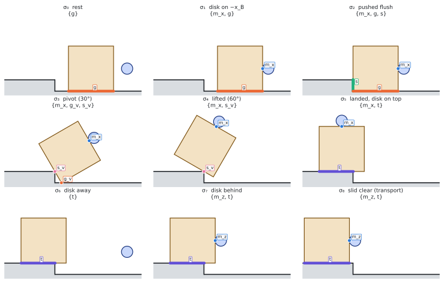
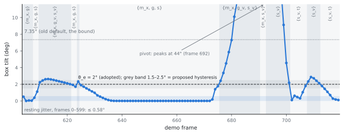

**Code.** Branch `phase1/planar` of `Symplectomorphism/c-gnn`: commits `ca4123b`
(contact layer), `2114cf5` (compendium), `21727bb` (paper), `b2665cb` (finite
gradients, robustness tests) and `62782b8` (θ<sub>e</sub> as its own
parameter, 2°). Python 3.14 (`cmg/.venv314`); Angelo's `MPPISolver`, `Cand` and
`Search` run on it unchanged.

## What step 1 replaces

The walkthrough ended on a list of defects in the contact layer
([page 9](../code-walkthrough/09-step1.qmd)). The main one: faces are closed
sets that share their edges, so one physical contact lit 3 to 6 template bits
at once, on every frame of the demo. The search, the hold test and the graph
all inherited that over-count. Step 1 rebuilds the layer in the x–z plane
with the paper's contact names. Exactly one contact per body pair is on, and
each contact carries its contact set, the part of the box that actually
touches.

## The scene

{.lightbox}

`step2d.yaml` declares the scene with `dimension: 2`. Its catalog has 40
templates: 8 disk–box, 8 box–floor, 16 box–riser and 8 box–platform. The
paper's count is 44 because it also lists the four disk–environment
contacts, which the code leaves out. The seven named contacts are g (box
bottom on the floor), g<sub>v</sub> (box corner on the floor), s (box side
flush on the riser), s<sub>v</sub> (step corner on the box side), t (box on
the platform), m<sub>x</sub> and m<sub>z</sub> (disk on a box face). The
exclusions {g, t}, {g<sub>v</sub>, s}, {g, s<sub>v</sub>} and
{g, m<sub>z</sub>} are given by name.

## When a contact is on

For each body pair, a template is **on** when all of these hold:

1. **In band.** Its gap is between −ε<sub>pen</sub> and ε<sub>on</sub> = 1 mm.
2. **It touches inside both features.** The touching part may not sit only
   at an endpoint the feature does not own. A box edge touching the floor
   only at its end is the corner's contact, not the edge's. The step corner
   counts for the riser, not the platform.
3. **Edge on edge needs alignment.** The two edges must be within
   θ<sub>e</sub> = 2° of parallel and overlap by at least ℓ<sub>min</sub> =
   a/16 (7.8 mm). Otherwise the contact is a corner contact.
4. **The higher-dimensional contact wins.** A corner contact inside a flush
   edge contact is not counted separately. Any tie the tolerances leave goes
   to the higher-dimensional contact.

This is the principal-contact rule of Xiao and Ji (2001) with tolerances,
written in the paper as `def:near-map`.

{.lightbox}

## The demo, frame by frame

The viewer replays the 1,721-frame demo shipped with `cmg`
(`step_example_trajectory.npz`). It labels every frame with the new layer and
draws the contact sets.

<iframe src="contact-viewer.html" title="Contact layer viewer" loading="lazy" allow="fullscreen" allowfullscreen
  style="width:100%;height:1260px;border:1px solid var(--bs-border-color, #d0d7de);border-radius:8px"></iframe>

[Open the viewer on its own page](contact-viewer.html){target="_blank"} for more room.

What to watch for:

- **One bit per pair.** The table's "in band" column is the old closed-feature
  count: up to 6 for one contact. The on column never holds more than one.
- **The chain, in order.** The formation goes {g} → {m<sub>x</sub>, g} →
  {m<sub>x</sub>, g, s} → {m<sub>x</sub>, g<sub>v</sub>, s<sub>v</sub>} →
  {m<sub>x</sub>, s<sub>v</sub>} → {s<sub>v</sub>} → {s<sub>v</sub>, t} →
  {m<sub>z</sub>, s<sub>v</sub>, t} → {m<sub>z</sub>, t} → {t}. It never shows
  an excluded formation.
- **Two rocks the chain leaves out.** At frame 609 the box hits the riser and
  rocks onto its corner, up to 2.6°. After landing (frames 708–712) it
  seesaws on the step corner with its platform end up, so only
  s<sub>v</sub> is on. Both are real motion; the next section is about them.
- **One vertex–vertex frame** (920): box corner on the step corner as the
  disk pushes the box clear.
- **Tie-breaks** fire on 2 frames, both with the box pressed more than 1 mm
  into the riser.

## Edge contacts and the tilt θ<sub>e</sub>

This was the first of step 1's refinements to review. It is now settled at
θ<sub>e</sub> = 2°.

**What we had agreed.** An edge counted as flat on a surface when the part
of it within ε<sub>on</sub> = 1 mm of the surface was at least
ℓ<sub>min</sub> = 7.8 mm long. A box tipped by θ with its corner down keeps a
1 mm sliver of length ε<sub>on</sub>/sin θ. So the length rule already
called the box flat up to arcsin(ε<sub>on</sub>/ℓ<sub>min</sub>) = 7.35°,
when its far end is 16 mm off the floor.

**Why the length rule failed.** As the box tips over the step corner, the
floor's contact set ends at the box corner, but the riser's runs about
ε<sub>on</sub> past the step corner. The floor contact turned into a corner
contact at 7.35° and the riser contact only at 8.44°. In between, the label
was {g<sub>v</sub>, s}: on a corner yet flush on the riser, which is
impossible for a rigid box in a right-angled corner. Testing the angle
instead makes both contacts switch at the same tilt, because they share the
box's angle.

**Why 2°.** The angle no longer has to be 7.35°. The spec now takes
`max_edge_contact_tilt_deg`, anywhere in (0, 7.35°]; ℓ<sub>min</sub> only sets
the overlap. A box at rest in the demo tilts at most 0.58°, and 2° is three
times that.

{.lightbox}

The sweep below labels the same demo at several thresholds:

| θ<sub>e</sub> | Formation runs | Rock at the riser | Seesaw after landing | Flicker | Excluded formations |
|---|---|---|---|---|---|
| 1° | 16 | yes | yes, plus a 1-frame corner contact on the platform | none | 0 |
| 1.5° | 15 | yes | yes | none | 0 |
| **2° (adopted)** | 17 | yes | yes | one, 3 frames (tilt hovers at 2°, frames 622–625) | 0 |
| 2.5° | 15 | 4 frames | 2 frames | none | 0 |
| 3° to 7.35° | 11 | no | no | none | 0 |

The solver's own rollouts show the same rock: pushing the box into the riser
tips it 2.5° on impact. That gives 5 label changes along the rollout at 2°,
against 1 at 7.35°, with the same final on-set. The solver itself only reads
gaps, and gaps do not depend on θ<sub>e</sub>.

**Proposed, not adopted: hysteresis for trajectory labels.** When a
trajectory is labeled frame by frame (an execution monitor, the replay, data
for the ranker), use two thresholds. Switch from edge to corner at 2.5° and
back at 1.5°. On the demo this keeps both rocks and removes the flicker (15
runs instead of 17). The on-set N(χ) itself stays a function of the pose
alone, because the search and the solver query single poses. A minimum dwell
of 3 frames was tried instead and rejected: it also swallows real one- and
two-frame formations, such as the vertex–vertex frame 920.

## The other two refinements (under review)

- **Penetration is charged to the nearest surface.** A penetration counts
  against the nearest environment segment or segment endpoint. Without this,
  a box face 2 mm into the riser read +1.6 mm (s off, s<sub>v</sub> on), and a
  box corner 1.6 mm past the riser read −31 mm into the platform. The
  computation is exact: along a box edge every condition is linear, or a
  convex quadratic near an endpoint.
- **A counted tie-break.** When tolerances leave two templates of one pair,
  the higher-dimensional one wins, then the smaller gap. It fires on 2 of
  1,721 demo frames, both pressed deeper than ε<sub>on</sub>.

## The hold test on contact sets

`physics/hold.py` now supports each contact at both ends of its contact set
instead of one tie-broken point blended by smoothing. On the named poses:

| Pose and asserted formation | Holds? |
|---|---|
| Box flat, {g} | yes, with a real margin |
| Box flat, nothing asserted | no |
| Tipped 30°, disk pushing, {m<sub>x</sub>, g<sub>v</sub>, s<sub>v</sub>} | yes |
| Same pose, disk let go: {g<sub>v</sub>, s<sub>v</sub>} | no (break m<sub>x</sub> refused mid-topple) |
| Tipped 60°, {g<sub>v</sub>, s<sub>v</sub>} | yes (center of mass past the corner) |
| Landed, {s<sub>v</sub>, t} and {t} | yes |
| Landed but overhanging (center of mass at x = −0.02), {s<sub>v</sub>, t} | no |

A support-interval oracle (the exact range of support a contact set can give)
agrees with the LP.

## Tests, speed and reproducibility

- **Tests.** `tests/test_planar_contact.py` has 21 tests, 27 items with the
  parametrized cases. They cover the schema and its rejections, the kernels
  against sampling references, finite gradients, the chain, the named poses,
  Decision 4's table, the 2° switch, corner ownership, the disk rounding a
  corner, the demo sequence above, hold acceptance and the oracle. The full
  full suite (33 items) passes on Python 3.14 (CPU and GPU) and on Python 3.12.
- **Speed.** The planar gap takes 22 ms per 7,680 configurations, against
  57 ms for the 3D catalog. One full MPPI call takes 10 s on the RTX 5080
  against 36 s on the CPU.
- **Reproducibility.** CPU runs repeat exactly. By default GPU runs repeat
  inside one process but not between processes, because XLA picks its kernels
  at compile time: the same MPPI call ended once with the box flush and once
  tipped 1.4°. With `XLA_FLAGS=--xla_gpu_deterministic_ops=true`, three
  separate processes gave identical results, at about 13% more time per call.
  CPU and GPU never agree bit for bit, so compare success rates across them.

## Still open

- Review of the two remaining refinements, and whether to adopt the
  hysteresis for trajectory labels.
- `Cand` still proposes a second contact for a pair that already has one;
  the Valid check of step 2 removes it.
- Paper backlog: the chain's renumbering, the labels of Figure 1 and the
  theory items still follow the old chain (status board of the compendium).

## Reproduce

```bash
cd ~/repos/research/c-gnn && git switch phase1/planar && cd cmg
uv venv --python 3.14 .venv314 && source .venv314/bin/activate
uv pip install -e ".[dev,cuda]" matplotlib     # drop ",cuda" without an NVIDIA GPU
JAX_PLATFORMS=cpu python -m pytest -q tests/test_planar_contact.py
# the figures and the viewer data on this page:
JAX_PLATFORMS=cpu python <website>/research/nonprehensile/planar-build/scripts/01_contact_layer.py <out dir>
```

[Back to the planar build](index.qmd)
