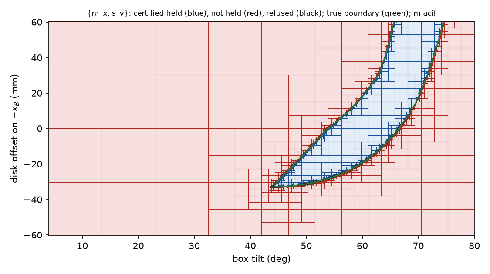

## Why

The [hold gate](hold-gate.qmd) solves a small linear program at one pose.
Everything around it samples: the transition sweep tests a grid of poses,
the realizer's target χt is the best of five disk placements, and a
transport checks poses along the push. A sampled test can step over a thin
region where the box holds, and between its samples it proves nothing.

The certificate decides a whole box of parameters at once, here the box's
tilt θ and the disk's offset h along the face, with finitely many linear
programs and exact arithmetic where it matters.

## How

1. **Enclose the data.** Over a box, every entry of the hold program's
   matrices lies in an interval. Interval arithmetic
   ([immrax](https://github.com/gtfactslab/immrax), mean-value form)
   computes these intervals, widened outward for rounding.
2. **Inside: Rohn's theorem.** The interval system has a nonnegative
   solution at *every* pose of the box if each of its 27 = 128
   "vertex" systems does (Rohn; the test behind wrench-feasible workspaces
   of cable robots, Gouttefarde, Daney and Merlet 2011). Each vertex's
   margin comes from a float32 witness whose residual is bounded
   rigorously, so the conclusion is exact.
3. **Outside: a separator.** One vector, checked in rational arithmetic,
   proves that no pose in the box can hold.
4. **Split the rest**, down to a declared minimum width; what is still
   undecided is refused, a thin band along the true boundary.

## The pivot

After the pivot, breaking gv leaves the disk and the step
corner, {mx, sv}, to hold the box.

{.lightbox}

No decided box disagrees with the real gate (5 × 5 points in each, every
apparent violation re-solved in float64 by HiGHS). Held tilts: 44.4° to
74.4°, as on the [pivot map](hold-gate.qmd#pivot).

## The contacts must not change inside the box

The hold program assumes a fixed set of contacts. A planner edge also needs
the recognizer to read the same formation, {mx, gv,
sv}, at every pose of the box, with no tie. If the step corner
slides off the face, or the disk comes within a few millimeters of a box
corner, the program answered a question about contacts that are not there.

The recognizer's own rules (gaps against εon, relative
interiors, the parallel test) become four interval conditions here: the
tilt stays clear of the parallel angle θe, the step corner stays
inside the face (θ < 75.40°), the disk stays at least 5.7 mm from the
face's corners (|h| ≤ 56.82 mm), and every other contact stays at least
εon away. On 74,115 grid poses they agree with the real
recognizer exactly.

**Rounding.** The recognizer runs in float32, so at an exact boundary it
can disagree with exact arithmetic. Every threshold is moved by a bound on
the float32 error: 0.6 µm for gaps, from a check of *every* float32 tilt
(1,070,141,404 values) through the real angle computation on each machine
the planner runs on, plus a rounding analysis of the rest. The bound
differs by processor (the sine's error is 9.4·10−8 on the local
Ryzen and 1.32·10−7 on Ganymede2's EPYC), so the largest is used.

{.lightbox}

## What the sampled pieces miss

With the certificate as the reference:

| Piece | Against the certificate |
|---|---|
| Pointwise gate, 106 random poses | admits nothing that cannot hold; refuses 5 that can (float32 failures of one exit program) |
| Transition sweep, 2,520 starting poses | never hands over a pose that cannot hold; **21 refusals** with a certified-held pose in its own reach |
| The five placements of χt | at **10–15 tilts** none of the five holds while a held interval exists (44°–47°, 73°–74.5°); elsewhere a median 29% of the margin is lost |

The sampled pieces fail by refusing, never by admitting: they are safe but
incomplete.

## Certified placement

A branch and bound over the offset h finds a placement whose margin is
certified within 10−3 of the best, with an upper bound from the
interval system's relaxation made rigorous by weak duality (an exactly
checked dual). On 153 tilts it agrees with a 2,001-point search to
6.8·10−4, in about 106 boxes and 4–5 s per tilt.

| Tilt | Best h (mm) | Certified margin | Held offsets (mm) | Five placements |
|---|---|---|---|---|
| 45° | −31.3 | 0.025 | −32.8 … −29.3 | none held |
| 55° | −13.9 | 0.250 | −27.1 … +2.9 | best 0.081 |
| 60° | −1.0 | 0.368 | −19.1 … +18.3 | held |
| 70° | +42.6 | 0.593 | +17.7 … +60.5 | held |
| 74° | +60.5 | 0.138 | +54.0 … +60.5 | none held |

## What is next

Transports (certifying the hold along a push instead of at sampled poses,
which also removes the fixed transport range) are being built; then the
certified placement goes into the search in place of the five points.
The details, derivations and all runs are in the technical report,
Chapter 15.
