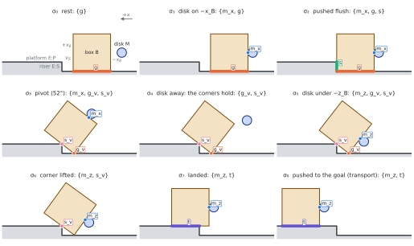

## Why

The [hold gate](hold-gate.qmd) solves a small linear program at one pose.
Everything around it samples: the transition sweep tests a grid of poses,
the realizer's target χt is the best of five disk placements, and a
transport checks poses along the push. A sampled test can step over a thin
region where the box holds, and between its samples it proves nothing.

The certificate decides a whole box of parameters at once, here the box's
tilt θ and the disk's offset h along the face, with finitely many linear
programs and exact arithmetic where it matters.

## How

1. **Enclose the data.** Over a box, every entry of the hold program's
   matrices lies in an interval. Interval arithmetic
   ([immrax](https://github.com/gtfactslab/immrax), mean-value form)
   computes these intervals, widened outward for rounding.
2. **Inside: Rohn's theorem.** The interval system has a nonnegative
   solution at *every* pose of the box if each of its 27 = 128
   "vertex" systems does (Rohn; the test behind wrench-feasible workspaces
   of cable robots, Gouttefarde, Daney and Merlet 2011). Each vertex's
   margin comes from a float32 witness whose residual is bounded
   rigorously, so the conclusion is exact.
3. **Outside: a separator.** One vector, checked in rational arithmetic,
   proves that no pose in the box can hold.
4. **Split the rest**, down to a declared minimum width; what is still
   undecided is refused, a thin band along the true boundary.

## The pivot

After the pivot, breaking gv leaves the disk and the step
corner, {mx, sv}, to hold the box.

{.lightbox}

No decided box disagrees with the real gate (5 × 5 points in each, every
apparent violation re-solved in float64 by HiGHS). Held tilts: 44.4° to
74.4°, as on the [pivot map](hold-gate.qmd#pivot).

## The contacts must not change inside the box

The hold program assumes a fixed set of contacts. A planner edge also needs
the recognizer to read the same formation, {mx, gv,
sv}, at every pose of the box, with no tie. If the step corner
slides off the face, or the disk comes within a few millimeters of a box
corner, the program answered a question about contacts that are not there.

The recognizer's own rules (gaps against εon, relative
interiors, the parallel test) become four interval conditions here: the
tilt stays clear of the parallel angle θe, the step corner stays
inside the face (θ < 75.40°), the disk stays at least 5.7 mm from the
face's corners (|h| ≤ 56.82 mm), and every other contact stays at least
εon away. On 74,115 grid poses they agree with the real
recognizer exactly.

**Rounding.** The recognizer runs in float32, so at an exact boundary it
can disagree with exact arithmetic. Every threshold is moved by a bound on
the float32 error: 0.6 µm for gaps, from a check of *every* float32 tilt
(1,070,141,404 values) through the real angle computation on each machine
the planner runs on, plus a rounding analysis of the rest. The bound
differs by processor (the sine's error is 9.4·10−8 on the local
Ryzen and 1.32·10−7 on Ganymede2's EPYC), so the largest is used.

{.lightbox}

## What the sampled pieces miss

With the certificate as the reference:

| Piece | Against the certificate |
|---|---|
| Pointwise gate, 106 random poses | admits nothing that cannot hold; refused 5 that can (float32 failures of one exit program), 0 since the gate's margin became a certified bound (Nov 11) |
| Transition sweep, 2,520 starting poses | never hands over a pose that cannot hold; **21 refusals** with a certified-held pose in its own reach |
| The five placements of χt | at **10–15 tilts** none of the five holds while a held interval exists (44°–47°, 73°–74.5°); elsewhere a median 29% of the margin is lost |

The sampled pieces fail by refusing, never by admitting: they are safe but
incomplete.

## Certified placement

In the code behind the search option `chi_t_rule="certified"`, off by
default: it is sound (none of 316 certified placements overstates the float64
margin) but changes no outcome yet, because 72% of the lift's placements put
the disk on a box corner, which the box certificate does not cover.

A branch and bound over the offset h finds a placement whose margin is
certified within 10−3 of the best, with an upper bound from the
interval system's relaxation made rigorous by weak duality (an exactly
checked dual). On 153 tilts it agrees with a 2,001-point search to
6.8·10−4, in about 106 boxes and 4–5 s per tilt.

| Tilt | Best h (mm) | Certified margin | Held offsets (mm) | Five placements |
|---|---|---|---|---|
| 45° | −31.3 | 0.025 | −32.8 … −29.3 | none held |
| 55° | −13.9 | 0.250 | −27.1 … +2.9 | best 0.081 |
| 60° | −1.0 | 0.368 | −19.1 … +18.3 | held |
| 70° | +42.6 | 0.593 | +17.7 … +60.5 | held |
| 74° | +60.5 | 0.138 | +54.0 … +60.5 | none held |

## Sliding changes what "held" means

The hold test asks whether *some* forces inside the friction cones balance
gravity. That is enough for a box at rest, but not along a motion. Under
Coulomb's law a contact that **slides** carries exactly one force, on the
edge of its friction cone opposite the slip; only a contact that **sticks**
may use its whole cone. On the step, the box's floor corner and its face on
the step corner must slide whenever the box tilts, and the disk, which
cannot rotate, slides along the face unless it moves down at exactly the
rate that cancels the slip.

So a plan is not just a path of poses: it is a **stick–slip plan**, a path
through poses cut into segments at pauses, saying which contacts stick and
which slide (and which way) on each segment. It is indexed by the path, not
by time: a quasi-static motion can run a segment at any speed.

**Theorem S** (paper §IX, full proof in its appendix): if an edge has a
*certified* stick–slip plan (on boxes covering the plan, the contacts stay
the same, the hold is certified with the forces Coulomb's law leaves for
each segment, nothing overlaps, and the disk stays in its workspace), then
a motion consistent with rigid bodies, Coulomb friction and quasi-static
balance carries the edge out, from every start in a tube around the plan.
Together with the earlier result that the gate never refuses a realizable
edge, the certified gate accepts only edges that can be carried out.

{.lightbox}

## The indirect lift

The strategy we want the planner to find on its own, from the scene alone,
is the **indirect lift**: tip the box onto the step corner until it rests on
its two corners, let the disk walk round to the box's raised underside, then
lift the corner and roll the box onto the platform. The box is held at every
instant; no throw or release is needed.

{.lightbox}

**What is certified.** The last four edits of the indirect lift,
break(mx), make(mz), break(gv) and the roll
sv → t, and the transport that closes it, each have a certified
stick–slip plan, so Theorem S applies to them for **every disk friction
μ ∈ [0.3, 0.5]**, in a tube of 0.25° × 0.5 mm around the plan. The plan
starts at a 30° tilt with the disk 40 mm below the centre of the box's −x
face.

**What is not.** The first three edits, make(mx), make(s) and
the pivot, and the tilt from the pivot's end to 30°, have no certified plan.

The animation below moves the box and the disk through the plan's poses
(it is a plan, not a simulation). Each frame is labelled with the formation
the float32 recognizer reads there, and with whether that segment is
certified.

<video src="media/plan_animation_from_rest.mp4" controls muted playsinline preload="metadata" width="100%"></video>

*The indirect lift from the box at rest. The prefix (approach, push to the
riser, the pivot to 30°) is marked "NOT yet certified"; from 30° on, every
segment is certified for every μdisk ∈ [0.3, 0.5]. The caption
under the box says which contacts stick and which slide on the current
segment.*

The planner's own run of this chain in simulation is on
[The planner runs the indirect lift from rest](../results/indirect-lift.qmd).

## What is next

- **Stick–slip plans inside the realizer.** The gate stays at the hold
  level (it certifies that *some* forces hold the box, a relaxation of
  Coulomb realizability, so it never refuses a realizable edge). The
  realizer Λqs is to plan stick–slip plans: on each segment each
  contact sticks or slides, the kinematics and the force program agree, and
  the feed-forward is the least squeeze inside those cones. See
  [the local solver](local-solver.qmd#lambda-qs) for why its present plans
  fall short.
- **A polynomial certificate for large regions.** With c = cos θ and
  s = sin θ on c² + s² = 1, the hold program's data are polynomials of
  degree at most 3. A polynomial witness with a sum-of-squares positivity
  proof certifies "held" over a whole region, and a polynomial Farkas
  multiplier certifies "not held", without splitting into boxes. It also
  covers disk placements on a box corner, which the box certificate does
  not (the corner's normal turns with the placement). First prototype: the
  pivot, one parameter.
- **An online tube certificate.** Along Λqs's receding horizon,
  certify the tube of the next segment from the measured state before
  executing it, and otherwise shorten it, re-plan or refuse. This extends
  the realizer's check from the plan's knots to whole segments.

The details, derivations and all runs are in the technical report,
Chapter 15.
