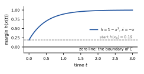
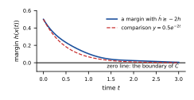
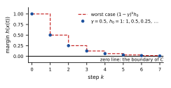
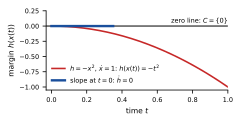
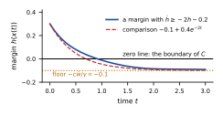

```{=html}
<style>
/* Set the theorem environments of this page apart; translucent tints read on light and dark themes. */
#quarto-document-content div.theorem { border-left: 3px solid rgba(26, 79, 156, .6); background: rgba(26, 79, 156, .06);
  padding: .55em .9em; margin: 1em 0; border-radius: 0 .25rem .25rem 0; }
#quarto-document-content div.theorem.definition { border-left-color: rgba(46, 125, 50, .7); background: rgba(46, 125, 50, .06); }
#quarto-document-content div.theorem.example { border-left-color: rgba(127, 127, 127, .6); background: rgba(127, 127, 127, .07); }
#quarto-document-content div.theorem > p:last-child { margin-bottom: 0; }
#quarto-document-content div.proof { border-left: 2px dashed rgba(127, 127, 127, .6); padding: .1em .9em; margin: 1em 0; }
#quarto-document-content div.proof::after { content: "\220E"; display: block; text-align: right; }
</style>
```

**Before this page:** [interval arithmetic](interval-arithmetic.qmd),
[zonotopes](zonotopes.qmd) and [certified funnels and
composition](funnel-composition.qmd). Its companion is [dissipation
(passivity) certificates](passivity-certificates.qmd): a storage function
bounds an energy from above, a barrier function bounds a margin from below.
The terminology: the **block** is the manipulated object; a **box** is only
an interval box (a product of intervals).

**Who this is for.** You know state-space control and Lyapunov functions.
This page builds control barrier functions (CBFs) from one idea, proves the
results it uses, relates them to Lyapunov functions, works one example by
hand, and ends with a reading list.

## 1. Safety as set invariance

**Intuition.** "Safe" usually means "never leaves a region": the block never
reaches the wall, a normal force never drops below a floor, a tilt never
exceeds a bound. Write the region as the set where a scalar **margin** is
nonnegative. Safety then says: a motion that starts with a nonnegative
margin keeps it nonnegative forever.

**The setting.** Take a system $\dot x=f(x)$ with state
$x\in\mathbb R^n$, and a continuously differentiable function
$h:\mathbb R^n\to\mathbb R$. The **safe set** is

$$
C=\{x:\ h(x)\ge 0\},\qquad \partial C=\{x:\ h(x)=0\},\qquad \operatorname{Int}C=\{x:\ h(x)>0\}.
$$ {#eq-safe-set}

The last two equalities need $\nabla h\neq0$ where $h=0$; @exm-counterexample
shows what goes wrong without it.

::: {#def-forward-invariance}
## Forward invariance
In plain words: every motion that starts in $C$ stays in $C$. Formally, $C$
is **forward invariant** if for every $x_0\in C$ the solution with
$x(0)=x_0$ satisfies $x(t)\in C$ for all $t\ge0$ for which it exists.
:::

::: {#exm-invariance}
## Invariant or not
Let $h(x)=1-x^2$, so $C=[-1,1]$. With $\dot x=-x$, every motion decays
toward 0 and never leaves $[-1,1]$: $C$ is forward invariant. With
$\dot x=+x$, the motion from $x_0=0.5$ reaches $x=1$ at $t=\ln2$ and
leaves: not invariant.
:::

**Nagumo's theorem** is the exact test, and it looks only at the boundary.

::: {#thm-nagumo}
## Nagumo [@nagumo1942lage; @blanchini1999set]
Suppose $\dot x=f(x)$ has a unique solution from every initial state. A
closed set $C$ is forward invariant if and only if $f(x)\in T_C(x)$ at every
$x\in\partial C$.
:::

Here $T_C(x)$ is the (Bouligand) **tangent cone**: the directions $d$ with
$\liminf_{\tau\downarrow0}\operatorname{dist}(x+\tau d,C)/\tau=0$, that is,
the directions in which one can move from $x$ while leaving $C$ by less
than first order. If $h$ is continuously differentiable and
$\nabla h(x)\neq0$, then $T_C(x)=\{d:\nabla h(x)\cdot d\ge0\}$, and the test
reads

$$
\dot h(x)=\nabla h(x)\cdot f(x)\;\ge\;0\qquad\text{for every }x\in\partial C .
$$ {#eq-nagumo}

Uniqueness matters: without it, the tangent condition guarantees only that
*some* solution stays in $C$.

## 2. From barrier certificates to control barrier functions

### Barrier certificates: verification, no input

Prajna and Jadbabaie [@prajna2004safety] asked a verification question:
given $\dot x=f(x,d)$ with a disturbance $d$, an initial set $X_0$ and an
unsafe set $X_u$, can any motion get from $X_0$ to $X_u$? A **barrier
certificate** is a function $B$ with

$$
B(x)\le0\ \text{on } X_0,\qquad B(x)>0\ \text{on } X_u,\qquad
\nabla B(x)\cdot f(x,d)\le0\ \text{for all } x,d .
$$ {#eq-barrier-certificate}

$B$ never increases, so it can never climb from $\le0$ to $>0$: no motion
from $X_0$ reaches $X_u$. With $h=-B$ this is "$\dot h\ge0$ everywhere",
@prp-barrier-certificate. They searched for $B$ by sums-of-squares
programming, and the journal version adds a stochastic certificate (a
supermartingale) [@prajna2007framework]. There is no input: the controller,
if any, is already inside $f$.

### Control barrier functions: synthesis, with an input

With a control-affine system

$$
\dot x=f(x)+g(x)\,u,\qquad u\in U\subseteq\mathbb R^m ,
$$ {#eq-control-affine}

the derivative of $h$ depends on the input:
$\dot h=L_fh(x)+L_gh(x)\,u$, with the **Lie derivatives**
$L_fh=\nabla h\cdot f$ (a scalar) and $L_gh=\nabla h\cdot g$ (a row of $m$
numbers). The question changes from "is the system safe?" to "is there an
input that keeps it safe?". Wieland and Allgöwer first proposed the
control barrier function [@wieland2007constructive], by analogy with the
control Lyapunov function; Ames, Grizzle and Tabuada turned it into the
quadratic program used today [@ames2014cbfqp; @ames2017cbfqp].

::: {#def-class-k}
## Extended class-$\mathcal K$ function
In plain words: a continuous, strictly increasing function through the
origin that is also defined for negative arguments. Formally,
$\alpha:(-b,a)\to\mathbb R$ with $a,b>0$, continuous, strictly increasing,
and $\alpha(0)=0$. The everyday choice is $\alpha(h)=\gamma h$ with
$\gamma>0$.
:::

::: {#def-cbf}
## Zeroing control barrier function [@ames2017cbfqp; @ames2019cbf]
Let $h$ be continuously differentiable, $C=\{h\ge0\}$, and $D\supseteq C$
an open set. $h$ is a **control barrier function** on $D$ if there is an
extended class-$\mathcal K$ function $\alpha$ such that

$$
\sup_{u\in U}\big[\,L_fh(x)+L_gh(x)\,u\,\big]\;\ge\;-\alpha\big(h(x)\big)\qquad\text{for every } x\in D .
$$ {#eq-cbf}

The admissible inputs at $x$ form
$$
K_{\rm cbf}(x)=\{u\in U:\ L_fh(x)+L_gh(x)u\ge-\alpha(h(x))\}.
$$
:::

The claim, proved as @prp-zeroing: any locally Lipschitz feedback
$u(x)\in K_{\rm cbf}(x)$ keeps $C$ forward invariant.

**Read the condition.** Inside $C$, $h>0$ and $\alpha(h)>0$, so $h$ may
decrease, but no faster than $\alpha(h)$. On the boundary, $\alpha(0)=0$,
so $\dot h\ge0$, which is Nagumo's condition @eq-nagumo. Outside $C$,
$\alpha(h)<0$, so $h$ must increase: the state is pushed back.

**Why the $\alpha(h)$ form.** The earlier conditions were "$\dot h\ge0$
everywhere" (barrier certificates) or its reciprocal analogue, and Ames et
al. note both are too restrictive in the interior of $C$
[@ames2017cbfqp]: they freeze every level set of $h$, so a controller may
never spend margin, even far from the boundary. Two forms relax this.

- The **reciprocal** form uses $B=1/h$, which blows up at the boundary,
  with a condition like $\dot B\le\gamma/B$ [@ames2014cbfqp]. $B$ is not
  defined outside $C$, and the constraint becomes ill-conditioned near
  $\partial C$.
- The **zeroing** form @eq-cbf is defined on an open $D$ that reaches
  outside $C$. It makes $C$ asymptotically stable as well as invariant, and
  that is the source of its robustness: a small disturbance that pushes the
  state out is pushed back [@xu2015robustness; @ames2017cbfqp]. It is the
  form used almost everywhere now, and on the rest of this page.

## 3. Why it works: the invariance proofs

**Standing assumptions.** Every result below uses these.

- **The system.** $\dot x=f(x)$ with $f$ locally Lipschitz. For the CBF
  case, $f$ is the closed loop $f(x)+g(x)u(x)$, and the feedback $u(x)$ is
  locally Lipschitz too (Remark 2 below says when the CBF-QP's feedback is).
- **Unique solutions.** Local Lipschitz continuity gives, for each $x_0$, a
  unique solution $x(t)$ on a maximal interval $[0,T)$. "For all $t$"
  below means all $t\in[0,T)$; whether $T=\infty$ is a separate question.
- **The margin.** $h$ is continuously differentiable, and
  $\dot h(x):=\nabla h(x)\cdot f(x)$. Along a solution, the chain rule
  makes $m(t)=h(x(t))$ continuously differentiable, with
  $\dot m(t)=\dot h(x(t))$.

**Two tools.**

::: {#def-exit-time}
## First exit time
In plain words: the last moment up to which a motion has stayed in $C$ the
whole time. Formally,
$$
t^*=\sup\{\tau\in[0,T):\ x(s)\in C\text{ for all } s\in[0,\tau]\}.
$$
If $C$
is not forward invariant, some motion from $C$ has $t^*<T$, and there are
times just after $t^*$ at which it is outside $C$.
:::

::: {#lem-comparison}
## Comparison lemma
In plain words: if a quantity always grows at least as fast as the solution
of a reference scalar equation would at the same value, and starts no
lower, it stays no lower. Formally, let $\dot y=\varphi(y)$ with $\varphi$
locally Lipschitz have the solution $y(t)$ on $[0,T_1)$. If a continuously
differentiable $m$ satisfies $\dot m(t)\ge\varphi(m(t))$ and $m(0)\ge y(0)$,
then $m(t)\ge y(t)$ on $[0,T_1)$. This is Khalil's Lemma 3.4
[@khalil2002nonlinear], stated there for upper bounds and applied here to
$-m$.
:::

### The margin never decreases

::: {#prp-barrier-certificate}
## Barrier certificate
Let $D$ be an open set containing $C$. If $\dot h(x)\ge0$ for every
$x\in D$, then $C$ is forward invariant.
:::

{width=60%}

**Intuition.** The margin can never shrink, so it can never fall from
$\ge0$ to $<0$.

::: {.proof}
Take $x_0\in C$ and suppose, for a contradiction, that the motion leaves $C$.

1. *First exit time.* Then $t^*<T$, and every interval $(t^*,t^*+\delta)$
   contains times at which $x(t)\notin C$.
2. *Continuity, and $C$ closed.* $x(t)\in C$ for $t<t^*$, $x$ is continuous,
   and $C=\{h\ge0\}$ is closed because $h$ is continuous. So $x(t^*)\in C$.
3. *$D$ open, continuity.* $x(t^*)\in C\subseteq D$ and $D$ is open, so for
   some $\varepsilon>0$, $x(t)\in D$ for all $t\in[0,t^*+\varepsilon)$.
4. *Monotonicity.* On that interval $\dot m(t)=\dot h(x(t))\ge0$, so
   $m(t)\ge m(0)=h(x_0)\ge0$: $x(t)\in C$ on $[0,t^*+\varepsilon)$.
5. *Contradiction.* Step 4 contradicts step 1 with $\delta=\varepsilon$.
:::

This is a Lyapunov argument: $V=-h$ never increases, so its sublevel set
$\{V\le0\}=C$ is invariant, exactly as the sublevel sets of a Lyapunov
function are (§4 makes this precise). Step 3 is why the condition must hold
on an open $D$ and not only on $C$; @exm-counterexample shows that the step
cannot be skipped.

::: {#exm-p1}
## Check @prp-barrier-certificate by hand
$\dot x=-x$ and $h=1-x^2$ give $\dot h=-2x\dot x=2x^2\ge0$ on all of
$\mathbb R$. From $x_0=0.9$, $h(x_0)=0.19$. At $t=1$, $x=0.9e^{-1}=0.331$
and $h=1-0.81e^{-2}=0.890\ge0.19$.
:::

### The margin may shrink, but not past zero

::: {#prp-zeroing}
## Zeroing barrier function
Let $\alpha$ be extended class-$\mathcal K$ and locally Lipschitz, and $D$
an open set containing $C$. If $\dot h(x)\ge-\alpha(h(x))$ for every
$x\in D$, then $C$ is forward invariant. For the closed loop $f+gu(x)$,
this proves that a locally Lipschitz $u(x)\in K_{\rm cbf}(x)$ keeps $C$
safe.
:::

{width=60%}

**Intuition.** $h$ is a distance-like margin to the unsafe set. The
condition says the margin may shrink, but never faster than $\alpha(h)$,
and $\alpha(0)=0$ means it stops shrinking exactly at the boundary.

::: {.proof}
Take $x_0\in C$.

1. *The comparison system.* Let $y(t)$ solve $\dot y=-\alpha(y)$ with
   $y(0)=h(x_0)\ge0$.
2. *Uniqueness: zero is a floor.* Since $\alpha(0)=0$, the constant
   $y\equiv0$ is a solution. $\alpha$ is locally Lipschitz, so solutions are
   unique, and two different solutions can never meet. So if $y(0)>0$, then
   $y(t)>0$ for all $t$, and if $y(0)=0$, then $y\equiv0$. Either way
   $y(t)\ge0$. It exists for all $t\ge0$: while $y>0$, $\dot y<0$, so $y$
   stays in $[0,y(0)]$.
3. *First exit time, $D$ open.* Suppose the motion leaves $C$. As in steps
   1–3 of the proof of @prp-barrier-certificate, $t^*<T$, $x(t^*)\in C$, and
   $x(t)\in D$ on $[0,t^*+\varepsilon)$.
4. *Comparison.* On that interval, $\dot m\ge-\alpha(m)$ and $m(0)=y(0)$, so
   @lem-comparison with $\varphi=-\alpha$ gives $m(t)\ge y(t)\ge0$.
5. *Contradiction.* So $x(t)\in C$ on $[0,t^*+\varepsilon)$, against the
   definition of $t^*$.
:::

**Remark 1 (where the condition bites).** In the interior, $\alpha(h)>0$,
so the condition allows $\dot h<0$: the controller may spend margin. Only
at the boundary does it demand $\dot h\ge0$. This is what makes the
zeroing form less restrictive than @prp-barrier-certificate.

**Remark 2 (the feedback must be Lipschitz).** The proof needs unique
closed-loop solutions. Suppose $f$, $g$, $\nabla h$, $\alpha$ and the
nominal controller are locally Lipschitz, and $L_gh(x)\neq0$. Then the
single-constraint CBF-QP of §5 has the closed form @eq-qp-closed. It is
built from Lipschitz operations ($\max(0,\cdot)$, products, and division by
$\lVert L_gh\rVert^2$ away from zero), so its feedback is locally
Lipschitz. Ames et al. prove the same for the QP that combines a CBF with a
control Lyapunov function, under this relative-degree-one condition
[@ames2017cbfqp, Thm. 3]. They also note that once input bounds are added
as further QP constraints, Lipschitz continuity is no longer assured.

::: {#exm-p2}
## Check @prp-zeroing by hand
With $\alpha(h)=2h$ and $h(x_0)=0.5$, the bound is $h(t)\ge0.5e^{-2t}$.
That is $0.068$ at $t=1$ and $0.0012$ at $t=3$: shrinking, never negative.
The bound reaches zero only as $t\to\infty$, so a filtered motion
approaches the boundary without touching it in finite time. Run B of
@exm-wall shows this.
:::

### Discrete time: the form a time-stepped certifier uses

::: {#prp-discrete}
## Discrete-time barrier function
Let $x_{k+1}=F(x_k)$, and $\gamma\in(0,1]$. If

$$
h(F(x))-h(x)\;\ge\;-\gamma\,h(x)\qquad\text{for every }x\in C,
$$ {#eq-dcbf}

then from any $x_0\in C$, $h(x_k)\ge(1-\gamma)^k\,h(x_0)\ge0$ for all
$k\ge0$.
:::

{width=60%}

**Intuition.** Each step may spend at most the fraction $\gamma$ of the
margin it has, and spending a fraction of something nonnegative leaves
something nonnegative.

::: {.proof}
1. *Rearrange.* At $x_k\in C$, @eq-dcbf reads
   $h(x_{k+1})\ge(1-\gamma)\,h(x_k)$.
2. *Induction, base.* $h(x_0)=(1-\gamma)^0h(x_0)$ and $h(x_0)\ge0$.
3. *Induction, step.* If $h(x_k)\ge(1-\gamma)^kh(x_0)\ge0$, then
   $x_k\in C$, so step 1 applies. Since $1-\gamma\ge0$,
   $$
   h(x_{k+1})\ge(1-\gamma)h(x_k)\ge(1-\gamma)^{k+1}h(x_0)\ge0.
   $$
:::

Nothing in the proof needs continuity, differentiability or Lipschitz
constants. $F$ may be a simulator step or a step with an impact in it, and
$h$ may have kinks. Nor does the condition need an open $D$: a step lands
where it lands, and @eq-dcbf at $x_k$ bounds $h$ there directly. This is
Agrawal and Sreenath's discrete-time CBF [@agrawal2017discrete]. With an
input, $F(x,u)$, the condition is a constraint on $u$, but in general no
longer an affine one (§7).

::: {#exm-p3}
## Check @prp-discrete by hand
$\gamma=0.5$, $h_0=1$: the bound is $1, 0.5, 0.25, 0.125,\dots$, never
negative. If $\gamma>1$ were allowed, say $\gamma=1.5$, the bound would read
$1,-0.5,\dots$: unsafe after one step. That is why $\gamma\le1$. With
$\gamma=1$, the condition is just "the next state is safe".
:::

### A counterexample: why the boundary-only condition needs care

::: {#exm-counterexample}
## The gradient test can be fooled
Let $h(x)=-x^2$, so $C=\{0\}$, and $\dot x=1$. Then $\dot h\ge0$ at every
point of $C$, yet the motion from $x_0=0$ leaves $C$ at once.
:::

{width=60%}

**Why the intuition breaks.** The margin $h=-x^2$ has zero slope at the
boundary, so "$\dot h\ge0$ at the boundary" says nothing there.

1. *The condition holds on $C$.* $\dot h=-2x\cdot1=-2x$, which is $0\ge0$
   at $x=0$, the only point of $C$.
2. *The motion leaves.* $x(t)=t$, so $h(x(t))=-t^2<0$ for every $t>0$.
3. *What failed.* $\nabla h(0)=0$. @prp-barrier-certificate asks for
   $\dot h\ge0$ on an open $D\ni0$, and that fails: at any $x>0$,
   $\dot h=-2x<0$. Step 3 of its proof is the step this example breaks.
4. *What Nagumo says.* A single point's tangent cone is $T_C(0)=\{0\}$, and
   $f=1\notin T_C(0)$, so @thm-nagumo correctly says "not invariant". The
   gradient form @eq-nagumo is only valid where $\nabla h\neq0$.

### With a bounded disturbance

::: {#prp-robust}
## Robust margin, input-to-state safety
Let $\dot x=f(x)+g(x)u+p(x)w$ with $\lVert w(t)\rVert\le\bar w$, and
$c=\sup_{x\in D}\lVert\nabla h(x)\,p(x)\rVert$. Suppose the feedback meets
the nominal condition $L_fh+L_ghu\ge-\gamma h$ on $D$. Then every disturbed
motion has $\dot h\ge-\gamma h-c\bar w$, and the slightly inflated set
$C_w=\{h\ge-c\bar w/\gamma\}$ is forward invariant (when $C_w\subseteq D$).
:::

{width=60%}

**Intuition.** The disturbance can steal at most $c\bar w$ of margin per
unit time, and the barrier condition restores $\gamma h$, so the two balance
at $h=-c\bar w/\gamma$.

::: {.proof}
$\tilde h=h+c\bar w/\gamma$ satisfies $\dot{\tilde h}=\dot h\ge-\gamma\tilde h$,
so @prp-zeroing applies to $\tilde h$. Its proof uses only this inequality
along the motion, so a time-varying $w(t)$ is fine.
:::

To keep $C$ itself, demand the margin up front:
$L_fh+L_ghu\ge-\gamma h+c\bar w$. For general $\alpha$, and for choosing the
margin as a function of $L_gh$, see input-to-state safety
[@kolathaya2019issf] and the robustness of zeroing CBFs
[@xu2015robustness; @jankovic2018robust]; this page states the linear case
only.

::: {#exm-p5}
## Check @prp-robust by hand
$\gamma=2$, $c\bar w=0.2$: the floor is $-0.1$. A motion with $h(0)=0.3$
satisfies $h(t)\ge-0.1+0.4e^{-2t}$.
:::

## 4. Lyapunov functions and barrier functions: the same idea, two jobs

**The question.** A Lyapunov function has $\dot V\le0$; a barrier function
has $\dot h\ge0$. One decreases, the other increases. How do the two fit?

### The sign is only a convention

| | Lyapunov | Barrier |
|---|---|---|
| Good region | a sublevel set $\{V\le c\}$ | a superlevel set $\{h\ge0\}$ |
| Condition | $\dot V\le0$ | $\dot h\ge0$, or $\dot h\ge-\alpha(h)$ |
| In words | $V$ never climbs toward the edge | $h$ never falls toward the edge |

: The sign is only a convention {#tbl-sign}

The sign says which side of a level set is good. Flip it:

$$
h=c-V\qquad\Longrightarrow\qquad \dot h=-\dot V,
$$ {#eq-flip}

and "$\dot V\le0$" becomes "$\dot h\ge0$". Both say the same thing: the
scalar never moves toward the boundary of the good set.

### Lyapunov gives barriers for free

::: {#prp-lyapunov-barrier}
## Lyapunov gives barriers for free
Let $V$ be continuously differentiable with $\dot V(x)=\nabla V(x)\cdot f(x)\le0$
for every $x\in\mathbb R^n$. Then every sublevel set $\{V\le c\}$ is
forward invariant.
:::

::: {.proof}
Fix $c$ and let $h_c=c-V$. Then $\{h_c\ge0\}=\{V\le c\}$, and by
@eq-flip, $\dot h_c=-\dot V\ge0$ on $\mathbb R^n$, which is an open set
containing $\{h_c\ge0\}$. @prp-barrier-certificate applies.
:::

One Lyapunov function hands you a whole nested family of safe sets, one per
level $c$. The proof never used $V\ge0$ or an equilibrium; those matter for
convergence, not for invariance.

### The converse fails

{width=95%}

A barrier function does not give a Lyapunov function back.

- **One set, no convergence.** A barrier certifies one set, and says nothing
  about where motions go inside it.
- **No equilibrium.** The set need not contain an equilibrium at all, and
  $h$ is sign-indefinite: positive inside, negative outside.
- **Binding only at the boundary.** The CBF condition @eq-cbf lets $h$
  *decrease* inside $C$ (the state may drift toward the boundary) and forces
  $\dot h\ge0$ only where $h=0$, because $\alpha(0)=0$.

In Lyapunov form, with $h=c-V$, the zeroing condition reads

$$
\dot V\;\le\;\alpha\big(c-V\big).
$$ {#eq-cbf-lyap}

This is the Lyapunov condition, relaxed in the interior ($V<c$ allows
$\dot V>0$) and enforced on the level set $\{V=c\}$.

### Side by side

::: {.table-responsive}

| | Control Lyapunov function (CLF) | Control barrier function (CBF) |
|---|---|---|
| Certifies | stability: convergence to an equilibrium or a set | safety: forward invariance of one set |
| Sign | $V\ge0$, positive definite about the target | $h$ sign-indefinite: $\ge0$ on $C$, $<0$ outside |
| Holds on | everywhere in the region of interest | an open neighbourhood of $C$; binding at $\partial C$ |
| Equilibrium needed | yes | no |
| Strict form | $\dot V\le-\alpha(V)$ | $\dot h\ge-\alpha(h)$ |
| Control version | $\inf_u\big[L_fV+L_gVu\big]\le-\alpha(V)$ | $\sup_u\big[L_fh+L_ghu\big]\ge-\alpha(h)$ |
| Discrete time | $V(x_{k+1})\le V(x_k)$ | $h(x_{k+1})\ge(1-\gamma)h(x_k)$ |
| Converse theorem | asymptotic stability implies a Lyapunov function exists [@massera1949liapounoff; @khalil2002nonlinear] | safety implies a barrier certificate exists, under conditions on the flow [@prajna2005necessity; @wisniewski2016converse] |
| Verification | sums of squares, LP, or set-based enclosures | the same: sums of squares, LP, or set-based enclosures |
| In the CLF–CBF QP | a soft constraint, with a slack | a hard constraint |

:::

: CLF and CBF side by side {#tbl-clf-cbf}

**The converse theorems.** For Lyapunov functions, Massera proved that
asymptotic stability implies the existence of a Lyapunov function
[@massera1949liapounoff]; Khalil's §4.7 collects the converse theorems
[@khalil2002nonlinear]. For barrier certificates, Prajna and Rantzer proved
necessity for flows with neither singular points nor closed orbits
[@prajna2005necessity]. Wisniewski and Sloth extended it to a class of
structurally stable systems with several singular elements, after
redefining safety to suit them [@wisniewski2016converse]. Safety alone is
not enough: the flow must be regular enough.

**The CLF–CBF quadratic program** [@ames2017cbfqp]. Both conditions are
affine in $u$, so one QP can carry both:

$$
\begin{aligned}
\min_{u,\,\delta}\quad & \tfrac12\lVert u-u_{\rm ref}\rVert^2+p\,\delta^2\\
\text{s.t.}\quad & L_fV+L_gV\,u\le-\alpha_V(V)+\delta &&\text{(stability, soft)}\\
& L_fh+L_gh\,u\ge-\alpha(h) &&\text{(safety, hard)}
\end{aligned}
$$ {#eq-clf-cbf-qp}

Stability is a *soft* constraint: the slack $\delta$, penalized by $p>0$,
lets it give way. Safety is *hard*. The order follows the stakes: when the
two conflict (the target lies beyond an obstacle), the controller should
give up progress, not safety. The slack also keeps the QP feasible whenever
the CBF constraint alone is (with $L_gh\neq0$). Ames et al.'s Lipschitz
result is stated for this relaxed form [@ames2017cbfqp, Thm. 3].

### What it means for this project

The storage function $S$ of the [dissipation
certificates](passivity-certificates.qmd) is Lyapunov-like with a supply:
$\dot S\le s-d$. With zero supply, it is a Lyapunov function. Its sublevel
sets are barrier sets through $h=c-S$ (@prp-lyapunov-barrier). So storage
and barrier are two jobs of one idea: the first proves that the block comes
to rest, the second proves where it can never go.

::: {#exm-tilt}
## The tilt: a bound, not a decrease
Take the tilt margin $h=\theta_{\max}-\theta$. A tilt barrier needs only
that the tilt never crosses its bound; it does not need the tilt to shrink.
During a support switch, the block may rock slightly, so the tilt grows a
little. A Lyapunov-style "the tilt decreases everywhere" would be false
there. The barrier condition $\dot h\ge-\alpha(h)$ still allows that growth
while margin remains, and binds only at $\theta=\theta_{\max}$. This
illustrates the idea; no result is claimed here.
:::

## 5. The CBF-QP safety filter

**Intuition.** Keep a controller you already trust for performance (the
**nominal** one), and change its output only when safety requires it, and
then as little as possible.

**The precise statement** [@ames2014cbfqp; @ames2017cbfqp]. At each state
$x$, apply

$$
u^*(x)=\arg\min_{u\in U}\ \tfrac12\lVert u-u_{\rm nom}(x)\rVert^2
\quad\text{s.t.}\quad L_fh(x)+L_gh(x)\,u+\alpha(h(x))\ge0 .
$$ {#eq-cbf-qp}

The constraint is affine in $u$, so with a polyhedral $U$ this is a
quadratic program: small, convex, and fast enough to solve at every control
step.

**One constraint, no input bounds: a closed form.** Write
$\psi(x)=L_fh+L_gh\,u_{\rm nom}+\alpha(h)$, the slack the nominal input
leaves. If $\psi\ge0$, the nominal input is already safe, and
$u^*=u_{\rm nom}$. Otherwise, project onto the constraint's half-space:

$$
u^*=u_{\rm nom}+\frac{\max\big(0,\,-\psi(x)\big)}{\lVert L_gh(x)\rVert^2}\,L_gh(x)^{\top}\qquad(L_gh\neq0).
$$ {#eq-qp-closed}

The filter is inactive far from the boundary, and it pushes only along
$L_gh^\top$, the input direction that changes $h$ fastest.

**Feasibility.**

- **No input bounds.** With $U=\mathbb R^m$ and $L_gh(x)\neq0$, the
  constraint can always be met. Where $L_gh(x)=0$, it is a condition on
  the state alone, and the QP is infeasible whenever it fails. That is the
  relative-degree problem of @exm-wall.
- **Input bounds.** With bounded $U$, the "$\sup_{u\in U}$" in @eq-cbf is
  the whole difficulty. A function that is a CBF for unbounded inputs may
  not be one for $\lVert u\rVert\le u_{\max}$: near the boundary, no
  admissible input can stop the decrease, and the QP becomes infeasible.
  Valid CBFs under input bounds must build the braking ability into $h$
  [@ames2017cbfqp; @breeden2021high]. Run C of @exm-wall shows it.
- **Several constraints.** Each may be satisfiable alone but not jointly,
  and the QP's Lipschitz continuity is then not assured [@ames2017cbfqp].

## 6. A worked toy: a block pushed toward a wall

::: {#exm-wall}
## A block pushed toward a wall
A block slides without friction on a line, at position $x$ and speed $v$.
It is driven by an acceleration $u$, and a wall stands at
$x_{\max}=100$ mm. The nominal controller pushes it toward the wall with
$u_{\rm nom}=0.5$ m/s². Safety: $h=x_{\max}-x\ge0$, with
$\dot x=v$, $\dot v=u$.
:::

**The first try fails: relative degree 2.** $\dot h=-v$ contains no $u$:
$L_gh=0$. The CBF condition $-v\ge-\gamma h$ is a condition on the state,
which the input cannot enforce at this instant. The input reaches $h$ only
through $\ddot h=-u$; $h$ has **relative degree 2**.

**The fix: an exponential (high-order) CBF** [@nguyen2016exponential;
@xiao2022high]. Make the barrier condition itself the new margin,

$$
h_1=\dot h+\lambda h=-v+\lambda(x_{\max}-x),
$$ {#eq-ecbf}

and impose a first-order CBF condition on $h_1$, which does contain $u$:

$$
\dot h_1+\lambda h_1\ge0\iff -u-\lambda v+\lambda(-v+\lambda h)\ge0
\iff u\le\lambda^2h-2\lambda v .
$$ {#eq-ecbf-condition}

By @prp-zeroing, $h_1\ge0$ is kept. And $h_1\ge0$ means
$\dot h\ge-\lambda h$, so @prp-zeroing again keeps $h\ge0$. The invariant
set is $C\cap\{h_1\ge0\}$: closer to the wall, the block must be slower,
$v\le\lambda(x_{\max}-x)$. Here the closed form @eq-qp-closed is simply
$u^*=\min\big(u_{\rm nom},\ \lambda^2h-2\lambda v\big)$.

**With numbers** ($\lambda=5$ s⁻¹, so $u\le 25h-10v$):

- **A, no filter, from $v_0=100$ mm/s.** The block hits the wall at
  $v=\sqrt{0.1^2+2(0.5)(0.1)}=332$ mm/s, at $t=(0.332-0.1)/0.5=463$ ms.
- **B, filtered, from $v_0=100$ mm/s.** At the start,
  $25(0.1)-10(0.1)=1.5>0.5$, so the filter is inactive. It switches on at
  $x=15.8$ mm, $v=161$ mm/s, where $25h-10v$ drops to $0.5$. It then brakes,
  at most $0.327$ m/s², and the block creeps toward the wall: $98.3$ mm
  after $1.2$ s, never reaching it.
- **C, filtered, with braking limited to $|u|\le a_{\max}=1$ m/s², from
  $v_0=480$ mm/s.** The start satisfies $h_1=-0.48+0.5=0.02\ge0$, but the
  filter asks for $u=2.5-4.8=-2.3$ m/s² at once. That is beyond the limit,
  so the QP is infeasible, and saturated braking hits the wall at
  $\sqrt{0.48^2-2(1)(0.1)}=174$ mm/s.

{width=100%}

**What C teaches.** From $v_0=480$ mm/s, the shortest stopping distance is
$v_0^2/(2a_{\max})=115.2$ mm $>100$ mm. No admissible input saves the
block, so $h_1$ is not a valid CBF for $|u|\le1$: its "$\sup_{u\in U}$"
fails near the wall at high speed. A barrier that knows the limit is the
braking margin

$$
h_b=x_{\max}-x-\frac{v\,|v|}{2a_{\max}},\qquad
\dot h_b=-v-\frac{|v|}{a_{\max}}\,u ,
$$ {#eq-braking}

which is continuously differentiable. For $v>0$, full braking
$u=-a_{\max}$ gives $\dot h_b=0\ge-\alpha(h_b)$, so the condition can
always be met within the limit. Its zero set is the green curve. The same
idea, a braking distance inside $h$, is the adaptive-cruise-control barrier
of [@ames2014cbfqp; @ames2017cbfqp]. A good choice of $h$ can remove both
the relative-degree problem ($L_gh_b\neq0$ for $v\neq0$) and the
input-bound problem. Making that choice is the hard part.

## 7. Practical extensions

Each item gives the problem and its key references.

- **High relative degree.** Exponential CBFs stack the derivatives
  $h,\dot h,\dots,h^{(r-1)}$ and place real poles by linear-system design
  [@nguyen2016exponential]. High-order CBFs chain class-$\mathcal K$
  functions, $\psi_i=\dot\psi_{i-1}+\alpha_i(\psi_{i-1})$, as @eq-ecbf did
  [@xiao2019high; @xiao2022high]. Input bounds with high relative degree
  are treated in [@breeden2021high], and mechanical systems with torque
  inputs and position limits in [@shawcortez2021grasping].
- **Disturbances and model error.** The zeroing form is robust: $C$ is
  asymptotically stable, so a perturbation only inflates it
  [@xu2015robustness]. Robust CBFs add worst-case margins
  [@jankovic2018robust]. Input-to-state safety bounds the inflation by a
  class-$\mathcal K$ function of the disturbance's size
  [@kolathaya2019issf], as in @prp-robust.
- **Discrete time and sampling.** The step condition @eq-dcbf
  [@agrawal2017discrete] is generally not affine in $u$, so the filter
  becomes a nonlinear program (a quadratically constrained QP under
  conditions). It also sits naturally in model predictive control
  [@zeng2021mpc]. A continuous-time CBF applied with a zero-order hold
  needs a margin for the drift between samples [@breeden2022sampled].
  Verifying a candidate discrete-time CBF over a set is a branch-and-bound
  global optimization [@shakhesi2026verification].
- **Nonsmooth and hybrid.** The max and min of several barriers (Boolean
  combinations) give nonsmooth barriers on differential inclusions
  [@glotfelter2017nonsmooth]. For hybrid systems with flows and jumps (an
  impact is a jump), sufficient conditions pair a flow condition with a
  jump condition [@maghenem2021hybrid]. Walking robots are the classic
  example of CBFs across impacts [@hsu2015bipedal; @nguyen2016stepping].
- **Stochastic.** With noise, invariance holds with a probability, through
  a supermartingale condition [@prajna2007framework]. CBFs for stochastic
  differential equations are developed in [@clark2021stochastic].
- **Learned and neural CBFs, and their verification.** For a survey, see
  [@dawson2023survey]. A learned $h$ is only a candidate until verified over
  the whole set. Verification can be exact over a ReLU network's linear
  pieces [@zhang2023exact], use bound propagation with branch and bound
  inside training [@wang2024branch], or, for parametric barriers, use
  interval analysis [@djaballah2017parametric]. Hamilton–Jacobi
  reachability can refine or construct CBFs [@tonkens2022refining;
  @choi2021robust].
- **Set-based safety filters.** Zonotopic safe sets with safety-preserving
  controllers for sampled-data systems [@gruber2021safe]; a set-based CBF
  built from a convex control-invariant set [@wabersich2025tunable]; and a
  formally verified pipeline from zonotope reachability to proof
  certificates for control envelopes [@hellwig2025zonotopes].
- **Robotics, legs and contact.** Multi-robot collision avoidance
  [@wang2017multirobot]. Legged robots: bipedal walking and stepping stones
  [@hsu2015bipedal; @nguyen2016stepping], and CBFs inside MPC and
  whole-body control [@grandia2021multilayered]. CBFs through reduced-order
  models [@cohen2024reduced], and manipulators sharing space with people
  [@ferraguti2022safety]. Closest to contact: grasp constraints (no slip,
  joint limits) with robust sampled-data CBFs [@shawcortez2021grasping];
  contact-force and force-closure constraints from tactile sensing
  [@kim2025grasping]; and a discrete-time CBF for smoothed implicit contact
  dynamics, whose contact forces are not affine in the input
  [@lee2026implicit].

## 8. Relation to this project

- **Funnels are certified invariant tubes.** A
  [funnel](funnel-composition.qmd) certifies that every state entering its
  entry set stays in the tube, and that at every such state the margins
  hold: the normal force above the floor $N_{\min}$, every force inside its
  friction cone, the motor forces in their box, and the tilt and reading
  bounds. Each margin is a function $q(x)-b\ge0$, which is barrier-type. The
  certificate today proves invariance by propagating sets step by step, and
  it checks the margins on every reached set. A barrier certificate would
  prove invariance with a one-step inequality on a margin, checked once
  over the whole tube (@prp-discrete).
- **The check is the same range-bounding problem.** The discrete-time
  condition $h(F(x,u,\mu))-(1-\gamma)h(x)\ge0$ must hold for every state in
  a set, every admissible contact class and every $\mu\in[0.3,0.5]$. That
  makes it a lower bound on one function over a set. This is what the
  certifier computes, with outward rounding, by
  [interval](interval-arithmetic.qmd) or [zonotope](zonotopes.qmd)
  enclosures (§7 of the zonotope page: a linearization plus a remainder).
  The two terms share $x$, so the *dependency* loss of plain intervals would
  hurt. Zonotopes and the mean-value form keep that correlation.
- **Storage and barrier pair naturally** (§4). A dissipation inequality
  bounds an energy from above, and a barrier bounds a margin from below.
  The level set $\{S\le S_0\}$ used at a junction on the [passivity
  page](passivity-certificates.qmd) is a barrier set through $h=S_0-S$.
- **The hard parts, named.**
  - *Complementarity.* The input reaches the contact forces through the
    contact LCP. Within one contact class, the forces solve linear
    equations, so for the rigid model at a fixed state they are affine in
    the motor inputs. Across classes they are not. A CBF condition is
    therefore affine in $u$ class by class at best, and the class
    enumeration remains.
  - *Impacts.* An impact is a jump, and needs a jump condition beside the
    flow condition [@maghenem2021hybrid]. @prp-discrete sidesteps the
    distinction only when the step map contains the impact.
  - *Relative degree.* Position-type margins (tilt, the block's place)
    have relative degree 2 from the motor forces. Force-type margins (floor,
    cone) depend on the input algebraically, with relative degree 0. They
    are constraints on $u$, not barriers in the dynamic sense.
  - *The measured disturbance.* The simulator's residual is bounded at a
    joint 95/95 level, not worst-case. A robust margin $c\bar w$ built
    from it (@prp-robust) inherits that statistical qualifier.
  - *Time-stepping.* The simulator and the certifier step, so the natural
    condition is the discrete-time one, @eq-dcbf. It is not affine in $u$,
    and the filter becomes a nonlinear program.

## What to remember

- **Safety is invariance** of $C=\{h\ge0\}$. Nagumo: with unique
  solutions, look only at the boundary, using the tangent cone. The
  gradient test needs $\nabla h\neq0$ there.
- **Barrier certificate:** $\dot h\ge0$ on an open set around $C$,
  verification only. **CBF:** $\sup_u[L_fh+L_ghu]\ge-\alpha(h)$, synthesis.
  The zeroing $\alpha(h)$ form lets the margin be spent inside, and it is
  robust.
- **The proofs** combine the first exit time with monotonicity
  (@prp-barrier-certificate), the comparison lemma with uniqueness
  (@prp-zeroing), and induction in discrete time (@prp-discrete, no
  regularity needed).
- **Lyapunov and barrier** are one idea with a sign flip $h=c-V$. A
  Lyapunov function gives a nested family of barrier sets; a barrier gives
  one set, no convergence, and binds only at its boundary.
- **CBF-QP:** the minimal change to a nominal controller, in closed form
  for one constraint. Infeasibility comes from relative degree and input
  bounds. With a CLF: stability soft, safety hard.
- **Relative degree 2** (position limits under force inputs) needs an
  exponential or high-order CBF, or a barrier that builds in braking.
- **For us:** funnel margins are barrier-type; a discrete-time CBF check
  over a set is a range bound the certifier already computes; storage and
  barrier functions are two jobs of one idea. The open parts are
  complementarity, impacts, relative degree, the measured disturbance and
  time-stepping.

## Further reading {.unnumbered}

**Foundations**

- Nagumo [@nagumo1942lage]: the original invariance theorem (in German):
  sub-tangentiality at the boundary.
- Blanchini [@blanchini1999set], and Blanchini and Miani
  [@blanchini2015settheoretic]: the survey and the book on set invariance
  in control, covering tangent cones, controlled invariance, and polyhedral
  and ellipsoidal sets.
- Khalil [@khalil2002nonlinear]: §3.4 for the comparison principle used in
  the proofs, §4.7 for the converse Lyapunov theorems.
- Prajna and Jadbabaie [@prajna2004safety], and Prajna, Jadbabaie and
  Pappas [@prajna2007framework]: barrier certificates by sums of squares,
  worst-case and stochastic.
- Wieland and Allgöwer [@wieland2007constructive]: the first control
  barrier function.
- Ames, Grizzle and Tabuada [@ames2014cbfqp], and Ames, Xu, Grizzle and
  Tabuada [@ames2017cbfqp]: the CBF-QP, the reciprocal and zeroing forms,
  the CLF–CBF QP and its Lipschitz result, and adaptive cruise control.

**Tutorials and surveys**

- Ames et al. [@ames2019cbf]: the standard tutorial; start here.
- Garg et al. [@garg2024advances]: a recent survey of the practical
  problems: input bounds, feasibility, sampling and robustness.
- Cohen, Molnar and Ames [@cohen2024reduced]: CBFs through reduced-order
  models, with robotics examples.
- Dawson, Gao and Fan [@dawson2023survey]: learned Lyapunov, barrier and
  contraction certificates, and how they are verified.

**Extensions**

- Nguyen and Sreenath [@nguyen2016exponential], and Xiao and Belta
  [@xiao2022high]: exponential and high-order CBFs for relative degree.
- Xu et al. [@xu2015robustness], and Kolathaya and Ames
  [@kolathaya2019issf]: the robustness of zeroing CBFs, and input-to-state
  safety.
- Agrawal and Sreenath [@agrawal2017discrete]: discrete-time CBFs. Shakhesi,
  Heemels and Katriniok [@shakhesi2026verification]: verifying them by
  branch and bound.
- Glotfelter, Cortés and Egerstedt [@glotfelter2017nonsmooth], and Maghenem
  and Sanfelice [@maghenem2021hybrid]: nonsmooth barriers, and hybrid
  inclusions with jumps.
- Clark [@clark2021stochastic]: stochastic CBFs.
- Prajna and Rantzer [@prajna2005necessity], and Wisniewski and Sloth
  [@wisniewski2016converse]: when a safe system must have a barrier
  certificate.
- Djaballah et al. [@djaballah2017parametric]: barrier functions found and
  verified by interval analysis, the closest in method to our certifier.

**Robotics and contact**

- Grandia et al. [@grandia2021multilayered]: CBFs in legged MPC and
  whole-body control.
- Shaw Cortez et al. [@shawcortez2021grasping]: CBFs for mechanical systems
  with sampling and model error, applied to grasp constraints.
- Lee, Kim and Sloth [@lee2026implicit]: a safety filter for contact
  dynamics whose forces come from a smoothed complementarity model.
- Gruber and Althoff [@gruber2021safe]: zonotopic safe sets and safety
  filters, set-based rather than function-based.

## Figures {.unnumbered}

The figures are drawn by `scripts/bg_cbf_figures.py`
(`python bg_cbf_figures.py media`): small, checkable examples, not records.

## References {.unnumbered}

::: {#refs}
:::
