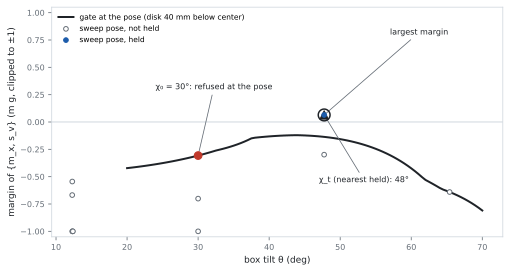

## What the gate asks

Each edit links a formation to one it contains (or the reverse). At the
instant a contact is made or broken it carries no force, so the box must be
held by the **less-constrained end** of the edit alone: the new formation
for a break, the current one for a make. Multi-contact planners use the
same rule. Hauser et al. (*IJRR* 2008): at a transition the robot "can
support itself only with forces applied at the contact in [σ]", because
"the applied force is zero at the instant of time when the contact is made
or broken". Escande et al. (*RAS* 2013) require "the geometric constraints
of the biggest (for the inclusion) of the two sets and the stability
constraints of the smallest one".

The gate H answers two questions before the local solver is called:

1. **Does the less-constrained end hold the box?** A linear program over
   contact forces, with the disk's motor limits, answered with a witness or
   a certificate and a margin.
2. **Where?** If not at the current pose χ₀, then at a nearby pose where
   the edit could happen: the **transition sweep**.

## Holding against gravity

A formation **holds** the box if contact forces in their Coulomb cones
cancel gravity, force and moment, and the disk's motors can supply the
disk's share. In the plane:

- each friction cone has two edge rays, so a contact force is a nonnegative
  mix of two vectors (μ = 0.2 for the box on E; 0.99 for the disk);
- a contact along a segment acts through its two endpoints (the moment is
  linear in the point of application), so each contact contributes at most
  four generators;
- the disk is held still by two slide motors of ±1 N, which must supply its
  push on the box plus its own weight (0.196 N). Its push is therefore
  bounded, and **the disk alone cannot hold the box up**: lifting box and
  disk takes 1.18 N.

The **margin** is how large a disturbance the contacts can absorb: the
largest r such that the needed wrench plus r·D is still supported, with D
the ℓ₁ unit ball of pushes and twists (forces in units of the box's weight
mg, moments in mg·a/2). Negative margins measure how far from holding. A
box flat on the floor has margin 0.2 = μ: the smallest pure sideways push
that makes it slide.

The test is a set of small linear programs, solved in float32 inside JAX
and batched over poses. [Background: deciding support](support-tutorial.qmd)
derives it from first principles, starting from the exact cone test that
still serves as a cross-check.

## Where the edit happens: the transition sweep {#sweep}

The gate does not have to pass at χ₀ itself: the solver may first move the
box within the current contacts and then change them. So H searches near
χ₀ for a **transition pose** χ<sub>tr</sub>:

1. It takes the **more-constrained** end's contacts as constraints (one
   point constraint per vertex or disk contact, two per edge–edge contact)
   and finds their free directions (the null space of the constraints'
   Jacobian; at most three, the smallest singular directions).
2. It lays a grid along those directions (5 points each, ±0.05 in metres,
   angles scaled by the box's half-size a/2) and projects each grid pose
   back onto the constraints.
3. It keeps the poses the recognizer labels exactly as the more-constrained
   end, with no tie, and runs the hold test on the less-constrained end at
   each.

H passes if the test passes at χ₀ or at any kept grid pose. The pose
handed to the solver is χ₀ if it passes; otherwise the nearest grid pose
with margin at least 0.02; otherwise the passing pose of largest margin.
The acceptance threshold is margin ≥ 0; both thresholds are open choices
([Issues](issues.qmd#step3-choices)).

{.lightbox}

| From χ₀ = 30°, disk 40 mm low | Result |
|---|---|
| Gate at χ₀ | refused, margin −0.31 |
| First tilt that holds | 42° |
| Sweep, 5 points (default) | 2 free directions, 11 recognized poses, 2 held; χ<sub>tr</sub> at 45.0°, margin 0.25 |
| Sweep, 9 points, same range | 39 recognized, 8 held; nearest 45.0° (0.25), largest margin 55.2° (0.48) |
| Sweep, 9 points, range 0.08 | 24 recognized, 8 held; nearest 42.0° (0.15), largest margin 62.7° (0.61) |

The paper proves that the exact, continuous sweep never refuses an edit a
quasi-static motion could realize, under stated hypotheses; the grid
version holds above a margin band that depends on the grid's covering
distance.

## The pivot needs the disk low {#pivot}

{.lightbox}

After the pivot, breaking g<sub>v</sub> leaves the disk and the step corner
to hold the box. On a finer grid (0.5° × 1.5 mm) they hold:

| Disk on −x<sub>B</sub> | Tilts held |
|---|---|
| At the bottom of the face | 34.0°–65.5° |
| 40 mm below the face center | 42°–68° |
| At the face center | 54.0°–71.5° |

Never below 34° or above 75°; never at 30°; at 45° only with the disk at
least 30 mm below the face center. Pushing at mid-height, the disk cannot
keep the box on the corner without the floor, and at 30° the motors are too
weak wherever it pushes. A float64 LP with the same motor limits confirms
these answers, so they are facts about the physics and the motors, not
about the test. Without motor limits more than twice as many poses would
hold (815 against 382 of the 1,599 grid poses).

## Accuracy and speed {#accuracy}

Checked against a float64 LP (SciPy's HiGHS) with the same motor limits,
coded independently: 1,000 random cases, and 208 near the support boundary
(16 sweeps of disk height on the pivot, bisected to the boundary).

| Gate (float32) | Random | Near the boundary | ms per 256 poses, CPU / GPU |
|---|---|---|---|
| **LP with motor limits (the gate)** | **1,000 of 1,000** | **199 / 202 of 208** (CPU / GPU) | **14.7 / 3.4** |
| LP, no limits | 1,000 | 386 / 383 of 416 | 8.5 / 2.5 |
| Exact cone test, no limits (cross-check) | 1,000 | 390 / 389 of 416 | 5.0 / 1.6 |

The gate makes no false rejection and returns no "uncertain" answer. Every
miss is the bisected boundary pose itself: the gate's margin there is 0 (at
most 2·10<sup>−7</sup>) while HiGHS says "just not". At 0.33 mm or more from
the boundary the two always agree. A positive acceptance threshold would
remove these misses; the default (0) does not.

## Does the gate prune? (checkpoint 1) {#checkpoint-1}

Among candidate edits that are edges and whose new contacts are within
reach, the share H rejects:

| Nodes | Candidates | Rejected at χ₀ only | Rejected with the sweep |
|---|---|---|---|
| The chain's 9 starts | 179 | 18.4% | 14.5% |
| 205 demo nodes | 3,112 | 22.8% | 22.7% |

By type on the demo nodes, H rejects 75% of breaks (211 of 280) and 74% of
transfers (444 of 597), but only 47 of 2,022 makes: a make's
less-constrained end is the current formation, which already holds. H
prunes the edits that drop or shrink support, which are the ones that need
it.

## Reproduce

```bash
cd ~/repos/research/c-gnn && git switch phase1/planar && git pull && cd cmg
JAX_PLATFORMS=cpu PYTHONPATH=tests .venv314/bin/python -m pytest -q tests/test_planar_step2.py tests/test_step3.py
JAX_PLATFORMS=cpu .venv314/bin/python <website>/research/nonprehensile/planar-build/scripts/02_hold_gate.py <out dir>   # pivot map
JAX_PLATFORMS=cpu .venv314/bin/python <website>/research/nonprehensile/planar-build/scripts/03_figures.py <out dir>     # sweep figure and table
JAX_PLATFORMS=cpu .venv314/bin/python <website>/research/nonprehensile/planar-build/scripts/03_checkpoints.py <out dir>  # checkpoint 1
```

The fine-grid pivot numbers come from
`reports/contact-mode-graphs/scripts/pivot/pivot_numbers.py` in `c-gnn`.

[← Edits](edits.qmd) · [Background: deciding support](support-tutorial.qmd) · [The local solver →](local-solver.qmd)
