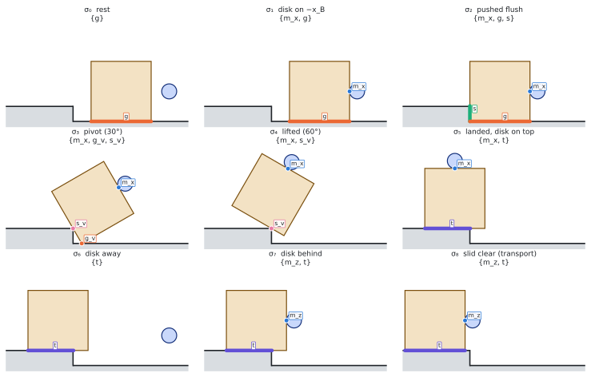

The [code walkthrough](../code-walkthrough/index.qmd) studies `cmg` as Angelo
left it on `phase1/dev`. This section describes the planar (x–z) version of
the box-over-a-step problem built on top of it, on the branch
`phase1/planar` of `Symplectomorphism/c-gnn`. The pages are organized by
topic and describe the current state; how each part got there is collected
on [Issues and resolutions](issues.qmd).

## The problem

A disk pushes a square box over a step: the box slides on the floor, tips
onto its corner against the riser, rests on the step corner, and lands on
the platform. Each phase uses a different set of contacts with the
environment, so a planner has to choose *which contacts* to make and break,
in which order, and then find a motion for each change.

{.lightbox}

## The approach

1. **[Contact states](contact-states.qmd).** A state is a set of
   *principal contacts* in the sense of Xiao and Ji, recognized from a
   simulated pose with small tolerances.
2. **[Edits](edits.qmd).** Neighboring states differ by making, breaking or
   shrinking one contact; several change at once only when no single change
   is possible.
3. **[The hold gate](hold-gate.qmd).** Before any motion is computed, a
   small linear program checks that the contacts which persist through an
   edit can hold the box, at a pose where the edit can happen.
   [Background: deciding support](support-tutorial.qmd) derives the test
   from first principles.
   [Certifying a whole box](certificate.qmd) decides it for every pose in a
   box of poses or disk placements at once.
4. **[The local solver](local-solver.qmd).** A realizer (Λ) tries to
   realize each edit that passes the gate in simulation.
5. **[Search and ranking](search.qmd).** A search over edits, ordered by a
   ranker and a value estimate, so that few expensive Λ calls are needed.

## Where things stand

| Part | What | Status |
|---|---|---|
| [Contact states](contact-states.qmd) | planar scene, principal contacts, recognizer | Built (Xiao–Ji construction, Nov 7) |
| [Edits](edits.qmd), [the hold gate](hold-gate.qmd) | validity from geometry, transfers, compound edges; the LP gate with motor limits, the transition sweep and a certified margin; makes and transfers close the added contact | Built; the gate certifies holds only (Theorem B's level) |
| [Certifying a whole box](certificate.qmd) | interval certificates over boxes of poses; stick–slip plans and Theorem S; the indirect lift's last four edits and closing transport certified over the friction band | Built; certified placement in the code behind a flag (off) |
| [The local solver](local-solver.qmd) | the success test, the quasi-static realizer Λqs with its four default options; learned skills for the hard break (trained at disk friction 0.99; retraining over the band in progress) | Built; Λqs's plans are sequences of held poses, and stick–slip plans in the realizer are next |
| [Search](search.qmd) | node identity, the redesigned search (Decision 23), value and ranker | Built and run; the search does not yet find the indirect lift by itself |

The current configuration: disk–box friction is a declared band
μdisk ∈ [0.3, 0.5]; the gate and the tracker use 0.3
([the local solver](local-solver.qmd)). The indirect lift's last four edits
and its closing transport are certified for every μ in the band
([Certifying a whole box](certificate.qmd#the-indirect-lift)). Given only the
lift's formation sequence, the planner runs it from rest in simulation at
μ = 0.3, 0.4 and 0.5
([The planner runs the indirect lift from rest](../results/index.qmd)).

Videos of the planner's motions are on [Results](../results/index.qmd).
Open decisions and known defects are on [Issues and resolutions](issues.qmd),
at the top.
