::: {.callout-note title="Result (steps 3b–3c): the quasi-static realizer follows the chain; one class of breaks remains"}
The mode-scheduled realizer **Λ<sub>qs</sub>** realizes **23 of 24** chain
edits from canonical and perturbed starts (GPU), including the pivot that no
MPPI cost realized; MPPI-E realizes 15. **Receding-horizon re-planning does
not raise success** (22–23 of 24) but halves the tracking deviation at a
0.2 s interval. Every remaining failure is a **break(g<sub>v</sub>) whose
quasi-static hold needs more disk friction than the tracker uses**: the
gate and the plan count on μ = 0.99 at the disk, the tracker on 0.35.
Choices for Aykut: [Issues](issues.qmd#step3c-choices).
:::

## What the solver must do

The local solver Λ gets an edit σ → σ′ that passed [the hold gate](hold-gate.qmd),
the current pose χ₀, and the transition pose χ<sub>tr</sub> the gate found.
It returns a simulated record, and the edit is accepted only if the record
passes one **success test**, shared by every realizer:

- **persistence:** every kept contact is on at every sample; for a transfer
  c → d, one of c and d is on at every sample;
- **departure:** a contact dropped outright ends above ε<sub>on</sub>;
- **dwell:** the recognized formation equals σ′ for the last samples, with
  no tie;
- **overlap:** no gap below −ε<sub>pen</sub>;
- the manipulator's time limit, support while the disk lets go, and progress
  toward the goal for transport.

## The mode-scheduled realizer Λ<sub>qs</sub> (step 3b) {#lambda-qs}

The edit names the contacts before and after, and the gate's sweep gives
χ<sub>tr</sub>, so Λ<sub>qs</sub> plans on known contacts and tracks the plan
in MuJoCo:

- **plan:** knots on the contact constraints (Gauss–Newton projection of an
  interpolation); phase I from χ₀ to χ<sub>tr</sub> keeping σ; phase II by
  edit kind: a relaxing edit ends at the nearest pose recognized exactly as
  σ′ with σ′ holding; a constraining edit ends at χ<sub>tr</sub> projected
  onto σ′ and pressed 2 mm past the closure; transport moves up to 0.05
  toward the goal;
- **feed-forward:** a quasi-static force at each knot (nonnegative least
  squares over the gate's friction-cone rays);
- **tracking:** while the disk touches, a PD force along the box's free
  directions, mapped through the contact and kept inside the disk's friction
  cone (μ = 0.35, below the simulator's 0.99, so the contact sticks) and the
  ±1 N motor box; otherwise PD on the planned disk positions.

## A learned skill for the hard breaks {#learned-skill}

The hard break(g<sub>v</sub>) starts fail for every planner so far because
the box's corners slide: the maneuver needs timing or momentum that a
quasi-static plan can't provide. So a controller for this one maneuver is
being *learned*, in the same MJX simulator the rest of the system uses:

- **Two algorithms, two variants:** proximal policy optimization (PPO) and
  soft actor-critic (SAC), from Brax, each trained as a **residual**
  correction on top of Λ<sub>qs</sub>'s commands and **from scratch**.
- **Training:** randomized starts (tilt 30–45°, disk height, friction, mass)
  with a curriculum from easy to hard tilts; the reward is reaching the target
  formation under the strict success test, with penalties for slipping,
  falling and deep penetration. On Juno's H200 GPUs, several seeds each.
- **Validation:** the six hard starts and 50+ held-out ones, against
  Λ<sub>qs</sub> and MPPI (both 0 of 6 so far), with a penetration limit and a
  re-check with stiffer contacts, so a policy can't win by exploiting the
  simulator.
- **Feasibility:** if some start stays unsolved by every run, a brute-force
  search over open-loop force sequences within the motors' ±1 N tells whether
  it is hard to learn or impossible.

A learned skill would carry a measured success rate, not a quasi-static
certificate; the call bound still holds (it counts Λ calls).

**Result: SAC trained from scratch solves the whole family.** Under the strict
success test (settle clause off; a re-evaluation with it on is in progress), on
the same starts for every method:

| Method | Hard starts | Held-out starts (95% CI) | Penetration violations |
|---|---|---|---|
| **SAC, from scratch** (3 seeds) | **18 / 18** | **150 / 150** (98–100%) | 0 |
| SAC, residual on Λ<sub>qs</sub> | 6 / 18 | 50 / 150 (26–41%) | 75 |
| PPO, residual or from scratch (equal 4-configuration budget; a larger sweep is running) | 0 / 18 | 0 / 150 | 82–86 |
| Λ<sub>qs</sub> (quasi-static) | 0 / 6 | 1 / 50 | 0 |
| MPPI | 0 / 6 | 0 / 50 | 0 |

SAC gives the same result with stiffer contacts, so it isn't exploiting soft
contacts; every hard start was solved, so the feasibility search wasn't
needed. Learning from scratch beats the residual because Λ<sub>qs</sub>'s
commands are a poor starting point here (they fail 79 of 80 grid starts). PPO
learned nothing under the same tuning budget. Two caveats: SAC is unstable
(two of three seeds collapse after peaking, so the best checkpoint is kept),
and the policy tips the box to about 72° in 0.25 s and then holds the new
contact state in a small limit cycle (about ±2° at 4 Hz), which the strict test
accepts because its settle clause is off; the settle-on numbers will decide
that clause's default. The skill exists as Λ<sub>RL</sub> (`cmg/rl/skill.py`):
the search will call it for the hard break whenever the start is within its
training range, and Λ<sub>qs</sub> otherwise (being wired in). It carries an
empirical success rate with a confidence interval, outside the gate's
quasi-static certificate; the call bound treats it as a solver that succeeds at
random.

## Re-planning and failure diagnostics (step 3c) {#step-3c}

**Re-planning (RH*k*).** Every *k* steps (20, 40, 80: every 0.2, 0.4, 0.8 s)
the plan is rebuilt from the current simulated state and its first segment
tracked. The phase comes from the recognized formation: still σ, re-plan
phase I toward the same χ<sub>tr</sub>; already σ′, a path to the previous end
pose; in between, or past χ<sub>tr</sub> on the schedule but not yet σ′, the
previous plan continues. Each phase keeps its scheduled end. The record
stops early if a contact that must persist is lost. The first version gave
every new plan the time that was left and restarted the change at each
re-plan, and was worse than open loop
([issue](issues.qmd#replan-defect)); the table is after the fix.

**Ablations.** F1: a release must lift the dropped contact at least 4 mm
(phase II goes farther past χ<sub>tr</sub>). F2: the feed-forward ramps in from
the start's equilibrium force instead of from zero. RH40r re-sweeps
χ<sub>tr</sub> at each re-plan.

**Diagnostics** for every run (time series kept for failed ones): planned vs
executed box and disk, the deviation; recognized vs planned formation and
the first unexpected loss or gain; the edit's gaps; MuJoCo's contact forces
(replayed), friction-cone ratios and slip; motor commands against the
limits; the box's kinetic energy; the re-plan log; a one-line diagnosis and
a failure mode.

**Cases.** The chain's 8 edits from a canonical and 2 perturbed starts (24
calls) and a hard set of 6: break(g<sub>v</sub>) from 30°, 35°, 40° with the
disk 40 or 20 mm low. After a success the next chain edit is tried from
where the record ended.

| Variant | Chain (of 24) | Hard (of 6) | Canonical (of 8) | Next edit | Deepest overlap | Median max deviation | Time per call |
|---|---|---|---|---|---|---|---|
| open loop (3b) | **23** | 0 | 8 | 12 of 20 | 4.2 mm | 37 mm | 2.7 s |
| open + F1, F2 | 22 | 0 | 7 | 10 of 19 | 5.5 mm | 39 mm | 2.8 s |
| RH20 | 22 | 0 | 8 | 12 of 19 | **2.9 mm** | **19 mm** | 8.8 s |
| RH40 | 22 | 0 | 8 | 12 of 19 | 4.2 mm | 42 mm | 7.5 s |
| RH80 | 22\* | 0 | 8 | 12 of 20 | 4.2 mm\* | 42 mm | 5.7 s |
| RH20 + F | 21 | 0 | 7 | 11 of 18 | 5.5 mm | 19 mm | 10.4 s |
| RH40 + F | 21 | 0 | 7 | 11 of 18 | 5.5 mm | 41 mm | 7.5 s |
| RH80 + F | 21 | 0 | 7 | 11 of 18 | 5.5 mm | 40 mm | 5.7 s |
| RH40r (χ<sub>tr</sub> re-swept) | 20 | 0 | 7 | 9 of 17 | 4.2 mm | 35 mm | 9.8 s |
| MPPI-E | 15 | 0 | 5 | 6 of 15 | 4.6 mm | — | 40 s |

GPU (RTX 5080). \* One transport run fails on a single sample whose gap has
the wrong sign (−96 mm for +96 mm; [issue](issues.qmd#gap-sign)); without
it RH80 is 23 of 24.

::: {.callout-note collapse="true" title="The same on the CPU"}
| Variant | Chain (of 24) | Hard (of 6) | Canonical (of 8) | Next edit | Deepest overlap | Median max deviation | Time per call |
|---|---|---|---|---|---|---|---|
| open loop | 22 | 0 | 7 | 12 of 19 | 3.4 mm | 43 mm | 0.16 s |
| open + F1, F2 | 22 | 0 | 7 | 11 of 19 | 4.5 mm | 23 mm | 0.16 s |
| RH20 | 22 | 0 | 7 | 11 of 19 | 3.4 mm | 21 mm | 1.5 s |
| RH40 | 21 | 0 | 7 | 11 of 18 | 3.4 mm | 43 mm | 1.1 s |
| RH80 | 22 | 0 | 7 | 12 of 19 | 3.4 mm | 43 mm | 0.9 s |
| RH20 + F | 23 | 0 | 7 | 11 of 20 | 4.8 mm | 21 mm | 1.5 s |
| RH40 + F | 23 | 0 | 7 | 11 of 20 | 4.5 mm | 24 mm | 1.1 s |
| RH80 + F | 23 | 0 | 7 | 10 of 20 | 4.5 mm | 24 mm | 0.9 s |
| RH40r | 19 | 0 | 6 | 8 of 16 | 3.4 mm | 27 mm | 1.3 s |

Python 3.14; MPPI-E not run (120 s per call on the CPU). Failures: corner
not released 4–6 and slump in ramp-in 3 for every variant, plus 3
overshoots for RH40r.
:::

**Failure modes** (failed runs per variant, GPU):

| Variant | Corner not released | Late change | Slump in ramp-in | Persistence loss | Overshoot | Slip, disk | Slip, environment |
|---|---|---|---|---|---|---|---|
| open loop | 4 | 0 | 3 | 0 | 0 | 0 | 0 |
| open + F | 4 | 0 | 3 | 1 | 0 | 0 | 0 |
| RH20 | 5 | 0 | 3 | 0 | 0 | 0 | 0 |
| RH40 | 3 | 2 | 3 | 0 | 0 | 0 | 0 |
| RH80\* | 3 | 1 | 3 | 0 | 0 | 0 | 0 |
| RH20 + F | 4 | 1 | 3 | 1 | 0 | 0 | 0 |
| RH40 + F | 5 | 0 | 3 | 1 | 0 | 0 | 0 |
| RH80 + F | 5 | 0 | 3 | 1 | 0 | 0 | 0 |
| RH40r | 4 | 0 | 3 | 0 | 3 | 0 | 0 |
| MPPI-E | 6 | 0 | 0 | 2 | 3 | 2 | 2 |

### Why the remaining runs fail {#diagnosis}

All are break(g<sub>v</sub>): the hard set and one or two perturbed chain
starts.

- **Slump during ramp-in** (disk 40 mm low, every quasi-static variant).
  The riser contact s<sub>v</sub> is lost within 9–21 steps; from 30° the box
  falls flat in 0.2 s. The motors are not saturated then and the disk
  barely slides. At that start the plan asks the disk for (0.33, 0.09) N, a
  tangential/normal ratio of 0.99 at the disk–box contact, which the
  simulator's μ = 0.99 allows and the gate counts on. The tracker keeps the
  disk's force inside μ = 0.35 and applies (0.16, −0.03) N, the same with
  and without F2 (both ramps are projected onto the same point of the
  cone, so F2 changes nothing here).
- **Corner not released** (disk 20 mm low, and the failing chain starts).
  The box tilts, but the riser contact runs at its friction limit (ratio
  1.00, the environment's μ = 0.2) and the box chatters between riser and
  floor, so the floor corner never opens past ε<sub>on</sub>, or opens and
  falls back in the dwell when the disk's force drops. The lift the plan
  gives to disk friction lands on the riser contact, which cannot carry it.
- **Late change** (RH40, RH80): σ′ is reached in the last 0.2 s, fewer than
  the 20 dwell samples.

**The check.** With the plan's forces computed with the disk's friction
capped at 0.35, the quasi-static residual of every failing break rises from
about 0.015 to 0.22–0.27: no disk force inside the tracker's cone holds the
box through these breaks. Raising the tracker's μ to 0.6 removes the slump
at 30° and 40° but the corner still stays down (5 of 12 probe cases instead
of 4); at 0.9 the disk slides on the soft contact (2 of 12). So the gate
passes edits that this realizer cannot do, and the fix starts with giving
the gate and the plan the friction the realizer can use.

**F1 and F2.** No consistent effect: on the GPU they cost a
transfer(s<sub>v</sub> → t) start (the full equilibrium force at the first step
overshoots the soft contact), on the CPU they gain a break(g<sub>v</sub>) start
with re-planning. F1 cannot help the remaining failures: the corner does not
follow the planned lift at all.

**Re-planning before the fix** realized 1–2 hard starts per variant (all
with the disk 20 mm low) while failing the chain's constraining edits: its
compressed, faster phase II lifted the corner where the quasi-static
schedule does not. That points at quasi-dynamic motion for these breaks,
after the friction question.

::: {.callout-note collapse="true" title="Failure plots: open loop and RH20 (GPU)"}
Each figure: box tilt planned and executed with the deviation; the edit's
gaps; contact normal forces (MuJoCo replay) and the planned disk force;
friction-cone ratios; motor commands and limits; slip speeds and the box's
kinetic energy; the one-line diagnosis at the bottom.

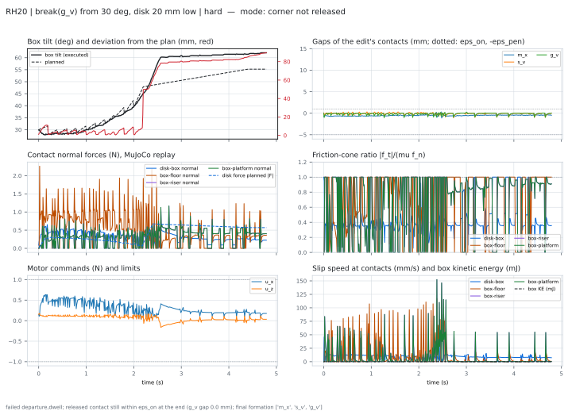{.lightbox group="step3c"}

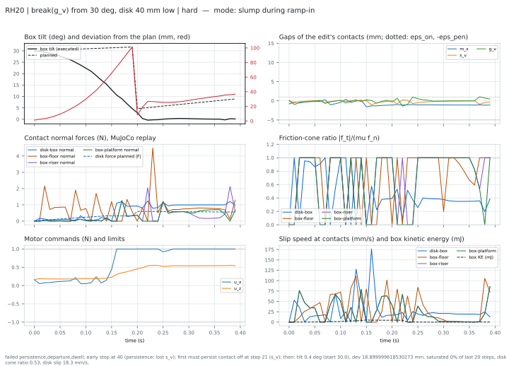{.lightbox group="step3c"}

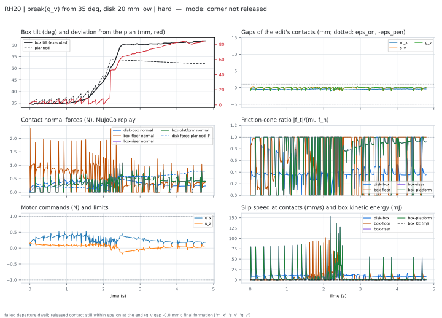{.lightbox group="step3c"}

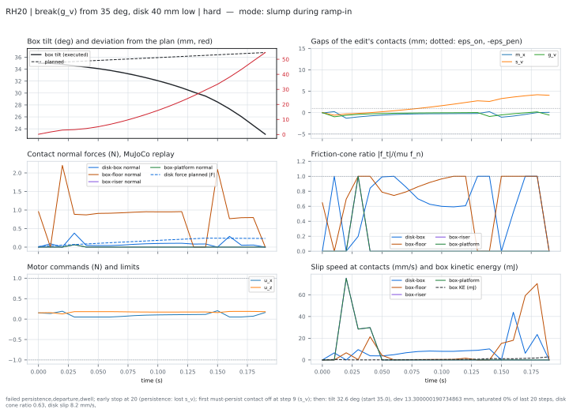{.lightbox group="step3c"}

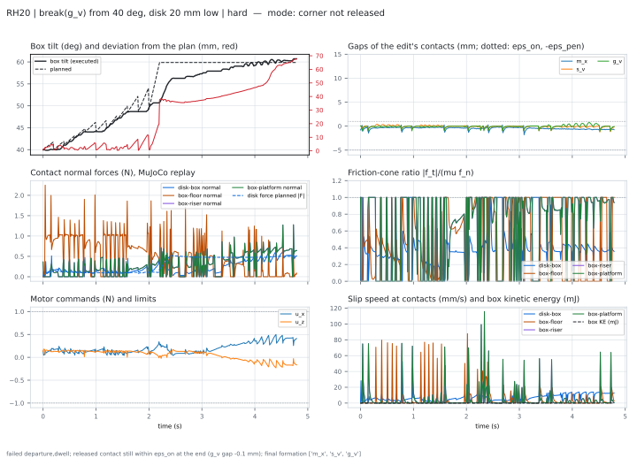{.lightbox group="step3c"}

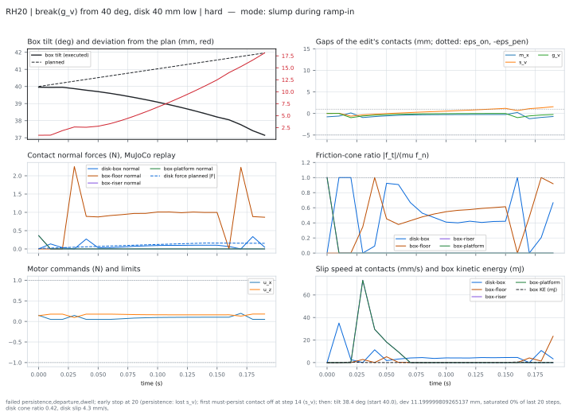{.lightbox group="step3c"}

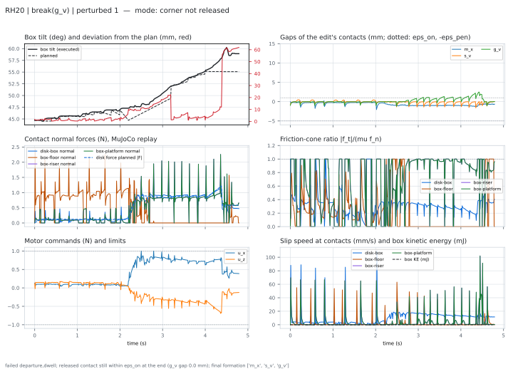{.lightbox group="step3c"}

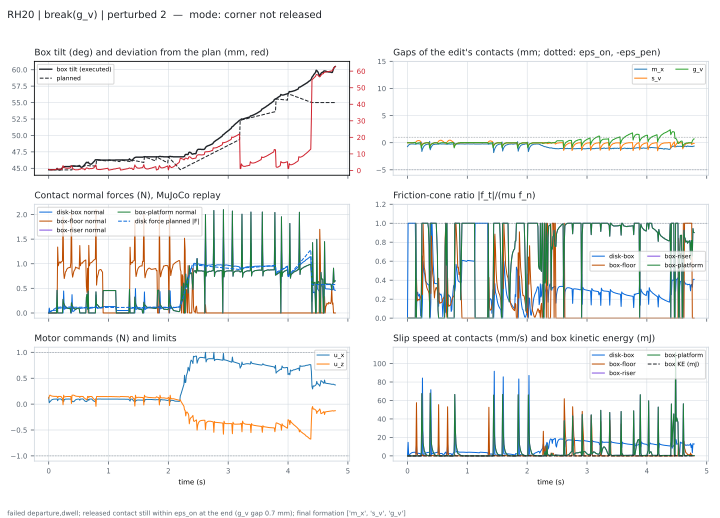{.lightbox group="step3c"}

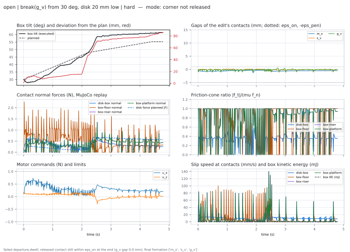{.lightbox group="step3c"}

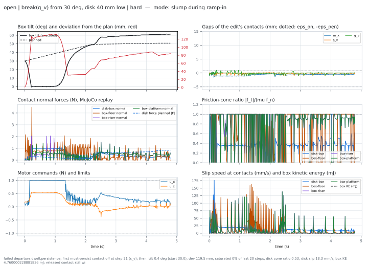{.lightbox group="step3c"}

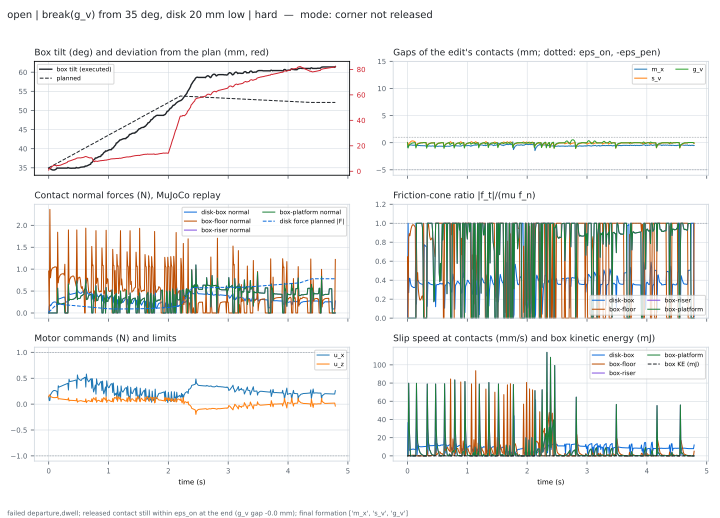{.lightbox group="step3c"}

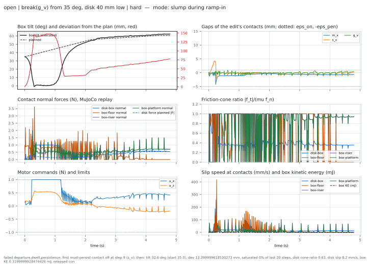{.lightbox group="step3c"}

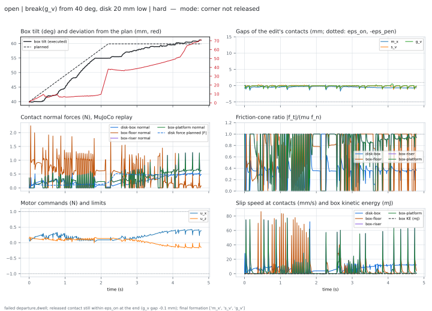{.lightbox group="step3c"}

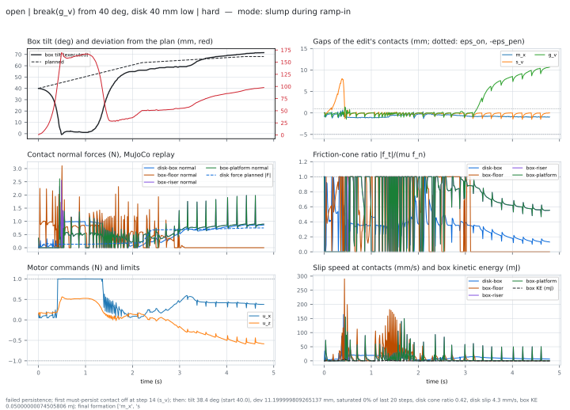{.lightbox group="step3c"}

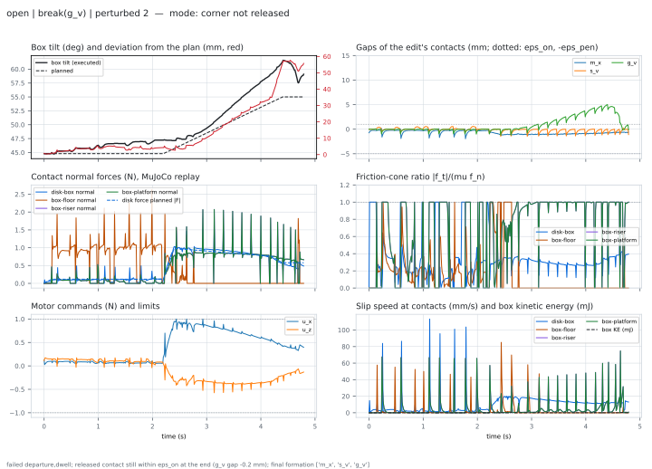{.lightbox group="step3c"}
:::

**Checkpoint 2: does Λ realize the edits that pass the gate?** On the
chain, 96% on the GPU (open loop, 23 of 24; 92% for RH20 and RH40; MPPI-E
63%), 92% on the CPU. With the hard set, all of which pass the gate, 77% (23 of 30). What
the gate passes and Λ<sub>qs</sub> cannot realize is now one class: breaks
that hold the box on a corner with more disk friction than the tracker
uses.

## The friction match (step 3d) {#step-3d}

Decided Nov 8 (compendium, Decision 15): give the gate and the plan the
disk–box friction the tracker uses (0.35) instead of the simulator's 0.99,
so the gate rejects the breaks Λ<sub>qs</sub> cannot realize. Built as a
scene parameter, `manipulator_friction`, and measured. It does not do what
it was meant to, and it is **left unset** pending Aykut's choice.

**A defect found first: the gate's sweep depended on the backend.** The
sweep lays a 5 × 5 grid along the free directions of the more-constrained
formation. Those were the SVD's null vectors, and when two directions are
free (the pivot's tilt and the disk along −x<sub>B</sub>) any rotation of
them is an equally valid answer. The CPU and the GPU returned different
rotations, so they probed different poses. At μ = 0.99 the feasible region
hid this; at 0.35 it decided the verdict (the chain's break(g<sub>v</sub>):
refused on the CPU, margin 0.29 on the GPU). Fixed: a basis that depends on
the subspace only. The backends now agree to 10⁻³, and checkpoint 1 at the
simulator's friction is unchanged.

**What the gate says at μ = 0.35** (sweep margin; start = tilt / disk depth
below the corner):

| sweep | 45° / 40 mm (chain) | 30° / 40 | 35° / 40 | 40° / 40 | 30° / 20 | 35° / 20 | 40° / 20 |
|---|---|---|---|---|---|---|---|
| μ = 0.99, 5 points | 0.12 | 0.28 | | | 0.31 | 0.45 | 0.44 |
| 0.35, 5 points (decided grid) | **refused** | 0.06 | 0.10 | 0.01 | 0.06 | 0.05 | 0.34 |
| 0.35, 9 points | 0.18 | 0.06 | 0.10 | 0.07 | 0.14 | 0.21 | 0.13 |

With the decided grid, 0.35 refuses the chain's own break, which the
realizer does: a false refusal. With a 9-point grid it passes every start,
including the six the realizer fails.

**What the realizer does with friction-matched plans** (GPU, open loop,
9-point sweep): the chain's break(g<sub>v</sub>) 3 of 3 (step 3c: 2 of 3);
the hard starts 0 of 6, with the same failure modes as before (slump
during ramp-in with the disk 40 mm low, corner not released with it 20 mm
low). The disk's contact now stays inside its cone (ratio at most 0.37).
The box's floor and riser corners reach ratio 1.0 and slide, while the
tracker's correction adds up to twice the planned disk force. So the hard
breaks fail dynamically, not for lack of a quasi-static transition, and no
friction setting in the gate will reject them. Checkpoint 1 barely moves
(chain 32.4% → 33.8% rejected with the sweep; demo 39.5% either way).

**Choices** (compendium, Step 3d): keep the friction cap unset; refine the
sweep (9 points, or adaptive around the best pose) before the teacher
search; for the hard breaks, a tracker that also keeps the environment
contacts inside their cones, then a quasi-dynamic method.

**Decided** (Nov 8, Decision 16): the cap stays unset; the hard breaks wait
for an environment-aware tracker, then a quasi-dynamic method; the sweep's
resolution was settled by measurement (next section).

## The sweep's resolution, measured (step 3d follow-up) {#sweep-resolution}

Every candidate edit that is an edge and passes Near, on the chain's
starts, the six hard break(g<sub>v</sub>) starts and the 205 demo nodes
(1,797 candidates), was swept with several grids and compared with a dense
reference (65 × 65 poses for two free directions, up to 4,913 poses), at
the simulator's friction and at the stress case μ = 0.35. The `cube` grid is
the old one (5 or 9 values on all three directions; unused directions
repeat poses). The `dim` grid puts about N poses on the directions that are
actually free (8 × 8 for two directions at N = 64). Refinement adds a 3 × 3 × 3
grid at half spacing around the recognized pose of largest margin, twice.

| grid | poses | CPU ms per candidate | false refusals, μ<sub>sim</sub> | false refusals, μ = 0.35 |
|---|---:|---:|---:|---:|
| cube 5 (until now) | 125 | 13.7 | 0 | 1 |
| cube 9 | 729 | 96.8 | 0 | 0 |
| dim 125 | 125 | 13.8 | 0 | 2 |
| **dim 64 + 2 levels (now the default)** | 118 | 12.1 | 0 | 0 |
| cube 5 + 2 levels | 179 | 18.8 | 0 | 0 |
| reference | ≤ 4,913 | 767 | (1,112 pass) | (1,112 pass) |

No grid ever passes an edit the reference refuses. At the default friction
the resolution changes no verdict; at 0.35 the 5-point grid refuses the
chain's realizable break(g<sub>v</sub>) from 45°, and the adaptive grid
does not. It costs what the old grid cost, a seventh of 9 points.

**What the gate costs in a search.** Per expanded node: one Λ call (0.16 s
on CPU, open loop) and one gate evaluation (0.75 s on CPU; 0.33 s at χ₀,
0.42 s for the sweep). So the gate is about 82% of a node's time; 9 points
would make it 95% and a node 4× slower. The gate is 13× faster on CPU than
on a GPU (the LPs' iterations batch poorly). Two cheaper levers remain:
sizing the sweep's slots to a node's candidates (32 slots for 8.6
candidates on average; 8 slots: 0.43 s per node), and evaluating the gate
once per key (Decision 18): the demo nodes fall into about 8 keys, about 26
nodes each, which would bring the gate's share to about 16% if a per-key
gate cost about one node's.


## The compiled cost (step 3, MPPI)

The first Λ is MPPI, a sampling-based model-predictive controller running
the MuJoCo simulation. The paper's compiled cost is dimensionless: band,
leave and overlap terms on the gaps, a control term, and a terminal barrier
on the destination formation. It extends to Xiao and Ji's edits through the
point-contact view:

- **a transfer** keeps the contained contact and moves the *released end*:
  for g → g<sub>v</sub> the other bottom corner lifts until the tilt passes
  2θ<sub>e</sub>; for the disk going round a box corner, the contact point
  slides past the vertex; a constraining transfer (s<sub>v</sub> → t) lays
  the edge flat;
- **a compound edge** adds up its parts;
- **options:** a margin term at the end, a dwell term, the two-phase
  subgoal (reach χ<sub>tr</sub>, then change), and scaling the contact terms
  by ε<sub>on</sub> instead of the box size.

## The cost experiment (step 3, MPPI)

**Setup.** MPPI with 256 samples, 5 updates, controls held 3 steps and a
30-step look-ahead; executed records of 60 + 20 steps (0.8 s). Each edit of
the chain is tried from its canonical start and from 2 perturbed starts, plus
break(g<sub>v</sub>) from 30°, which needs the sweep. The variants:

- **A:** the current MPPI cost (hand-set weights; a signed linear arrival
  term);
- **B:** the paper's compiled cost;
- **C:** B plus the terminal margin and dwell terms;
- **D:** C plus the transition subgoal;
- **E:** D with the contact terms divided by ε<sub>on</sub> instead of the
  box size, a smooth terminal cost, and a barrier of 100.

After a success, the next chain edit is attempted from where the record
ended.

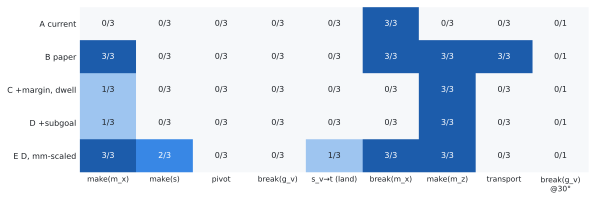{.lightbox}

| Variant | Successes (of 25) | Canonical (of 9) | Reached σ′ at some sample | Deepest overlap | 95th percentile | Next edit succeeds | Time per call |
|---|---|---|---|---|---|---|---|
| A, current | 3 | 1 | 24 | 14.1 mm | 12.5 mm | 0 of 3 | 22.8 s |
| B, paper | 12 | 4 | 24 | 8.1 mm | 5.4 mm | 4 of 9 | 24.3 s |
| C, + margin, dwell | 4 | 1 | 24 | 8.2 mm | 5.0 mm | 0 of 4 | 23.5 s |
| D, + subgoal | 4 | 1 | 25 | 8.2 mm | 5.0 mm | 0 of 4 | 23.5 s |
| E, D scaled by ε<sub>on</sub> | 12 | 4 | 24 | 4.7 mm | 4.0 mm | 6 of 12 | 23.4 s |

GPU (RTX 5080). On the CPU the canonical starts give A 1 of 9 and E 4 of 9,
as on the GPU, at 196 s and 120 s per call. The experiment ran before the
code's pose distance was aligned with the paper's (angles weighted by a/2
instead of a), which affects only which held pose the sweep calls nearest
and the goal distance's angle term, zero during transport.

**What the table says**

- **The current cost overlaps.** A reaches σ′ in 24 of 25 records but
  succeeds in 3: its linear arrival term pushes contacts up to 14 mm deep.
- **The paper's cost is badly scaled for millimetre contacts.** With the box
  size as the unit, a 1 mm gap costs (1/125)² ≈ 6·10⁻⁵, so the barrier
  decides almost everything. C and D are *worse* than B, probably because
  their margin term outweighs those tiny contact terms (the run does not
  isolate the cause). E, the same terms over ε<sub>on</sub>, matches B's
  success rate with half the overlap and the best follow-on rate.
- **The subgoal changed nothing on the chain:** from every canonical start
  the gate passes at χ₀, so χ<sub>tr</sub> = χ₀. Where it matters
  (break(g<sub>v</sub>) from 30°), D also fails.
- **What no variant does:** the pivot (B tilts the box to about 30° and
  reaches σ′ but fails another clause; E never tilts it); break(g<sub>v</sub>)
  from 45° (B's box topples onto the platform; E's stays on its corner at
  62–65° and never lifts); break(g<sub>v</sub>) from 30°. These are the edits
  where the disk must hold the box on a corner through an unstable motion,
  and a 0.3 s look-ahead with 1 N motors does not find that motion.
- **Transport** succeeds with B (3 of 3) but not with E (0 of 3, still
  moving about 20 mm in the dwell window).

**Checkpoint 2 with MPPI: does Λ realize the edits that pass the gate?**
Not reliably: 12 of 25 (48%) at best, and never the pivot or
break(g<sub>v</sub>). (With Λ<sub>qs</sub>: [step 3c](#step-3c).)
(Checkpoint 1, whether the gate prunes, is on [the hold gate](hold-gate.qmd#checkpoint-1).)

## ε<sub>pen</sub> and ties

The recognizer's overlap tolerance was 10 mm at step 3; since step 3b it is
5 mm (provisional).
Ties on the 4,000 jittered demo poses, with ε<sub>pen</sub> replaced:

| ε<sub>pen</sub> | 1.5 mm | 2 mm | 3 mm | 4 mm | 5 mm | 10 mm (today) |
|---|---|---|---|---|---|---|
| Tied poses | 25 | 44 | 98 | 168 | 257 | 475 |

E's rollouts overlap at most 4.7 mm (95th percentile 4.0 mm); an
ε<sub>pen</sub> below that would fail E's successes on the overlap clause.

## Reproduce

Steps 3b–3c (in `cmg/`; every heavy run in a memory-capped scope):

```bash
cd ~/repos/research/c-gnn && git switch phase1/planar && git pull && cd cmg
JAX_PLATFORMS=cpu PYTHONPATH=tests .venv314/bin/python -m pytest -q tests/test_modesched.py tests/test_receding.py
R=scripts/step3c/results
scripts/step3c/capped.sh 16G .venv314/bin/python scripts/step3c/experiment.py --out $R/gpu.json --log $R/gpu.log \
    --variants open,open+F,RH20,RH40,RH80,RH20+F,RH40+F,RH80+F,RH40r,E      # about 3 h on GPU
.venv314/bin/python scripts/step3c/eta.py $R/gpu.log                                 # progress and time left
.venv314/bin/python scripts/step3c/plots.py $R/gpu.json <out dir> --variants open,RH20      # failure plots and tables
JAX_PLATFORMS=cpu .venv314/bin/python scripts/step3c/friction_probe.py 0.35,0.6,0.9 "break(g_v);hard" [--plan-mu]
```

Step 3 (MPPI and the compiled cost):

```bash
cd ~/repos/research/c-gnn && git switch phase1/planar && git pull && cd cmg
JAX_PLATFORMS=cpu PYTHONPATH=tests .venv314/bin/python -m pytest -q tests/test_step3.py
.venv314/bin/python <website>/research/nonprehensile/planar-build/scripts/03_local_solver.py <out dir>     # the experiment (about 70 min on GPU)
JAX_PLATFORMS=cpu .venv314/bin/python <website>/research/nonprehensile/planar-build/scripts/03_ties_eps_pen.py <out dir>
```

[← The hold gate](hold-gate.qmd) · [Node identity →](node-identity.qmd)
