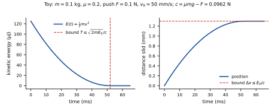
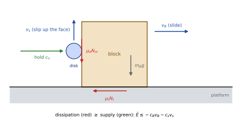

**Before this page:** [interval arithmetic](interval-arithmetic.qmd),
[zonotopes](zonotopes.qmd) and [certified funnels and
composition](funnel-composition.qmd). The terminology: the **block** is the
manipulated object; a **box** is only an interval box (a product of
intervals).

## 1. The idea in one inequality

**Intuition.** A system that cannot create energy, and loses some whenever
it moves, must eventually stop. Friction is the classic loss: while
anything slides, Coulomb friction turns kinetic energy into heat. If the
forces that can add energy are weaker than the friction that removes it,
the energy can only go down, and with it the motion.

**The general statement** [@willems1972dissipative; @brogliato2020dissipative].
Take a state $x$ in a set $\mathcal X$, an input $u$ and a disturbance $w$.
Choose

- a **storage function** $S(x)\ge 0$ (an "energy");
- an **output** $y$ and a **supply rate** $s(u,y,w)$ (the power the outside
  world can feed in);
- a **dissipation** $d(x)\ge 0$ (the power that is surely lost).

They form a **dissipation certificate** on $\mathcal X$ if, along every
motion,

$$
\dot S \;\le\; s(u,y,w) - d(x).
$$

For contact, "every motion" means every admissible stick/slip **contact
class** at every state of $\mathcal X$, and the inequality is checked as a
lower bound on $s-d-\dot S$ with the same sound enclosures as every other
certificate on this site: interval or zonotope arithmetic with outward
rounding, where a refusal is always possible and a false pass is not.

**What it gives.** Each follows in one line from the inequality:

| Use | Condition | Conclusion |
|---|---|---|
| Termination | $s\le0$, $d\ge c\sqrt S$ off the target | target reached by $T\le 2\sqrt{S_0}/c$ |
| Reach set | $d\ge c\,\lvert\dot r\rvert$ for a distance $r$ | $\Delta r\le S_0/c$ |
| Disturbance | the measured residual's power inside $s$ | a margin $c$ that shrinks, no extra argument |
| Composition | the exit's level set $\{S\le S_0\}$ inside the next entry | one containment check at the junction |

## 2. A worked toy: a block pushed against friction

A block of mass $m=0.1$ kg slides on a floor with friction $\mu=0.2$ at
$v_0=50$ mm/s, while something pushes it forward with $F=0.1$ N.

- Storage: $E=\tfrac12 mv^2$, with $E_0=\tfrac12(0.1)(0.05)^2=1.25\times10^{-4}$ J.
- Supply: the push's power, $Fv$.
- Dissipation: friction's power, $\mu m g\,v = 0.196\,v$ W.
- So $\dot E = Fv-\mu mgv = -c\,v$ with $c=\mu mg-F=0.0962$ N $>0$.

The push is not passive (it feeds energy in), but friction removes more.
Integrating, $c\,\Delta x\le E_0$:

$$
\Delta x \;\le\; \frac{E_0}{c} = \frac{1.25\times10^{-4}}{0.0962} = 1.30\ \text{mm}.
$$

And since $v=\sqrt{2E/m}$, $\tfrac{d}{dt}\sqrt E=\dot E/(2\sqrt E)\le -c/\sqrt{2m}$,
so the block stops within $T\le\sqrt{2mE_0}/c=52$ ms.

**Check it by hand.** The deceleration is $c/m=0.962$ m/s², so the exact
stopping distance is $v_0^2/(2\cdot0.962)=1.30$ mm and the exact time
$0.05/0.962=52$ ms. In one dimension the bounds are exact.

{width=90%}

## 3. The real case: the rest after the impact

After the impact on the platform, the block slides forward at $v_B$ (up to
48.4 mm/s on the hand-off) and the disk slips up the block's face at $v_s$
(up to 73 mm/s), while the hold force presses the block forward. Does it
come to rest, and where?

{width=80%}

- **Storage:** $E=\tfrac12(m_B+m_M)v_B^2+\tfrac12 m_M v_s^2$.
- **Supply:** the hold force's power and the measured simulator residual's.
- **Dissipation:** friction at the block's two platform supports,
  $\mu_t N_t v_B$, and at the disk, $\mu_d N_m v_s$, with $\mu_d$ anywhere
  in $[0.3,0.5]$.

The balance is $\dot E\le -c_Bv_B-c_sv_s$, where $c_B$ and $c_s$ are the
friction forces' lower bounds less the hold force and the residual. Then
$\Delta x_B\le E_0/c_B$ and $\Delta k\le E_0/c_s$, with $k$ the disk's place
on the face.

**With numbers.** With the whole hand-off's largest speeds,
$$
E_0=\tfrac12(0.12)(0.0484)^2+\tfrac12(0.02)(0.073)^2=1.94\times10^{-4}\ \text{J}.
$$
The certified margins on the test units are at least $c_B=0.0821$ N and
$c_s=0.0297$ N, which give $\Delta x_B\le 2.36$ mm and $\Delta k\le 6.53$ mm,
and rest within $\sqrt{2(0.12)E_0}/0.0297=0.23$ s. Per unit, with each
unit's own $E_0$, the certificate's bounds are at most 2.26 mm and 5.93 mm.

**What makes it closed-form: position invariance.** The bounds need the
friction forces over the whole region the block can reach, and that region
is what the bounds produce, a fixed point in general. On the flat platform
it is not: the two supports keep the block from rotating, and the
translational balance has no lever arm in it, so the total normal force at
the supports and the disk's forces depend only on the tilt, the friction
coefficients and the hold force, never on where the block is. They are
enclosed once, at a point, and hold everywhere.

**The result on a test sample.** Of 400 hand-off units, 300 had been
refused by the per-class deceleration bounds; the energy certificate
certifies all 400. The rest set it gives does not lie in the entry of the
transport the composed chain uses, so that link of the chain stays
measured; the transport's wide entry is the one it can lie in.

## 4. Why it beat per-class deceleration bounds

The per-class route asks, in every contact class, that each slip
decelerate at every state of a region: the hand-off's positions grown by
the stopping distance. It encloses the class's accelerations over that
grown position box with an interval Jacobian, and the box is wide enough
that the enclosure loses the margin: the deceleration bound crosses zero
although every actual motion decelerates. Splitting the box recovers some
units, at a cost.

The energy route asks a different question. It never bounds a deceleration
pointwise over the grown box; it adds up the power over the whole motion.
And because the forces it needs are position-invariant, the grown box does
not enter at all. The same physics, a different inequality, and no loss to
the box.

## 5. Where this stands

The facts are classical: dry friction stops an oscillator in finite time
[@adly2006finite], and mechanical systems with unilateral contact and
friction have a full stability theory [@leine2008stability]. The closest
certificate is Posa, Tobenkin and Tedrake's
[@posa2013lyapunov; @posa2016stability]: sums-of-squares Lyapunov functions
for rigid bodies with impacts and friction, with energy as the first
example. What differs here is the certificate's form: an input and a
measured disturbance as supply, a friction band, outward-rounded
enclosures, and composition at the junctions of a plan.

## 6. The general avenue

Kinetic energy is monotone here because nothing but the hold's small push
feeds it. Where it is not (a pivot driven by the disk, an accelerating
transport), the storage function and the output must be **found together**:

1. **Search, then verify soundly.** Propose $S$ and $y$ per edge, from a
   parametric family or a learned proposer, and verify the inequality with
   the same enclosures; a bad proposal can fail, never pass. Joint
   storage–supply search with a sound verifier exists for smooth systems
   [@wang2026dissipativity; @strong2025local] and in sums-of-squares form
   [@ebenbauer2006dissipation]; mode-dependent storage for hybrid systems
   goes back to [@bemporad2008passivity].
2. **The step-integrated inequality.** The simulator steps, and an impact
   is a jump, so the inequality to verify is
   $S(x_{k+1})-S(x_k)\le\int (s-d)\,dt$ over one step, on the reachable set.
   Hybrid zonotopes represent an edge's contact classes exactly
   [@bird2023hybrid], and a ReLU storage function has an exact
   hybrid-zonotope graph [@ortiz2023relu].
3. **An ablation.** The joint search must be shown to matter: certify the
   same edges with a fixed supply and with the searched one.
4. **Composition by level sets** along the contact-formation graph, in the
   tradition of compositional dissipativity [@arcak2016networks].

## Figures

The two figures are drawn by `scripts/bg_dissipation_figures.py`
(`python bg_dissipation_figures.py media`): small, checkable examples, not
records.

## References

::: {#refs}
:::
