## The result in brief {.smaller}

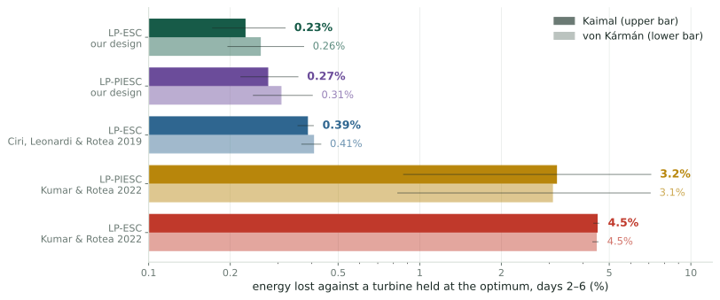{.fig-wide}

::: kpis
::: {.kpi .blue}
[41% less]{.big}
[energy lost than the best published design, LP-ESC of Ciri, Leonardi & Rotea 2019 (same one-day tracking time): 0.385% → 0.227%, about 27 MWh per turbine-year at 8 m/s]{.lab}
:::
::: {.kpi .gold}
[14× less]{.big}
[than the LP-PIESC of Kumar & Rotea 2022: 3.19% → 0.227%, about 500 MWh per turbine-year]{.lab}
:::
::: {.kpi .hot}
[20× less]{.big}
[than the LP-ESC tuning of Kumar & Rotea 2022: 4.51% → 0.227%, about 730 MWh per turbine-year]{.lab}
:::
:::

[Six-day simulations of the nonlinear NREL 5 MW turbine at 8 m/s, turbulence intensity 0.10, four wind records per spectrum; every controller runs in the same wind as a turbine held at the optimum. Bars: mean over records, lines: range. Solid: Kaimal; light: von Kármán.]{.tiny}

::: notes
The headline. Designed from the turbulence spectrum, an ordinary demodulation loop loses
0.23 percent of the energy. The best published design loses 0.39; the two 2022 tunings
lose 3 to 4.5 percent. The rest of the talk is where these numbers come from, and why
the prediction and the simulation agree.
:::

## One gain, unknown and drifting {.smaller}

::: cols2w
::: {}
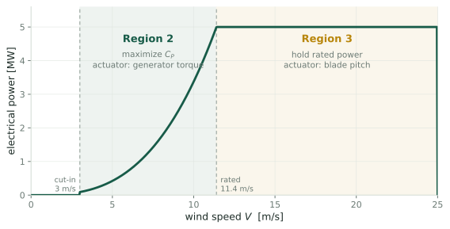

Below rated wind speed the turbine should run at the tip-speed ratio $\lambda = R\Omega/V$
that maximizes the power coefficient $C_P(\lambda)$. The standard controller sets the generator
torque to $u\,\Omega^2$; the **gain** $u$ alone fixes where the rotor settles, at every wind
speed (Unit 1).
:::
::: {}
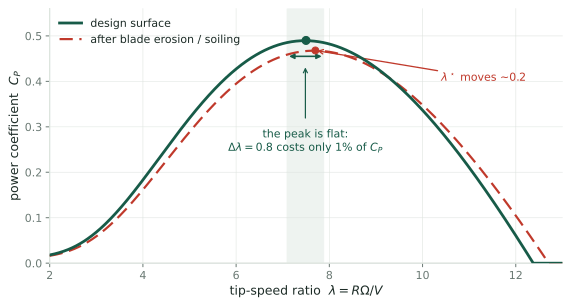

The best gain $u^\star$ depends on the blades, which erode, ice and foul. It must be
**found online**, and found again when it moves.
:::
:::

::: notes
At a fixed tip-speed ratio, both torques scale as V squared, so the wind cancels and
the gain alone sets lambda. The optimum is one number, but it drifts with the blades.
:::

## Extremum seeking finds it, by two routes {.smaller}

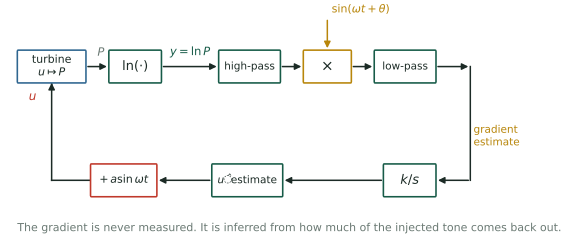{.fig-band}

1. **Dither**: add $a\sin\omega t$ to the gain, period $T = 2\pi/\omega$.
2. **Estimate**: read from log-power $y = \ln P$ how power changes with the gain.
3. **Step**: move the gain uphill, once per period (step size $\kappa$) or continuously.

::: cols2
::: card
[LP-ESC: demodulation]{.cardh}
Correlate $y$ with the dither over each period: the **in-phase channel** $\hat g$ [Rotea 2017; Ciri, Leonardi & Rotea 2019].
:::
::: card
[LP-PIESC: least squares]{.cardh}
Fit $\dot y \approx \theta_0 + \theta_1(\nu - \hat\nu)$ by recursive least squares; proportional-integral update [Kumar & Rotea 2022].
:::
:::

::: notes
Both are log-power schemes: the log removes the mean wind speed from the loop gain.
They differ in how they turn the response into a gradient.
:::

## LP-PIESC: a least-squares fit in place of the correlation {.smaller}

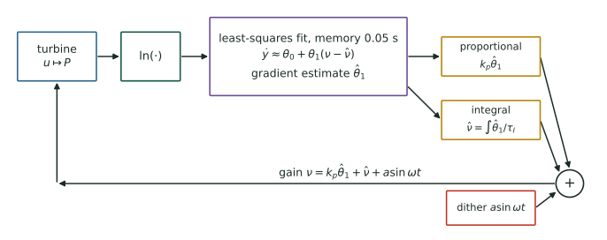{.fig-band}

Published tuning [Kumar & Rotea 2022]: $T = 314$ s, $a = 0.082\,\nu^\star$, estimator memory
$1/k_T = 0.05$ s, ridge $q = 10^{-6}$, $k_p = 5\times10^{-6}$ s, $\tau_I = 2.8$; normalized gain
$\nu = 0.061\,u/u^\star$. Reported to reach the optimum almost at once, with a quarter of
the classical dither.

::: notes
Keep in mind two numbers: a memory of a twentieth of a second, and a period of five
minutes. Their ratio is what decides what this estimator reads.
:::

## Turbulence makes the gain scatter {.smaller}

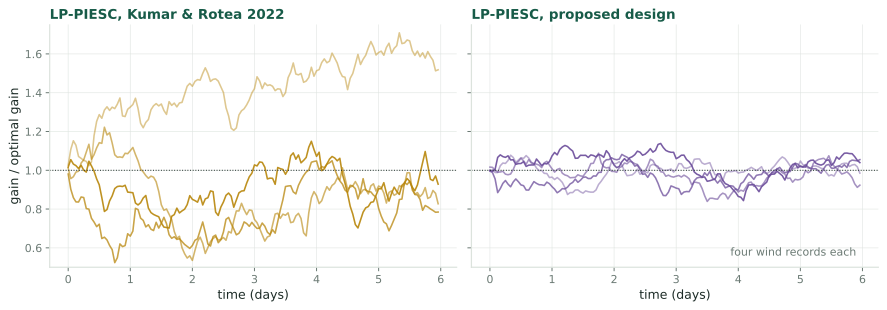{.fig-wide}

::: claim
**Scatter** $\sigma(\tilde u)$: the standard deviation of the gain error $\tilde u = u - u^\star$
once the loop has settled, a spread over time quoted as a fraction of $u^\star$. It concerns
the center of the dither only; the dither's own cost is counted separately. Every
excursion costs power: the loss is $\tfrac12|J''|\,\sigma(\tilde u)^2$ plus the dither's cost.
:::

::: notes
Left: the 2022 LP-PIESC in four wind records over six days, started at the optimum. It
random-walks. Right: our design, same winds. The scatter is the size of this motion.
:::

## What this work answers {.smaller}

Given the wind's spectral density and the tuning of each controller:

1. How noisy is **one gradient estimate** at the optimum, and what does LP-PIESC's estimate measure?
2. How large is the **scatter** of the gain in steady state?
3. How much **power is lost**, and which tuning loses least for a required tracking time?
4. How do the **two routes compare**, and do the predictions survive **simulation**, including the published runs?

::: claim
**The answer in one line.** At the optimum the wind enters log-power as $3\varepsilon$, so
each estimate is the wind seen through a known window; a slow loop sees only the wind's
density at the dither frequency; the scatter, the loss and the best tuning then follow
in closed form from **three numbers**: that density, the curvature of $C_P$ at its peak,
and the rotor time constant.
:::

::: notes
Everything that follows is this one sentence, unpacked and checked.
:::

## The argument in one line {.smaller}

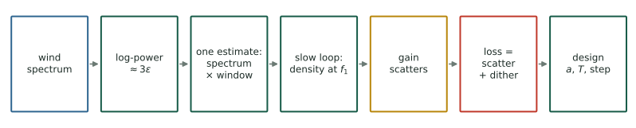

::: cols3
::: card
[The wind]{.cardh}
$\Phi(f_1)$: the turbulence density at the dither frequency $f_1 = 1/T$ (IEC Kaimal or von Kármán).
:::
::: card
[The rotor]{.cardh}
$\tau_r = 6.88$ s: the time constant with which the rotor follows the gain (at 8 m/s).
:::
::: card
[The power curve]{.cardh}
$\chi = 6.3$: how sharply $C_P$ peaks; $|J''(u^\star)|\,u^{\star2} = \chi/9 = 0.70$.
:::
:::

::: notes
Five links, each checked in simulation. Then the design, and the evidence on energy.
:::

## Link 1: at the optimum, the wind enters log-power as $3\varepsilon$ {.smaller}

::: cols2w
::: {}
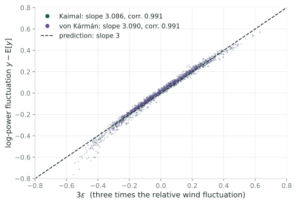
:::
::: {}
With $V = \bar V(1 + \varepsilon)$, power is $\propto V^3 C_P(\lambda)$, so
$$y = \ln P = \text{const} + 3\ln(1+\varepsilon) + \ln C_P(\lambda).$$

At $u^\star$ the power curve is **flat**: $C_P'(\lambda^\star) = 0$, so the wind's effect through
$\lambda$ drops out at first order, and
$$y - \mathbb{E}[y] = 3\,\varepsilon + O(\sigma_\varepsilon^2).$$

[Simulation: slope 3.086 (Kaimal), 3.090 (von Kármán); correlation 0.991.]{.small}
:::
:::

::: notes
A gust changes power only through the cube of the wind speed, because at the peak the
power curve is flat. That single term makes everything else linear.
:::

## Link 2: one estimate sees the spectrum through a window {.smaller}

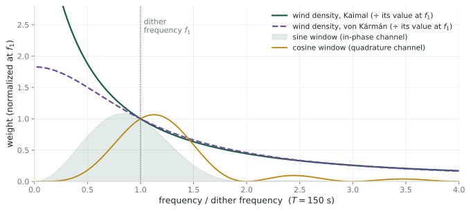{.fig-band}

The demodulated estimate correlates $y$ with $\sin\omega t$, so its noise is
$6Z_n/(aT)$ with $Z_n = \int_0^T \varepsilon(nT+t)\sin\omega t\,dt$, and
$$\operatorname{Var}(Z) = \int \Phi(f)\,|\hat w(f)|^2\,df .$$

[Both windows pass $f_1$ equally; the sine window leans to low frequencies, where the wind has its energy, so the quadrature (cosine) channel is the quieter one per estimate (Units 12–14).]{.small}

::: notes
A linear filter of a stationary wind: its variance is the spectrum integrated against
the filter's squared gain.
:::

## Checked over a tenfold range of dither periods {.smaller}

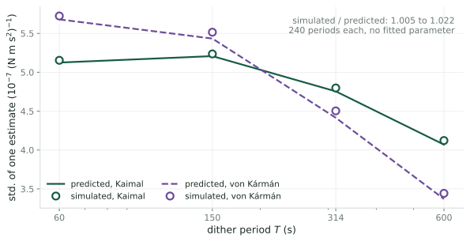{.fig-wide}

::: claim
Predicted and simulated standard deviation of one estimate agree within **0.5 – 2.2 %**
for $T$ from 60 to 600 s under both spectra, with **no fitted parameter**; the small excess
is the size and sign of the terms the prediction leaves out.
:::

::: notes
240 periods per point; sampling uncertainty about 4.6 percent per point.
:::

## The two IEC turbulence spectra {.smaller}

::: cols2w
::: {}
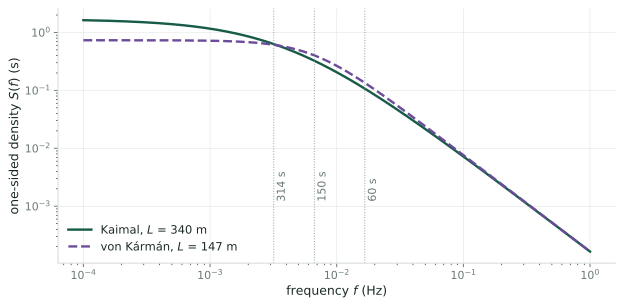
:::
::: {}
- Same flat level $4\sigma_\varepsilon^2 L/\bar V$, so $L$ is the integral length scale:
  **340 m** (Kaimal), **147 m** (von Kármán) at the 90 m hub.
- Both fall as $f^{-5/3}$; they differ mainly near their corners.
- At the published period (314 s) the densities agree within **3 %**; at 60, 150, 600 s
  their ratio is 0.79, 0.81, 1.35.
- Effect on the predicted scatter: at most **11 %** over 60–314 s. **No conclusion changes.**
:::
:::

::: notes
Everything is worked out twice, on equal footing. The spectrum enters only through its
value at the dither frequency.
:::

## Link 3: the published LP-PIESC reads the quadrature channel {.smaller}

::: cols2w
::: {}
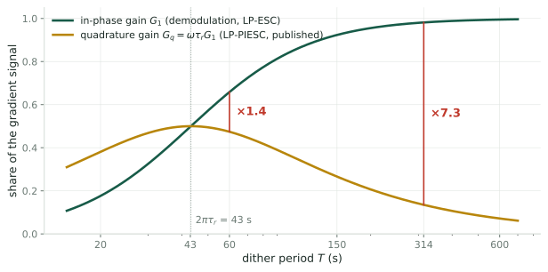
:::
::: {}
Over a 0.05 s memory the regressor is frozen, so the ridge fit returns the minimum-norm
product
$$\hat\theta_1 = \frac{d\,\dot y}{1 + d^2 + \gamma},$$
whose period average is the **cosine** (quadrature) coefficient of $y$. Its signal is
$G_q = \omega\tau_r G_1$: **0.135** against **0.981** for demodulation at 314 s.

[Simulation: $\hat\theta_1$ follows $d\,\dot y$ with correlation 0.997; in-phase / quadrature 7.24, predicted $1/(\omega\tau_r) = 7.27$.]{.small}
:::
:::

::: notes
The estimator sees the gradient only through the rotor's lag. A rotor without lag would
give it no gradient signal at all.
:::

## Link 4: a slow loop sees one frequency {.smaller}

::: cols2w
::: {}
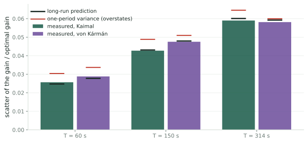
:::
::: {}
Averaging $N$ estimates is one estimate over $N$ periods; its window narrows onto $f_1$
(Fejér). So the noise a slow loop feels is the **long-run variance**
$$\sigma_\infty^2 = \frac{2\Psi}{a^2T},\qquad \Psi = 9\,\Phi(f_1),$$
and the scatter at tracking time $\tau_c$ is
$$\sigma(\tilde u)^2 = \frac{\Psi}{a^2 g^2\,\tau_c\,J''^2},\quad g = G_1 \text{ or } G_q .$$

[Simulated loops: within **4 %** of the long-run prediction; one period's variance overstates by up to 18 %.]{.small}
:::
:::

::: notes
The period cancels from the scatter once you fix the tracking time; the wind enters
through its density at one frequency.
:::

## Link 5: loss = scatter + dither; the best amplitude balances them {.smaller}

::: cols2w
::: {}
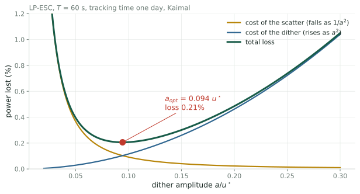
:::
::: {}
$$\ell(a) = \underbrace{\frac{\Psi}{2a^2g^2\tau_c|J''|}}_{\text{scatter}} + \underbrace{\tfrac14|J''|G_1a^2}_{\text{dither}}$$

Least when the two are **equal**:
$$a_{opt} = \Big(\frac{2\Psi}{g^2G_1\tau_cJ''^2}\Big)^{1/4},\qquad
\ell_{min} = \sqrt{\frac{\Psi G_1}{2\tau_c g^2}}.$$

Then $\kappa = T/(\tau_c G_1|J''|)$ (LP-ESC) or $\tau_I = \tau_c\pi a^2G_q|J''|/T$ (LP-PIESC).
:::
:::

::: notes
A larger dither lets a loop of fixed tracking time take smaller steps and scatter less,
but the dither itself costs power. The least loss balances the two.
:::

## Choosing the period {.smaller}

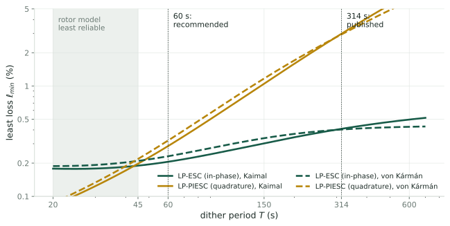{.fig-wide}

::: claim
Shorter periods move $f_1$ up the falling spectrum, so the least loss falls, until the
rotor's lag takes over. **Recommendation: $T = 60$ s** (about nine rotor time constants):
LP-ESC **0.21 %**, LP-PIESC **0.29 %** (Kaimal, one day), against 0.41 % and 2.98 % at 314 s.
The quadrature penalty $1/(\omega\tau_r)$ falls from **7.3** to **1.4**.
:::

::: notes
Below about 45 seconds the static power curve and the first-order rotor are least
reliable, so we stop at 60.
:::

## The published LP-PIESC tracks in 5.1 days {.smaller}

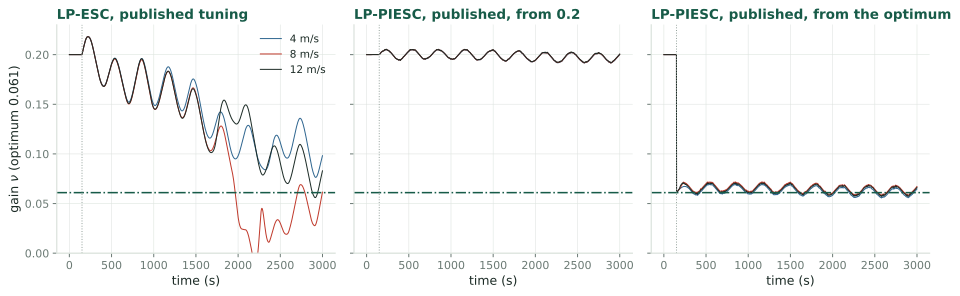{.fig-wide}

::: claim
Its integral path is a slow loop on the quadrature channel with loop gain
$7.13\times10^{-4}$ per period: tracking time **5.1 days**, stationary scatter **0.33 $u^\star$**,
loss **3.9 %** (Kaimal). The published fast convergence appears only when the integrator
**starts at the optimum**, which the closed-form optimum makes possible.
:::

::: notes
LP-ESC with its published tuning converges in about 1000 seconds, as reported. LP-PIESC
barely moves from any other start in 3000 seconds.
:::

## Energy over six days, every controller in the same wind {.smaller}

::: bigtable
| controller ($T$, $a/u^\star$) | Kaimal, days 2–6 | predicted | von Kármán, days 2–6 | predicted |
|---|---|---|---|---|
| LP-ESC, Kumar & Rotea 2022 (314 s, 0.33) | 4.51 % | | 4.48 % | |
| LP-PIESC, Kumar & Rotea 2022 (314 s, 0.082) | 3.19 % (0.9–7.1) | 3.9 %^a^ | 3.09 % | |
| LP-ESC, Ciri, Leonardi & Rotea 2019 (150 s, 0.136) | 0.385 % | 0.38 % | 0.406 % | 0.39 % |
| **LP-PIESC, our design (60 s, 0.111)** | **0.275 %** | 0.29 % | **0.308 %** | 0.32 % |
| **LP-ESC, our design (60 s, 0.094)** | **0.227 %** | 0.21 % | **0.258 %** | 0.23 % |
:::

[Energy lost against a turbine held at $u^\star$ in the same wind; mean of four six-day records. ^a^ stationary prediction for a 5.1-day tracking time, which six days do not reach. Our designs and the 2019 design use a one-day tracking time.]{.tiny}

::: claim
The designs **lose what the formulas predict**. The 2022 LP-PIESC depends on the wind
record (0.9 to 7.1 %); the 2022 LP-ESC loses 1.94 points to its large dither alone.
:::

::: notes
Every number here is in the claim checker. The prediction for the designs comes from
three numbers and was made before the simulation.
:::

## After the optimum moves {.smaller}

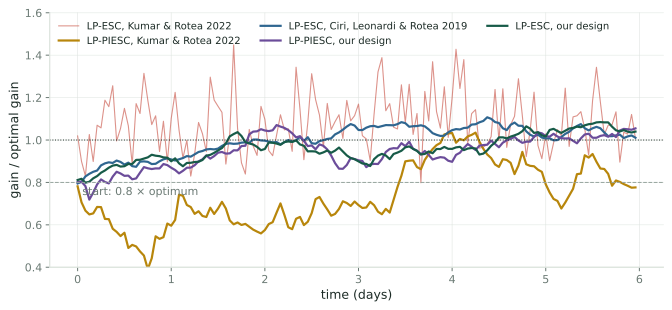{.fig-wide}

::: claim
Gain started at **0.8 $u^\star$**. Energy lost on the first day: our LP-ESC **0.67 %**,
LP-ESC 2019 0.89 %, LP-PIESC 2022 **3.2 %** (0.6 to 9 % with the wind record), LP-ESC 2022 4.2 %.
The 2022 LP-PIESC's gain wanders instead of converging (0.78–1.45 $u^\star$ after six days).
:::

::: notes
One wind record shown. The designs return within about a day, as their tracking time says.
:::

## Gains over the published designs {.smaller}

::: kpis
::: {.kpi .blue}
[−41 %]{.big}
[energy lost vs. the best published design (LP-ESC, Ciri, Leonardi & Rotea 2019, same tracking time): 0.16 points, **27 MWh** per turbine-year at 8 m/s. Von Kármán: −36 %.]{.lab}
:::
::: {.kpi .gold}
[÷14]{.big}
[vs. LP-PIESC, Kumar & Rotea 2022: 2.97 points, **508 MWh** per turbine-year. Our LP-PIESC retuned by the same rules: ÷12.]{.lab}
:::
::: {.kpi .hot}
[÷20]{.big}
[vs. LP-ESC, Kumar & Rotea 2022: 4.28 points, **733 MWh** per turbine-year, 1.94 points of it the large dither alone.]{.lab}
:::
:::

::: remark
Measured in our simulator: NREL 5 MW rotor with a static power curve and a first-order
rotor, aerodynamic power, 8 m/s, turbulence intensity 0.10, synthesized turbulence. The
published designs were tuned in other simulators; the comparison holds turbine, wind and
(for the 2019 design) tracking time fixed, so the design is the only difference. Reference
turbine: 1.95 MW mean, 17.1 GWh per year at this wind.
:::

::: notes
The gain over the best published design comes entirely from the period and the
amplitude: shorter period, amplitude set where scatter and dither cost the same.
:::

## When is LP-PIESC the right choice? {.smaller}

::: cols2
::: card
[The gap is a tuning choice]{.cardh}
The penalty comes from the 0.05 s memory plus fitting $\dot y$. Fit $y$ itself over a full
period and least squares reads the **in-phase** channel, with demodulation's loss. At
60 s the published estimator costs only **20 %** more (0.275 vs 0.227 %).
:::
::: card
[Least squares gives more than an estimate]{.cardh}
An explicit model, an information matrix that can serve as an **error bar**, and updates
in **continuous time**: useful for a loop that acts on its own uncertainty.
:::
::: card
[The quadrature channel's one merit]{.cardh}
A slow wind **drift** within a period reads as gradient in the sine window but cancels in
the cosine window. It loses more signal ($\times\omega\tau_r$) than it saves in noise.
:::
::: card
[Speed was the published motivation]{.cardh}
This work measures steady-state loss of a slow loop and neglects the proportional path.
Whether a retuned least-squares loop **recovers faster** after the optimum moves is open.
:::
:::

::: notes
For steady-state energy capture, choose demodulation or a full-period least-squares fit.
Choose LP-PIESC's structure where its model, its error bar or a faster transient is
needed, and tune it by these rules.
:::

## The design procedure {.smaller}

::: cols2
::: {}
**Three numbers**

1. $\tau_r = \dfrac{2I\lambda^{\star2}}{3\rho\pi R^4\bar V C_P^{max}}$ from the rotor data.
2. $\chi$ from the design power curve: $|J''(u^\star)| = \chi/(9u^{\star2})$.
3. $\Psi = 9\,\Phi(1/T)$ from the site's spectrum (or the IEC model).

**One choice**: the tracking time $\tau_c$ (blades change over weeks; recover from
start-up within a day: $\tau_c = 1$ day).
:::
::: {}
**Then**

4. $T \approx 9\,\tau_r$ (60 s here).
5. $a = a_{opt}$.
6. $\kappa = T/(\tau_cG_1|J''|)$ or $\tau_I = \tau_c\pi a^2G_q|J''|/T$.

::: claim
An error in the curvature changes only the tracking time ($\tau_c|J''_d/J''|$); the loop
stays unbiased.
:::
:::
:::

::: notes
Everything needed before any simulation is run.
:::

## Limits, and the next step {.smaller}

- **Stationary wind**, fixed mean speed and turbulence intensity; a day mixes wind states.
- **Point spectra** of the standard; the rotor averages the wind over its disk (affects content above about 0.06 Hz).
- **Static power curve and first-order rotor**; induced-flow lag and drivetrain outside the model.
- **Aerodynamic, not electrical, power**: the term $I\Omega\dot\Omega$ matters when $\omega\tau_r$ is not small (0.72 at 60 s).
- **LP-PIESC**: proportional path and projection neglected.
- **The simulations use the same spectra** as the analysis: they test the derivation, not the wind models.

::: openq
**Next:** test the predictions on measured turbine data and electrical power, and measure
recovery speed after the optimum moves, where LP-PIESC was meant to excel.
:::

## Summary {.smaller}

::: claim
1. At the optimum the wind enters log-power as **$3\varepsilon$**, so each gradient estimate is the wind seen through a known window.
2. A slow loop sees only the wind's density **at the dither frequency**; the scatter is $\sqrt{\Psi/(a^2g^2\tau_cJ''^2)}$.
3. The published LP-PIESC reads the **quadrature channel**, $\omega\tau_r$ of the signal, and tracks in **5.1 days**.
4. Loss = scatter + dither; the **minimum-loss design** follows from three numbers, at $T \approx 9\tau_r$.
5. Measured over six days: **0.23 %** lost, **41 % less** than the best published design and **14–20× less** than the 2022 tunings.
:::

[Technical report and workbook: rotea repository, `papers/esc-spectral-noise/`.]{.small}

## Backup {.divider}

## B1: The rest point, and why the wind cancels {.smaller}

At a fixed tip-speed ratio $\lambda = R\Omega/V$, aerodynamic torque
$\tfrac12\rho\pi R^3V^2C_P(\lambda)/\lambda$ and generator torque $u\Omega^2 = u\lambda^2V^2/R^2$
both scale as $V^2$. The torque balance is wind-free:
$$\frac{C_P(\lambda)}{\lambda^3} = c_u\,u,\qquad c_u = \frac{2}{\rho\pi R^5}.$$

For every gain below $1.86\,u^\star$ there is exactly **one** rest point, on the branch through
$\lambda^\star$; it is stable, and near it the rotor is first order with time constant $\tau_r$
(Units 1–2). Log-power at rest is a wind constant plus $J(u) = \ln C_P(\lambda_{eq}(u))$, which
peaks at $u^\star = 2.23\times10^6$ N m s² with $J''(u^\star) = -\chi/(9u^{\star2})$ (Unit 3).

## B2: The rotor time constant, and the inertia {.smaller}

$$\tau_r = \frac{2I\lambda^{\star2}}{3\rho\pi R^4\bar V C_P^{max}} = 6.88\ \text{s at } 8\ \text{m/s},\qquad \tau_r\propto 1/\bar V.$$

Inertia from the NREL 5 MW blade and hub data, moving each blade to the shaft by the
parallel-axis theorem:
$$I_{rotor} = 3\cos^2\beta_p\,(I_b + 2r_hS_b + m_br_h^2) + 115\,926 = 3.88\times10^7\ \text{kg m}^2,$$
plus the generator, $97^2\times534$: $I = 4.38\times10^7$ kg m². The value $3.54\times10^7$ used
in [Kumar & Rotea 2022] omits the hub-radius offset $r_h = 1.5$ m.

## B3: The rotor seen from the gain {.smaller}

A first-order lag with unit static gain and time constant $\tau_r$, followed by the slope $J'$.
A dither $a\sin\omega t$ returns as
$$\delta y = J'a\,(G_1\sin\omega t - G_q\cos\omega t),\qquad G_1 = \frac{1}{1+(\omega\tau_r)^2},\quad G_q = \omega\tau_rG_1 .$$
At 314 s: $G_1 = 0.981$, $G_q = 0.135$; at 60 s: $G_1 = 0.66$, $G_q = 0.48$. The two cross at
$T = 2\pi\tau_r = 43$ s, where $G_q = 1/2$ is largest (Unit 4).

## B4: The estimate in calm wind {.smaller}

The demodulated estimate is a Fourier coefficient: $\hat g_n = B_1/a$, $\hat g^c_n = A_1/a$
(first sine and cosine coefficients of $y$ over the period). It ignores the mean and every
higher harmonic, but a drift within the period reads as gradient (Unit 5).

Its bias: $\hat g_n = J'(u_n) + \tfrac{a^2}{8}J'''(u_n) + O(a^4)$. At $a = 0.136\,u^\star$ the loop
settles **0.37 %** above $u^\star$, costing about $5\times10^{-6}$ of the power, against 0.32 % for
the dither itself (Unit 6). The error that matters is random.

## B5: The wind as a random process {.smaller}

$V = \bar V(1+\varepsilon)$, $\varepsilon$ stationary with autocovariance
$\Gamma(\tau) = \mathbb{E}[\varepsilon(t)\varepsilon(t+\tau)]$, $|\Gamma| \le \Gamma(0) = \sigma_\varepsilon^2 = \mathrm{TI}^2$,
and spectral density $\Phi(f) = \int\Gamma(\tau)e^{-i2\pi f\tau}d\tau$, one-sided $S = 2\Phi$,
$\sigma_\varepsilon^2 = \int_0^\infty S\,df$ (Units 7–8). Remainders are ranked by RMS in powers of
$\sigma_\varepsilon$; with sixth moments finite, products of $k \le 3$ filtered winds are
$O(\sigma_\varepsilon^k)$ (Unit 9).

The tip-speed ratio sees the **high-passed** wind (corner $1/(2\pi\tau_r) = 0.023$ Hz); its mean
stays at $\lambda^\star$ to second order (Unit 10). In the Kaimal model 72 % of the variance lies
below that corner.

## B6: The least-squares estimator, unpacked {.smaller}

The recursion computes, at every instant, the minimizer of an exponentially weighted ridge
cost with memory $1/k_T$ (Unit 15). LP-PIESC's states combine into $z = \tilde y + c^\top\hat\theta$
with $\dot z = -k_fz + \dot y$: it regresses low-pass-filtered $\dot y$ on the equally filtered
regressor, effective ridge $\gamma = qk_f^2 = 4\times10^{-4}$ (Unit 16).

Memory number $\mathcal M = \omega^2/(k_T^2\gamma) = 0.0025$: the regressor is frozen over the
memory, so the fit is the **minimum-norm** product, whose period average is the quadrature
channel (Unit 17). A fit of $y$ on $[1, d]$ over a full period returns the in-phase channel.

## B7: Correlated noise and the long-run variance {.smaller}

A first-order recursion $x_{n+1} = \alpha x_n + \kappa v_n$ with correlated noise has variance
$$\frac{\kappa^2\sigma_v^2}{1-\alpha^2}\Big[1 + 2\sum_{k\ge1}\alpha^k\rho_k\Big],$$
and as the loop slows the bracket tends to $1 + 2\sum\rho_k$, the **long-run variance** per
sample (Units 20–21). Summed in the frequency domain with Fejér's kernel, it is
$2\Psi/(a^2T)$, for both channels (Unit 22). For Kaimal at 150 s one period's variance is
1.29× the long-run value (in-phase) and 0.87× (quadrature).

## B8: Short records under-measure the scatter {.smaller}

The sample variance of a record is low by the variance of its own mean:
$\mathbb{E}[s^2] = \sigma^2 - \operatorname{Var}(\bar x)$ (Unit 21). For a two-day record of a loop with a
six-hour tracking time (eight tracking times), the sample standard deviation is
**0.88** of the true one, a 12 % shortfall. The nonlinear comparison of LP-PIESC against
demodulation applies this factor to its predictions.

## B9: Away from the optimum {.smaller}

Away from $u^\star$ the rotor adds a high-passed copy of the wind to log-power with weight
$\eta \approx 2.1\,\tilde u/u^\star$. The noise is multiplied by $|1 + \eta H(f_1)/3|$; for a loop
whose scatter is $0.1\,u^\star$ it changes by about **2 %** (Unit 26). The noise model derived at
$u^\star$ holds over the gains a converged loop visits.

## B10: The synthesized wind {.smaller}

A sum of cosines with independent uniform phases, amplitudes $\sqrt{2S(f_k)/D}$: strictly
stationary with the target spectrum on its frequency grid. A ten-hour record sampled at
0.5 s lacks **2.7 %** of the variance (mostly above the Nyquist frequency), so its turbulence
intensity is 9.86 % (Kaimal); it is Gaussian to within an excess kurtosis of −0.002 (Unit 27).
Runs under the two spectra share their random phases.

## B11: Where the optimum sits in turbulence {.smaller}

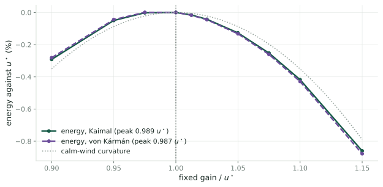{.fig-band}

Fixed gains, no dither: the energy peaks at **0.99 $u^\star$**; mean log-power, which the loops
climb, at **1.013 $u^\star$** (1.014 von Kármán). The difference costs about 0.02 % of the energy.
The dither alone, centre held at $u^\star$, costs **exactly** the calm-wind $\tfrac14|J''|G_1a^2$:
0.102 % at 60 s and 0.094 $u^\star$, 0.116 % for the published LP-PIESC dither.

## B12: Why the 2022 LP-ESC tuning loses 4.5 % {.smaller}

- Its dither, $a = 0.33\,u^\star$ at 314 s, costs **1.94 %** on its own (measured; the quadratic formula gives 1.88 %).
- Its integrator is fast: it reaches the optimum's neighbourhood within the first hour, but swings the gain by **0.17 $u^\star$** root-mean-square, about a mean 10 % above $u^\star$.
- Together: 4.5 %, steady, independent of the start.

Both it and the 2019 design are LP-ESC; the difference is the tuning.

## B13: Simulation setup {.smaller}

::: bigtable
| | |
|---|---|
| turbine | NREL 5 MW rotor, Heier power curve rescaled to $(7.48, 0.4895)$, $I = 4.38\times10^7$ kg m² |
| wind | 8 m/s, TI 0.10, Kaimal ($L$ = 340 m) and von Kármán (147 m), synthesized, 0.5 s |
| integration | adaptive Runge–Kutta (demodulation tests); Euler, 5 ms (LP-PIESC and energy runs) |
| energy runs | five controllers + reference at $u^\star$, same wind; 6 days × 4 records × 2 spectra × 2 starts |
| checks | 523 stated numbers recomputed from formulas and stored results by the claim checker |
:::

## B14: Running example {.smaller}

::: bigtable
| quantity | value |
|---|---|
| rotor radius, air density | 63 m, 1.225 kg/m³ |
| optimum | $\lambda^\star = 7.48$, $C_P^{max} = 0.4895$, $u^\star = 2.23\times10^6$ N m s² ($\nu^\star = 0.061$) |
| curvature | $\chi = 6.3$, $|J''(u^\star)|u^{\star2} = 0.70$ |
| rotor time constant | 6.88 s at 8 m/s |
| dither periods | 60 s (recommended), 150 s (2019 design), 314 s (2022 tunings) |
| tracking time | one day (designs) |
:::

## References {.smaller}

- [R17] M. A. Rotea, "Logarithmic power feedback for extremum seeking control of wind turbines," *IFAC-PapersOnLine*, vol. 50, no. 1, pp. 4504–4509, 2017.
- [CLR19] U. Ciri, S. Leonardi, M. A. Rotea, "Evaluation of log-of-power extremum seeking control for wind turbines using large eddy simulations," *Wind Energy*, vol. 22, pp. 992–1002, 2019.
- [KR22] D. Kumar, M. A. Rotea, "Wind turbine power maximization using log-power proportional-integral extremum seeking," *Energies*, vol. 15, 1004, 2022.
- [GD17] M. Guay, D. Dochain, "A proportional-integral extremum-seeking controller design technique," *Automatica*, vol. 77, pp. 61–67, 2017.
- [J09] J. Jonkman, S. Butterfield, W. Musial, G. Scott, "Definition of a 5-MW reference wind turbine for offshore system development," NREL/TP-500-38060, 2009.
- [IEC] IEC 61400-1, *Wind turbines – Part 1: Design requirements*.
