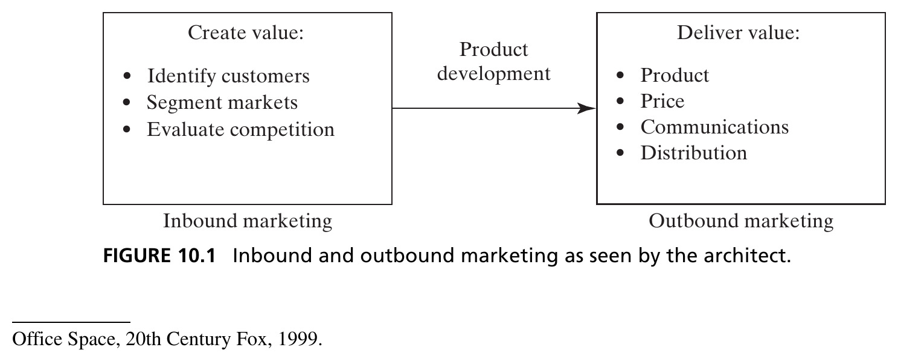
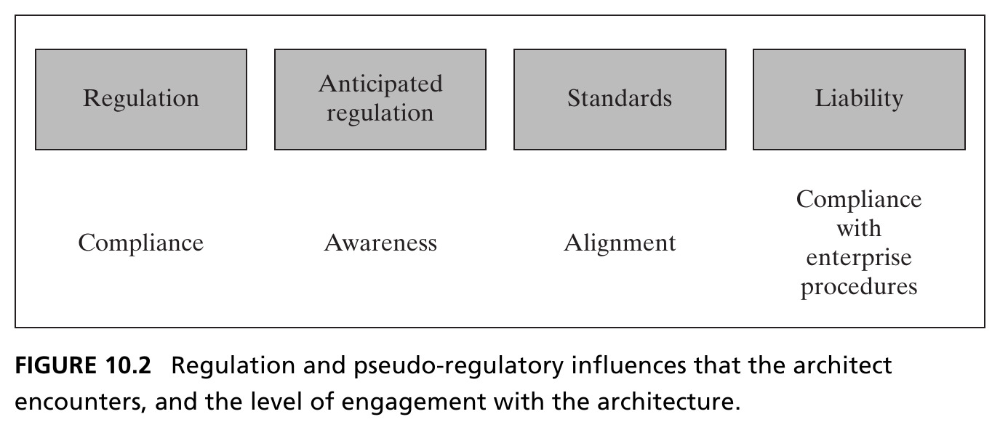
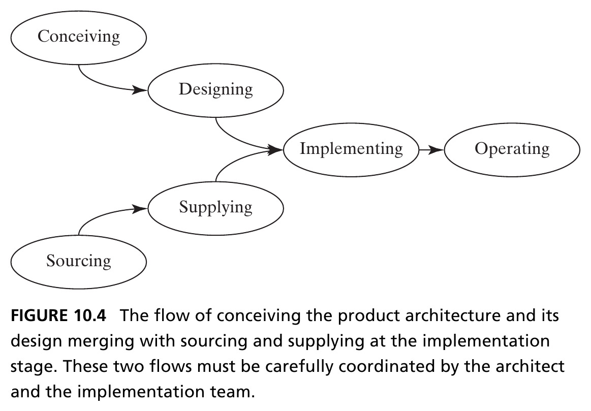
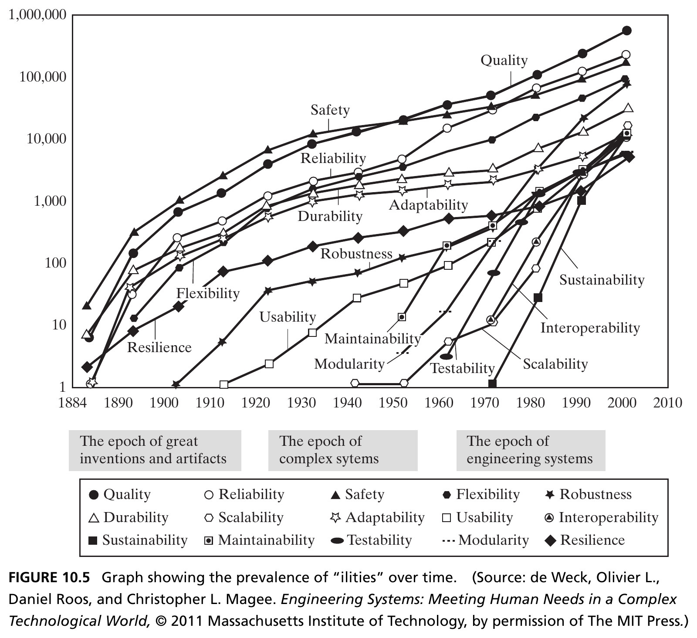
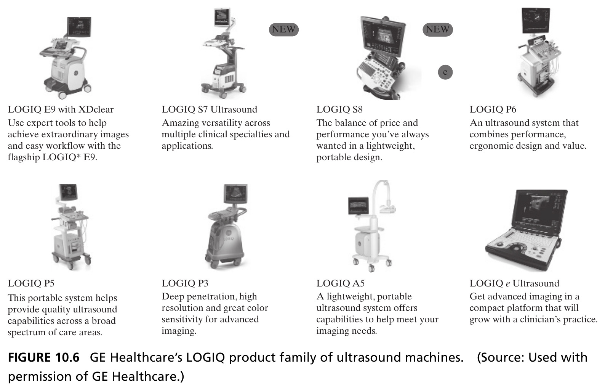
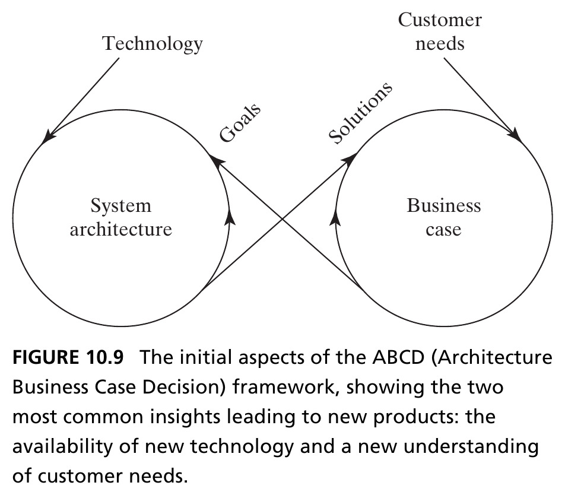
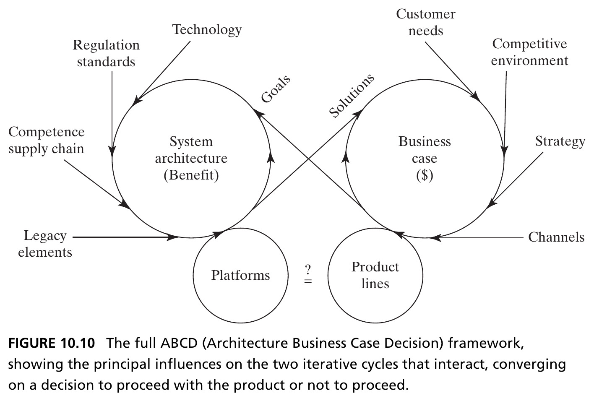
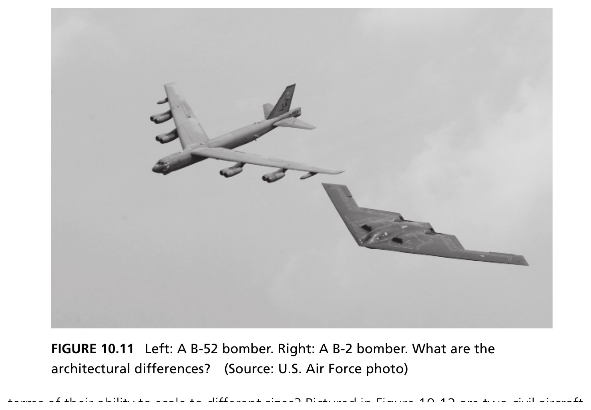
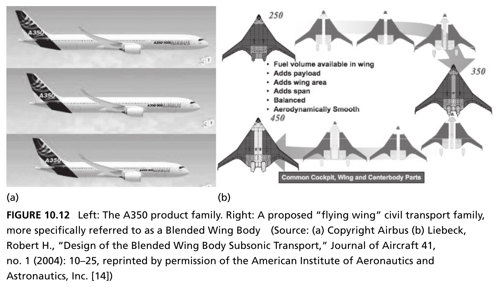
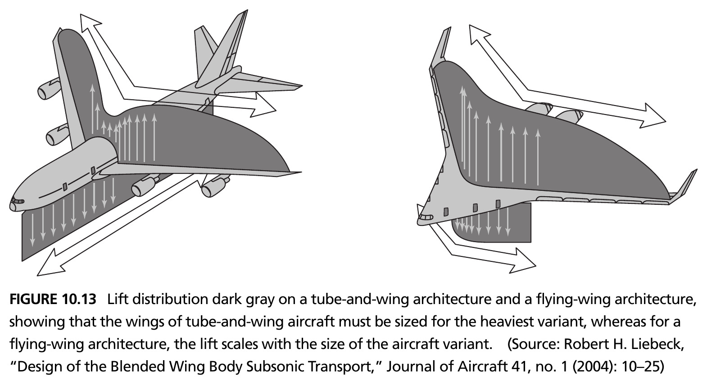

## Beyond the Architect's Immediate Control {.smaller}

- Chapter 9 established the architect's role: reduce ambiguity, employ creativity, manage complexity
- Much of that ambiguity comes from **upstream** influences (strategy, marketing, customers, technology, regulation) and **downstream** influences (implementation, operations, Design for X, product evolution)
- The architect doesn't control these, but must understand them well enough to make good decisions
- For each influence, ask how much it affects **architectural** decisions. Will marketing affect whether the car is two-wheel or four-wheel drive?

::: {.fragment .callout-tip title="Roadmap: the ABCD Product Case"}
This chapter surveys the principal upstream and downstream influences, then shows how they combine in an iterative decision framework: the **ABCD Product Case**.
:::

::: {.notes}
- Upstream and downstream influences affect architecture even when the architect does not control them. This chapter examines their relationships to architectural decisions, then combines them in the ABCD Product Case.
- Architectural decisions affect the form-function mapping, performance limits, major tradeoffs, and cost. Examples include the number of driven wheels on a car, an aircraft's tail configuration, and whether an algorithm must operate in real time.
- Detailed design choices, such as seat upholstery, usually have more predictable effects. Identify the decisions with potentially large or emergent consequences early.
- The book uses Kahneman's observation to question reliance on intuition under high stakes. Later component optimization may not repair an unsuitable architectural choice.

**Discussion:** Can an architect ignore an influence because it is outside their control?

**Suggested answer:** No. External influences still affect feasibility and value. Identify their implications, clarify uncertain assumptions with the responsible parties, and adapt the architecture accordingly.

:::

## Box 10.1 · Which Decisions Are Architectural? {.smaller}

| Architectural decision | Detailed design decision |
|---|---|
| Driven wheels on a car; tail or no tail on an aircraft; real-time or batch algorithm | Seat fabric or another local finish |

Architectural choices set the **form–function mapping**, performance envelope, major tradeoffs, and often cost. Their consequences can spread through the whole system, so they are expensive to change late.

::: {.side-caption}
Adapted from Crawley, Cameron & Selva (2016), Box 10.1.
:::

::: {.notes}
- An architectural decision creates fundamentally different system concepts; a local detail normally has more predictable effects.
- A seat-material change can affect cost, but is less likely to change the system's form–function mapping or produce large emergent consequences.
- Identify these decisions early, state their assumptions, and compare alternatives before detailed optimization makes a concept hard to change.

**Discussion:** Why might component optimization fail to repair a poor architectural choice?

**Suggested answer:** If the architecture fixes an unsuitable performance envelope or coupling pattern, improving one component cannot remove the system-level constraint.
:::

# 10.2 Upstream Influence: Corporate Strategy

## A Strategy Must Say What It Excludes {.smaller}

- **Corporate strategy** is the means by which an enterprise achieves its goals: profitability and shareholder value for a firm, the mission for a government agency
- A useful strategy defines the mission, the scope of activities, long- and intermediate-term goals, resource allocation decisions, and planned initiatives
- It must **differentiate**: which markets, features, and customers are considered, and which are **excluded**
- "Grow the revenue of the firm while maintaining the product margins" conveys almost nothing about the decisions the firm has made

::: {.fragment .callout-note appearance="simple" icon=false}
"Strategy involves calculated gambles. If success were assured, strategy would be called investing in risk-free bonds!" (Crawley, Cameron & Selva, §10.2)
:::

::: {.notes}
- An effective strategy communicates vision and direction to stakeholders and the team, and guides the investment of scarce resources. It should form a coherent, unifying, and integrative pattern of decisions.
- Exclusions make a strategy useful to the architect. Knowing which segments, features, and customers will not be served removes ambiguity from the goals.
- A strategy that excludes nothing gives no guidance for architectural decisions.

**Discussion:** Rewrite "grow revenue while maintaining margins" as a statement an architect could act on.

**Suggested answer:** Name a target segment, a basis of competition, and an exclusion. For example (an illustration, not from the book): "Enter the commercial inspection-drone market by competing on endurance; do not pursue the consumer segment." The architect can now derive goals for endurance, payload, and certification, and drop consumer-oriented features.
:::

## Strategy and Architecture Shape Each Other {.smaller}

In many technology firms, the architecture has an enormous impact on corporate strategy, and vice versa.

::: {.columns}
::: {.column width="50%"}
**IBM PC**

- Strategy decision: outsource the operating system to Microsoft
- Architecture decision: a stable architecture for the PC
- Together, these shaped the desktop computer market for 25 years
:::
::: {.column width="50%"}
**Airbus A319 / A320 / A321**

- Architecture decision: a common glass cockpit across the family
- Strategy effect: Airbus could sell airlines the benefits of **commonality** through training and maintenance savings
:::
:::

::: {.notes}
- IBM: a sourcing decision combined with an architectural decision. A commonly told consequence, beyond what the book states: the stable, well-documented architecture enabled compatible machines from other manufacturers, and much of the industry's value moved to the operating system and processor suppliers.
- Airbus: an architectural choice created a market strategy. Training and maintenance savings became part of the sales argument for the whole family.
- The architect therefore needs to understand strategy well enough to see when an architectural choice creates or forecloses strategic options.

**Discussion:** In each example, which way does the influence run?

**Suggested answer:** IBM: strategy (outsourcing) and architecture (a stable PC architecture) together shaped the market, which in turn constrained IBM's later strategic options. Airbus: architecture (the common cockpit) enabled a market strategy (selling commonality). The influence runs in both directions.
:::

## Four Levels of Strategy {.smaller}

::: {.chapter10-table}
| Level | What it tells the architect | Example from the book |
|:----|:-------|:-------|
| **Shareholder annual report** | Public long-term objectives, action programs, and resource priorities; says little about what is excluded | "Be the largest automotive OEM by units sold in 2018" |
| **Executive** | Which businesses the firm is in; where it invests selectively; what it excludes | BMW exits Formula 1 in 2009 and creates BMW i for small, efficient city vehicles |
| **Business unit** | How the unit segments its customers, which threats it mitigates, which opportunities it excludes | How BMW i segments customers and chooses its investments |
| **Functional** | How marketing, R&D, sourcing, and product development serve the corporate goals | "What must sourcing do if the firm wants to be first to market with technology?" |
:::

::: {.side-caption}
Adapted from Crawley, Cameron & Selva (2016), §10.2. The architect must be intimately familiar with the business unit strategy and deeply engaged with the functional strategies.
:::

::: {.notes}
- Public statements say little because information shared with competitors cannot reveal real priorities. Which of the five largest automakers doesn't want to be the largest?
- Financial analysts' reports are another window. They assess opportunities and threats in the competitive environment and the firm's strengths and weaknesses, such as a core competency in paper-routing mechanisms or a weakness in crafting service plans.
- BMW weighed brand awareness, brand association with F1, and technology trickle-down against the opportunity cost of other marketing and R&D investments. It forecast that "premium" would increasingly mean sustainability. The executive decision was an explicit exclusion, and it created a new business segment.
- The business unit level is where strategy becomes specific enough to set goals for a product.

**Discussion:** Why is the shareholder annual report the least useful level for an architect?

**Suggested answer:** It is written for a public audience that includes competitors, so it states broad objectives without revealing priorities or exclusions. The architect needs the executive, business unit, and functional levels, which are usually internal.
:::

## Functional Strategies: Questions the Architect Asks {.smaller}

::: {.chapter10-table}
| Function | Key strategy questions |
|:----|:-----------|
| **Marketing** | Where does the company compete (markets, segments, competitors, geography)? How does it compete (cost, quality, services, feature innovator or follower)? |
| **R&D / Technology** | How important is new technology? Will it be developed or acquired, at what level of investment, with what multiproduct planning? |
| **Manufacturing / Sourcing** | How important is low-cost manufacturing? Internal manufacturing or outsourcing? How will suppliers be integrated? |
| **Product Development** | How will new products be developed? Any platforming? Global or regional products? Internal, outsourced, or an alliance? |
:::

::: {.side-caption}
From Crawley, Cameron & Selva (2016), §10.2.
:::

::: {.notes}
- Each answer constrains the architecture. Competing as a feature innovator rather than a follower changes how much technology risk is acceptable. Outsourcing turns supplier boundaries into architectural boundaries (Section 10.6). Platforming commits the enterprise to a product-family architecture (Section 10.9).
- Several of these functional strategies return later in the chapter as influences in their own right.

**Discussion:** Which of these answers would most change the architecture of a consumer drone?

**Suggested answer:** Several could. A decision to platform across a family forces shared modules and stable interfaces. A decision to outsource the flight controller makes it a supplier-defined module. A decision to compete on cost may rule out expensive sensors. Ask these questions before concept selection.
:::

## Reading Strategy in Financial Terms {.smaller}

At every level, strategic goals are often stated in **corporate finance** terms. The architect must translate them into product implications.

::: {.chapter10-table}
| Goal as stated | The architect's question |
|:------|:------|
| 20% compound annual growth rate (CAGR) for a market entry in Asia | What product development timeline does this imply? |
| R&D at 3% of revenues | Is that enough to develop the lead variant of a product family? |
| Second and third variants | Will they help amortize the lead variant's investment? What is the ROI of each variant compared with the platform as a whole? |
:::

::: {.fragment .callout-tip title="Quick check"}
At 20% CAGR, revenue doubles in about ln 2 / ln 1.2 ≈ 3.8 years. Can the product, its variants, and its supply chain be ready in time to carry that growth?
:::

::: {.notes}
- The book's warning: an architect who cannot interpret a 20% CAGR target in terms of development timelines will fail at communicating goals for the project.
- The doubling time is an added illustration, not from the book: solving 1.2^t = 2 gives t ≈ 3.8 years.
- The lead variant often carries the platform investment. Whether later variants actually share it decides whether the platform earns more than standalone products would (see divergence in Section 10.9).

**Discussion:** A firm sets R&D at 3% of revenues. What would you need to know to judge whether that funds the lead variant?

**Suggested answer:** The revenue base, the lead variant's estimated development cost and schedule, how much of that cost later variants will share, and when the variants will start producing revenue. Compare the cumulative R&D budget with the cumulative development cost over the schedule.
:::

## Four Couplings Between Strategy and Architecture {.smaller}

::: {.chapter10-table}
| Aspect | Strategy → architecture | Architecture → strategy |
|:----|:-------|:-------|
| **Mission and scope** | Address the enterprise's mission and stakeholder needs; respect the activities strategy excludes | The architecture can constrain the scope available to strategy; communicate that constraint |
| **Enterprise goals** | Meet revenue, margin, ROI, and growth goals; align with a market opportunity or defend against a threat; build on core competencies | Advocate for expanding competencies, or plan to go outside the enterprise |
| **Resource allocation** | Fit within the resource allocation guidelines | Know the decision process and defend the allocation |
| **Initiatives and action plans** | Leverage corporate initiatives and functional strategies | Enable new functional strategies, or communicate constraints that complicate them |
:::

::: {.side-caption}
Condensed from Crawley, Cameron & Selva (2016), §10.2.
:::

::: {.notes}
- The book asks two questions together: how does strategy affect architecture, and how does architecture affect strategy? Students tend to forget the right-hand column.
- The Airbus cockpit is a right-column example: an architectural decision enabled a commonality strategy.

**Discussion:** Give an example of an architecture constraining the scope available to corporate strategy.

**Suggested answer:** A product built around a closed, proprietary interface can make it hard for the firm to later open it to third parties or build a services business on it. A power architecture designed for one grid standard can exclude markets with another. The architect must make such limits visible to the strategists.
:::

# 10.3 Upstream Influence: Marketing

## Figure 10.1 · Marketing as Seen by the Architect {.smaller}

{height=380px fig-align="center"}

::: {.side-caption}
**Inbound marketing** creates value: identifying customers, segmenting markets, evaluating competition. **Outbound marketing** delivers value: product, price, communications, distribution. Product development is the bridge between them. Source: Crawley, Cameron & Selva (2016), Fig. 10.1.
:::

::: {.notes}
- Marketing and engineering may draw different conclusions from sales data, customer feedback, warranty reports, and product tests. The architect helps reconcile these sources.
- The book uses a line from Office Space to introduce this division of responsibilities. Ask how direct communication between engineering and customers could improve the evidence.
- Inbound marketing identifies customers and segments, investigates needs, and evaluates competitors. Outbound marketing concerns the product offering, pricing, communication, and distribution.
- Product development connects the identified opportunity to a deliverable offering. Use Figure 10.1 to trace those relationships.

**Discussion:** What should marketing contribute beyond a list of desired features?

**Suggested answer:** Evidence about users, segments, competing offerings, and value. The architect translates that information into goals and alternatives rather than treating every requested feature as mandatory.

:::

## Market Size and Competitors Are Uncertain Inputs {.smaller}

- The business case starts from the **total addressable market** (yearly sales if 100% of the market is captured), then estimates initial and steady-state **penetration** to get sales volumes
- For complex systems, markets have been misestimated by **two orders of magnitude**, up and down. In capital-intensive industries, a factor of 2 can separate success from failure
- Example: optical communications for satellites promise higher data rates with lower mass, but pointing accuracy, cloud cover, and demand for the underlying services are uncertain (the market rejected the size of Iridium's handset)
- **Competitive analysis:** a common mistake in technology firms is to assume competitors' technology **will not improve**. Characterize competing products and predict their trends

::: {.notes}
- Segmentation groups customers with similar needs who respond similarly to outbound marketing. Segment descriptions can seed use cases, structure needs interviews, and guide prototype evaluations.
- A few complex systems are easier to size because very few customers can afford them, such as military attack helicopters or 200-MW gas turbines. Most complex systems compete in markets that are harder to predict.
- Competitors are not all bad: their presence informs and educates customers and helps grow the market.

**Discussion:** Why is a market estimate an architectural input and not only a business one?

**Suggested answer:** Volume determines which manufacturing processes, tooling investments, and platform strategies are justified, and how long the architecture must stay competitive. A factor-of-2 error can change the preferred concept.
:::

## Four Interactions Between Marketing and Architecture {.smaller}

::: {.chapter10-table}
| Interaction | What it means for the architect |
|:----|:-----------|
| **Stakeholders and their needs** | The architecture can satisfy some needs and place others out of reach |
| **Segmentation, market size, penetration** | Requirements must reflect a real customer community; estimated sales drive the business case; penetration timing affects how stable the architecture will be in the market |
| **Competitors and competing products** | Customers compare function and performance with competitors; estimate competitors' systems as well as possible |
| **Outbound marketing** | Outbound marketing defines revenue, so the architecture must enable it; know the plans for product definition, communications, and distribution channels (which affect service) |
:::

::: {.side-caption}
Condensed from Crawley, Cameron & Selva (2016), §10.3. Marketing knows *what* customers want; the architect determines *whether and how* it can be delivered.
:::

::: {.notes}
- Inbound marketing generates the voice of the customer (needs, preferences, willingness to pay), which the architect translates into solution-neutral function (Chapter 7) and goals (Chapter 11).
- Successful firms link marketing and product development closely. Separate marketing and engineering roadmaps may work for toothpaste, but not for complex systems.
- Outbound marketing needs a clear explanation of the product's benefits and distinguishing features. Keep marketing and the architecture team in regular contact.

**Discussion:** How would you respond to a request to match every competitor feature?

**Suggested answer:** Ask which stakeholder outcome each feature supports and at what cost. Compare concepts against prioritized needs; indiscriminate matching can add complexity without corresponding value.

:::

## Sections 10.2–10.3 Summary {.smaller}

- A strategy helps the architect when it states priorities and **exclusions**; the useful levels are executive, business unit, and functional, not the public annual report
- Strategy and architecture shape each other (IBM PC, Airbus cockpit), and strategic goals arrive in financial terms the architect must translate
- Inbound marketing shapes goals through needs, segmentation, market size, and competitors; the architecture must also enable outbound marketing

::: {.notes}
- Checkpoint before the next upstream influence. Students should be able to explain why a strategy without exclusions gives no architectural guidance, and name the four levels of strategy.
- They should be able to state at least one coupling in each direction between strategy and architecture.
- For marketing, they should distinguish inbound from outbound and explain why market-size uncertainty matters to the architecture.
- The common theme is translation: turning an ambiguous strategy statement or customer need into goals concrete enough to shape form and function. The same lens applies next to regulation, then to technology.

**Discussion:** Why must strategy and marketing be interpreted together?

**Suggested answer:** Marketing identifies opportunities and needs; strategy shapes which opportunities the enterprise intends and is able to pursue. Architectural goals must reflect both.

:::

# 10.4 Upstream Influence: Regulation and Pseudo-Regulatory Influences

## Regulation: Enabler and Barrier {.smaller}

- Regulation can be both an **enabler** of competitive advantage and a **barrier** to entry
- It can preserve an existing architecture well past its useful life, or generate an opportunity for new architectures to disrupt the market
- Example: Tier 4 Final emissions regulations for off-highway trucks imposed stricter standards and forced firms to update their engine portfolios, but also opened a new competitive axis on fuel efficiency

::: {.fragment .callout-tip title="Direct and indirect effects"}
Regulation affects architecture two ways: **directly** (mandatory backup cameras, medical device material rules) and **indirectly**, through downstream factors like manufacturing location, hiring rate, or addressable markets.
:::

::: {.notes}
- Regulation can protect incumbents who have already invested in compliance, or reset a stable market and let new architectures compete.
- Tier 4 Final required stricter emissions from off-highway trucks. Firms had to update their entire engine portfolios, but the reset also let them compete anew on fuel efficiency.
- The direct pathway: a regulation requires a feature or property of the product itself, such as backup cameras on U.S. cars or restrictions on materials in medical devices.
- The indirect pathway: regulation shapes where manufacturing can be located, how quickly staff can be hired or released, and where the product can be sold. These factors change the product's economic viability, and therefore its architecture.

**Discussion:** How can a constraint also create an opportunity?

**Suggested answer:** A new requirement may favor a concept or capability the enterprise can deliver well. It restricts the feasible space while potentially changing the value of alternatives within that space.

:::

## Figure 10.2 · Regulation and Pseudo-Regulatory Influences {.smaller}

{height=380px fig-align="center"}

::: {.side-caption}
Four categories, each demanding a different level of engagement: **regulation** (compliance), **anticipated regulation** (awareness), **standards** (alignment), **liability** (compliance with enterprise procedures). Source: Crawley, Cameron & Selva (2016), Fig. 10.2.
:::

::: {.notes}
- Regulation is law, so compliance is mandatory. The architect's job is to understand the regulatory intent well enough to implement compliance correctly (next slides).
- Anticipated regulation calls for awareness: track proposed rules and watch leading jurisdictions.
- Standards call for alignment. They are often voluntary and aimed at interoperability, such as ISO 14001 or MIL-STD-1553, but industry associations may require them as self-regulation to stave off government rules. A firm that sets a standard gains leverage, as Intel has with semiconductor wafer-size transitions.
- Liability calls for compliance with enterprise procedures. Litigation over product liability or contractual compliance acts as pseudo-regulation; Sun Microsystems, owner of Java, sued Microsoft for improperly implementing the Java 1.1 standard.

**Discussion:** Why distinguish legal requirements from industry expectations?

**Suggested answer:** Their authority and consequences differ. Both may influence adoption, but the model should record which are binding constraints and which are preferences or market conditions.

:::

## Sources and Levels of Regulation {.smaller}

- Regulations occur at **federal, state, and city/county levels** in the U.S., plus international regulations: agencies like the FDA, USDA, FAA, and EPA oversee federal rules
- **Anticipated regulation** can be forecast: in the short term, track notices of proposed rulemaking; in the long term, watch leading jurisdictions (Swiss appliance noise limits, Swedish automotive safety rules, California fleet emissions)
- The architect must decide: which elements of regulation are important enough to shape the *architecture*, and which can be addressed later in detailed design and testing?

::: {.notes}
- Using the United States as the reference case: federal agencies (FDA, USDA, FAA, EPA), state rules (California's CARB, state motor-vehicle safety equipment laws), and city/county codes, which are usually too diffuse for a complex system to cover exhaustively.
- Regulations are easy to find where certification is required, such as aircraft type certificates, but can be hard to unearth elsewhere. The architect, often working with the legal function, is responsible for knowing all relevant regulations.
- Proposed rules move through a public process, and industry is often invited to comment. Automotive firms lobbied against mandatory backup cameras and commented on implementation deadlines relative to development lead times.
- Not every regulatory requirement deserves to shape the architecture. Some can be handled in detailed design and testing without changing the form-function mapping.

**Discussion:** What belongs in the architecture model when a requirement's applicability is unresolved?

**Suggested answer:** An explicit assumption and a dependency on clarification by the responsible specialist. Explore how alternative interpretations affect feasibility before committing to a costly configuration.

:::

## Regulatory Intent and Rigidity {.smaller}

The first step in complying with any regulation is to understand its **intent**.

::: {.chapter10-table}
| Intent | Example |
|:-----|:-------|
| Protect the consumer | Credit card bills must show the payback period if only the minimum is paid |
| Prevent workplace injury | OSHA ventilation and protection standards for toxic materials |
| Protect the environment | CAFE fleet-average standards for car manufacturers |
| Implement industrial policy | Tax credits for plug-in electric vehicles; implicit tariffs |
| Prevent dissemination of sensitive technology | ITAR limits on sharing munitions-related data with non-U.S. citizens |
:::

::: {.fragment .callout-tip title="How rigid is the limit?"}
Leading firms often **exceed** regulations because doing so adds customer value or marketing benefit. Where regulation pushes an industry toward a social good, firms engineer **as close to the limit as possible**. Intent helps predict which case applies.
:::

::: {.notes}
- Understanding intent serves two purposes: it shows how compliance will be implemented, and it helps predict anticipated regulation.
- Compliance is overseen in several ways: a certificate required to operate the system, plans submitted for review and approval, designated examiners, regular or surprise inspections, or, at the extreme, self-certification with records that must be produced if a complaint or lawsuit arises.
- As a general rule, regulations lag the leading edge of the market. Where they lead instead, firms design to the limit to deliver more operating value at lower cost.

**Discussion:** Why does rigidity matter to the architecture?

**Suggested answer:** A limit the product will comfortably exceed can be handled in detailed design. A limit the product must approach closely becomes a sizing constraint that can decide between concepts, and it needs margin and evidence planned from the start.
:::

## The Architect and the Legal Department {.smaller}

::: {.columns}
::: {.column width="50%"}
**Legal counsel**

- Role is to be conservative: protect the firm from risk and liability
- Not incentivized by the product's success in the market
- Works from existing law; rarely tasked with anticipating regulation
:::
::: {.column width="50%"}
**The architect**

- Understands corporate and legal strategy as they relate to regulation and pseudo-regulation
- Complies where mandatory; otherwise implements to the extent necessary or desirable
- **Bridges the gap** with legal counsel and provides comprehensive guidance for the product
:::
:::

::: {.notes}
- The two roles have different objectives. Legal minimizes risk under current law; the architect has to weigh compliance against product value and anticipate rules that may arrive during the product's life.
- Neither can replace the other. The architect needs legal expertise on what the law requires; legal needs the architect to explain which design choices are affected and how.

**Discussion:** Why can't the architect simply hand regulatory questions to the legal department?

**Suggested answer:** Legal counsel is not optimizing product value and does not usually forecast regulation. The architect must decide which regulatory factors shape the architecture, how far to exceed or approach limits, and how to prepare for anticipated rules.
:::

## Section 10.4 Summary {.smaller}

- Regulation is a two-edged upstream influence: it can protect incumbents or create openings for disruption
- Beyond formal regulation, the architect must track pseudo-regulatory influences: anticipated regulation, standards, and liability exposure
- Understanding regulatory **intent** shows how compliance will work, how rigid a limit is, and where regulation is heading
- The architect bridges the gap with legal counsel and separates regulatory elements that must shape the architecture from those addressable later in detailed design

::: {.notes}
- Review before moving to technology. Students should see regulation as a strategic influence, not only a compliance burden, as in the Tier 4 Final example.
- They should be able to name the four categories of Figure 10.2 and the level of engagement each demands.
- They should be able to explain why the architect, not the legal department, must anticipate regulation and decide which factors shape the architecture now.

**Discussion:** What is the risk of adding regulatory checks only after concept selection?

**Suggested answer:** They may invalidate the preferred concept or require major redesign. Relevant constraints should inform exploration early and remain traceable as the design develops.

:::

# 10.5 Upstream Influence: Technology

## Introducing New Technology {.smaller}

- The architect decides **whether and how** to introduce new technology into the system
- Three questions the architect must answer:

::: {.fragment .callout-important appearance="minimal" icon=false}
**1.** Will the technology be ready for infusion? **2.** Will it actually create additional value for customers and stakeholders? **3.** How will it be effectively transferred into the product or system?
:::

::: {.notes}
- Evaluate readiness, value, and transfer when considering new technology. A new technology may motivate the product, but it still needs to satisfy the system's requirements.
- Readiness concerns performance in the intended environment and availability by the integration deadline. Value concerns benefits relative to cost, risk, and alternatives. Transfer concerns how the receiving team will acquire and apply the technology.
- These questions interact. Integration difficulty can change the readiness assessment and the expected benefit.

**Discussion:** What evidence should an architect require before committing to a new technology?

**Suggested answer:** Require evidence on all three questions. **Readiness:** can the technology meet the required operating conditions by the integration deadline? **Value:** does its system-level benefit justify cost, risk, and supporting changes relative to a credible alternative? **Transfer:** who will supply the expertise, process control, documentation, and integration support? These checks can proceed iteratively; transfer difficulty can change both readiness and value. Keep a fallback or staged introduction when a promising technology remains uncertain.

:::

## Readiness and Value: What Can Go Wrong {.smaller}

- Technology develops **at its own pace**, independent of the product schedule. It may be ready in time, late, or have lain fallow so long that its development team has dispersed
- **Advocates sometimes overstate readiness.** The TRL scale (next slides) gives developers and architects a common vocabulary for evidence
- Development is not linear: setbacks and iteration before infusion are common, despite the impression a TRL rating gives
- **Value** is best judged by comparing architectures possible *with* the technology against those *without* it (Chapter 12), including the risk of timely delivery and the long-term supplier base

::: {.notes}
- The book focuses on technologies early in their "S" curve, where readiness is most uncertain.
- The architect is responsible for understanding the candidate technologies, not just accepting a readiness claim.
- A with/without comparison guards against assuming the new technology is better because it is new. The alternative architecture without it is the baseline.

**Discussion:** A supplier says its new sensor "will be TRL 7 by next spring." How should you respond?

**Suggested answer:** Treat it as a forecast, not evidence. Ask what has been demonstrated, in what environment, and what the plan to reach the next level depends on. Carry an architecture that works without the sensor until the evidence arrives.
:::

## Figure 10.3 · Technology Readiness Levels: 1–4 {.smaller}

| TRL | Evidence of readiness |
|---|---|
| **1** | Basic scientific principles observed and reported |
| **2** | Possible application or technology concept formulated |
| **3** | Analytical and experimental proof of a critical function |
| **4** | Components integrated and validated in a laboratory |

::: {.side-caption}
Early research and laboratory validation. Adapted from the U.S. Department of Defense scale in Crawley, Cameron & Selva (2016), Fig. 10.3.
:::

::: {.notes}
- TRL 1 concerns reported basic principles. TRL 2 proposes an application without proof that it will work.
- TRL 3 tests a critical function; TRL 4 integrates basic components in a laboratory, still at low fidelity relative to the eventual system.
- A rating describes evidence already obtained, not the date by which the next rating will be reached.
:::

## Figure 10.3 · TRL 5–7: Prototype Evidence {.smaller}

| TRL | Evidence of readiness |
|---|---|
| **5** | Components validated with realistic support in a relevant environment |
| **6** | Representative system or subsystem prototype demonstrated in a relevant environment |
| **7** | Near-operational system prototype demonstrated in an operational environment |

::: {.side-caption}
Adapted from Crawley, Cameron & Selva (2016), Fig. 10.3.
:::

::: {.notes}
- TRL 5 tests integrated components with realistic support; TRL 6 tests a representative system or subsystem prototype.
- TRL 7 requires an operational environment, rather than a simulated one.
:::

## Figure 10.3 · TRL 8–9: Qualification and Use {.smaller}

| TRL | Evidence of readiness |
|---|---|
| **8** | Final system completed and qualified through test and demonstration |
| **9** | Final system proven in successful mission operations |

::: {.side-caption}
Adapted from Crawley, Cameron & Selva (2016), Fig. 10.3.
:::

::: {.notes}
- A qualified system at TRL 8 still differs from technology proven in operational mission conditions at TRL 9.
- Ask what was actually tested at the reported level. A mature component can still create an immature integrated system, and development may iterate or suffer setbacks.

**Discussion:** Why is a TRL 6 prototype not yet evidence of TRL 9 readiness?

**Suggested answer:** Relevant-environment prototype testing does not establish that the completed system is qualified or has succeeded under mission conditions.
:::

## Technology Transfer and Know-How {.smaller}

- Technology transfer discussions often jump straight to **IP ownership**, which is necessary but not sufficient
- IP ownership or licensing covers the **"know what"**; the real problem is transferring the **"know how"**
- **People** are by far the most effective means of transfer: in firms with research labs, the developers often move with the technology into the product team

::: {.fragment .callout-tip title="An inefficient market for technology"}
Many firms now acquire technology from suppliers, universities, government laboratories, and small companies. Those developers often don't know the technology's potential value, almost certainly don't know the architect's intended application, and rarely have the money and time to mature it. The architect must devise a mechanism for transfer.
:::

::: {.notes}
- IP ownership or licensing establishes rights to use the technology. Reliable use also requires practical knowledge about production, operating limits, and troubleshooting.
- Experienced developers can transfer this knowledge by working with the receiving team. Internal research staff may move into product development with the technology.
- With external sources, the architect works with the enterprise's technology team to plan the transfer: training, documentation, joint integration work, and evidence that the receiving team can reproduce the required results.

**Discussion:** What should a technology transfer plan include beyond a license?

**Suggested answer:** Transfer the ability to reproduce reliable results, not only the right to use a design. Pair receiving engineers with experienced developers, document operating windows and failure modes, train staff on representative equipment, and demonstrate repeatable performance at the receiving site. Licensing can establish permission without transferring tacit production and troubleshooting knowledge. Acceptance evidence should show that the receiving team can operate and maintain the technology without indefinite dependence on its inventors.

:::

## Section 10.5 Summary {.smaller}

- The architect must judge technology readiness (TRL), value creation, and transfer mechanism before infusing new technology
- Technology development is not linear: setbacks and iteration before final readiness are the norm, despite what a TRL rating might suggest
- Effective transfer includes both IP arrangements ("know what") and the people and expertise needed to use the technology reliably ("know how")

::: {.notes}
- Review before turning from upstream to downstream influences. Students should be able to state the three questions (readiness, value, transfer), explain the TRL scale and its caveat about nonlinear development, and explain why know-how matters more than IP ownership alone.
- This closes the upstream half of the chapter: strategy, marketing, regulation, and technology. The architect interprets each of them without controlling it.
- The downstream half is the mirror image. The architect doesn't control implementation, operations, or product evolution, but must bring their relevant details into early decisions.

**Discussion:** What three checks should precede technology infusion?

**Suggested answer:** Assess readiness for the relevant environment, system-level value relative to alternatives, and the ability to transfer know-how into the receiving organization. Weakness in any one can undermine the expected benefit.

:::

# 10.6 Downstream Influence: Implementation

## Compressing Downstream Detail {.smaller}

- The downstream development of the system is an equally significant source of ambiguity
- Identify downstream constraints that affect architectural choices and consider them early
- We use **implementation** rather than "manufacturing" to cover both hardware and software: designing software means choosing algorithms/abstractions, data structures, program flow; implementing means writing and testing the actual code

::: {.notes}
- Downstream influences include implementation, operations, Design for X, and product evolution. Identify the aspects that could change early architectural choices.
- Implementation includes both hardware manufacturing and software coding and testing. Software design includes algorithms, abstractions, data structures, program flow, and pseudocode.
- The architect draws on specialists in manufacturing, coding, and supply-chain management to identify relevant constraints before committing to a concept.

**Discussion:** Which downstream details deserve attention during concept selection?

**Suggested answer:** Those likely to affect feasibility, major cost, interfaces, or lifecycle performance. For example, a difficult assembly or maintenance access requirement can change the preferred architecture.

:::

## Figure 10.4 · The Flow to Implementation {.smaller}

{height=420px fig-align="center"}

::: {.side-caption}
Conceiving and designing merge with sourcing and supplying at the implementation stage: two flows that must be carefully coordinated by the architect and the implementation team. Source: Crawley, Cameron & Selva (2016), Fig. 10.4.
:::

::: {.notes}
- Figure 10.4 brings together the conceive/design flow and the source/supply flow at implementation. Coordinate their assumptions, schedules, and interfaces.
- A design must be compatible with available materials, components, production methods, and supplier capabilities. Sourcing decisions can also change the design.
- The architect and implementation team share responsibility for identifying constraints early and resolving mismatches. Include software dependencies and integration arrangements when applying the diagram to informational systems.

**Discussion:** How can implementation planning change a function-to-form allocation?

**Suggested answer:** Available supplier capabilities, manufacturing processes, and integration methods may favor a different grouping. The revised allocation must still satisfy the required functions and interfaces.

:::

## Make or Buy? {.smaller}

- Implementation is an **ongoing business process**: the product joins a queue of other projects in the implementation system, so the architect must understand that process and work with implementers from early in development
- It spans sourcing, capitalization and ramp-up, software development and test, hardware manufacturing and quality control, supply chain management, integration, system test, and certification

::: {.fragment .callout-important appearance="minimal" icon=false}
The key implementation decision for the architect is **make or buy**: will the product be implemented within the enterprise or at a supplier?

**1. Competence.** Is it within the enterprise's core implementation competence, or one the firm wants to develop? **2. Capacity.** Is there "space" in the implementation process to realize this product?
:::

::: {.notes}
- Competence comes first: does the firm have, or want to develop, the capabilities to build the entire system? Capacity is the secondary question.
- A make decision ties the product to the enterprise's own processes and queue. A buy decision ties it to a supplier's capabilities, interfaces, and schedule.

**Discussion:** A drone company is deciding whether to make its own motors. What would you ask?

**Suggested answer:** Whether motor design and production are a core competence the firm has or wants to build (does it differentiate the product?), whether the factory has capacity for them, and what buying would do to the architecture: the supplier's motor sizes, interfaces, and roadmap would become constraints on the airframe and power system.
:::

## Suppliers Can Define or Defy Decomposition {.smaller}

::: {.columns}
::: {.column width="50%"}
**Benefits of early supplier involvement**

- Access to more technology
- Implementation expertise
:::
::: {.column width="50%"}
**Drawbacks**

- Suppliers start influencing the architecture for their own good
:::
:::

::: {.callout-important appearance="minimal" icon=false}
Once a supplier is slated to provide a component, that component becomes a **hard boundary** and will influence decomposition. Suppliers can **define** decomposition or **defy** decomposition.
:::

- Involve the implementation team early, take part in make/buy discussions, and carefully **time** the introduction of suppliers into architecting
- Supply chains have many coordination points, incomplete information, and lags; these dynamics affect timing decisions such as time to market of the first product

::: {.notes}
- Two questions arise when key suppliers are involved: how early to bring them in, and how to handle their effect on the architectural decomposition.
- Bringing a supplier in too early can let its product line shape the architecture. Bringing it in too late can miss technology and expertise, or discover that its component doesn't fit the planned boundary.

**Discussion:** What does "defy decomposition" look like in practice?

**Suggested answer:** The supplier's module bundles functions the architect intended to separate, or splits functions the architect intended to keep together, or its interface doesn't match the planned boundary. The architecture then adapts to the supplier's product rather than the reverse.
:::

## Section 10.6 Summary {.smaller}

- Implementation covers both coding and manufacturing; it is where the design flow and the supply chain flow converge
- The key architectural decision is **make or buy**, based on core competence and capacity
- Suppliers become hard boundaries: they can define or defy decomposition, so the timing of their involvement matters
- The architect's job is to compress downstream implementation detail into decisions made early, rather than discovering constraints too late

::: {.notes}
- Review. Students should be able to explain why "implementation" replaces "manufacturing" (to cover software as naturally as hardware) and describe the two converging flows in Figure 10.4.
- They should be able to state the make/buy questions (competence, then capacity) and explain how a supplier can define or defy decomposition.
- Supply chain dynamics affect major timing decisions such as time to market for the first product.
- Next, we move from building the system to operating it.

**Discussion:** When is a technically feasible concept not implementable by the enterprise?

**Suggested answer:** When necessary skills, suppliers, tooling, resources, or schedule are unavailable. Technical feasibility is only one part of the realization problem.

:::

# 10.7 Downstream Influence: Operations

## Table 10.1 · Preparing for Operation {.smaller}

| Phase | Air transport | Hybrid car | Refrigerator |
|---|---|---|---|
| **Get Ready** | Sell tickets; schedule aircraft and staff | Deliver, register, and bring car home | Deliver, install, and transfer ownership |
| **Get Set** | Check in travelers; load baggage and catering; plan flight | Fuel, start, adjust seats, load passengers | Cool down, set temperature, load food |
| **Go: primary** | Transport travelers | Transport people and cargo | Preserve food |
| **Go: secondary** | Feed and entertain travelers | Provide climate control, entertainment, navigation | Provide ice and cold water; freeze food |

::: {.side-caption}
Condensed examples from Crawley, Cameron & Selva (2016), Table 10.1. “Get Ready” may happen once; “Get Set” prepares each use.
:::

::: {.notes}
- Operations deliver system value, but require preparation before primary use begins.
- Get Ready includes distribution, ownership, staffing, and installation. Get Set includes the recurring tasks immediately before operation.
- Nominal operation creates primary and secondary value. The latter should not be ignored in architectural tradeoffs.
:::

## Table 10.1 · Off-Nominal Operation {.smaller}

| Phase | Air transport | Hybrid car | Refrigerator |
|---|---|---|---|
| **Go: contingent** | Notify travelers of delays and missed connections | Repair a flat tire; prevent a skid or low-speed damage | Permit easy spill cleanup |
| **Go: emergency** | Brace and evacuate through slides | Protect occupants in a crash | Prevent entrapment in an abandoned unit |
| **Go: stand-alone** | Move an aircraft without passengers | Start or operate selected functions without a driver inside | Not listed in the book's table |

::: {.side-caption}
Condensed from Crawley, Cameron & Selva (2016), Table 10.1. The book also gives keeping food cold during a power outage as a stand-alone example in the surrounding text.
:::

::: {.notes}
- Contingencies are recoverable without sacrificing primary function or causing damage. Emergencies shift attention to saving life and limiting damage.
- Stand-alone operation occurs without a normal supporting system; it is a separate mode, not a severity level.
- The refrigerator entry is “NA” in Table 10.1, although the text provides the power-outage example. Preserve that distinction when discussing the source.
:::

## Table 10.1 · Ending, Storing, and Fixing {.smaller}

| Phase | Air transport | Hybrid car | Refrigerator |
|---|---|---|---|
| **Get Unset** | Deplane travelers; unload baggage | Unload passengers and baggage; park | Clean out food |
| **Get Unready** | Clean and store aircraft overnight | Clean and store car for an extended period | Uninstall and dispose |
| **Fix** | Routine maintenance and upgrades | Regular and event-driven maintenance | Event-driven maintenance and repair |

::: {.side-caption}
Condensed from Crawley, Cameron & Selva (2016), Table 10.1. Get Unset follows a use cycle; Get Unready prepares for longer storage or retirement.
:::

::: {.notes}
- Post-use tasks and long-term retirement or storage are different categories; each may require different access, interfaces, and procedures.
- Fix includes inspection, calibration, repair, overhaul, and updating as appropriate to the system.
- Use the full ten-row framework to check a proposed architecture for overlooked operational modes.

**Discussion:** Which phase might reveal a need for removable connections?

**Suggested answer:** Get Unready or Fix, depending on whether removal is for retirement, storage, or servicing.
:::

## Contingencies, Emergencies, and Stand-Alone Operations {.smaller}

::: {.columns}
::: {.column width="50%"}
**Contingency operations**

Off-normal, but recoverable without loss of primary function or personal/property damage. Performance may degrade gracefully: a spill in a refrigerator, a skid, a missed network packet. The architect builds in recovery provisions.
:::
::: {.column width="50%"}
**Emergency operations**

Off-normal conditions beyond the planned recovery range. Protecting life and limiting property damage take priority over delivering the primary function. The architecture needs provisions for these conditions.
:::
:::

::: {.fragment .callout-tip title="Stand-alone operations"}
**Stand-alone operations**: the system must operate without connection to its normal supporting systems. This is common during test, but sometimes also happens in the field (e.g., a refrigerator keeping food cold through a power outage).
:::

::: {.notes}
- Contingency operations recover from off-normal conditions within the system's planned capabilities. Examples include cleaning a refrigerator spill, recovering from a skid, or retransmitting a missing packet. Performance may temporarily decrease.
- Emergency operations prioritize life and property when normal recovery is no longer adequate. Identify the transition criteria and the provisions needed for safe response.
- Stand-alone operations occur without some normally available supporting systems. Examples include isolated testing and maintaining refrigeration during a power interruption.
- Define the boundary and operating conditions before classifying an event. The same event may be recoverable in one design and an emergency in another.

**Discussion:** How would you state a stand-alone operation requirement for a laptop?

**Suggested answer:** Example requirement for a laptop: maintain a defined essential workload on battery for a specified duration when mains power is unavailable, with a stated initial charge and power profile. The precise duration would come from stakeholder needs, not from this example. Identify which normal support is absent, what reduced service remains, and when safe shutdown is required. Stand-alone operation is a capability or mode; whether it is a contingency or emergency depends on the circumstances and consequences.

:::

## Section 10.7 Summary {.smaller}

- Operations include preparation, nominal and off-nominal use, shutdown, storage, and repair
- Table 10.1 gives ten modes across three different systems; the modes can expose architectural requirements before detailed design
- Contingencies permit recovery, emergencies prioritize protection, and stand-alone operation removes normal support

::: {.notes}
Ask students to apply the framework to a system not shown in Table 10.1. The aim is to surface interfaces, provisions, and responsibilities that primary-value operation alone would hide.
:::

# 10.8 Downstream Influence: Design for X

## Design for X Brings Later Constraints Forward {.smaller}

**Design for X (DfX)** is a family of guidelines that brings downstream concerns into early architectural decisions.

| Guideline | Early question |
|---|---|
| Design for Manufacturing | Can the chosen form be made and assembled reliably? |
| Design to Cost | Can the concept meet its cost target across its lifecycle? |
| Design for Test | Where will tests observe and access critical behavior? |
| Design for Six Sigma | How will variation affect performance and quality? |

::: {.side-caption}
Examples from Crawley, Cameron & Selva (2016), §10.8. A circuit-board probe point is one concrete Design for Test provision.
:::

::: {.notes}
- DfX propagates downstream constraints and considerations upstream while architectural choices can still accommodate them.
- A probe point requires board space and electrical access. Adding it after layout or packaging is fixed can be expensive or impossible.
- DfX guidelines do not all carry equal weight for every system; identify which constraints distinguish the candidate architectures.

**Discussion:** How could a test requirement alter an architecture?

**Suggested answer:** It may require accessible modules, measurement ports, isolation points, or software hooks, changing interfaces and packaging.
:::

## Figure 10.5 · The Prevalence of "Ilities" Over Time {.smaller}

{height=400px fig-align="center"}

::: {.side-caption}
15 "ilities" tracked by journal mentions since 1884 (log scale): quality and safety dominate early; sustainability, interoperability, and scalability are recent arrivals. Not every "ility" is architecturally distinguishing, and they are not independent of one another. Source: Crawley, Cameron & Selva (2016), Fig. 10.5, after de Weck, Roos & Magee (2011), © MIT Press.
:::

::: {.notes}
- Figure 10.5 tracks mentions of 15 ilities in journals since 1884, using a logarithmic scale. Interpret it as a history of terminology and research attention.
- Quality and safety appear prominently early in the record. Sustainability, interoperability, and scalability appear later in the period shown.
- These attributes concern how a system performs across operating conditions and its lifecycle. They can influence architecture, but their importance depends on the product and stakeholders.
- The attributes interact. Examine possible conflicts and supporting relationships among reliability, maintainability, flexibility, safety, and other goals. A label alone does not define a measurable requirement.

**Discussion:** Why do different ‘ilities’ matter at different lifecycle stages?

**Suggested answer:** Production emphasizes manufacturability; operation and support emphasize reliability and maintainability; later changes emphasize adaptability. Early architecture choices can constrain all of them.

:::

## Which Ilities Distinguish Architectures? {.smaller}

::: {.columns}
::: {.column width="50%"}
**Not every ility is architecturally distinguishing, and none always is**

- **Reliability** may distinguish between pump architectures, but not between vehicle architectures if it arises only from detailed design or the assembly method
- **Maintainability** of a tablet may depend on an integral vs. modular case (architectural), or on how easily the screen coating cleans (not architectural)
:::
::: {.column width="50%"}
**The ilities are not independent**

- **Durability** may correlate with the emphasis on manufacturing quality
- **Modularity** may affect **adaptability**
- **Robustness** may be inversely related to **flexibility**
:::
:::

::: {.notes}
- The test for any ility: does it take different values across the candidate architectures because of architectural decisions? If it only varies with detailed design, it belongs later.
- Because ilities interact, improving one can degrade another. Robustness (insensitivity to change) and flexibility (ease of change) often pull in opposite directions.

**Discussion:** For a sidewalk delivery robot, name one ility that would likely distinguish architectures and one that would not.

**Suggested answer:** Maintainability is likely distinguishing if the concepts differ between a swappable battery module and an integrated pack. Usability of the customer's phone app is unlikely to distinguish the robot's architectures. The answer depends on the actual candidate concepts.
:::

## Section 10.8 Summary {.smaller}

- DfX turns manufacturing, cost, test, quality, and other downstream concerns into early design constraints
- The “ilities” name desired system qualities, but each needs a concrete measure and a reason to affect architecture
- Choose the constraints that distinguish candidate concepts; do not assume every “ility” is independent

::: {.notes}
Distinguish the guideline from the outcome: Design for Test is an activity; testability is a property of the resulting system. Ask which DfX concerns should be checked before committing to an inaccessible or hard-to-produce form.
:::

# 10.9 Downstream Influence: Product Evolution and Product Families

## Box 10.2 · Reusing Legacy Elements {.smaller}

- Legacy elements carry **known behavior** and often hidden, emergent properties
- Check whether assumptions behind the old architecture still hold in the new system
- Reusing an element in a new context may require substantial integration work and retesting
- Document interfaces and design knowledge so future teams can reuse elements safely

::: {.side-caption}
Adapted from Crawley, Cameron & Selva (2016), Box 10.2.
:::

::: {.notes}
- Starting from a blank slate is rarely possible or desirable. A printing company estimated that recoding the legacy software for its mid-size printers, accreted over 15 years, would cost its entire operating profit for a year.
- Benefits of reuse: development cost is already expensed, tooling is paid for, and performance is known. The downside: legacy elements impose constraints, such as a reused network bus limiting achievable data rates.
- Do not equate previously tested with validated in the new context. NASA's reuse of Space Shuttle solid rocket motors and main engines involved requalifying spares and potentially redesigning 40-year-old pumps and valves.
- Reuse is sharing that was not intended in the original design; platforming is intended sharing.

**Discussion:** What would you verify before reusing a control module in another product?

**Suggested answer:** Its assumptions about inputs, timing, environment, dependencies, and interaction with new components, followed by integration tests in the new context.
:::

## Box 10.3 · Plan for Product Evolution {.smaller}

Systems must evolve as needs and technology change. Put the most **stable contracts at interfaces** so internal elements can change without forcing every other element to change.

- State a master vision for likely variants and upgrades
- Reserve capacity where expected evolution needs it
- Keep the cost of changing an element from spreading across the whole family

::: {.side-caption}
Adapted from Crawley, Cameron & Selva (2016), Box 10.3.
:::

::: {.notes}
- The book's principle is that a system that cannot evolve risks losing competitive advantage.
- Stable interfaces do not mean frozen functionality; they provide a contract that permits elements on either side to evolve.
- Reserve resources deliberately, such as space, power, bandwidth, or computing headroom, when their future use is plausible.

**Discussion:** Why should an architect think about the second product variant while designing the first?

**Suggested answer:** Initial interfaces and shared modules determine whether the next variant can change cheaply or requires system-wide redesign.
:::

## Clockspeed: Where to Put the Stable Interfaces {.smaller}

- Much of product family evolution is **unforeseeable**
- Industry **clockspeed** limits how far ahead the architect can forecast: stable markets such as rail tend to see component-level innovation within a stable architecture, while mobile phones move far faster
- The architect can invest in **real options** during design, such as additional interfaces that enable future modularity

::: {.fragment .callout-important appearance="minimal" icon=false}
**Best practice:** explicitly set interfaces between **slow- and fast-clockspeed components**, on the presumption that unplanned evolution will occur on the fast side of the interface.
:::

::: {.notes}
- A real option costs something now (an extra interface, reserved space or power) and pays off only if a future change happens. Its value grows with the uncertainty about which change will come.
- The B-52 at the end of this chapter is a worked example: its engines evolved faster than its airframe, and their modular placement allowed several engine upgrades.

**Discussion:** In a laptop, where would you put interfaces between slow and fast clockspeed?

**Suggested answer:** Between the chassis, display, and keyboard (slow) and the storage, memory, and wireless modules (fast). Standard slots for the fast-changing parts let them be upgraded or swapped across generations without redesigning the enclosure.
:::

## Platforming vs. Reuse {.smaller}

::: {.callout-note appearance="simple" icon=false}
**Platforming** is the intentional sharing of parts and process across or within products.
:::

- Platforms require the architect to invest once in a common part or module, *predicting* which future models will use it
- Unlike reuse (known performance, known use case), platforming means choosing constraints while living with uncertainty about future applications
- Platforming has become a key strategy for delivering product variety across multiple markets and vertical segments

::: {.notes}
- Platforming intentionally shares parts and processes across products or variants. It requires investment before all future applications are known.
- Reuse applies an existing solution to a known need. Platforming anticipates a family of needs and chooses shared constraints under uncertainty.
- Shared development and production can support product variety across market segments. Assess whether expected commonality will justify the added investment and restrictions.
- Future variants may require different performance, interfaces, or capacity. Record the assumptions about those variants when choosing the platform.

**Discussion:** How does platforming differ from reusing one convenient part?

**Suggested answer:** Platforming deliberately supports a family through planned common architecture and variation. Isolated reuse can save effort without defining or coordinating a product-family strategy.

:::

## Figure 10.6 · GE Healthcare's LOGIQ Product Family {.smaller}

{height=400px fig-align="center"}

::: {.side-caption}
The figure shows eight variants in GE Healthcare's LOGIQ ultrasound family. Compare the range of products when considering opportunities for shared architecture and components. Source: Crawley, Cameron & Selva (2016), Fig. 10.6. Used with permission of GE Healthcare.
:::

::: {.notes}
- A product line or product family is a linked group of products, such as this LOGIQ family of ultrasound machines.
- Product families do not necessarily share components or architecture. They can be named and stratified by feature content for marketing alone. A family tree like this one does not by itself show whether platforming happens underneath.
- Conceiving a family requires deciding how much variety is demanded: will one machine serve the whole market, or are differentiated offerings needed?
- It also raises product evolution: will the family launch in parallel, or be phased into the market?

**Discussion:** How would you decide how many LOGIQ variants to offer, and whether to launch them together?

**Suggested answer:** Different user settings can justify different combinations of portability, imaging capability, workflow, serviceability, and cost. A flagship and a portable product need not share all internal components merely because they share branding. Decide the needed variants from segment requirements, then investigate actual reusable architecture and interfaces. Parallel launch may shorten market rollout but require more simultaneous resources; phased launch can enable learning while introducing divergence and compatibility risks. The historical family picture alone cannot establish the best strategy.

:::

## Figure 10.7 · Platforming Benefits: Conception and Development {.smaller}

| Phase | Potential benefits |
|---|---|
| **Conception** | Faster variants; entry into niche markets; easier deployment of new technology through common interfaces; technology risk concentrated in fewer parts |
| **Development** | Shared engineering; less repeated testing and commissioning; shared test equipment; reusable or amended certifications |

::: {.side-caption}
Condensed from Crawley, Cameron & Selva (2016), Fig. 10.7. Benefits depend on actual sharing across variants.
:::

::: {.notes}
- A platform can reduce the unique work needed for a new variant, allowing a faster response to a newly identified market.
- Common interfaces can simplify technology upgrades; shared tests and certifications can reduce repeated development effort.
- None of these is automatic: verify which parts and approvals can truly be shared.
:::

## Figure 10.7 · Platforming Benefits: Production and Operations {.smaller}

| Phase | Potential benefits |
|---|---|
| **Production** | Shared tooling; learning-curve labor savings; scale economies; volume purchasing; lower safety stock; flexibility in variant output |
| **Operations** | Shared sustaining engineering and facilities; transferable operator training; purchasing and inventory savings; shared inspections and compliance work; flexibility in staffing |

::: {.side-caption}
Condensed from Crawley, Cameron & Selva (2016), Fig. 10.7. Evaluate benefits over the entire product family and lifecycle.
:::

::: {.notes}
- Shared parts can raise order volume and reduce inventory buffers; shared processes can support switching production volume among variants.
- Operators and maintainers may transfer skills across products if the commonality is real and operationally meaningful.
- Compare family-wide savings with the investment required to create and sustain the platform.

**Discussion:** When would common branding produce none of these benefits?

**Suggested answer:** When products share a name but have separate components, interfaces, tooling, test procedures, and support systems.
:::

## Figure 10.8 · Platforming Costs: Before Production {.smaller}

| Phase | Costs and drawbacks |
|---|---|
| **Conception** | Future variants must use shared parts; schedule and brand risk concentrate; variants may cannibalize sales; a sole supplier may raise prices |
| **Development** | Designing for several use cases and more flexible test equipment adds cost |

::: {.side-caption}
Condensed from Crawley, Cameron & Selva (2016), Fig. 10.8.
:::

## Figure 10.8 · Platforming Costs: Production and Use {.smaller}

| Phase | Costs and drawbacks |
|---|---|
| **Production** | Lower-end variants may carry costly higher-end parts; configuration control and production capacity become harder to manage |
| **Operations** | A shared part can fail across many variants; performance may fall short of a unique optimized design |

::: {.side-caption}
Condensed from Crawley, Cameron & Selva (2016), Fig. 10.8.
:::

::: {.notes}
- Examine platforming costs throughout the lifecycle. Conception can constrain future variants and concentrate schedule, brand, or product-cannibalization risk.
- Development must accommodate multiple use cases and may require more flexible test equipment.
- Production can force smaller products to use components sized for larger ones, while adding configuration-management work.
- In operation, a common-part failure may affect several variants, and shared components may not perform optimally in every application.
- Compare these costs with the savings from shared investment. The decision depends on the expected family, production volumes, and required differences among variants.

**Discussion:** When can sharing a component make a smaller product worse?

**Suggested answer:** The shared component may be sized for a higher-end variant, adding mass, cost, or unused capability. Compare family-wide savings with each variant's performance and differentiation needs.

:::

## Linchpin Parts and Divergence {.smaller}

- Commonality can be **non-architectural** (standardizing on M8 and M10 bolts) or **architectural** (sharing engines across trucks, or a whole rolling chassis, drivetrain, and geometry). The architecture defines which modules can be paired, such as which axles with which transmissions
- Platforms that save development cost often share **linchpin** parts at the heart of the architecture, such as Black & Decker's common motor across its hand tools. Changes to a linchpin cascade through many other parts
- Other examples of cost sharing: Volkswagen's A platform (VW Jetta, Audi TT, Seat Toledo) and the Joint Strike Fighter's Air Force, Marine, and Navy variants

::: {.fragment .callout-important appearance="minimal" icon=false}
**Divergence.** In the MIT Commonality Study, platform development cost up to 50% more than standalone development, yet many firms realized less sharing than they planned. Divergence is often set early: by long schedule offsets between variants, and by variant goals that don't say where over-performance will be carried for the sake of common parts.
:::

::: {.notes}
- Platforms increase development complexity: the architect must judge the variety demanded, decide where over-performance can be carried for shared components, and define interfaces that work for several modules.
- Offsets of months or years between variants let requirements, technology, and suppliers change, and each later team has reasons to depart from the shared design.
- The architecture chosen shapes the product's longevity and its modularity for new functionality.

**Discussion:** How can an architect reduce divergence when variants are planned years apart?

**Suggested answer:** Write explicit goals for each variant that accept a stated amount of over-performance from shared parts, place the shared parts behind stable interfaces, and identify which elements are expected to diverge (the fast-clockspeed side) so that divergence there does not spread to the linchpin parts.
:::

## Section 10.9 Summary {.smaller}

- Reuse is unintended sharing of a known element; platforming is deliberate, forward-looking sharing across a product family
- Put stable interfaces between slow- and fast-clockspeed components, where unplanned evolution is most likely
- Sharing supports product variety, but requires investment, introduces costs and risks throughout the lifecycle, and often **diverges** from the plan

::: {.notes}
- Review. Students should be able to state the reuse/platforming distinction (known vs. predicted performance and use case) and explain that a product family does not necessarily imply shared architecture.
- They should be able to explain the slow/fast clockspeed interface practice and name at least one platforming cost from each of the four phases.
- They should be able to explain divergence and why linchpin parts make platform changes expensive.
- This closes the downstream half of the chapter: implementation, operations, Design for X, and product evolution. These influences interact rather than add up, which motivates the iterative ABCD Product Case.

**Discussion:** What evidence would justify investing in a platform?

**Suggested answer:** Credible demand for the variants, meaningful common requirements, and lifecycle benefits that outweigh development overhead, compromises, and shared risks. Common branding alone is insufficient.

:::

# 10.10 Combining Influences: The ABCD Product Case

## Combining Influences Iteratively {.smaller}

- Upstream and downstream influences interact. Revisit goals and constraints as concept options develop
- Innovation traditionally derives from one of two sources: a **new customer need**, or a **new technology** that improves the performance/cost ratio of meeting an existing need
- This view is simplified (it omits value-chain integration, market expansion strategies, and installed-base service strategies), but it is a useful anchor

::: {.notes}
- Treating the influences as a checklist (enumerate each one's goals and constraints, then sum them) is too linear. The book rejects it because the influences interact and constrain each other.
- Need-driven innovation: adding an icemaker to a refrigerator answers a customer need with existing technology. Technology-driven innovation: automatic tracking of stored food depends on new RFID technology.
- The two-source model leaves out strategies that capture value through backward or forward integration, that leverage home markets for regional or global expansion, or that use an installed base of hardware to sell high-margin services. It is still a useful anchor for the framework on the next slide.

**Discussion:** Why can't upstream influences simply be added into one score once?

**Suggested answer:** They interact: a technology changes cost, which changes the business case and potentially the target market. Iteration is needed to obtain a mutually consistent architecture and business proposition.

:::

## Figure 10.9 · The Initial ABCD Framework {.smaller}

{height=420px fig-align="center"}

::: {.side-caption}
**A**rchitecture **B**usiness **C**ase **D**ecision: two iterative cycles. Technology feeds the architecture cycle and customer needs feed the business case cycle; the business case sets *goals* for the architecture, which returns *solutions* to the business case. Source: Crawley, Cameron & Selva (2016), Fig. 10.9.
:::

::: {.notes}
- Two cycles: system architecture on the left, business case on the right. Technology enters the architecture cycle; customer needs enter the business case cycle.
- Read the arrow directions carefully. "Goals" runs from the business case to the system architecture. "Solutions" runs from the system architecture to the business case.
- Need-driven path: a customer need sets goals for the architecture; the architect evaluates whether a solution is feasible and helps decide whether the business case closes at that solution's cost.
- Technology-driven path: a new technology suggests a solution; the architect evaluates whether it addresses real customer needs.
- Either way, architecture and business case are not separate workstreams combined at the end. They iterate against each other.

**Discussion:** What feedback should flow from architecture to the business case?

**Suggested answer:** Achievable performance, development and lifecycle costs, schedule, and risks. These can change projected demand, price, investment, and whether the product remains attractive.

:::

## The Architect ↔ Business Case Interaction {.smaller}

- When product innovation identifies a **customer need**, that need sets *goals* for the system architecture: the architect evaluates feasibility and helps determine whether the business case "closes" (survives financial scrutiny) based on solution cost
- When product innovation derives from a **new technology**, the architect must evaluate whether the resulting solution actually addresses customer needs
- Architecture and the business case develop together, with each informing revisions to the other

::: {.notes}
- Need-driven: customer need → goals for the architecture → feasibility assessment → does the business case close?
- Technology-driven: new technology → candidate solution → does it address a real need? → business case.
- The architect sits at the hinge between the technical and the financial.
- A business case "closes" when projected revenues earn enough margin to merit the investment. The technical architecture must close too: the goals are met by solutions, the required technology is present or developed, and the planned supply chain can deliver the architecture.

**Discussion:** What does it mean for both the technical architecture and the business case to close?

**Suggested answer:** Technical closure means a credible integrated solution meets the goals with available or developable technology, suppliers, and implementation resources. Business closure means the projected benefits and revenues justify the full investment and lifecycle costs under stated assumptions. Neither is sufficient alone: a feasible product can be economically unattractive, while a profitable spreadsheet can depend on impossible performance or schedules. Iterate both models and test the assumptions linking price, demand, performance, cost, and delivery.

:::

## Figure 10.10 · The Full ABCD Framework {.smaller}

{height=460px fig-align="center"}

::: {.side-caption}
External drivers now flow in on both sides: regulation, standards, competence, and legacy elements shape the architecture cycle; competitive environment, strategy, and channels shape the business case cycle. Platforms and product lines converge on a **proceed / do not proceed** decision. Source: Crawley, Cameron & Selva (2016), Fig. 10.10.
:::

::: {.notes}
- Figure 10.10 adds external influences to both cycles of the ABCD framework. Regulation, standards, enterprise capabilities, and legacy elements influence architecture. Competition, strategy, and sales channels influence the business case.
- These influences interact through the proposed product. A technically feasible architecture may not support a viable business case, while an attractive market opportunity may require capabilities the enterprise lacks.
- Platforms and product lines add assumptions about shared investment and future variants. Revise the architecture and business case together until the evidence supports a proceed or do-not-proceed decision.

**Discussion:** Why do channels belong in a framework about architecture?

**Suggested answer:** Distribution and service channels impose packaging, support, and variant needs. Conversely, an architecture may enable or obstruct the way the enterprise intends to sell and support it.

:::

## Currencies, Drivers, and Channels {.smaller}

- Each cycle has its own **currency**: the architecture is assessed in **benefit**, the business case in **dollars**. Together they inform the **value proposition**, benefit at cost
- **Competitive environment** acts mainly on the business case (barriers to entry, competitor offerings, market timing). **Regulation** mainly constrains technical solutions, but can reshape the business case: Tier 4 Final made firms sell off inventory before the deadline and compete on new dimensions after it
- Internal drivers: the architecture absorbs goals set by the firm's **strategy** and by its **supply chain** competence
- **Platforms ?= product lines**: in some businesses they coincide; in others the platform is a technical artifact and the product line is channel-focused

::: {.notes}
- The two external drivers (competitive environment, regulation) and two internal drivers (strategy, supply chain competence) are the first additions to the initial framework. Channels, product lines, legacy elements, and platforms complete it.
- Firm-level investments should contribute positively to the product's business case rather than only impose constraints on it.
- Channels example: in one case, the retail channels selling a heavy-equipment product were responsible for adding five new variants to a product line of four. Matching competitor price points started it, but the channel customer identified the opportunity and lobbied hard for it.
- The combined architecture and business case is sometimes called the "product case." The Decision is the point where both close and the enterprise commits to the product.

**Discussion:** What should the architect check when a channel asks for unplanned variants?

**Suggested answer:** Whether the platform's interfaces and shared parts can support the new variants without divergence, what they add to configuration management and production capacity, and whether the added revenue still closes the business case once those costs are included.
:::

## Section 10.10 Summary {.smaller}

- The ABCD framework models architecture and business case as two interacting cycles: the business case sets goals for the architecture, and the architecture returns solutions
- Technology and customer needs are the two most common entry points; the full framework adds external drivers (competitive environment, regulation) and internal drivers (strategy, supply chain competence), plus channels, product lines, legacy elements, and platforms
- The two cycles converge on a single decision: proceed with the product, or not

::: {.notes}
- Review before the closing case study. Students should be able to sketch the two-circle framework and place "goals" (business case → architecture) and "solutions" (architecture → business case) correctly.
- They should be able to place the added influences: regulation and standards, competence and supply chain, and legacy elements with platforms act on the architecture; competitive environment, strategy, and channels with product lines act on the business case.
- They should be able to explain the two currencies (benefit and dollars) and what it means for both cycles to close at the Decision.
- The B-52/B-2 case study next shows how these influences produce different architectures for similar missions.

**Discussion:** What does reaching a product decision require from both framework cycles?

**Suggested answer:** A credible technical solution and a credible business case with consistent assumptions. Resolve major disagreements about performance, resources, timing, and value before commitment.

:::

# Box 10.4 Case Study: The B-52 and B-2 Bombers

## Figure 10.11 · Two Bombers, Two Architectures {.smaller}

::: {.columns}
::: {.column width="55%"}
- Same mission, different architectures: **tube-and-wing** (B-52) vs. **flying wing** (B-2)
- Which differences were decided **early**, and which most shape the performance envelope? (Box 10.1)
- **Tail:** the B-52 has separate horizontal and vertical surfaces; the B-2 has none, which changes pitch and yaw stability
- **Engines:** the B-2's are concealed and integral (low radar signature); the B-52's are under-wing and modular, allowing several upgrades
:::
::: {.column width="45%"}
{height=320px fig-align="center"}
:::
:::

::: {.notes}
- The book frames the case around legacy, product evolution, and platforms: which architectural decisions were made early, and what did they lock in?
- Tail: without separated horizontal and vertical control surfaces, the B-2 must achieve pitch and yaw stability through the wing itself.
- Engines: the B-52 has had several engine upgrades because engine technology has a faster clockspeed than the airframe structure. This is the slow/fast interface principle from Section 10.9 in action.
- The following civil-transport examples examine a related downstream issue: how the two architectures scale into product families.

**Discussion:** Which of these differences are architectural decisions in the sense of Box 10.1?

**Suggested answer:** Early choices include overall tube-and-wing versus flying-wing configuration, tail arrangement, and exposed versus integrated engine placement. These couple structural, aerodynamic, signature, control, integration, and maintainability considerations and help define the feasible performance envelope. Different mission priorities, available technologies, and development contexts can favor different solutions despite the same broad functional label. Keep the comparison at the chapter's architectural level: detailed geometry and operating requirements are needed to quantify performance, and a photograph cannot prove which specific tradeoff dominated the historical decision.

:::

## Figure 10.12 · Scaling a Product Family {.smaller}

{height=440px fig-align="center"}

::: {.side-caption}
Left: the Airbus A350 tube-and-wing family: a shared wing, stretched or shortened fuselage. Right: a proposed flying-wing civil transport family, scaling by adding center-body sections rather than stretching a tube. Source: Crawley, Cameron & Selva (2016), Fig. 10.12. (Left) © Airbus. (Right) Liebeck (2004), *Journal of Aircraft* 41(1), by permission of AIAA.
:::

::: {.notes}
- The civil-transport examples compare ways of changing passenger capacity across a family.
- A tube-and-wing family can share a wing while varying fuselage length. Sizing the common wing for the heaviest variant can leave smaller variants with more wing capacity than they need.
- The proposed flying-wing family adds center-body sections. Its lifting area changes with capacity rather than relying on a separately stretched fuselage.
- Use the figures to examine the consequences of each sharing strategy.

**Discussion:** How does each family change its passenger capacity?

**Suggested answer:** In the book's conceptual comparison, a tube-and-wing family changes capacity mainly by altering fuselage length while seeking wing and subsystem commonality. A blended-wing-body proposal adds center-body sections, changing the integrated lifting and volume geometry. Commonality can save development effort while imposing excess capability, mass, or constraints on smaller variants. Treat the illustration as a platforming argument rather than proof that every production A350 variant has identical wings or that scaling requires no aerodynamic, structural, control, or certification changes.

:::

## Why the Architectures Scale Differently {.smaller}

- For tube-and-wing aircraft, the wing is sized for the **heaviest** family member; since wings are expensive to optimize, they're shared across the family with minor changes
- Net effect: the wing is "overdesigned" for the *smallest* family member, producing more lift than that aircraft needs
- The flying-wing family instead scales by **splitting along the centerline** and inserting center-body sections: a different scaling mechanism

::: {.notes}
- In the tube-and-wing example, sharing an expensive wing design reduces repeated development, but smaller aircraft inherit capacity sized for the largest variant.
- Relate this to the production cost of platforming: a lower-capacity product may use higher-capacity components.
- The flying-wing proposal changes the center-body geometry to increase capacity. Compare the associated changes in lifting area and structure.

**Discussion:** Why does changing capacity affect a blended configuration differently?

**Suggested answer:** Its load-carrying volume and lifting geometry are tightly integrated. Changing one can alter the other, while a more separated arrangement offers different opportunities for component commonality.

:::

## Figure 10.13 · Lift Distribution, Compared {.smaller}

{height=440px fig-align="center"}

::: {.side-caption}
Dark gray shows the lift-producing region on each architecture. For tube-and-wing, the fuselage produces almost no lift: lengthening it to add capacity forces the wing to grow to support the extra weight. For the flying wing, lift scales naturally with the size of the variant. Source: Crawley, Cameron & Selva (2016), Fig. 10.13, after Liebeck (2004).
:::

::: {.notes}
- Trace the shaded lift-producing regions in both drawings. The tube-and-wing design concentrates lift mainly in the wing, while the flying-wing body's size also contributes to lifting area.
- Increasing passenger capacity adds weight. The family must provide sufficient lift for each variant.
- Compare how each architecture changes with capacity and which parts can remain common. This illustrates how product-family assumptions influence architectural choices.

**Discussion:** What should be held constant when comparing lift distributions?

**Suggested answer:** The comparison's operating conditions, total lift requirement, geometry assumptions, and normalization. A plotted shape alone cannot establish complete aircraft performance or family economics.

:::

## Product Families and Architectural Choice {.smaller}

::: {.callout-important appearance="minimal" icon=false}
A downstream consideration, how a family of products needs to **scale**, can be a first-order driver of architectural choice, just as important as the primary function itself.
:::

- Both bombers deliver the mission function; the B-2's concealed, integral engines reduce its radar signature, while the B-52's modular engines have allowed several upgrades over its life
- The civil-aircraft family comparison shows how scaling requirements can favor different forms; the bomber comparison adds distinct mission and technology pressures

::: {.notes}
- A product-family requirement can influence the initial architecture because different forms accommodate capacity changes differently.
- Stealth is another influence in the military examples: concealed engines and the absence of a tail contribute to the B-2's low radar signature.
- The B-52's modular engine placement shows the evolution side: a long-lived airframe absorbed several generations of faster-moving engine technology.
- Keep the product-family illustration distinct from the complete historical explanation of either bomber. Mission requirements, technology, and implementation constraints must also be considered.

**Discussion:** What is the general lesson beyond the aircraft example?

**Suggested answer:** Early allocation and coupling choices shape later scalability and reuse. Assess the intended product family before assuming that a successful point design will scale conveniently.

:::

## Chapter 10 Summary {.smaller}

- Upstream influences (strategy, marketing, regulation, and technology) shape the goals and constraints the architect must resolve before architecture can begin
- Downstream influences (implementation, operations, Design for X, and product evolution) must be compressed and fed back into decisions made much earlier
- The **ABCD Product Case** frames architecture and business case as two coupled iterative cycles, converging on a proceed/no-proceed decision
- The aircraft case study illustrates how mission requirements and lifecycle considerations can lead to different architectures
- Throughout, the architect must be prepared to declare a **current valid information set** so others can work, knowing it may be corrected and updated

::: {.callout-tip title="Reference"}
Crawley, E., Cameron, B., & Selva, D. (2016). *System Architecture: Strategy and Product Development for Complex Systems*. Pearson. Chapter 10.
:::

::: {.notes}
- Review upstream influences from strategy, marketing, regulation, and technology. These help define goals and constraints.
- Review downstream influences from implementation, operations, and product evolution. Bring the relevant details into early decisions.
- The ABCD framework connects architecture and business-case development through iteration.
- Use the aircraft examples to explain why similar primary functions can lead to different architectures under different requirements and constraints.
- Reducing ambiguity does not mean waiting for certainty. The architect publishes the best current information so the team can proceed, and revises it as influences change.

**Discussion:** What is one question to ask before freezing a concept?

**Suggested answer:** Ask whether implementation, operation, evolution, and business assumptions support it. A concept attractive under one narrow metric may fail under the full enterprise and lifecycle context.

:::

## Next: Translating Needs into Goals

Chapter 11 returns to Part 3's synthetic process, examining how the architect converts fuzzy stakeholder needs into concrete, testable goals.

::: {.notes}
- Chapter 11 develops stakeholder needs into explicit goals. Connect this task to the ambiguous upstream inputs examined here.
- Ask students to identify a need that would require clarification before it could guide an architectural decision.

:::
