## Stakeholder Needs and System Goals {.smaller}

- Chapters 9–10 identified influences on architecture. Chapter 11 turns those influences into **prioritized goals**
- **Needs** belong to beneficiaries. **Goals** state what the producing enterprise chooses to accomplish to meet those needs
- Three challenges recur: discovering **latent needs**, comparing **many stakeholders**, and recognizing **indirect value delivery**
- We follow the Hybrid Car example, then examine IBM's 1998 Nagano Olympics IT system

::: {.notes}
Source: Crawley, Cameron & Selva (2016), §11.1.

- Chapter 11 asks what the system must accomplish, building on the influences examined in Chapters 9 and 10.
- Chs. 9-10 mapped the terrain (architect's role, product development process, upstream/downstream influences) but never said, concretely, what to build: this chapter fills that gap with a repeatable process
- **Throughline** (recurs all lecture): identify beneficiaries/stakeholders and needs (11.2), characterize/prioritize needs (11.3), interpret needs as goals (11.4), and prioritize goals (11.5)
- Running example: **Hybrid Car** project (continues into Ch. 12)
- Closes with a real, high-stakes case study: IBM's IT system for the 1998 Nagano Winter Olympics

**Suggested answer:** Begin by stating who should benefit, what outcome they need, and what constraints define success. For a hybrid car, “use a battery” prematurely chooses form; a need such as providing required travel with acceptable cost and environmental impact leaves concepts open. Goals should turn these needs into assessable desired outcomes with boundaries and priorities. Resolve uncertainty through evidence and agreement rather than hiding it behind an early solution choice.

:::

## Needs-to-Goals Framework {.smaller}

::: {.columns}
::: {.column width="60%"}
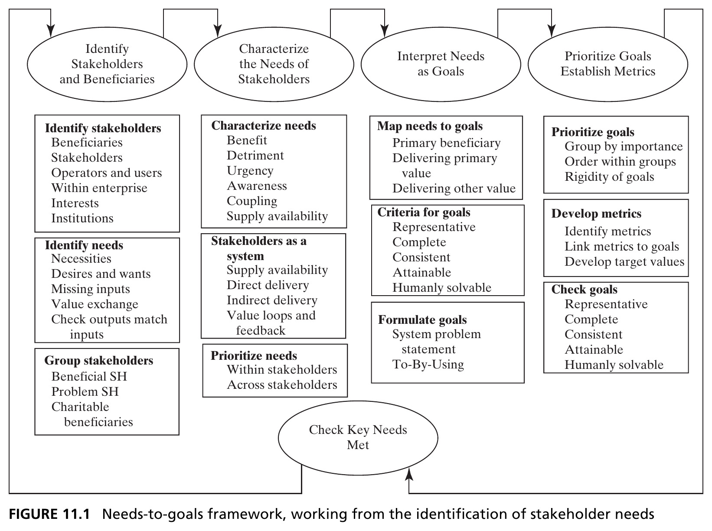{width=100% height=410px fig-align="center"}
:::
::: {.column width="40%"}
1. **Identify** beneficiaries, stakeholders, and needs (§11.2)
2. **Characterize** and prioritize needs (§11.3)
3. **Interpret** selected needs as goals (§11.4)
4. **Prioritize** goals, with metrics and targets (§11.5)

**Feedback:** check that goals meet key needs. Repeat as evidence changes.
:::
:::

::: {.side-caption}
Source: Crawley, Cameron & Selva (2016), Fig. 11.1.
:::

::: {.notes}
Source: Crawley, Cameron & Selva (2016), §11.1.

- **This diagram is the map for the whole chapter**: every remaining slide fits into one of its boxes
- **Four ellipses = four process steps**: identify stakeholders/beneficiaries → characterize needs → interpret needs as goals → prioritize goals/establish metrics
- Sub-task boxes below each: e.g. "identify" = stakeholders, beneficiaries, operators/users, inside/outside-enterprise interests, institutions; "characterize needs" = benefit, detriment, urgency, awareness, coupling, supply availability
- **Closing loop**: "check key needs met" feeds back up: not linear, one-pass; iterative like most of this course
- This diagram = the chapter's table of contents: 11.2 = ellipse 1, 11.3 = ellipse 2, 11.4 = ellipse 3, 11.5 = ellipse 4. Keep it as an anchor

**Discussion:** Where should traceability begin in the needs-to-goals framework?

**Suggested answer:** With stakeholders and their desired outcomes. Follow those needs through prioritization and goal formulation so every important target has a defensible purpose.

:::

# 11.2 Identifying Beneficiaries and Stakeholders

## Beneficiaries and Stakeholders {.smaller}

::: {.columns}
::: {.column width="42%"}
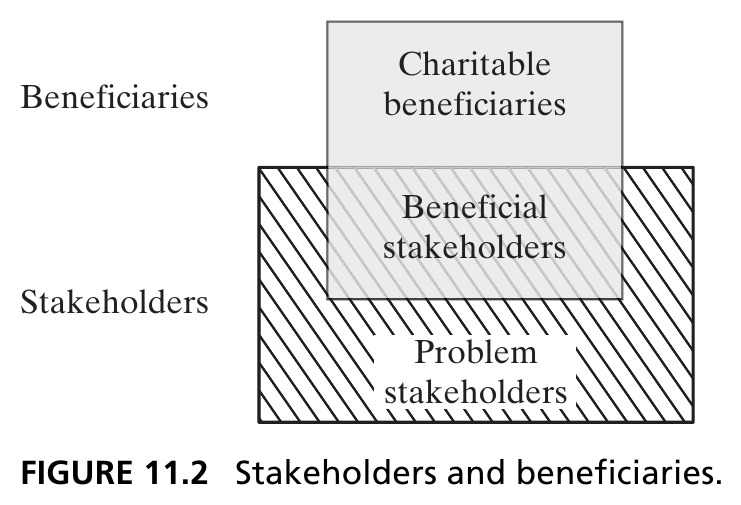{width=100% height=330px fig-align="center"}
:::
::: {.column width="58%"}
- **Beneficiary:** “Who benefits from the outputs of this project?”
- **Stakeholder:** “Who provides inputs that are required to make this project successful?”
- **Beneficial stakeholders** both receive and provide value
- **Charitable beneficiaries** receive value without a return
- **Problem stakeholders** supply needed inputs without a valued return
:::
:::

::: {.side-caption}
Source: Crawley, Cameron & Selva (2016), Fig. 11.2.
:::

::: {.notes}
Source: Crawley, Cameron & Selva (2016), §11.2.

- Distinguish beneficiaries from stakeholders using the relationships shown in the figure.
- "Stakeholder" became extremely broad since Freeman's 1984 *Stakeholder Management*: often reduced to a PR activity instead of the upstream process it should be
- **Beneficiaries**: benefit from your actions: you are important *to them*
- **Stakeholders**: have a stake in your product/enterprise: they are important *to you* (closer to original "stockholder": supplies something you need for a stake in the outcome)
- **Three categories from the diagram** (place real examples in each):
  - **Beneficial stakeholders**: intersection: receive from you *and* provide to you (ideal, mutually-reinforcing)
  - **Charitable beneficiaries**: beneficiaries who aren't stakeholders: you give value, get nothing back
  - **Problem stakeholders**: stakeholders who aren't beneficiaries: you need something from them, one-sided, harder to manage
- Come back to charitable beneficiaries/problem stakeholders concretely with the Hybrid Car in a couple slides

**Discussion:** Is every stakeholder a direct beneficiary?

**Suggested answer:** No. A stakeholder may constrain, enable, or bear costs from the system without directly receiving its primary benefit. Identify the relationship instead of assuming all interests are identical.

:::

## Beneficiary, Stakeholder, Operator {.smaller}

| Role | Taxi example | Architectural concern |
|---|---|---|
| **Primary beneficiary** receives the main benefit | Passenger | Safe, timely transportation |
| **Stakeholder** supplies a needed input | Fleet owner provides the vehicle and investment | Viable operations and return |
| **Operator** runs the system | Driver | Usable controls and working conditions |

- A consumer may fill all three roles. Corporate and government systems often separate them, creating different incentives
- Search **inside** the enterprise as well as outside it: design, implementation, operations, sales, service, and management all supply inputs or receive outcomes
- Begin with the **primary beneficiary**. A system cannot succeed if it fails to meet that beneficiary's primary need

::: {.notes}
Source: Crawley, Cameron & Selva (2016), §11.2, pp. 242–243. The last column illustrates concerns for the book's taxi roles.

**Discussion:** How would confusing the passenger with the fleet owner affect the goals?

**Suggested answer:** It could favor operating cost and return while missing passenger outcomes. Both sets of needs matter, and the operator adds another perspective.
:::

## Setting Bounds and Granularity {.smaller}

- **Bounds:** how far should we trace effects beyond the project? Contractor payments can affect suppliers, employees, and local businesses
- **Granularity:** should we model individual suppliers, their departments, or a single “Suppliers” group? Separate actors when their needs or influence differ
- **Architectural-impact test:** could the choice among the candidate architectures matter to this stakeholder or beneficiary?
- If all candidates deliver the same benefit, retain the stakeholder's management needs but reduce the detail used for architectural comparison
- Revisit the boundary and grouping when the alternatives or project context change

::: {.notes}
Source: Crawley, Cameron & Selva (2016), §11.2.

- **Two genuine methodological difficulties students will hit in any real project**
- **Bounds**: how far to trace ripple effects before stopping: e.g. economic multiplier effect (contractor spends money, employees spend it locally, ripples outward indefinitely). Real economic literature exists, but deep analysis of every ripple is usually impractical
- **Granularity**: right level of abstraction: individual suppliers, or one abstraction "Suppliers"? Matters if individual suppliers have meaningfully different needs/influence
- **The book's single test for both** (fragment): does the choice among architectures *actually under consideration* matter to this stakeholder? If every candidate delivers the same benefit, still manage them, but they don't need fine granularity or extended bounds
- Worth memorizing: recurs as the practical scope filter for the rest of the chapter

**Suggested answer:** Represent a stakeholder separately when the candidate architectures affect that stakeholder in a meaningfully different way or when its authority or constraints matter to the decision. A generic “Suppliers” node is adequate only if aggregation does not hide important differences in capability, dependence, or needs. Stakeholders who receive the same benefit from every candidate may require little comparative detail, but their obligations and threshold requirements still need management. Revisit bounds when the architecture alternatives change.

:::

## Box 11.1 · Principle of the Beginning {.smaller}

**Early participation has an outsized influence on the architecture.** Choose the initial participants deliberately.

- Include actors who strongly need the project's outputs and actors whose outputs the project needs
- Separate gathering opinions from granting **decision rights**

| Decision role | Meaning |
|---|---|
| Informed | Receives decisions and their rationale |
| Consulted | Supplies views for consideration |
| Voting | Participates in choosing among options |
| Veto | Can prevent a decision from proceeding |

::: {.side-caption}
Principle of the Beginning. Crawley, Cameron & Selva (2016), Box 11.1.
:::

::: {.notes}
Source: Crawley, Cameron & Selva (2016), §11.2.

- **Unpack both quotes briefly**: Plato: beginning disproportionately shapes everything downstream. Sun Tzu: great warriors/architects position early so success is secured before the real contest begins
- **Principle**: stakeholders included at *early* stages of product definition have an outsized impact on the eventual architecture: be deliberate, not casual, about who's in the room
- **Second bullet**: engaging a stakeholder for views ≠ their actual **decision rights**
- Four levels: **informed** after the fact, **consulted** without a vote, **voting** among options, **veto** power
- Be explicit which level applies to each stakeholder: conflating "listen to their opinion" with "give them veto power" is a common, costly real-project mistake

**Discussion:** Why should the starting boundary be revisited?

**Suggested answer:** An initially omitted stakeholder or exchange may change the relevant needs. Treat the boundary as a reasoned scope decision that can be revised when evidence changes.

:::

## A Starting Checklist of Stakeholders {.smaller}

::: {.columns}
::: {.column width="50%"}
- **Driver/owner:** primary beneficiary
- **Regulator:** approval
- **Producing enterprise:** investment and technology
- **Investors:** capital for the enterprise
- **Suppliers:** parts and technology
:::
::: {.column width="50%"}
- **Local community:** workforce
- **Environmental NGOs:** assurance and political support
- **Oil companies:** fuel supply
- **Hybrid Car project:** reference actor with its own input needs
:::
:::

- Start from existing products, customers, shareholders, suppliers, and Chapter 10's upstream/downstream influences
- The book omits other car companies from the detailed network. Include them if market share or consumer acceptance makes their role relevant
- This is a **first pass**. Exchanges and prioritization may reveal missing actors or justify regrouping

::: {.notes}
Source: Crawley, Cameron & Selva (2016), §11.2.

- **First concrete use of the Hybrid Car example**: walk through the book's first-pass stakeholder list
- Driver/owner = primary beneficiary; regulator (safety/emissions); the enterprise; investors; suppliers; local community; environmental NGOs; oil companies (unusual: a "competitor," since hybrids reduce gasoline consumption)
- Producing this initial list isn't hard: existing products/customers/shareholders/suppliers + Ch. 10's upstream/downstream influences get you a reasonable first draft fast
- Harder work (rest of chapter) is characterizing and prioritizing, not generating. This is a **first-pass list**: will be revisited at prioritization, don't treat as final

**Discussion:** Why is a checklist useful but insufficient for stakeholder identification?

**Suggested answer:** It prompts commonly missed groups, but the actual context determines relevance. Trace exchanges and consequences to discover actors that a generic list omits.

:::

## Box 11.2 · Definition of Needs {.smaller}

A **need** is a necessity, an overall desire or want, or a wish for something lacking.

- Needs belong to the beneficiary and may be ambiguous, unexpressed, or unrecognized. The architect interprets them when defining goals
- For **each beneficiary and stakeholder**, ask which of their needs this system could satisfy
- Start with the **primary beneficiary's primary need** and the change in the principal value-related operand
- For the Hybrid Car, the driver/owner needs transportation. The operand is **people and possessions**, whose **location** changes
- Customer specifications and previous products are useful evidence, but easily quantified technical requirements can hide less tangible needs

::: {.notes}
Source: Crawley, Cameron & Selva (2016), §11.2.

- **Pin down "need" precisely**: the chapter's entire logical structure depends on distinguishing needs from goals (Section 11.4). Conflating the two is the #1 student error
- Need = a necessity, an overall desire/want, or a wish for something lacking
- **Three properties, one at a time**:
  - Exist in the mind/heart of the beneficiary: fuzzy, unexpressed, even unrecognized (sets up "latent needs" ahead)
  - Primarily *outside* the firm's control: **owned by the beneficiary**, not invented/chosen by the firm (strong claim: firm can only understand/serve needs, not decide them)
  - Still a product/system attribute: must be *interpreted*, in part, by the architect to define goals
- This interpretive step is exactly what separates needs from goals: needs live in the beneficiary's world, goals live in the architect's design process

**Discussion:** How is a need different from a proposed feature?

**Suggested answer:** A need concerns a stakeholder's desired outcome. A feature is a possible means of satisfying it. Several concepts may meet the same need without sharing that feature.

:::

## Hybrid Car Beneficiary Needs {.smaller}

::: {.columns}
::: {.column width="58%"}
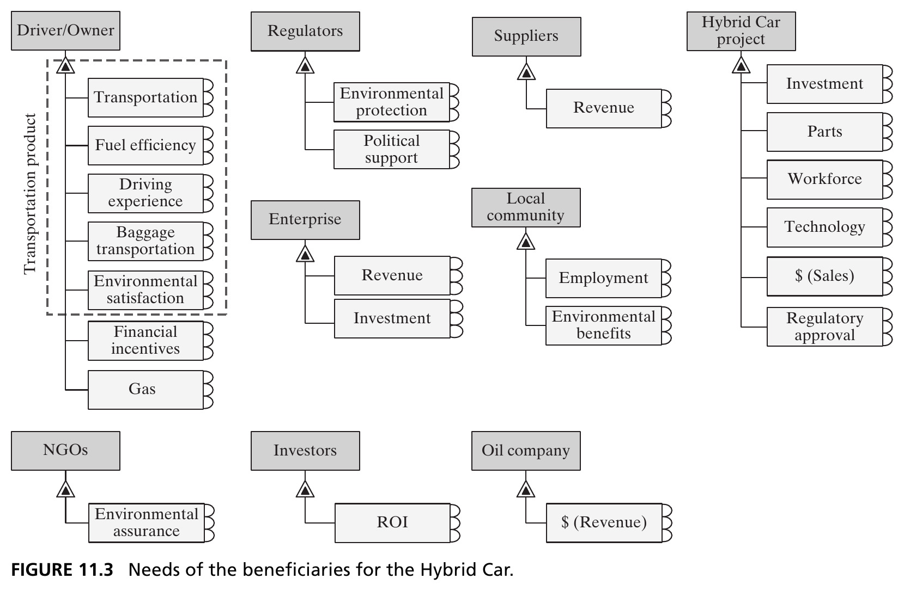{width=100% height=440px fig-align="center"}
:::
::: {.column width="42%"}
- **Driver/owner:** transportation, fuel efficiency, baggage, driving experience, environmental satisfaction
- **Other actors:** revenue, employment, investment, environmental protection, political support
- **Project:** investment, parts, workforce, technology, sales, and approval
- Needs are incomplete. Tax incentives, for example, require actors beyond the producer
:::
:::

::: {.side-caption}
Source: Crawley, Cameron & Selva (2016), Fig. 11.3.
:::

::: {.notes}
Source: Crawley, Cameron & Selva (2016), §11.2.

- **Example of everything so far**. Guidance: start with the primary beneficiary and their primary need, tied to changes in the principal value-related operand (Ch. 7)
- Driver/owner = primary beneficiary, primary need = fuel-efficient transportation
- **Trace the diagram**: Driver/Owner → transportation, fuel efficiency, driving experience, baggage, environmental satisfaction, financial incentives, gas (grouped as "transportation product"). Regulators → environmental protection, political support. Suppliers → revenue. Enterprise → revenue, investment. Local community → employment, environmental benefits. The project itself → investment, parts, workforce, technology, sales dollars, regulatory approval (it's its own stakeholder in the network). NGOs → environmental assurance. Investors → ROI. Oil company → revenue
- Diagram is deliberately **not complete**: an application of "focus" (Ch. 2). Not every driver need gets met by the real car (e.g. financial incentives/tax deduction: a policy lever outside the firm's control, even though legitimate)

**Discussion:** Why distinguish driver needs from enterprise needs for the hybrid car?

**Suggested answer:** The driver may emphasize mobility and ownership costs, while the enterprise needs a viable offering. Both matter, but combining them prematurely can conceal tradeoffs.

:::

## Latent Needs {.smaller}

- **Latent needs** exist before beneficiaries recognize or express them. A new product may satisfy a need that existing products leave unmet
- The book asks how Whirlpool identified demand for an exterior ice dispenser and how GM identified demand for OnStar among drivers who already had phones
- **Observe people in context** and use in-depth interviews to understand outcomes, frustrations, and workarounds
- Review feedback on earlier products and **iterate concepts with users**. No procedure guarantees discovery of every latent need
- Treat a proposed feature's value as a hypothesis to test. Engineering the feature does not establish that customers value it

::: {.notes}
Source: Crawley, Cameron & Selva (2016), §11.2.

- Discuss how a team can investigate needs that users have not expressed.
- Many transformative architectures serve needs nobody had recognized/expressed yet: **latent needs**: fundamental to the beneficiary, exist prior to and independent of the product that satisfies them
- **Examples**: Whirlpool's ice dispenser (before it existed, how did they know customers needed it?), GM's OnStar (drivers already had cell phones: redundant-seeming, yet needed)
- **Firm stance**: "latent" ≠ chosen by the firm. Pushes back on advertising *creating* needs: book calls that idea "dangerously overused" in engineering. Believing you can manufacture demand stops the hard work of understanding users
- **How to actually find them** (no reliable formula, by definition): Dichter's in-depth interviews (1950s), IDEO's "empathic design" (observing customers in context): only real tools are deep user scrutiny, concept iteration, feedback, hard work
- **Cautionary quotes**: false confidence about latent needs: Edison (1922): "the radio craze will die out." Ken Olson/DEC (1977): "no reason anyone would want a computer in their home"
- Both serious technologists, both spectacularly wrong. Ask students for modern-day equivalents

**Suggested answer:** Look for unmet outcomes rather than asking users to invent a product: an ice dispenser can address convenient access without handling trays, while an assistance service can address reliable access to help rather than merely access to a phone. Those are hypotheses to test through observation and prototypes, not proof of the companies' original research. A contemporary classroom hypothesis might be that users need less effort coordinating digital accounts, even if they never ask for a particular tool. Avoid inventing a modern quotation or claiming a forecast has failed without evidence; test the underlying assumption with users.

:::

## Value Delivery as an Exchange {.smaller}

::: {.columns}
::: {.column width="55%"}
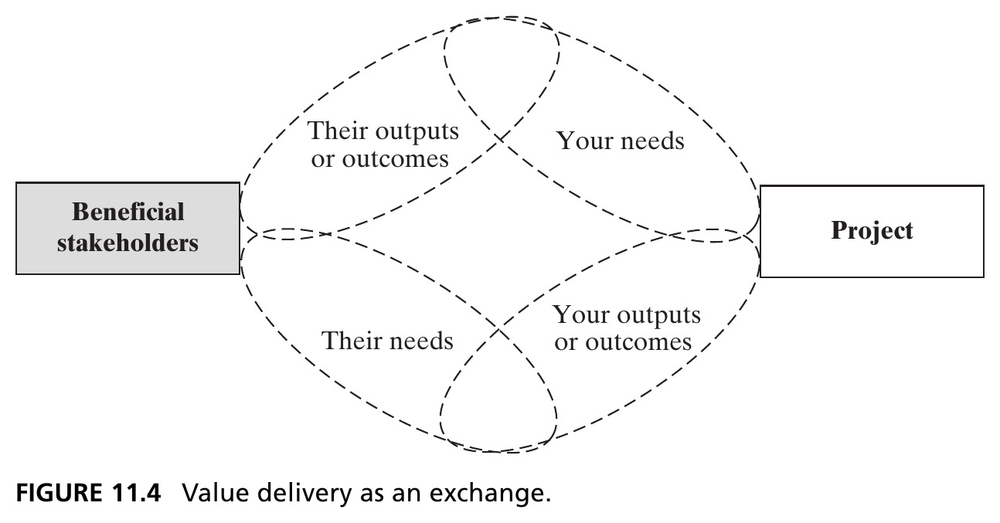{width=100% height=340px fig-align="center"}
:::
::: {.column width="45%"}
- **Project output:** what do we provide, and whose real need does it meet?
- **Project input:** what do we need, and who can provide it?
- Change the reference actor and repeat these questions around the network
- **Completeness check:** match needed inputs to providers and outputs to recipients. Unmatched flows expose omissions or unused outputs
:::
:::

::: {.side-caption}
Source: Crawley, Cameron & Selva (2016), Fig. 11.4.
:::

::: {.notes}
Source: Crawley, Cameron & Selva (2016), §11.2.

- **Foundational tenet: structures the rest of the chapter** through the stakeholder-map/value-loop material in 11.3: value results from an **exchange**
- We've been finding beneficiary needs to satisfy: that's only half. The other half: stakeholders have outputs that meet *our* project's needs
- Diagram: beneficial stakeholders on one side, project on the other, two flows: "their outputs" satisfy "your needs" and vice versa
- **Application**: exchange framing gives a *completeness* criterion: list each stakeholder's input needs, then find who provides them, iterate around the full network → complete stakeholder list ("check outputs match inputs" from Fig. 11.1). Builds into a full stakeholder map over the next several slides

**Discussion:** Does an exchange have to involve money?

**Suggested answer:** No. Information, services, permission, effort, or other valued resources can be exchanged. Naming what each party gives and receives helps explain the relationship.

:::

## Hybrid Car Exchange Groups {.smaller}

::: {.columns}
::: {.column width="60%"}
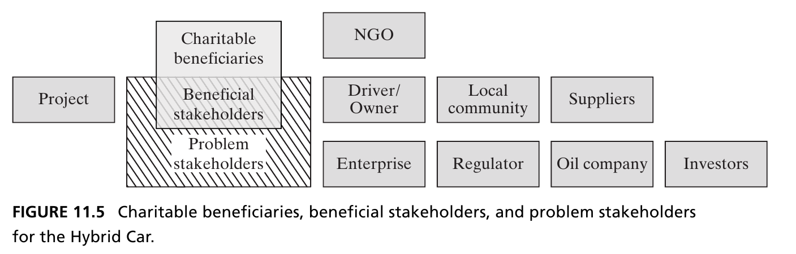{width=100% height=320px fig-align="center"}
:::
::: {.column width="40%"}
- **Charitable beneficiary:** NGO in this initial grouping
- **Beneficial stakeholders:** driver/owner, local community, suppliers
- **Problem stakeholders:** enterprise, regulator, oil company, investors
- These categories describe exchanges. A charging partnership could give an oil company a valued return and change its category
:::
:::

::: {.side-caption}
Source: Crawley, Cameron & Selva (2016), Fig. 11.5.
:::

::: {.notes}
Source: Crawley, Cameron & Selva (2016), §11.2.

- Read the three categories as exchange relationships, not moral judgments. A problem stakeholder supplies something the project needs but does not receive a clear benefit in this first model.
- The regulator supplies approval; the oil company supplies fuel while the project aims to reduce fuel use. A different arrangement can change the classification: the book's charging-station partnership could make an oil company a beneficial stakeholder.
- This first-pass grouping is distinct from the must/should/might prioritization on the next slides.

**Discussion:** Why could the same oil company move to another category?

**Suggested answer:** A charging partnership could give it electricity-sales revenue while its stations support the car's use. Both parties would then exchange valued outputs.
:::

## Grouping Stakeholders {.smaller}

The book proposes three initial priority groups:

- Stakeholders who **must be considered and satisfied**
- Stakeholders who **must be considered and should be satisfied**
- Stakeholders who **should be considered and might be satisfied**

Record this **first judgment before detailed analysis** so that the later network analysis can confirm or challenge it.

Keep this grouping separate from both **exchange categories** (charitable, beneficial, problem) and **decision rights** (consultation, vote, veto).

::: {.notes}
Source: Crawley, Cameron & Selva (2016), §11.2.

- **Final task of Step 1** in the Fig. 11.1 framework: rough first pass at prioritizing, before the deeper analysis in 11.3
- **Three-bucket taxonomy**: must be considered *and* satisfied; must be considered, *should* be satisfied; should be considered, *might* be satisfied
- Alternative framing worth mentioning: grouping by decision-involvement (veto, vote, non-voting opinion, consultation, informed)
- **Methodological point** (fragment): this is a first guess, done *before* rigorous method: that's the point, not a weakness: it gives something to compare the later rigorous analysis against
- If Section 11.3's rigorous ranking wildly differs from this first guess, investigate why. Fig. 11.6 next applies this taxonomy to the Hybrid Car

**Discussion:** When is grouping stakeholders misleading?

**Suggested answer:** When their needs, influence, or exposure to different architectures differ materially. Split the group if aggregation would hide a tradeoff relevant to the decision.

:::

## Initial Stakeholder Priorities {.smaller}

::: {.columns}
::: {.column width="60%"}
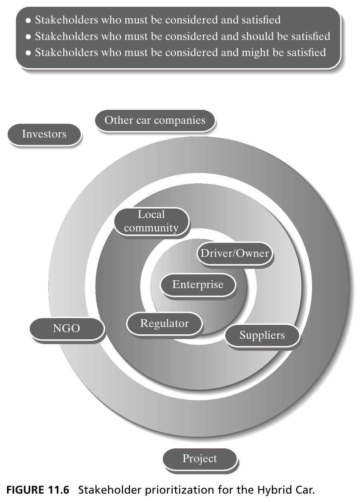{width=100% height=410px fig-align="center"}
:::
::: {.column width="40%"}
- **Inner ring:** enterprise and regulator
- **Middle ring:** driver/owner and local community
- **Outer ring:** suppliers, NGO, and investors
- Other car companies and the project reference sit outside the rings
- This records an initial expectation. Section 11.3 tests priorities using needs and exchanges
:::
:::

::: {.side-caption}
Source: Crawley, Cameron & Selva (2016), Fig. 11.6.
:::

::: {.notes}
Source: Crawley, Cameron & Selva (2016), §11.2.

- **Concrete application of the three-bucket taxonomy** to the Hybrid Car
- Innermost ring (must consider + satisfy): enterprise, regulator. Middle ring (must consider, should satisfy): driver/owner, local community. Outer ring (must consider, might satisfy): suppliers, NGOs, investors. Outside even that: other car companies, the project itself
- **Discussion prompt**: shouldn't driver/owner (primary beneficiary) be innermost, not middle? Good tension to surface: author's own judgment call at this early, un-rigorous stage
  - One legitimate answer: enterprise survival + regulatory compliance are existential threshold gates; serving the driver well is more of a spectrum
- Keep this figure in mind: Section 11.3 returns with a far more rigorous, quantitative prioritization via the stakeholder network/value loops; compare that result back against this first guess

**Suggested answer:** The inner ring can be defended if it denotes threshold conditions: the enterprise must remain viable and the product must meet binding constraints before it can serve users. It should not imply that customer value is optional. A driver/owner can also reasonably belong in the must-satisfy group for essential mobility and safety needs. Separate stakeholder labels from individual needs, explain what the rings mean, and revisit this first-pass ranking using the exchange network and explicit goals.

:::

## Section 11.2 Summary {.smaller}

- Identify beneficiaries by the **outputs they benefit from**, and stakeholders by the **required inputs they provide**
- Distinguish the **operator** when ownership, operation, and benefit belong to different actors
- Set bounds and granularity by testing for **architectural impact**
- Elicit needs, beginning with the primary beneficiary's primary need, and match inputs and outputs around the network
- Record exchange categories and initial priority groups. Keep decision rights explicit

::: {.notes}
Source: Crawley, Cameron & Selva (2016), §11.2.

- **Review before 11.3**: students should now be comfortable with:
  - Bounds/granularity test (does the choice among architectures matter to this stakeholder?)
  - Precise "need" vs. "goal" separation (goal still ahead in 11.4)
  - Beneficiary/stakeholder/charitable-beneficiary/problem-stakeholder taxonomy (Fig. 11.2)
  - Needs can be latent: firms discover, not invent them
  - Exchange-based view of stakeholder value (backbone of the next section's stakeholder-map material)
  - Value of a rough first-guess prioritization before rigorous analysis
- Section 11.3 builds the full stakeholder-network machinery: Kano analysis, stakeholder maps, value loops: to move past first guesses

**Discussion:** How do bounds and granularity affect a stakeholder analysis?

**Suggested answer:** Bounds determine who is represented; granularity determines how separately their needs are modeled. Choose enough detail to distinguish relevant architectural consequences without unnecessary complexity.

:::

# 11.3 Characterizing Needs

## Dimensions of Stakeholder Needs {.smaller}

- **Benefit intensity:** how much utility, worth, or benefit fulfillment brings
- **Detriment:** the adverse reaction if the need remains unmet
- **Urgency:** how quickly fulfillment is needed
- **Awareness:** whether the stakeholder recognizes the need
- **Coupling:** whether fulfilling one need relieves or intensifies another
- **Supply availability:** whether other sources could fulfill the need

Supply availability is more precisely a property of the **value flow**. The book includes it here because alternatives affect prioritization.

::: {.notes}
Source: Crawley, Cameron & Selva (2016), §11.3.

- Introduce the six dimensions as ways to compare needs and to reason about competing stakeholder claims.
- 11.2 completed column 1 of Fig. 11.1: now characterize needs to eventually prioritize them
- **Six dimensions** (useful vocabulary beyond this course):
  - **Benefit intensity**: utility/worth of fulfilling
  - **Detriment**: adverse reaction if unmet (distinct from benefit: can be low-benefit/high-detriment or vice versa)
  - **Urgency**: how quickly it must be fulfilled
  - **Awareness**: how aware stakeholders are of having it (ties to latent needs)
  - **Coupling**: degree to which satisfying one relieves/intensifies another
  - **Supply availability**: whether alternative sources can fulfill the need. This is more precisely a property of the flow.
- Formal survey methods exist (direct ranking, conjoint analysis, AHP): but next slide's **Kano analysis** is the model the book develops in detail

**Discussion:** Why can the same performance improvement produce different satisfaction responses?

**Suggested answer:** Some attributes are expected basics, others provide proportional value, and others are unexpected benefits. The response depends on the user, context, and existing expectations.

:::

## Kano Analysis {.smaller}

::: {.columns}
::: {.column width="54%"}
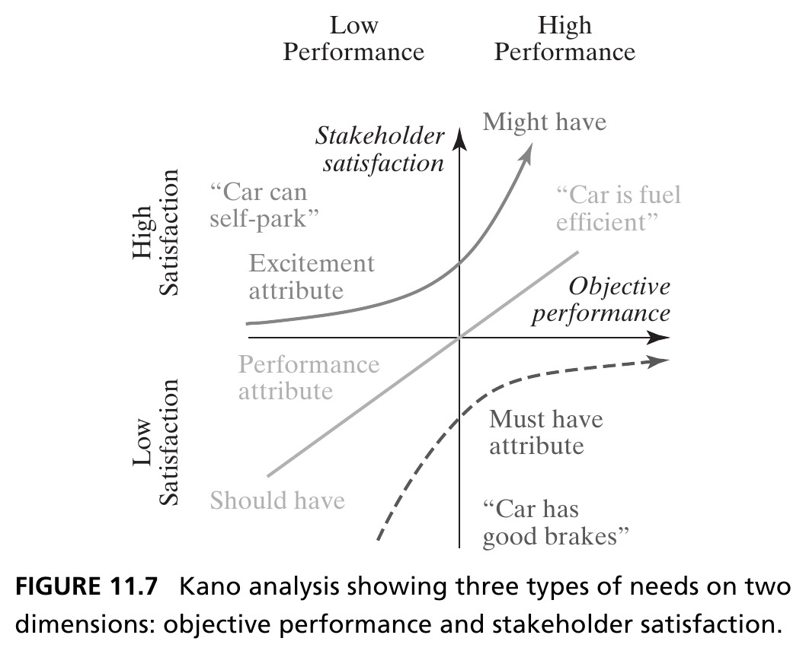{width=100% height=410px fig-align="center"}
:::
::: {.column width="46%"}
- **Must have:** absence causes strong dissatisfaction. Presence earns little extra satisfaction, as with good brakes
- **Should have:** improved performance brings more satisfaction, as with fuel efficiency
- **Might have:** presence delights, while absence causes little regret. Self-parking is the book's example
- Categories depend on the market and time. A delight can become expected
:::
:::

::: {.side-caption}
Source: Crawley, Cameron & Selva (2016), Fig. 11.7.
:::

::: {.notes}
Source: Crawley, Cameron & Selva (2016), §11.3.

- Use Kano analysis to compare how fulfillment affects satisfaction for different kinds of need.
- For each need, presence/absence falls into three categories:
  - **Must have**: essential, regret its absence
  - **Should have**: satisfied by presence, regret absence, less substantially
  - **Might have**: satisfied by presence, but *no* regret if absent
- **Diagram axes**: performance (x) vs. satisfaction (y)
  - **Must have** (good brakes): flat/low satisfaction across most range, crashes sharply below a threshold: no delight, but serious dissatisfaction if missing
  - **Should have** (fuel efficiency): roughly linear: more MPG, steadily more satisfaction
  - **Might have** (self-parking): "excitement"/delight attribute: absence unnoticed, presence differentiates
- **Dynamic caveat**: categories shift over time: self-parking may drift from "might have" to "must have" as market expects it. Today's delighter becomes tomorrow's baseline; anticipate the drift

**Discussion:** Does adding a delightful feature compensate for a missing basic need?

**Suggested answer:** Usually not for the affected user: reliable basic function may be a condition of acceptance. Use the Kano categories to explore reactions rather than assuming all improvements are interchangeable.

:::

## Judgment Still Matters {.smaller}

- **Direct ranking:** ask a stakeholder to assign importance on an anchored scale
- **Pairwise preferences:** compare needs using methods such as conjoint analysis or the analytic hierarchy process
- **Kano analysis:** compare reactions to a need's fulfillment and absence
- Use the evidence with experienced judgment. Large consumer data sets and mature technical buying criteria can strengthen formal analysis
- Ranking **one actor's needs** is easier than comparing **needs across actors**. The stakeholder network helps explain how their needs affect the project

::: {.notes}
Source: Crawley, Cameron & Selva (2016), §11.3.

- Discuss the evidence and judgment needed when applying formal prioritization methods.
- **First**: in many real markets, formal methods (even Kano) are *outmatched* by experienced practitioner judgment. Analysis earns its keep with large consumer datasets or mature technical buying criteria: otherwise, don't let it supplant seasoned judgment
- **Second**: many methods compare needs *within* one stakeholder (Kano); few compare needs *across* stakeholders (driver's handling need vs. regulator's emissions need?): tests genuine limits of human reasoning
- Sets up the next several slides: stakeholder-map/value-loop machinery is an attempt to make headway on this hard cross-stakeholder problem, even without fully solving it

**Suggested answer:** Do not compare a binding emissions limit with a handling preference as though both were interchangeable satisfaction scores. First identify non-negotiable thresholds, then compare feasible alternatives using agreed performance and benefit measures. Use evidence, stakeholder participation, and sensitivity analysis to expose the effect of weighting different needs. Experienced judgment helps interpret incomplete information, but its rationale and assumptions should remain reviewable rather than becoming an unexplained authority claim.

:::

## Stakeholders as a System {.smaller}

1. **Find providers:** who could satisfy each stakeholder's needs? Suppliers provide the project's parts
2. **Find recipients:** what does the project produce, and who needs it? Employment can meet community needs while securing a workforce
3. **Check stakeholder pairs:** which relevant exchanges occur between actors beyond the project?

- A **value flow** connects an output to another actor's input. Each flow has one direction and need not have an immediate return
- Label potential flows in **solution-neutral terms**. The map describes needs without committing to a concept
- An output with no genuine recipient need delivers no value. Record unused outputs rather than inventing needs to justify them

::: {.notes}
Source: Crawley, Cameron & Selva (2016), §11.3.

- Stakeholder exchanges form a system of entities and relationships. Represent those exchanges in a stakeholder map.
- Justifies building a **stakeholder map**: systems thinking applied to the stakeholder network itself
- **Three-step construction procedure** (directly builds the next two figures):
  1. For each stakeholder's needs, who could satisfy them? (Hybrid Car → supplier as parts source)
  2. What are the project's own outputs, and to whom do they flow? (e.g. employment → workforce need). Caution: outputs not linked to a real need are "unused outputs": a valuable finding on its own
  3. **Most powerful, often-overlooked**: combinatorially pair stakeholders, check for *any* relevant transactions between them, even indirect ones
- Step 3 reveals indirect transactions ahead: relationships invisible from the project's own direct inputs/outputs

**Suggested answer:** For a hybrid-car project, a supplier can provide needed components; the enterprise can provide employment to workers and a useful vehicle to customers; customers can return revenue and feedback. Then inspect exchanges beyond the project's immediate boundary, such as an investor providing capital to the enterprise or a service organization supporting the owner. A useful link names a real need, an exchanged object or service, and the parties involved. An output with no identified beneficiary deserves investigation rather than automatic celebration.

:::

## Hub-and-Spoke Stakeholder Map {.smaller}

::: {.columns}
::: {.column width="58%"}
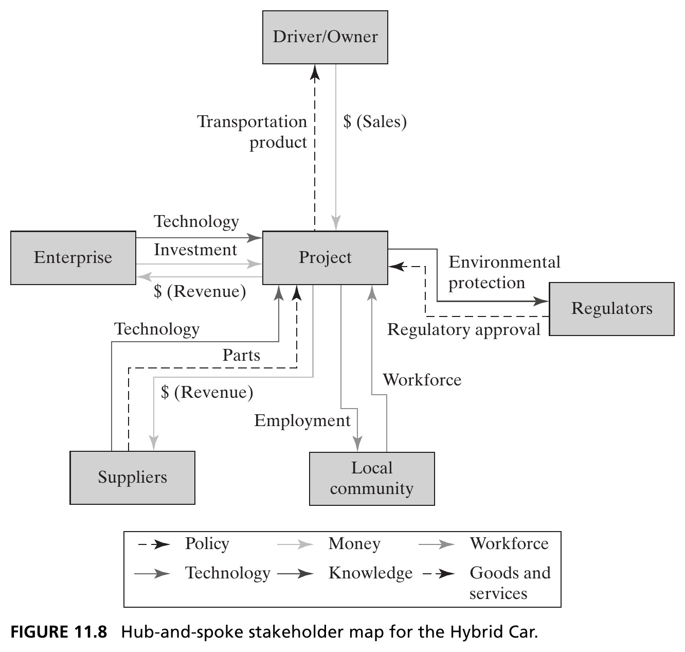{width=100% height=430px fig-align="center"}
:::
::: {.column width="42%"}
- Begin at the **project hub** and identify both directions of exchange
- The driver receives transportation and returns sales revenue. Suppliers return parts for revenue
- Flow types: **policy, money, workforce, technology, knowledge, goods and services**
- NGO, oil company, and investors have no direct project exchange here. The next step examines their indirect roles
:::
:::

::: {.side-caption}
Source: Crawley, Cameron & Selva (2016), Fig. 11.8.
:::

::: {.notes}
Source: Crawley, Cameron & Selva (2016), §11.3.

- **Output of applying steps 1-2** (previous slide) to the Hybrid Car. Project at center as hub, stakeholders connected by directional flows:
  - Enterprise: provides technology/investment, receives revenue
  - Suppliers: provide parts, receive revenue
  - Local community: provides workforce, receives employment
  - Regulators: provide regulatory approval, receive environmental protection
  - Driver/owner: receives the product, provides sales revenue
- **Legend: six flow types**: policy, money, workforce, technology, knowledge, goods and services: a reusable typology beyond this course
- **Deliberate constraint**: links are solution-neutral: potential connections, not commitments or a chosen concept for *how*
- "Value flow" = connection of an output to an input; **unidirectional**: doesn't imply a return flow
- That asymmetry lets us spot stakeholders *not* in equilibrium exchange: precisely charitable beneficiaries and problem stakeholders (Fig. 11.2), now visual

**Discussion:** What can a hub-and-spoke map overlook?

**Suggested answer:** Transactions between stakeholders that do not pass directly through the project. Those indirect relationships may still influence support, constraints, and delivered value.

:::

## Full Stakeholder Network {.smaller}

::: {.columns}
::: {.column width="60%"}
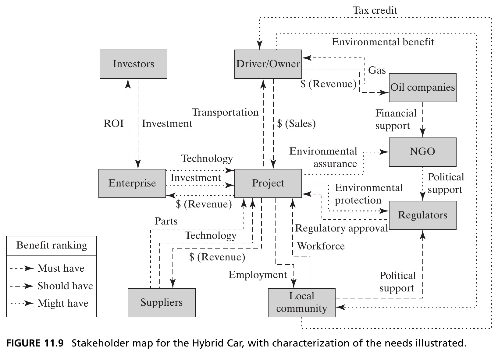{width=100% height=410px fig-align="center"}
:::
::: {.column width="40%"}
- Add exchanges **between stakeholders**: tax credits to drivers, investment to the enterprise
- NGO, oil company, and investors now enter the network
- The line styles also record **must/should/might** benefit rankings
- A **value loop** returns to its starting actor through reciprocal exchanges
:::
:::

::: {.side-caption}
Source: Crawley, Cameron & Selva (2016), Fig. 11.9.
:::

::: {.notes}
Source: Crawley, Cameron & Selva (2016), §11.3.

- **Example of Step 3**: combinatorially pairing stakeholders, checking transactions between *them*, not just with the project
- **What's new vs. hub-and-spoke**: NGOs, oil companies, investors now appear: absent from Fig. 11.8 because none transact *directly* with the project. They only appear via transactions *between other stakeholders* (e.g. investors relate to the enterprise, not the project)
- **Trace one chain** (preview of "value loop" next): local community → tax credit → driver/owner, plus other flows completing a longer loop through environmental benefit, environmental assurance, political support, regulatory approval, cycling back to the project
- This whole exercise interprets the stakeholders as a *system* (Ch. 2 sense): entities + relationships, no defined boundary beyond the completeness criterion (list every potentially relevant stakeholder). Choosing which entities to represent is always a judgment call trading off utility vs. complexity

**Discussion:** Why trace a chain beyond the project's direct customer?

**Suggested answer:** An indirect actor may provide resources or approval needed by another stakeholder. Following the chain reveals dependencies that direct transactions alone cannot explain.

:::

## Supply Availability and Importance {.smaller}

::: {.columns}
::: {.column width="60%"}
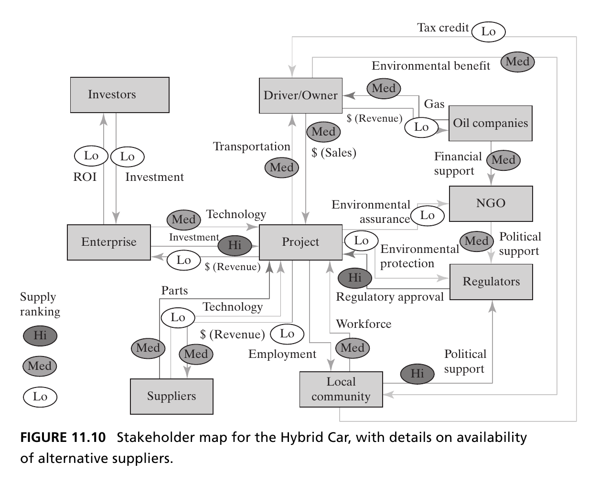{width=100% height=410px fig-align="center"}
:::
::: {.column width="40%"}
- **Supply availability:** can substitutes provide the same input?
- Environmental protection has many sources. Regulatory approval has one
- More substitutes reduce dependence on a particular provider
- Approval ranks **Hi**, environmental protection **Lo**. The labels express **supply importance**
:::
:::

::: {.side-caption}
Source: Crawley, Cameron & Selva (2016), Fig. 11.10.
:::

::: {.notes}
Source: Crawley, Cameron & Selva (2016), §11.3.

- Supply availability concerns alternative sources, while the figure's Hi/Med/Lo ranks express supply importance: regulatory approval is Hi despite having no alternative provider. Do not equate Hi with many substitutes. Competition in supply is a property of the flow.
- More substitute suppliers can reduce a provider's bargaining power and the urgency of obtaining that particular provider's output.
- Contrast the project's environmental-protection output with the regulator's approval: those two exchanges do not have symmetric alternatives.

**Discussion:** Why might two equally desired inputs receive different priority?

**Suggested answer:** If one can be supplied by many substitutes and the other only by one actor, the latter relationship is harder to replace.
:::

## Combining Need and Flow Importance {.smaller}

::: {.columns}
::: {.column width="55%"}
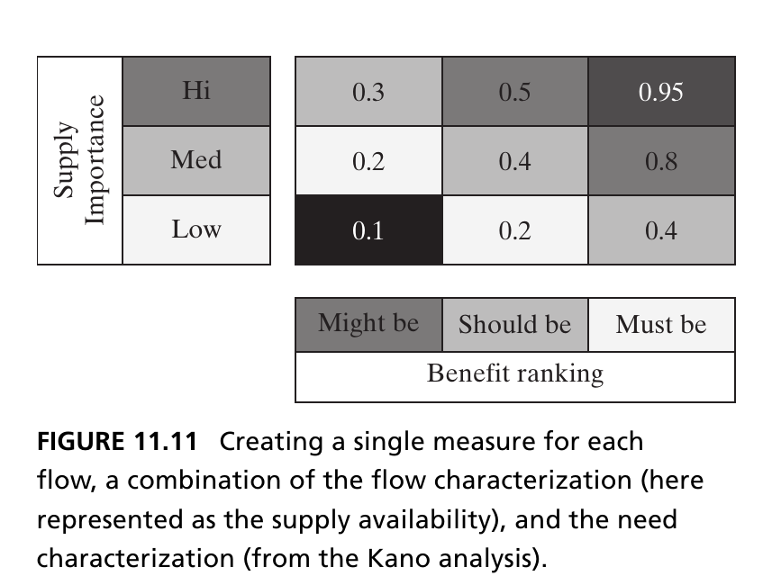{width=100% height=320px fig-align="center"}
:::
::: {.column width="45%"}
- Combine the recipient's **benefit ranking** with the flow's **supply importance**
- **Must be + Hi** gives **0.95** in this example
- **Might be + Low** gives **0.1**
- These are illustrative relative weights. A score of 0.95 is neither a probability nor a universal constant
- Record the judgments behind the scale and test whether rankings depend on them
:::
:::

::: {.side-caption}
Source: Crawley, Cameron & Selva (2016), Fig. 11.11.
:::

::: {.notes}
Source: Crawley, Cameron & Selva (2016), §11.3.

- The horizontal axis ranks the need's benefit; the vertical axis ranks the importance of supply availability. Their combination assigns one score to a flow.
- The numerical mapping is a modeling choice. A “must be” need with high supply importance receives 0.95 in this example; a “might be” need with low supply importance receives 0.1.
- Do not present these numbers as empirical constants. State whose judgment produced the ranks and examine sensitivity to a different mapping.

**Discussion:** What would a score of 0.95 mean here?

**Suggested answer:** This model assigns high importance to a flow linked to a must-have need and a high-importance supply relationship. It is relative within this analysis, not a 95% probability.
:::

## Priorities in Direct Exchanges {.smaller}

::: {.columns}
::: {.column width="58%"}
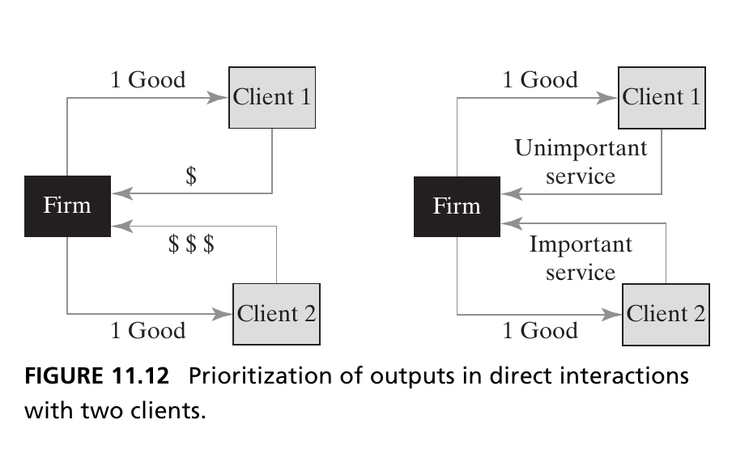{width=100% height=360px fig-align="center"}
:::
::: {.column width="42%"}
- If both clients return only money for the same good, revenue can rank the direct exchange
- A nonmonetary input may be more critical than its price suggests
- An inexpensive part or service can determine whether the whole system works
- **Prioritize stakeholders by the importance of the inputs they provide to the project**
:::
:::

::: {.side-caption}
Source: Crawley, Cameron & Selva (2016), Fig. 11.12.
:::

::: {.notes}
Source: Crawley, Cameron & Selva (2016), §11.3.

- If two customers return only money for the same good, revenue can rank their direct value to the firm.
- Monetary size is inadequate for inputs such as a critical service, permission, or technology. A low-cost component or service can be indispensable.
- Prioritize stakeholders by the importance of what they provide to the project, not solely by the price of what the project gives them.

**Discussion:** Why could the lower-revenue client receive higher priority?

**Suggested answer:** It may supply a more critical nonmonetary input. The project must evaluate the returned flow, not just sales volume.
:::

## An Indirect Value Loop {.smaller}

::: {.columns}
::: {.column width="55%"}
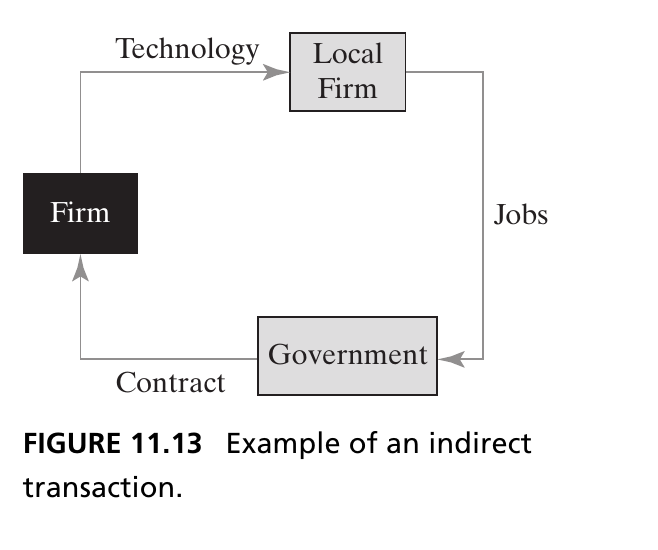{width=100% height=370px fig-align="center"}
:::
::: {.column width="45%"}
- The firm provides **technology** to a local partner
- The partner provides **jobs** valued by the government
- The government provides a **contract** to the firm
- Direct revenue from the local partner misses its role in securing the contract. Follow the complete loop
:::
:::

::: {.side-caption}
Source: Crawley, Cameron & Selva (2016), Fig. 11.13.
:::

::: {.notes}
Source: Crawley, Cameron & Selva (2016), §11.3.

- Trace the arrows all the way around. The local firm may provide little direct revenue, yet it is part of the path to an important government contract.
- Begin with a critical input to the project, trace backward through providers, then identify the project output that helps complete the loop.
- The recipient of a benefit need not be the party that pays for it.

**Discussion:** Which project output could be undervalued by direct-revenue ranking?

**Suggested answer:** Technology delivered to the local firm, because its indirect contribution to the government contract is absent from a direct-sales view.
:::

## Value Loops and Indirect Transactions {.smaller}

- A **value loop** is a sequence of value flows that returns to its starting stakeholder
- An **indirect transaction** involves at least one intermediary. The beneficiary need not be the party that pays
- Trace **backward from an important project input**, through its providers, to the project output that helps secure it
- A small partner may deserve high priority if it strongly influences a critical contract or approval
- Where several paths reach the same input, compare the strength of their value loops

::: {.notes}
Source: Crawley, Cameron & Selva (2016), §11.3.

- **Precise term for the previous slide's pattern**: **value loop** = series of value flows returning to the starting stakeholder: literally the emergent "system behavior" of the network (Ch. 2 sense)
- Hub-and-spoke only shows bilateral exchanges; the full network can contain real feedback loops, visible only once indirect transactions are traced
- **Indirect transactions**: one or more intermediaries between firm and end stakeholder. Example: firm gives technology to a local partner, partner gives employment to a government, government grants the contract back to the firm
- Firm's output (technology) and resulting input (contract) are no longer directly linked: works only via the intermediary, but still traceable and prioritizable
- **Practical prioritization**: trace *backward* from most important inputs, through the full network chain, to find who ultimately provides them (not just by direct transaction size)
- Simple metric: multiply the importance of needs satisfied at each link along a loop → one strength number per loop, comparable across different loop structures. The following figures build toward this calculation for the Hybrid Car

**Discussion:** What closes a value loop?

**Suggested answer:** A sequence of exchanges eventually returns value to an earlier participant. Trace the actual objects or services and parties; a closed drawing alone does not demonstrate a meaningful exchange.

:::

## From Value Loops to Ranked Needs {.smaller}

A simple loop-strength model multiplies the link importance scores:

$$S_{\mathrm{loop}}=\prod_{k=1}^{n} w_k$$

- **Example:** link weights 0.8, 0.5, and 0.4 give a loop strength of **0.16**
- Compare loops leading to an important input. Other things equal, stronger satisfaction at each link creates a stronger incentive to complete the exchange
- Weight project outputs according to the loops in which they participate, then normalize their relative priorities
- Check sensitivity to weights and network boundaries. The product is one modeling procedure, not a universal measure of value

::: {.side-caption}
Source: Crawley, Cameron & Selva (2016), §11.3, pp. 256–257. Numerical values are illustrative.
:::

::: {.notes}
Source: Crawley, Cameron & Selva (2016), §11.3.

- This makes explicit the calculation between Figures 11.11–11.13 and the ranked outputs in Figure 11.14.
- For illustration only, three link scores 0.8, 0.5, and 0.4 give a loop strength of 0.16. The numbers should come from an actual project's need and flow assessments.
- A product is only one possible aggregation rule; changing the scope or score mapping can change the ranking.
:::

## Prioritized Hybrid Car Needs {.smaller}

::: {.columns}
::: {.column width="58%"}
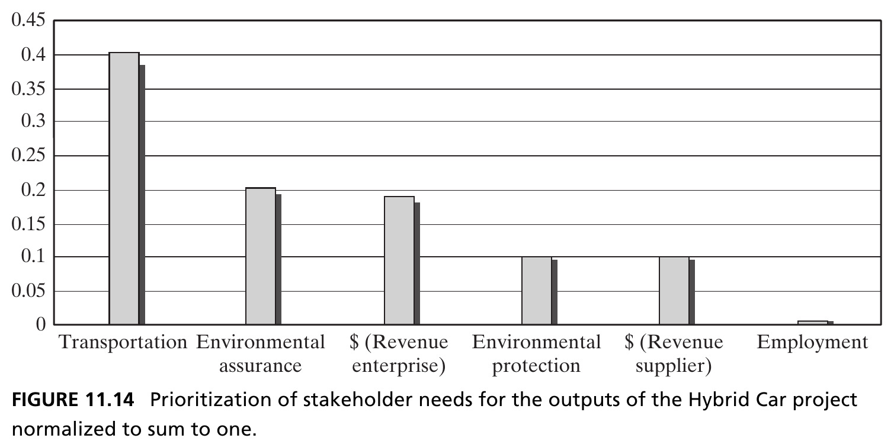{width=100% height=390px fig-align="center"}
:::
::: {.column width="42%"}
- Six project outputs receive **normalized priorities summing to one**
- Transportation ranks highest. Environmental assurance and enterprise revenue also matter
- Ranking follows **stakeholder-assessed needs and network structure**, instead of first assigning importance to whole stakeholders
- A purely bilateral analysis would miss the NGO's indirect role in regulatory approval
:::
:::

::: {.side-caption}
Source: Crawley, Cameron & Selva (2016), Fig. 11.14.
:::

::: {.notes}
Source: Crawley, Cameron & Selva (2016), §11.3.

- **Quantitative culmination** of the last several slides: applying the value-loop method to the six needs directly fulfilled by Hybrid Car outputs
- **Transportation dominates** (~0.4, normalized to sum to 1): primary beneficiary's primary need, strongest direct loop. Then environmental assurance and enterprise revenue meaningfully high, then environmental protection, supplier revenue, employment trailing
- The ranking avoids assigning stakeholder-level importance in advance. It still depends on judgments about needs, supply importance, score mapping, and which exchanges the model includes. The represented network is not independent of analyst judgment.
- **Honest limitation**: ignoring indirect transactions, a simpler method (order by direct need satisfaction) would work: but it misses third-party levers (like the NGO) that are individually unimportant bilaterally but matter through the network toward something big (regulatory approval)
- Architect must judge which systems need indirect-transaction analysis vs. simpler bilateral reasoning

**Discussion:** Should a prioritized-needs chart be treated as permanent?

**Suggested answer:** No. It reflects the represented stakeholders and assumptions. Revisit it when the mission, context, candidate architectures, or evidence about needs changes.

:::

## Box 11.3 · Principle of Balance {.smaller}

**Balance the system around its most important stakeholders.**

- The architect may never enumerate or quantify every influence. Tradeoffs remain necessary even after detailed analysis
- Balance the **whole system**. Optimizing each element separately does not ensure a balanced outcome
- **Optimality and flexibility compete:** tailoring the architecture tightly to today's use can reduce its ability to accommodate new uses or technologies
- Flexibility usually requires margin, which carries cost or reduces current performance

::: {.side-caption}
Source: Crawley, Cameron & Selva (2016), Box 11.3, Principle of Balance.
:::

::: {.notes}
Source: Crawley, Cameron & Selva (2016), §11.3.

- Explain why competing stakeholder goals require tradeoffs. Relate the quotations to the examples already discussed.
- **Three bullets, connected argument**:
  - You may never fully enumerate/quantify every factor: goal isn't a perfect optimum, it's sensible tradeoffs among identified factors
  - System must balance *as a whole*: not locally optimizing each element and assuming the sum balances. Same emergence idea from Ch. 2, applied to stakeholder-balancing: local optimization ≠ global balance
  - Architect perpetually trades **optimality vs. flexibility**: tightly optimized for today's use case = less margin for future ones, and vice versa
- This tension recurs the rest of the course: no formula resolves it, it's a deliberate judgment call informed by this section's stakeholder analysis

**Discussion:** What does balance mean when stakeholder needs conflict?

**Suggested answer:** Seek a coherent outcome that addresses important needs and binding constraints, making tradeoffs explicit. Balance does not require equal spending or equal satisfaction for every stakeholder.

:::

## Section 11.3 Summary {.smaller}

- Characterize needs using **all six dimensions**, including supply availability. Use Kano analysis to distinguish must, should, and might needs
- First compare needs within each stakeholder. Then compare across stakeholders through their exchanges
- Model **direct flows and indirect loops** when third-party relationships affect critical project inputs
- Rank project outputs by their contribution to securing those inputs. Check the effect of the model's assumptions
- Use the result to make system-level tradeoffs. Detailed network analysis is worthwhile when indirect exchanges matter

::: {.notes}
Source: Crawley, Cameron & Selva (2016), §11.3.

- **Review before goals**: students should be comfortable with:
  - Six dimensions (benefit intensity, detriment, urgency, awareness, coupling, supply availability) + Kano's three categories
  - Formal methods can be outmatched by human judgment; cross-stakeholder comparison harder than within-stakeholder
  - Stakeholder map construction (three-step procedure) treating the stakeholder set as a system
  - Indirect transactions and value loops → quantitative, network-derived prioritization
  - Principle of Balance: no system optimized for every stakeholder; the goal is balance
- Section 11.4 finally does the chapter-title's translation: needs → goals the architect can design against

**Discussion:** What has network analysis added beyond a stakeholder list?

**Suggested answer:** It identifies exchanges, dependencies, and indirect paths of value. These relationships help explain influence and prioritization rather than relying only on names or prominence.

:::

# 11.4 Interpreting Needs as Goals

## Box 11.4 · Definition of Goals {.smaller}

- **Needs** express what beneficiaries lack or desire
- **Goals** state what the producing enterprise plans and hopes to accomplish to meet selected needs
- The architect chooses a **well-defined subset** of needs to address, including beneficiary outcomes, enterprise strategy, and regulatory influences
- Choosing markets or deployment timing changes the applicable goals. Once a market is chosen, mandatory regulations remain constraints
- Goals can evolve as tradeoffs and evidence develop. The book uses “goals” to make those choices explicit

::: {.notes}
Source: Crawley, Cameron & Selva (2016), §11.4.

- Distinguish stakeholder needs from the goals chosen by the producing enterprise.
- Goal = what is planned to be accomplished, what the enterprise hopes to achieve: a **product/system attribute**, contrasting with needs (mind/heart of stakeholder, owned by the beneficiary)
- **Side-by-side comparison**: needs exist in the stakeholder's mind, prior to any product; goals are defined *by the enterprise*, intended to meet those needs. Needs aren't chosen by the firm; goals absolutely are: under the architect's control
- Goals aren't static: frequently traded off against other attributes during design. Ties back to Ch. 1 "Structured Creativity": "goals" not "requirements," specifically to preserve tradability
- **Subtlety**: architect is *choosing* which needs (beneficiary's and other stakeholders') to address. Doesn't mean corporate strategy/regulation are "optional": corporate strategy is an active market-choice, regulation is mandatory; the point is these are all needs the architect weighs and interprets, not bypassed commands

**Discussion:** Why are goals chosen even though needs are discovered?

**Suggested answer:** The enterprise commits to particular outcomes and scope after considering needs and feasibility. That choice determines what the system will attempt to satisfy and what it will not.

:::

## Five Criteria for Goals {.smaller}

| Criterion | Check on the goal set |
|---|---|
| **Representative** | Satisfying goals meets stakeholder needs |
| **Complete** | The goal set covers all prioritized needs |
| **Humanly solvable** | Designers can understand and use the goals |
| **Consistent** | Targets can hold together without contradiction |
| **Attainable** | Available resources suffice to reach the goals |

Check each **upstream influence** against the goals. Capture it or record a reason for excluding it. Trace needs to goals to expose omissions.

SMART addresses individual goals. Also check the **completeness and consistency of the whole set**.

::: {.notes}
Source: Crawley, Cameron & Selva (2016), §11.4.

- **Evaluative standard** for the rest of the chapter/Part 3: since goals are architect decisions, we need explicit criteria to judge them
- **Representative**: meeting the goals actually meets the underlying needs
- **Complete**: satisfying all goals satisfies all *prioritized* needs (qualifier matters: measured against 11.3's prioritization, not every conceivable need)
- **Humanly Solvable**: comprehensible, enhances (not hinders) the solver: hardest in practice, gets its own slide next
- **Consistent**: goals don't conflict
- **Attainable**: reachable given available resources
- **INCOSE comparison** (for SE-background students): their eight (Necessary, Implementation-independent, Clear-and-Concise, Complete, Consistent, Achievable, Traceable, Verifiable) collapse into these five: Necessary/Traceable/Verifiable → Representative; Implementation-independent/Clear-and-Concise → Humanly Solvable
- Not a competing framework: a deliberately compressed version, emphasizing tradeoffs *between* goals

**Discussion:** Can a goal be precise but still poor?

**Suggested answer:** Yes. It may omit an important need, conflict with another goal, be unattainable, or make the problem unnecessarily hard to solve. Precision addresses only part of goal quality.

:::

## Crafting Humanly Solvable Goals {.smaller}

- Keep goals **clear and minimal**. Extraneous information directs attention even when it is irrelevant
- Omitting information can also mislead: readers may assume that an unstated effect or constraint does not matter
- Preserve **solution-neutral intent** to leave room for alternative concepts
- In the book's F-16 example, specifying a **Mach 2+ fighter** emphasizes maximum speed. The underlying need, **exiting a dogfight quickly**, directs attention to acceleration and thrust-to-weight ratio
- A useful statement contains enough information to express the important needs without prescribing unnecessary design choices

::: {.notes}
Source: Crawley, Cameron & Selva (2016), §11.4.

- Humanly solvable goals give designers enough relevant information to reason about the problem without misleading detail.
- **Toy example**: "voltage drop across a 5-ohm resistor, 12-amp current, in a 120-V DC circuit": physics is trivial (5×12=60V), everything stated is true, but "120-V DC circuit" is extraneous and predisposes readers to reason about irrelevant things (e.g. resistance-temperature dependency)
- Simple problems: extraneous distraction is easy to catch. Complex systems: can't so easily dismiss extra info as irrelevant: misleading
- **Flip side, equally dangerous**: information *not* stated can be wrongly assumed excluded (e.g. omitting temperature data silently read as "no temperature dependency," even if unintended)
- Crafting a statement is a balancing act: enough solution-neutral info, no extraneous/misleading detail either way
- **F-16 example (Maier & Rechtin, fragment)**: original statement "build a Mach2+ fighter": real need was to exit a dogfight quickly, better served by thrust-to-weight ratio (acceleration) than top speed. Same need, different wording, very different aircraft

**Suggested answer:** For the resistor example, Ohm's law gives the drop directly: V = IR = 12 A × 5 Ω = 60 V, under the stated ideal-resistor assumptions. The 120 V circuit supply is unnecessary to compute that local drop, although it may matter to a different system-level question. The general lesson is to retain information needed for the decision and remove distractions without discarding genuine constraints or validity conditions.

:::

## Box 11.5 · Principle of the System Problem Statement {.smaller}

The **System Problem Statement (SPS)** is a concise assertion of what the system should accomplish to deliver value.

- It defines the **high-level goal** and draws the boundary between system content and context
- It provides the starting point for detailed goals and a common message for the design team
- Challenge and refine it early and repeatedly. The first formulation is rarely adequate
- A long requirements document can obscure the central purpose. Labels such as “cheaper toaster” inherit a previous solution without clarifying the beneficiary's need

::: {.notes}
Source: Crawley, Cameron & Selva (2016), §11.4.

- **Formalizes the F-16 lesson**: the **System Problem Statement (SPS)**: the single assertion of what the system is intended to accomplish to deliver value, like an organization's mission statement
- **Core claim**: the problem statement defines the high-level goal *and* establishes the system boundary (Ch. 2's content/context split): architectural consequences for scope
- **Rarely stated correctly on first formulation**: challenge and refine repeatedly, treat the first draft as a starting point for interrogation, not a finished artifact
- **Common failure mode**: de facto problem statement = previous product + modifier ("cheaper electric toaster," "more efficient roadster"): smuggles in solution-*specific* assumptions, forecloses design space
- Maier & Rechtin: real problem statements are often ill-formed, incomplete, over-constrained, a tangled mix of needs/goals/functions/forms: exactly what the next slide's To-By-Using framework untangles

**Discussion:** What should a system problem statement prevent?

**Suggested answer:** It should prevent the team from pursuing incompatible interpretations of success. It connects intended benefit to the functional problem while avoiding unjustified early commitment to form.

:::

## Hybrid Car SPS: First Formulation {.smaller}

The book's first formulation proposes manufacturing and selling a successful hybrid gas/electric car to environmentally conscious consumers.

- **“Manufacture”** commits the enterprise to production rather than outsourcing
- **“Hybrid gas/electric car”** selects a form before stating the intended benefit
- **“Successful”** gives no test of success, and “consumers” leaves the target group unclear
- Selling and manufacturing describe enterprise activities. They do not state the primary beneficiary's transformation

The next formulation begins with **transporting people and possessions** and separates intent, function, and form.

::: {.notes}
Source: Crawley, Cameron & Selva (2016), §11.4, pp. 261–263.

**Discussion:** What design freedom returns when the statement begins with transportation?

**Suggested answer:** Other transport concepts can be considered before choosing a car, a propulsion system, or a production arrangement.
:::

## The To-By-Using Framework {.smaller}

- **To:** the solution-neutral functional intent, including the operand, its beneficial attribute, and the desired change
- **By:** the solution-specific operating process and its performance attributes
- **Using:** the system form and its attributes

**Value delivery to the primary beneficiary comes first.** A police fleet and a consumer driver can imply different priorities for crash safety, equipment additions, and idle time.

Early discussions can use **To** alone. Add **By** and **Using** as architecting develops the concept, so an early choice does not unnecessarily restrict alternatives.

::: {.notes}
Source: Crawley, Cameron & Selva (2016), §11.4.

- **To-By-Using framework**: the practical tool for writing a good SPS (a canonical structure, not the book's own invention)
- **To** = solution-neutral functional intent (pure purpose, no mechanism). **By verb-ing** = solution-*specific* function. **Using** = form: connects to Ch. 2 form/function and Ch. 7 solution-neutral function
- **U.S. Constitution example** (non-engineering, memorable): "to form a more perfect union...promote the general welfare" (To) / "by laying and collecting taxes, paying debts" (By) / "using the powers of...Congress" (Using): shows the pattern generalizes beyond product design
- **Sequencing point (fragment)**: primary beneficiary's value delivery must come *first*: shapes the reader's interpretation most
- Hypothetical: targeting police fleets instead of consumers changes the SPS entirely, shifting priorities to crash safety, idle-time tolerance. To-By-Using maps directly onto the OPM concept template (intent → function → form) from Ch. 7: goals and concepts are deeply intertwined

**Discussion:** Why stay in ‘To’ before choosing ‘By’ and ‘Using’?

**Suggested answer:** Clarifying the intended benefit first preserves alternatives. Selecting a process or instrument too early may narrow the concept space before the need is understood.

:::

## To-By-Using and OPM {.smaller}

::: {.columns}
::: {.column width="60%"}
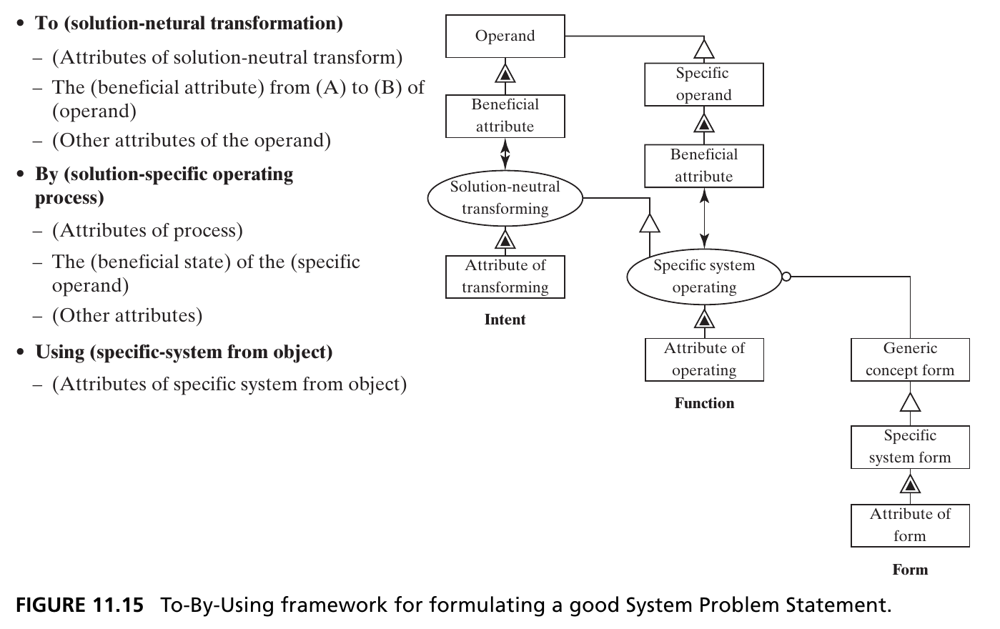{width=100% height=410px fig-align="center"}
:::
::: {.column width="40%"}
- **Intent:** operand and beneficial state change
- **Function:** operating process producing the change
- **Form:** object enabling the process
- The SPS aligns with Chapter 7's **OPM concept representation**
- Specify transformation, process, and form attributes that affect value
:::
:::

::: {.side-caption}
Source: Crawley, Cameron & Selva (2016), Fig. 11.15.
:::

::: {.notes}
Source: Crawley, Cameron & Selva (2016), §11.4.

- Trace the left-hand sentence template to the right-hand OPM concepts: operand and beneficial attribute for intent, a specific operating process for function, and a specific system object for form.
- The same need can support multiple By/Using alternatives. In early meetings, state the To clause before freezing a process or object.
- Figure 11.16 applies this general template to the hybrid car.

**Discussion:** Which part should remain stable while concepts are compared?

**Suggested answer:** The intended benefit in To, subject to new stakeholder evidence. By and Using are candidate means and may change.
:::

## Hybrid Car System Problem Statement {.smaller}

::: {.columns}
::: {.column width="58%"}
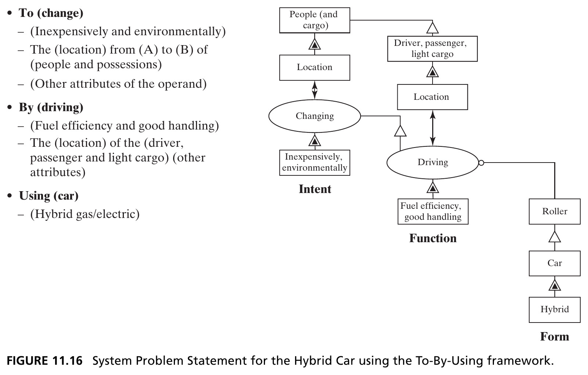{width=100% height=430px fig-align="center"}
:::
::: {.column width="42%"}
- **To:** transport people and possessions inexpensively and with acceptable environmental impact
- **By:** enabling drivers to move themselves, passengers, and light cargo fuel-efficiently with good handling
- **Using:** a hybrid gas/electric car
- **OPM:** people/cargo are the operand, location is the attribute, driving is the process, and the car is the form
:::
:::

::: {.side-caption}
Source: Crawley, Cameron & Selva (2016), Fig. 11.16.
:::

::: {.notes}
Source: Crawley, Cameron & Selva (2016), §11.4.

- **Finished Hybrid Car SPS**, traced against the OPM diagram
- **To**: change, inexpensively and environmentally, the location of people and possessions (still abstract: not "driving" or "a car" yet)
- **By**: driving: driver drives themselves, passengers, light cargo, fuel-efficiently, good handling
- **Using**: a hybrid gas/electric car
- Full prose: "Provide our customers a product to transport them and their possessions inexpensively and in an environmentally sound manner, by allowing them to drive themselves, their passengers, and light cargo fuel-efficiently and with good handling characteristics, using a hybrid gas/electric car"
- Note: "provide our customers..." openers indicate the firm's internal organizational intent, distinct from the externally-delivered value
- Next slide proceeds systematically through the template to enumerate detailed descriptive goals: keep this SPS visible, nearly every later goal traces back to one of these three components

**Discussion:** How would you challenge a hybrid-car problem statement that mandates a battery first?

**Suggested answer:** Ask which intended benefit requires that choice and whether alternative concepts could meet it. A mandated form should be an explicit constraint, not an unexamined substitute for the need.

:::

## From SPS to Detailed Goals {.smaller}

The SPS leads to descriptive goals for the primary beneficiary:

- **Transportation performance:** range, speed, and acceleration
- **Affordability:** acquisition cost and associated value to the driver
- **Environmental satisfaction:** the benefit the driver perceives
- **Driver accommodation:** body size and usable space
- **Passenger accommodation:** size and number of occupants
- **Cargo capacity:** mass, dimensions, and volume
- **Fuel efficiency** and **handling characteristics**

The book initially states all descriptive goals with “shall.” Priority and measurable targets are still to be established.

::: {.notes}
Source: Crawley, Cameron & Selva (2016), §11.4.

- **Direct systematic expansion of the SPS**: a goal per need, no priority yet (comes in 11.5)
- First goals shown (transportation performance, inexpensive, environmental satisfaction, driver accommodation, passengers/cargo, fuel efficiency, handling) trace to vehicle attributes vs. the driver/owner's value function
- Full list continues to other stakeholders (from 11.3's prioritization): modest investment/volume sales (investors/enterprise), stable supplier relationships, stable employment (community), regulatory/environmental requirements (regulators/NGOs)
- Some require interpreting a whole indirect value loop into one goal: e.g. environmental assurance to NGO → NGO converts to political support → regulator grants approval, requires stating the goal *and* recording the intent for the NGO to pass the benefit along
- **Terminology matters**: "goals," not "requirements": deliberate, load-bearing choice so architects stay free to trade off. "Shall" language implies non-negotiable mandate, obscuring the reality of tradeoffs. These are all flat "shall" statements for now: unprioritized, which 11.5 picks up next

**Discussion:** How can detailed goals drift away from the system problem statement?

**Suggested answer:** Teams may add local targets without tracing them to the intended benefit. Review each goal's contribution and check the combined set for omissions and conflicts.

:::

## Detailed Goals for Other Stakeholders {.smaller}

- **Enterprise:** modest investment, sales volume, and financial return, with the intent of securing investment and technology
- **Suppliers:** stable relationships and revenue, with the intent of securing uninterrupted quality parts
- **Local community:** stable, rewarding employment, with the intent of securing a dedicated workforce
- **Regulator and NGO:** regulatory compliance, environmental protection, and environmental assurance
- For an **indirect exchange**, record both the delivered benefit and its purpose: assurance to the NGO should support the political support needed for regulatory approval

Trace each goal to the **need and value flow** it represents.

::: {.notes}
Source: Crawley, Cameron & Selva (2016), §11.4, p. 264. These goals complete the descriptive set beyond vehicle attributes.

**Discussion:** Why record the intended return from environmental assurance?

**Suggested answer:** Assurance is part of an indirect loop. Recording the intended support for approval explains why the project prioritizes that output and what dependency needs checking.
:::

## Section 11.4 Summary {.smaller}

- Goals are enterprise-defined, prioritizable interpretations of stakeholder needs: evaluated against five criteria: representative, complete, humanly solvable, consistent, attainable
- The **System Problem Statement** and **To-By-Using** framework explain the intended benefit and the proposed approach
- Early architecting should stay solution-neutral (**To**) as long as possible before adding solution-specific function (**By**) and form (**Using**)

::: {.notes}
Source: Crawley, Cameron & Selva (2016), §11.4.

- **Review before prioritization**: students should be comfortable with:
  - Needs (beneficiary-owned, unchosen) vs. goals (enterprise-defined, chosen, tradable)
  - Five criteria (representative, complete, humanly solvable, consistent, attainable), and why humanly solvable is hardest
  - SPS as a formal tool, rarely correct on first formulation, must be challenged/refined
  - To-By-Using as the concrete construction method (intent → function → form)
- **Practical advice**: stay in "To" as long as practical before committing to "By"/"Using": early commitment forecloses design space, prejudices the eventual design
- Section 11.5 tackles the unfinished business: how do we prioritize among all these "shall" statements?

**Suggested answer:** Begin with stakeholder importance and the value delivered by each goal, then consider dependencies, feasibility, and tradeoffs. Identify mandatory constraints separately from objectives that can be traded. A long list of equally ranked “shall” statements conceals conflicts; the architect needs a small, coherent set of priorities that guides choices and can be traced back to stakeholder needs.

:::

# 11.5 Prioritizing Goals

## Critical, Important, Desirable {.smaller}

| Priority | Meaning | Resource allocation |
|---|---|---|
| **Critical** | About 3–7 absolute necessities for success | Protect resources needed to meet them |
| **Important** | Major contributors to success | Trade resources among them |
| **Desirable** | Useful outcomes with lower priority | Pursue when resources remain |

- Compare stakeholder goals using the **importance of inputs returned to the project**
- **Priority** and **rigidity** are separate. A goal can be strongly constraining without being ranked among the critical goals
- Distinguish absolutely constraining needs, constraining needs for a selected market, and unconstrained performance aspirations

::: {.notes}
Source: Crawley, Cameron & Selva (2016), §11.5.

- **Three-tier prioritization for goals**: direct structural parallel to the three-bucket stakeholder grouping (Section 11.2), same idea applied to goals
- **Critical**: 3-7 absolute necessities, "live or die": vivid phrase, real binding urgency
- **Important**: contribute meaningfully, not absolutely necessary
- **Desirable**: nice to have, success doesn't hinge on them
- **Application** (fragment): allocates limited resources: spend on critical without hesitation, trade/analyze among important, apply leftovers to desirable. A clean, actionable rule for resource scarcity, which virtually every real project faces

**Discussion:** What changes when a goal moves from desirable to critical?

**Suggested answer:** It changes which tradeoffs are acceptable and may define a feasibility threshold. State the criterion explicitly; a priority label alone does not supply a measurable acceptance condition.

:::

## Hybrid Car Goal Priorities {.smaller}

| Priority | Illustrative allocation in the book |
|---|---|
| **Critical** | Driver environmental satisfaction, stable supplier relationships, driver accommodation |
| **Important** | Range, regulatory compliance, passenger accommodation, rewarding employment, fuel efficiency |
| **Desirable** | Enterprise investment and return, handling, cargo capacity, low price |

- **Driver accommodation** is critical and constraining. **Compliance** is important and constraining
- **Importance does not determine rigidity.** Mandatory compliance remains a market-entry condition
- Priorities depend on the beneficiary and stakeholder analysis

::: {.notes}
Source: Crawley, Cameron & Selva (2016), §11.5, pp. 265–266. Preserve the book's illustrative allocation without implying that mandatory law can be traded away.

**Discussion:** Why is “important” an inadequate instruction for compliance?

**Suggested answer:** Priority describes resource emphasis. The compliance constraint still needs an explicit pass condition for the chosen market.
:::

## Goals Need Metrics and Targets {.smaller}

A complete goal identifies a **metric and target value**, along with its priority and rigidity.

| Descriptive goal | Metric suggested in the book |
|---|---|
| Good fuel efficiency | MPG or MPGe |
| Transport range | Miles |
| Driver accommodation | Percentage of the target population accommodated |
| Regulatory compliance | Certificate of compliance |
| Stable employment | Employee turnover rate |
| Desirable handling | Skidpad acceleration in g |

The book supplies these **metrics**, but leaves numerical targets to be set. A metric alone does not define “good” performance.

::: {.notes}
Source: Crawley, Cameron & Selva (2016), §11.5.

- **Practical refinement**: a goal without a metric + target value is incomplete: can't check if it's met. "Should have good fuel efficiency" implies MPG but sets no number: how much counts as "good"?
- **Rigidity**: second, orthogonal attribute: **constraining** ("must accommodate driver dimensions XYZ": hard boundary) vs. **unconstrained** ("should have good fuel efficiency": optimization target, no pass/fail line)
- Architect decides goal by goal: real tradeoff: more constraining goals shrink the target market (fewer designs satisfy every constraint); more unconstrained goals risk under-delivering on something firmly needed
- Many organizations blur this, treating all needs as equally rigid "musts": exactly what the next slide's Principle of Ambiguity pushes back on

**Suggested answer:** Replace “good fuel efficiency” with a specified consumption metric, target or bound, and test conditions, for example “fuel consumption shall not exceed X L/100 km on the agreed test cycle at the specified load.” X must come from the needs and feasibility work, not an arbitrary classroom number. Also state the measurement method and relevant operating envelope. A target without conditions can encourage optimizing the test rather than the intended service.

:::

## A Measurable Goal Example {.smaller}

**Illustrative target:**

Provide a driving range of **at least 300 miles** over a specified test cycle, vehicle load, and environmental conditions.

- **Metric:** distance traveled before the defined refueling or recharging endpoint
- **Target:** at least 300 miles
- **Priority:** important in the book's illustrative goal allocation
- **Rigidity:** state whether the target is a negotiable performance objective or a constraint for the chosen market
- **Trace:** driver transportation need, the SPS transportation intent, and the range goal

The architect must justify the target and test conditions from the intended use. The book does not prescribe 300 miles.

::: {.notes}
Source: Crawley, Cameron & Selva (2016), §11.5.

Source for goal structure: Crawley, Cameron & Selva (2016), §11.5. The 300-mile target is a classroom example only.

**Discussion:** Why specify the operating conditions as well as the distance?

**Suggested answer:** Range changes with load, driving cycle, and environment. The same number can represent different performance without agreed conditions.
:::

## Box 11.6 · Principle of Ambiguity and Goals {.smaller}

Early design contains **known unknowns, unknown unknowns, conflicting assumptions, and false assumptions**.

- Upstream inputs are often uncoordinated, incomplete, and contradictory
- Resolve them into a small set of goals that is representative, complete, consistent, humanly solvable, and challenging yet attainable
- Account for competitive pressures, enterprise strategy, available technology/resources, and regulatory influences
- Maintain a **process for revisiting goals** as needs and context evolve

::: {.side-caption}
Source: Crawley, Cameron & Selva (2016), Box 11.6, Principle of Ambiguity and Goals.
:::

::: {.notes}
Source: Crawley, Cameron & Selva (2016), §11.5.

- Goal-setting remains uncertain even when the process is organized. Revisit goals as new information becomes available.
- Proverb: aim higher than you expect to achieve: real execution tends to fall short regardless
- **Three substantive bullets, honest picture of reality**:
  - Early design phase = genuine ambiguity; architect's job to resolve it into small/complete/consistent/humanly-solvable goals (callback to 11.4's five criteria as the target state)
  - No single person controls the whole upstream process: expect uncoordinated, incomplete, conflicting inputs; not an unusual failure, the normal state
  - Context/needs keep evolving (latent needs, Kano drift): needs an ongoing *process* to reexamine/update goals, not a one-time kickoff activity

**Discussion:** Can numerical goals eliminate all ambiguity?

**Suggested answer:** No. Units, conditions, populations, methods, and interpretation still matter. A precise number can measure the wrong outcome or conceal disagreement about the system's purpose.

:::

## Consistency and Attainability {.smaller}

- **Logical consistency:** targets using the same metric must not contradict each other
- **System consistency:** goals such as low mass, long range, and high acceleration interact. The shape and severity of those tradeoffs may require an analytical model
- Some metrics add directly, such as component mass. Others emerge from the interaction of the architecture's elements
- **Attainability:** check technology, development schedule, resources, and risk together. Derivative products offer more evidence than entirely new designs
- If the goal set cannot be attained, revise its scope or add resources. Assess whether the model is reliable enough to support that choice

::: {.notes}
Source: Crawley, Cameron & Selva (2016), §11.5.

- **Deeper on two of the five criteria**: subtle, not simple checkboxes
- **Consistency**: many real goals conflict (e.g. range vs. battery weight). Not enough to know a tradeoff exists: need its *shape*: shallow, steep, or non-monotonic? Often can't assess by inspection: needs an analytical model (low- or high-fidelity), and you must separately trust the model's accuracy
- **Attainability**: reachable given technology, schedule, resources, risk. Much easier for derivative products than clean-slate designs (higher tech/schedule risk)
- Two levers when goals aren't attainable: **reduce scope**, or **add resources**: no third option
- Course's V&V coverage is deliberately shallow (covered in dedicated SE texts): Part 4 returns to attainability with explicit cost models

**Suggested answer:** Model the coupled goals over the candidate design space and test whether any feasible architecture meets their thresholds simultaneously. For range and battery mass, capacity can increase stored energy while also increasing vehicle mass and energy demand, so the relationship need not be linear. Examine the tradeoff curve, assumptions, and uncertainty before relaxing a goal. An infeasible result can indicate conflicting goals, an overly narrow concept set, or an inaccurate model; it does not automatically identify which goal should be discarded.

:::

## Verification and Validation {.smaller}

::: {.columns}
::: {.column width="60%"}
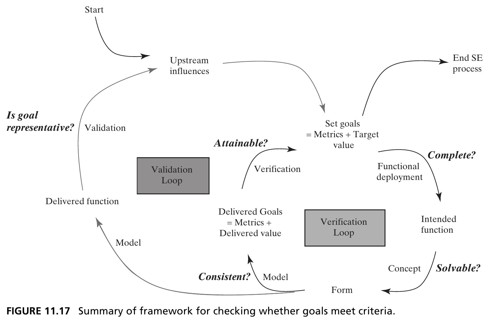{width=100% height=410px fig-align="center"}
:::
::: {.column width="40%"}
- **Validation loop:** delivered function meets stakeholder needs
- **Verification loop:** delivered values meet goal metrics and targets
- Five checks: **representative, complete, humanly solvable, consistent, attainable**
- Models help test the goal set as the concept and form develop
:::
:::

::: {.side-caption}
Source: Crawley, Cameron & Selva (2016), Fig. 11.17.
:::

::: {.notes}
Source: Crawley, Cameron & Selva (2016), §11.5.

- **Compact visual summary tying together all five criteria**: where each gets checked as a project proceeds from goal-setting to delivered system
- **Outer path**: upstream influences → goals (metrics + targets) → concept → form → intended function → functional deployment → delivered function
- **Validation loop**: "is the goal representative?": compares delivered function against the original upstream influences. Checks whether we built something addressing real stakeholder needs, not just a self-consistent spec
- **Verification loop**: the other four criteria (attainable, complete, consistent, solvable): compares delivered goals against concept/form/intended function, using a model where needed
- Maps onto classic V&V: verification = "did we build the system right?" (per its own goals); validation = "did we build the right system?" (per real upstream needs). Can pass verification and still fail validation if goals were never truly representative: why Representative sits apart, checked by its own loop

**Suggested answer:** Verification asks whether the system meets its specified goals; validation asks whether those goals and the delivered outcome address the original stakeholder needs in context. A vehicle can meet its specified test-cycle consumption and still disappoint a user whose real route and load were omitted. Passing a self-consistent specification therefore does not establish that the right system was built. Trace goals back to needs and test representative use as well as specification compliance.

:::

## Section 11.5 Summary {.smaller}

- Prioritize goals as **critical, important, or desirable** to guide resource decisions
- Record **rigidity separately** from importance, including constraints associated with the chosen market
- Specify **metrics, target values, and applicable conditions** so success can be assessed
- Use logical checks and models to assess consistency and attainability
- Verify performance against goals and validate that the delivered function meets stakeholder needs. Update the goals when the evidence changes

::: {.notes}
Source: Crawley, Cameron & Selva (2016), §11.5.

- **Closes 11.5 before chapter wrap-up**: students should be comfortable with:
  - Critical/important/desirable tiers and resource allocation
  - Every goal needs a metric, target value, and rigidity (constraining vs. unconstrained), not just prose
  - Consistency/attainability checks often need analytical modeling, not just inspection: tied together in the validation/verification-loop diagram
- All four Fig. 11.1 steps now complete: next slide pulls the whole chapter together before the Nagano case study

**Discussion:** What should the team do if no candidate meets all goals?

**Suggested answer:** Check the model and search coverage, then examine whether goals conflict or the concept set is too narrow. Revisit priorities with stakeholders rather than silently dropping a requirement.

:::

## 11.6 Chapter Summary {.smaller}

- Complex systems face real challenges managing stakeholders: many of them, often with unclear relative priority, sometimes providing only non-monetary inputs, and often delivering value indirectly
- Value delivery is an **exchange**: your outputs meet their needs, and their outputs meet yours
- Stakeholders should be **prioritized by the inputs they provide to the project**: directly or through indirect value loops
- Needs are translated into **goals** via the System Problem Statement and the To-By-Using framework, then checked against five criteria and prioritized as critical/important/desirable

::: {.callout-tip title="Reference"}
Crawley, E., Cameron, B., & Selva, D. (2016). *System Architecture: Strategy and Product Development for Complex Systems*. Pearson. Chapter 11.
:::

::: {.notes}
Source: Crawley, Cameron & Selva (2016), §11.5.

- **Full-chapter recap**: walk back through Fig. 11.1 one more time
- **Three opening challenges**: many stakeholders; unclear relative priority (especially non-monetary inputs like political support vs. revenue); value often delivered *indirectly* through intermediaries
- **Process built in order**:
  - Identify stakeholders/beneficiaries via exchange-based value (definitional anchor + completeness check)
  - Characterize needs (Kano as key tool)
  - Treat stakeholders as a system: stakeholder map, indirect transactions, value loops, network-based prioritization
  - Translate needs into goals (enterprise-defined, not beneficiary-owned) via SPS + To-By-Using, checked against five criteria, prioritized critical/important/desirable
- Why this matters: Chapter 12 takes this prioritized goal set for the Hybrid Car as the starting point for generating/evaluating concept alternatives: none of that is possible without this groundwork

**Discussion:** What distinguishes a useful goal set from a long specification?

**Suggested answer:** It represents important needs, is complete enough for the decision, and is consistent, attainable, and humanly solvable. Length alone provides none of these guarantees.

:::

# 11.7 Nagano Winter Olympics: Stakeholders in IT Architecture

## Scope of the Nagano IT System {.smaller}

*By Dr. Victor Tang, Director of IT Client Relations for IBM's 1998 Olympic Winter Games*

- IBM was contractually obligated to build, operate, and maintain the **entire IT system** for the Games: computing and delivering competitors' results, accrediting athletes and staff, recording drug-testing results, and more
- 25 million lines of software; 10 mainframes, 5,000 PCs, 1,500 printers, 160 servers, 2,000 routers: serving ~150,000 athletes, officials, and volunteers
- A genuine **system-of-systems**: each constituent system has a different stakeholder, with distinct priorities, interests, and biases

::: {.notes}
Source: Crawley, Cameron & Selva (2016), §11.7.

- **Unusual provenance**: written directly by Dr. Victor Tang, IBM's actual Director of IT Client Relations for the 1998 Games: first-hand practitioner account, not a retrospective
- **Scale and stakes**: IBM, one of 11 top sponsors (~\$60-80M sponsorship), contractually obligated to build/operate/maintain the *entire* IT system: results computation/delivery, athlete records, accreditation, drug-testing results, more
- Numbers: **25M lines of software**, 10 mainframes, 5,000 PCs, 1,500 printers, 160 servers, 2,000 routers, serving ~150,000 athletes/officials/volunteers
- **Genuine system-of-systems** (Ch. 2 emergence): each constituent system has its own distinct stakeholder (IOC, media, games admin, sports federations, Nagano Organizing Committee...) with different priorities/interests/biases: not one clean customer, exactly the hard multi-stakeholder situation this chapter built tools for

**Discussion:** Why is an Olympic IT service more than a collection of computers?

**Suggested answer:** Its value depends on timely, correct information and coordinated event operations. People, procedures, interfaces, and service continuity are part of the system delivering that outcome.

:::

## Nagano IT Systems and Stakeholders {.smaller}

::: {.columns}
::: {.column width="58%"}
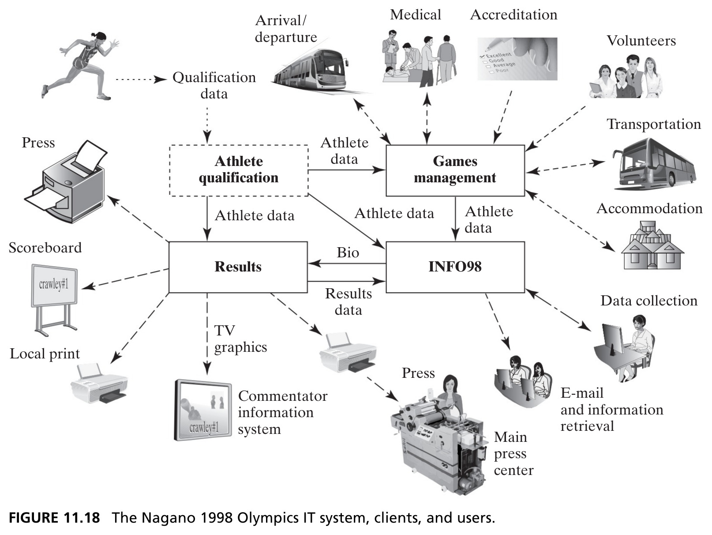{width=100% height=430px fig-align="center"}
:::
::: {.column width="42%"}
- **Core systems:** Athlete Qualification, Games Management, Results, and INFO98
- **Stakeholders:** organizers, sports federations, media, volunteers, medical and transport services
- Athlete and results data cross subsystem boundaries
- Each constituent system serves different priorities. The architecture must support the Games as a whole
:::
:::

::: {.side-caption}
Source: Crawley, Cameron & Selva (2016), Fig. 11.18.
:::

::: {.notes}
Source: Crawley, Cameron & Selva (2016), §11.7.

- **Concrete visualization of the system-of-systems scale**: four core systems (Athlete Qualification, Games Management, Results, INFO98) connected by athlete/results/bio data flows
- Surrounding client-facing layer: press, scoreboards, local print, TV graphics/commentator info, medical, accreditation, volunteers, transportation, accommodation, data collection, email/info retrieval
- Echoes the chapter's stakeholder-map exercises: same logic, real historical high-stakes system, mostly data flows instead of money/goods
- **Discussion prompt**: how would you identify the primary beneficiary and prioritize among all these stakeholders? No single obviously-dominant beneficiary like the Hybrid Car's driver/owner: hard, and the rest of the case study shows IBM navigating exactly this

**Suggested answer:** Begin with the event's mission and identify the beneficiaries of each service, rather than forcing one person to dominate the entire network. Athletes and officials need correct competition administration and results; broadcasters, press, and spectators depend on timely trustworthy information; organizers need reliable operations. Prioritize needs by consequence of failure, time criticality, binding commitments, and downstream dependence, then agree on service levels. Correct results may be an essential prerequisite for many other services even when those services have more visible users. The diagram identifies dependencies but cannot supply stakeholder weights by itself.

:::

## Rethinking IBM's Strategy {.smaller}

- At Atlanta in 1996, immature technology and poor execution damaged confidence in IBM
- For Nagano, IBM framed the mission as an **IT service that helps people run the Games**
- This changed the system boundary: reliable operations and stakeholder processes became part of the architectural concern
- **X-teams** connected domain experts across organizational boundaries. IBM invited stakeholders into development and embedded its engineers in stakeholders' processes
- Participants gained a better understanding of reciprocal dependencies and became credible advocates for the work

::: {.notes}
Source: Crawley, Cameron & Selva (2016), §11.7.

- The Atlanta Games exposed problems with products and technology that were not ready, damaging confidence before Nagano.
- Chapter's core theme (needs vs. goals, getting the problem statement right) plays out at enormous real stakes
- **IBM's strategic shift**: from product-technology-centric to products/technology as *the means* to deliver a *service*. Publicly stated: "IT as a service...helping those running the Games, run the Games...enhancing the Olympic experience"
- **Connect to Ch. 2's system boundary**: IBM literally *moved the boundary*: not "IT products IBM builds" with organizers as an external customer, but redrew the boundary to include the organizers' success itself
- Exactly the difference between solution-specific "By/Using" (specific IBM tech) and solution-neutral "To" (successfully running the Games): the To-By-Using discussion almost exactly

**Discussion:** How did a service-oriented framing change the IBM case's problem?

**Suggested answer:** It put successful Games operations at the center and treated technology as an enabling means. That changes priorities from showcasing products to supporting users' operational outcomes.

:::

## Responsibilities Without X-Teams {.smaller}

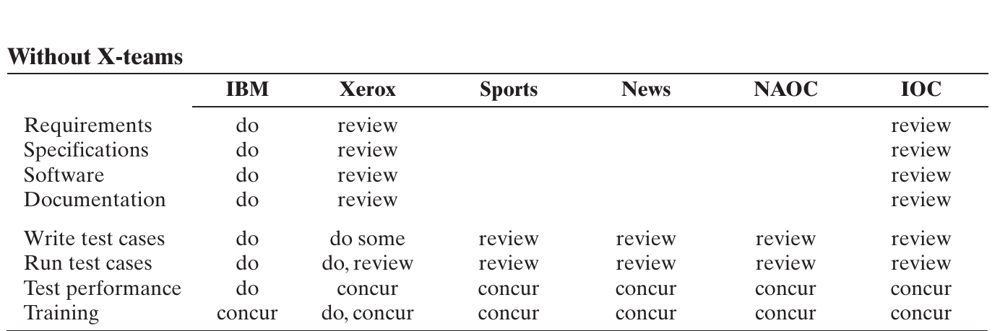{width=95% height=310px fig-align="center"}

- IBM owns requirements, specifications, software, and documentation
- Sports, news, and NAOC mainly review test work. Their operational knowledge enters late

::: {.side-caption}
Source: Crawley, Cameron & Selva (2016), Fig. 11.19.
:::

::: {.notes}
Source: Crawley, Cameron & Selva (2016), §11.7.

- Read columns left to right: IBM, Xerox, Sports, News, NAOC, IOC. Blank cells mean no role shown in this figure.
- Xerox does some test-case writing and test execution. Sports, News, NAOC, and IOC mainly review tests, then concur on performance and training.
- IBM only concurs on training; Xerox does and concurs. Do not infer that IBM created training in this baseline.
:::

## Responsibilities With X-Teams {.smaller}

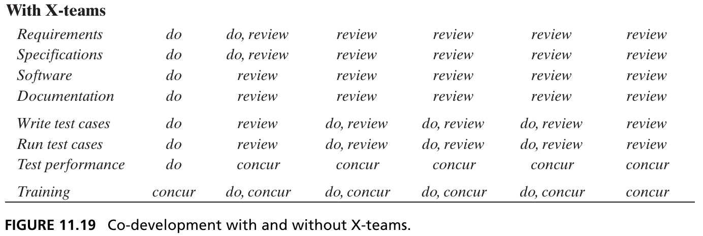{width=95% height=310px fig-align="center"}

- Xerox joins requirements and specifications work
- Sports, news, and NAOC help create and run tests and contribute to training
- IBM retains software responsibility while stakeholders participate more broadly

::: {.side-caption}
Source: Crawley, Cameron & Selva (2016), Fig. 11.19.
:::

::: {.notes}
Source: Crawley, Cameron & Selva (2016), §11.7.

- IBM still does the requirements, specifications, software, and documentation work. Xerox now also does and reviews requirements and specifications.
- Sports, News, and NAOC move from reviewing test cases to doing and reviewing them. IOC continues to review test cases.
- Sports, News, and NAOC also move from concurring on training to doing and concurring. IBM still only concurs; Xerox still does and concurs. Performance concurrence does not change.

**Discussion:** Which change would most directly reveal a misunderstood sports rule before the Games?

**Suggested answer:** Having sports-domain participants help write and execute test cases, rather than only review IBM's finished cases.
:::

## What the X-Team Comparison Shows {.smaller}

- Requirements and specifications gain early input from Xerox and broader review from the operating stakeholders
- Sports, news, and NAOC representatives help write and run tests and participate in training
- IBM retains responsibility for software and documentation. Wider participation complements its technical work
- Performance concurrence remains the same. The changed responsibilities concentrate on requirements, tests, and training
- The organizational arrangement helps reveal **needs and reciprocal dependencies** that document review alone can miss

::: {.notes}
Source: Crawley, Cameron & Selva (2016), §11.7.

The precise role matrix matters because “co-development” does not mean everyone jointly did every task. X-teams brought domain knowledge into decisions and tests where it could prevent misunderstandings. Compare this to Box 11.1's distinction among consultation, participation, and decision rights.
:::

## Rebuilding Trust Through the ICPG Process {.smaller}

IBM's four “Must Do” goals were:

- Meet all technical and management requirements
- Avoid surprises during the Games
- Provide 24/7 operations
- Provide highly secure and usable systems

**International Competitions Prior to the Games (ICPGs)** provided practice events using the rules and IT systems.

IBM convened federations, IOC representatives, and stakeholders to review documented errors. They agreed to treat resolving those errors and shortcomings as satisfying the requirements, making the work tractable through **management by exception**.

::: {.notes}
Source: Crawley, Cameron & Selva (2016), §11.7.

- **Four "IBM Must Do" goals** from the Atlanta debrief: meet all technical/management requirements, no surprises during the Games, 24/7 operations, highly secure/usable systems: reads exactly like Section 11.5's critical-goals category
- **Clever practical move**: tackling "meet all technical and management requirements": the full documented requirement set (Seiko timing, Xerox printing/distribution, accreditation/security, volunteer training, more) was "voluminous," daunting to fully satisfy
- **ICPGs (International Competitions Prior to the Games)**: real practice events (often existing World Cup competitions) testing new/modified Olympic rules and IT systems under live conditions first
- Formal plenary convocation on ICPG performance: federations/IOC came with documented errors/shortcomings from practice events. After negotiation: solving all *documented* errors became the agreed interpretation of "all requirements"
- Turned an impossibly vague, unverifiable goal into something tractable: anchoring "complete" to a concrete, finite list. A clever practical instance of making a goal "humanly solvable" under organizational pressure

**Discussion:** What kind of evidence can rebuild trust after a service failure?

**Suggested answer:** Shared, testable commitments and demonstrated progress against operational needs. A new promise or feature list is weaker than evidence that dependencies and responsibilities are understood.

:::

## Architecture as a Utility {.smaller}

- IBM treated IT as a **secure, usable utility** that continuously supplies data and information
- Networked servers provided the equivalent of a utility's plant and distribution grid. Applications generated the structured data used by clients
- Existing Athlete Qualification, Games Management, Results, and INFO98 systems formed the core. The design had to reuse, modify, or protect legacy systems
- The Results System decomposed into venue subsystems, connecting Seiko timing inputs to scoreboards and information services
- **Redundancy** duplicated key components so a failed component could be replaced by its counterpart while operations continued

::: {.notes}
Source: Crawley, Cameron & Selva (2016), §11.7.

- **Open with the Louis Sullivan quote** (skyscraper's inventor): connect to Ch. 7's concept/form material: architecture is a mapping from function-space to form-space, and meaningful architecture needs workable *concepts* embodying an abstract idea into a real, functioning artifact
- Book calls this **embodiment of an idea**: the most creative, challenging part of architecting; brilliant architectures need brilliant embodiments, not just correct requirements
- **IBM's concept, worth spelling out in full**: re-conceptualized the system as a *utility* (highly secure, plug-and-play),
  - networked servers = power plant/distribution grid (24/7 availability, satisfies one of the four "Must Do" goals)
  - applications = generators
  - structured data = the utility's actual output, serving stakeholders/public as clients
- Honest detail: this concept was initially received with **reserve and skepticism**: sound architectural reframing doesn't automatically earn buy-in; trust still had to be built (ICPG process + X-teams doing exactly that in parallel)
- **Results System**: most important subsystem (processes actual competition performance data): stepwise decomposition (per competition venue) + **reliability through redundancy**: key components duplicated throughout (timing interfaces, PCs, LANs, WANs, databases, mainframe/medium servers)
- No single point of failure could take down the whole system during the live Games

**Discussion:** What follows from treating the IT architecture as a utility?

**Suggested answer:** Users expect dependable service rather than needing to understand its internal products. Reliability, support, interfaces, and operational ownership become central architectural concerns.

:::

## Nagano IT Data Flows {.smaller}

::: {.columns}
::: {.column width="60%"}
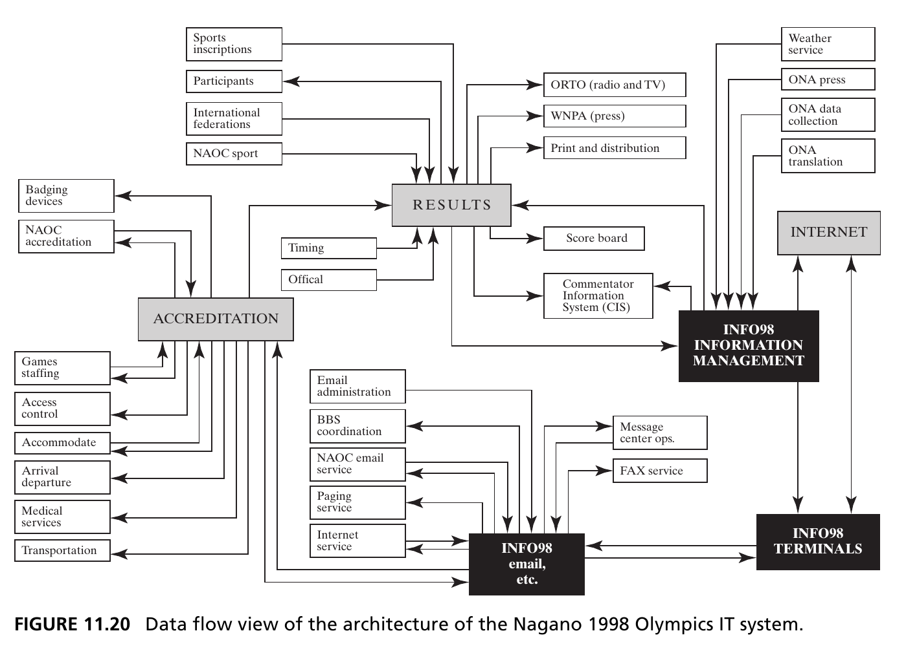{width=100% height=440px fig-align="center"}
:::
::: {.column width="40%"}
- **Results** connects competition entries and timing to media, scoreboards, and commentator information
- **Accreditation** supports access and athlete/staff services
- **INFO98** provides information management and retrieval
- Data and function flows integrate the legacy systems into a coherent service for the Games
:::
:::

::: {.side-caption}
Source: Crawley, Cameron & Selva (2016), Fig. 11.20.
:::

::: {.notes}
Source: Crawley, Cameron & Selva (2016), §11.7.

- The utility metaphor becomes a concrete service architecture: results are collected and distributed to scoreboards, commentators, broadcasters, and information services.
- Accreditation supports security and access-related services; INFO98 distributes information through management, email, and terminals.
- Ask which interfaces need timely and trustworthy results. The figure represents data and service flows, not ownership of every connected organization.
:::

## Results System Redundancy {.smaller}

::: {.columns}
::: {.column width="60%"}
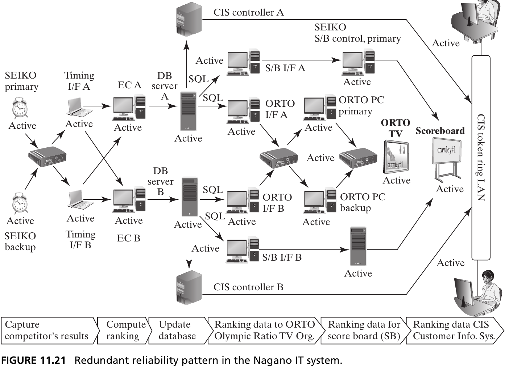{width=100% height=410px fig-align="center"}
:::
::: {.column width="40%"}
- Follow **capture, ranking, database update, and distribution**
- **A/B paths** duplicate timing, event control, databases, and output interfaces
- The pattern supports the critical continuity goal
- Test interfaces and failover. Duplicating hardware alone cannot establish continuity
:::
:::

::: {.side-caption}
Source: Crawley, Cameron & Selva (2016), Fig. 11.21.
:::

::: {.notes}
Source: Crawley, Cameron & Selva (2016), §11.7.

- Follow the primary and backup Seiko timing inputs through A/B timing interfaces, event controllers, database servers, ORTO output, scoreboard control, and CIS controllers.
- Duplication helps a working path continue if one component fails, but the drawing alone does not establish independent failure modes or guarantee availability. Test failover and shared infrastructure.
- This architectural pattern is tied to the critical goals of 24/7 operations and no surprises during the Games.

**Discussion:** What needs testing beyond having two servers?

**Suggested answer:** Failover detection and switching, data consistency, common network/power dependencies, and end-to-end output to scoreboards and broadcasters.
:::

## Data Flow and Reliability Serve the Stakeholders {.smaller}

- Correct results must reach the scoreboard, broadcasters, commentators, and information services when they need them
- The Results System's A/B paths support the critical availability goal, while shared interfaces still require integration and failover testing
- IBM's service framing ties these technical choices to event operations and user trust

::: {.notes}
Source: Crawley, Cameron & Selva (2016), §11.7.

Use Figures 11.20 and 11.21 together. Figure 11.20 identifies who depends on the information; Figure 11.21 shows one way to protect its production and distribution. Ask students to trace a result from Seiko's timing input to a scoreboard and to name where a backup path must take over.
:::

## Lessons from the Nagano IT Project {.smaller}

- **Architecture expresses business policy.** IBM's service mission gave stakeholders a common basis for judging technical decisions
- **The architect remains accountable for system integrity.** Implementation responsibilities must be delegated across a large organization
- X-teams brought stakeholder expertise into requirements, testing, and training
- Practice competitions converted broad expectations into an agreed body of issues to resolve
- Data flows, legacy integration, and redundancy supported the operational goals. The IOC's favorable assessment after the Games supported the service approach

::: {.notes}
Source: Crawley, Cameron & Selva (2016), §11.7.

- **Two headline lessons IBM itself drew: connect each back to the chapter's themes**, the purpose of closing on this case study
- **Lesson 1**: paraphrase of Clemenceau (war too important to be left to generals): IT architecture too important to be left entirely to technical experts, since IT is a technical *expression* of business policy. Must be positioned within that context to be meaningful to decision-makers, stakeholders, users: restates this chapter's core argument: architecture grounded in real needs/goals, not technical elegance alone
- **Lesson 2**: architect is always **accountable** for overall system integrity, but not personally **responsible** for implementation: implementation must be delegated. Especially critical for large-scale social/technical systems: no one person could implement it alone, but someone must hold the integrated whole together and answer for whether it works
- **Close on the resolution**: IBM entered Nagano with zero IOC confidence after Atlanta. Afterward, IOC Director General Francois Carrad (not known for handing out compliments) said: "Technology at the Winter Games in Nagano has been outstanding"
- Validates not just engineering execution but the *strategic reframing*: IT as a service, moved system boundary, X-teams co-development, ICPG tractability: everything this case study, and the chapter, built toward

**Discussion:** Which lesson from Nagano transfers to a small campus project?

**Suggested answer:** Define the user's successful activity before selecting technology, involve the people who must operate the service, and test the complete workflow rather than only individual components.

:::

## Next: Generating Concepts {.smaller}

- Chapter 11 produces a **prioritized goal set** tied to stakeholder needs and value exchanges
- The solution-neutral **To** statement defines the intended benefit without fixing the mechanism
- Chapter 12 develops alternative concepts through structured creativity
- Compare candidate **By** processes and **Using** forms against the goals, then revisit the goals where concept exploration reveals new evidence

::: {.side-caption}
Source: Crawley, Cameron & Selva (2016), Chapters 11–12.
:::

::: {.notes}
Source: Crawley, Cameron & Selva (2016), §11.7.

- Chapter 12 uses the goals developed here as the basis for generating concept alternatives.
- This chapter produced a prioritized, metric-bearing goal set for the Hybrid Car, built systematically from needs via SPS + To-By-Using
- Ch. 12 picks up *exactly* here: goals in hand, turns to structured-creativity techniques for generating concept alternatives: echoes Ch. 1's "Structured Creativity" (structured beats unstructured)
- Everything from this chapter: goals, priorities, constraining-vs-unconstrained status: becomes the concrete evaluative yardstick Ch. 12 uses to judge concept alternatives
:::
